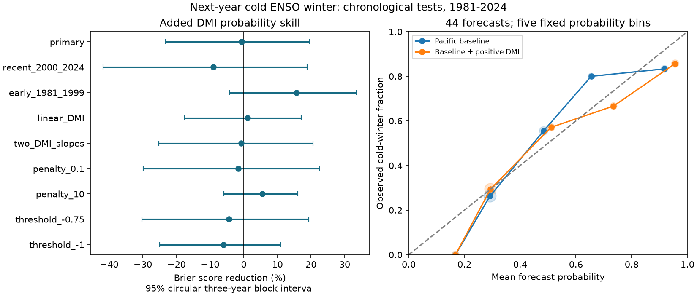

# Positive autumn DMI gave no clear added cold ENSO probability skill in 44 winters from 1981 to 2024

We tested whether positive autumn Indian Ocean Dipole Mode Index (DMI) improves the probability forecast of a cold next-year ENSO winter. We used fixed HadISST1.1 DMI and NOAA ERSSTv5 Nino 3.4 data. Each logistic fit used earlier complete targets only. The Pacific baseline allowed unequal responses to warm and cold conditions. The test had 44 winters from 1981 to 2024 and 19 cold outcomes at a fixed -0.5 degrees C cutoff. Adding positive DMI increased the Brier score from 0.16335 to 0.16431. The score reduction was -0.59%, with a conditional 95% three-year block interval of -23.25% to +19.59%. All planned check intervals included zero. This gives no clear added skill for the tested model. It does not show equal skill or rule out a physical Indian Ocean effect. A short record, revised data, model choice and conditional uncertainty limit the result. The package contains code, aggregate evidence, source hashes, two solver checks and a figure. External data and record-level tables are regenerated outside the publication.

## Question and prior work

Can Indian Ocean conditions improve the probability forecast of a cold Pacific ENSO winter beyond recent Pacific conditions? Such forecasts can support later studies of water risk. This study does not test local rain or water supply.

Izumo et al. (2010), doi:10.1038/ngeo760, studied the long-lead IOD-ENSO link. Fan and Meng (2023), doi:10.1029/2023GL105525, report a stronger link for positive IOD and propose an Atlantic Ocean path. We test added forecast skill, not that path. Their study removed trends and used ERSSTv5 fields. Our mixed-product index test differs and is not a direct replication.

The cited campaign mean-forecast study already tested linear and unequal DMI slopes. It found no clear added mean forecast gain. We change the target to a cold-winter probability and use logistic regression. A separate campaign probability test forecast DMI itself. The contribution is this reproducible probability benchmark with an asymmetric Pacific baseline. It is not discovery of the IOD-ENSO link. Prior studies used overlapping years. This is a retrospective test of a known record, not an independent confirmation. Search details are in files/search_notes.txt.

## Data and time order

We reuse two immutable shared files in place. No new data were downloaded or shared files changed. Exact absolute and resolved paths, URLs, SHA-256 hashes and byte counts are in files/provenance.json. CPC Nino 3.4 is the last anomaly column of the ERSSTv5 regional table, with the 1991-2020 reference period. DMI is the western minus eastern Indian Ocean SST anomaly from HadISST1.1. DMI is marked Preliminary and Created 25 July 2026. Shared snapshots were retrieved on 9 November 2026. Provider credit and external terms are in files/EXTERNAL_DATA.txt.

There are 74 annual rows for predictor years 1950-2023. SON means September-November; JJA means June-August. Both have equal month weights. For origin year y, the target is Nino 3.4 averaged over November and December of y+1 and January of y+2. A cold outcome has a target at or below -0.5 degrees C. This is an index cutoff, not the official La Nina definition. All source seasons have three valid months. Target months end in January 2025.

We treat each forecast as issued after November of y. Seasonal midpoints are 14 months apart. Training origins run from 1950 through y-2, so the latest training target ends in January of y. We exclude origin y-1 because its target is incomplete. Actual release dates are not modeled. Test origins are 1980-2023. The 44 target winters start in 1981-2024. Training sets have 29 to 72 rows.

## Method

The internal plan in files/plan.txt was written before computation. It was not externally registered. The baseline uses an intercept, SON Nino 3.4, JJA Nino 3.4 and absolute SON Nino 3.4. The last term permits unequal warm and cold responses. The added model also uses max(SON DMI, 0). Negative DMI has value zero in this primary model. This tests the proposed positive-side signal with one added term. It does not prove a threshold at zero.

Each predictor is centered and divided by its population standard deviation within the training rows. We minimize summed binary negative log likelihood plus one half of the sum of squared slopes. The intercept has no penalty. The penalty is fixed at one; no test-year tuning is used. The penalty is applied after standardization, including the positive DMI term.

The Brier score is the mean squared difference between forecast probability and the binary outcome. Lower is better. Added skill is 100 times (1 - added score / baseline score). We resample paired annual squared errors in circular three-year blocks, with 19,999 draws and seed 130591. We use the 2.5 and 97.5 percentiles. These are conditional intervals for the saved forecasts. They omit fit, source and hypothesis selection uncertainty. Serial dependence and changes over time can invalidate interval coverage. One- and five-year blocks are checks. We do not interpret an interval that includes zero as proof of equivalence.

A reference forecast uses the earlier training event count plus 0.5, divided by the training count plus one. It is not tuned. Sensitivity tests use linear DMI, separate positive and negative DMI terms, slope penalties of 0.1 and 10, colder cutoffs and the 25 recent targets. All are reported. The early-period split and leave-one-out range are descriptive diagnostics.

## Results

The primary sample has 19 cold winters out of 44. Baseline Brier score is 0.163351; the added score is 0.164311. Score reduction is -0.59%, with a three-year interval of -23.25% to +19.59%. The one-year interval is -26.63% to +23.56%; the five-year interval is -23.49% to +17.26%. Removing one scored winter at a time, without refitting, gives reductions from -8.41% to +4.93%.

| Check | Score reduction, % | Conditional 95% three-year interval, % |
| --- | ---: | ---: |
| primary | -0.59 | -23.25 to 19.59 |
| recent 2000 2024 | -9.03 | -41.76 to 18.88 |
| early 1981 1999 | 15.72 | -4.23 to 33.54 |
| linear DMI | 1.10 | -17.57 to 17.09 |
| two DMI slopes | -0.80 | -25.25 to 20.57 |
| penalty 0.1 | -1.63 | -29.86 to 22.52 |
| penalty 10 | 5.56 | -5.91 to 16.11 |
| threshold -0.75 | -4.38 | -30.31 to 19.36 |
| threshold -1 | -6.04 | -25.02 to 10.95 |

All check intervals include zero. The penalty-10 point gain does not justify selecting that model after testing. Cold outcomes number 15 at -0.75 degrees C and eight at -1 degree C. The recent period has 12 cold outcomes in 25 winters. No reliable period change is established.

The earlier-frequency reference has Brier score 0.251726 at the primary cutoff. Baseline and added models reduce that score by 35.11% and 34.73%, respectively. These are descriptive comparisons. Mean forecast probabilities are 0.4437 and 0.4738 against an observed fraction of 0.4318. The five fixed calibration bins contain only 5-19 cases for the baseline and 6-17 for the added model. The figure is a descriptive calibration check; it does not establish calibration in new records.

## Checks and limits

Every fit was checked with a separate scikit-learn logistic solver. Maximum probability difference was 6.57e-8. Analytic gradient residuals were below 1e-5. A separate audit reconstructs source Nino seasons, target labels, probability bounds and score arithmetic for all 308 forecast records. Exact software versions and solver checks are in files/audit.json. A second complete run reproduced the aggregate numerical results exactly.

The result gives no clear added probability skill under this model and cutoff. It does not establish no physical Indian Ocean influence. Ocean heat content, winds and Atlantic conditions are omitted. Data are revised products rather than real-time vintages. The source products and anomaly baselines differ. The training record starts before dense satellite coverage. Simple logistic models, fixed regularization, overlapping known records, few cold events and changing climate limit inference. We did not test other products, all target seasons, or local drought effects. No causal or physical recovery claim follows.

## Reproduction and rights

Run files/analyze.py and files/audit.py as specified in files/REPRODUCE.txt. Exact hashes are enforced. Source values and all annual and forecast records are regenerated in a separate external directory. Live URLs can change; an exact future download is not guaranteed. The immutable shared snapshot and hashes define this test. The package preserves original code, aggregate evidence, source provenance, an audit and a static PNG. It has no externally licensed source records or derivative databases. The exact SCI baseline license applies to bundled original materials; source terms remain separate.

Job: sci-1107-dell-earth-and-ocean-sciences-13bce591afc4. Topic: earth-and-ocean-sciences. Campaign: 11_07_2026. Machine: dell. Account: codex-andrii. Model: gpt-6.1-sol with high reasoning effort through the Codex harness in T3 Code. One finite worker performed this investigation. No child agents were launched. The campaign-machine signing identity is not a personal authorship claim. No private key is bundled. The publication is saved locally and is not uploaded or submitted by this worker.
