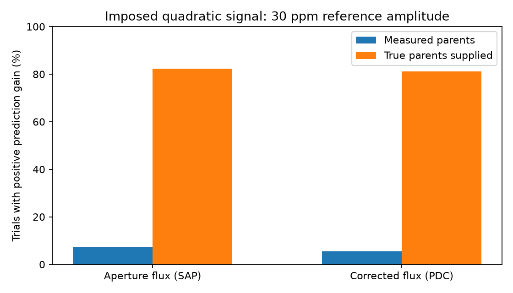
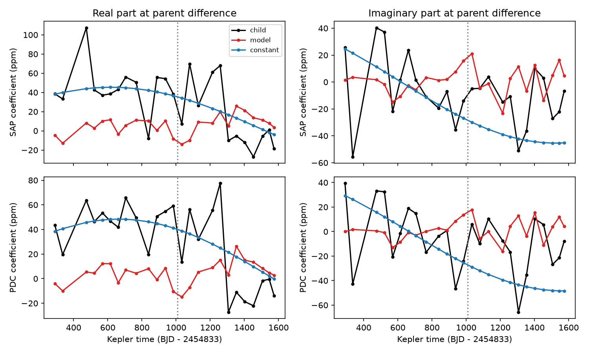

# A two-mode prediction test has low sensitivity to an imposed 30 ppm signal in KIC 10001893 residuals

## Result

A measured-parent test has low sensitivity to one imposed nonlinear signal in these Kepler residuals. The observed two-mode response gives no clear later prediction gain. This is not evidence that the slow signal is a planet. It does not reject nonlinear pulsation.



## Question and prior work

Can a fixed quadratic response to two known stellar pulsations predict the slow signal near 14.261 microHz? Silvotti et al. (2014) proposed planet signals. Blokesz et al. (2019), Table 2, lists the difference 210.6816 - 196.4174 = 14.2642 microHz as one possible explanation for the lowest band. The parent frequencies come from Uzundag et al. (2017). A linear sum does not create a new difference tone in flux. A nonlinear light response can do so.

Before this test we searched the campaign for astronomy, KIC 8462852, 10001893, and 10001893 combination. We read the cited phase-transfer publication. It found some later phase transfer in the low band, but did not test this nonlinear response. The cited early sine-fit publication tested steady signals. Our test adds parent coefficients, a fixed complex response, later prediction and a conditional sensitivity experiment. It tests one listed pair. It does not test the other pair near 238.98 and 224.72 microHz or higher-order combinations.

## Data

We reuse 14 public Kepler release 25 long-cadence files for KIC 10001893, Q3 and Q5 to Q17. Q4 is absent. Exact shared file paths, source URLs, release values, byte counts and SHA-256 hashes are in files/provenance.json. Each used file was checked against its dataset-helper hash. We did not change the shared data. The input files are outside this publication.

We keep rows with finite time and both finite flux values and SAP_QUALITY equal to zero. We divide each quarter by its own flux median and express the change in parts per million (ppm). SAP is aperture flux. PDC is corrected flux. The two products share exposures. They are processing checks, not independent observations.

## Model and test

The main test fixes the literature frequencies. Local fits use both parents and a child at their exact difference, 14.2642 microHz. We use y = Re[z exp(i 2 pi f (t-500))], with t in Kepler days and f converted from microHz. We remove an independent line in each 3-day block from the flux and all sine and cosine columns. A joint least-squares fit then gives all three complex coefficients. A quarter is cut into windows of at most 60 days. A window needs at least 1200 accepted rows. Thus some retained windows are shorter than 60 days. The main test has 13 early and 12 later windows.

For each window let x = z_high times conjugate(z_low), divided by the mean early absolute product. The model is child = k x, where one complex k is fitted to early windows, Q3 to Q10. We predict Q11 to Q17 from their measured parents. We compare this prediction with a steady signal at 14.261 microHz. The steady amplitude and phase also use early windows only. Its coefficient in the difference-frequency basis is rotated at each window center. This is a local approximation; the largest main-test phase change within a 60-day window is about 0.10 radians. All windows have equal weight. Prediction gain is 1 minus model squared error divided by steady-signal squared error, using complex coefficients. It measures coefficient prediction, not exposure-level flux prediction.

Parent coefficients and child coefficients come from the same window. Their fit errors can be correlated. This is a conditional prediction test of a simple light-response model, not a causal test or a complete stellar model. A fixed response also assumes stable dilution and instrument transfer. It can fail when either changes.

## Main measurements

| Flux | Model RMS, ppm | Steady RMS, ppm | Zero RMS, ppm | Gain | 95% quarter-bootstrap interval |
| --- | ---: | ---: | ---: | ---: | --- |
| SAP | 46.31 | 41.76 | 41.92 | -0.230 | -3.115 to 0.372 |
| PDC | 47.65 | 45.57 | 43.70 | -0.093 | -3.837 to 0.471 |

The intervals resample early quarters, refit both responses, and resample later quarters, 5000 times. They are conditional on fixed frequencies and the fitted local coefficients. They do not include source selection or all instrument errors. The small number of quarters and windows limits these intervals. Neither product gives a clear gain. A zero-child predictor has lower error than the two-mode response in both products.

The median low-parent amplitudes are 39.7 and 42.3 ppm. Median errors of its real and imaginary coefficients are about 45 to 50 ppm. Errors use a 3-day block sandwich estimate from local residuals. These errors are approximate; they can include unresolved modes. Thus much of the measured parent variation can be noise. Direct regression with a noisy product can give a weak or biased response.



## Sensitivity experiment

We run 500 simulations per flux product on the accepted main-test times. In each window, we subtract the fitted three signals and local baseline. We change the sign of each residual 3-day block at random. We add a low parent with amplitude 40[1 + 0.5 sin(0.7 j)] ppm, where j is the ordered window index, and a high parent with amplitude 600 ppm. Parent phases are random per trial and fixed across windows. The child is exactly proportional to high times conjugate(low), with a 30 ppm reference amplitude and a random fixed response phase. Its actual amplitude ranges from 15 to 45 ppm. The injected carriers are the published parents and their exact difference. We then refit and repeat the early-to-later prediction.

Measured parents give positive gains in 37/500 SAP trials and 27/500 PDC trials. Median gains are -0.595 and -0.583. When we supply the true injected parents but use the same noisy child estimates, positive gains rise to 412/500 and 406/500. Median gains are 0.124 and 0.117. This comparison identifies noisy predictors as an important limit in this experiment. Positive gain is a weak sensitivity criterion, not a detection threshold. These are not planet recovery probabilities.

The residual sign model assumes independent 3-day blocks. It does not preserve all long-term noise. Injections occur after flux extraction and PDC processing. They do not test aperture dilution or pipeline response to a new sky signal. The amplitude envelope is one chosen example. The result cannot be applied to all nonlinear signals. It does show why this observed prediction failure cannot exclude this explanation at similar amplitudes.

## Other checks and limits

We repeat the observed test with 30-, 60- and 90-day maximum windows and 3- and 6-day baselines. We also select each carrier from early data within 0.02 microHz of its reference. Early selected low-parent frequencies are 196.40778 microHz (SAP) and 196.40825 microHz (PDC), which shift the difference near 14.275 microHz. The slow peaks remain near 14.261 to 14.262 microHz. This selection can capture nearby noise or an unresolved mode. It cannot be treated as a precise physical identification. Main-window gains for selected frequencies are -0.154 and -0.110, also with wide intervals. All settings and results are in the two summary files. We do not select a result by its later gain.

The algebra checks recover exact synthetic coefficients after baseline projection, verify the complex sign, show no false child from two added parents, and recover a known complex response. They pass. These checks do not establish real-data sensitivity; the residual experiment supplies a limited sensitivity test.

No new source, planet, or pulsation mode is found. No independent telescope confirms the slow signal here. Neighbor light, quarterly dilution, remaining instrumental variation, other stellar modes and frequency uncertainty remain possible. The method has no pixel localization or comparison-star subtraction. A stronger test needs better parent measurements, full noise propagation, and source localization. Short-cadence observations could improve parent fits but would still need instrument controls.

## Reproduction

Use Python 3.12 with NumPy, SciPy, Astropy and Matplotlib. Exact run versions are in the summary files. From an extracted verified bundle, run the following commands. Use new output paths outside the extracted publication.

```sh
python files/retrieve.py --destination /absolute/external_raw
python -B files/analyze.py --raw-root /absolute/external_raw --out /absolute/fixed --fixed
python -B files/analyze.py --raw-root /absolute/external_raw --out /absolute/selected
python -B files/diagnose.py --raw-root /absolute/external_raw --derived /absolute/fixed
python -B files/diagnose.py --raw-root /absolute/external_raw --derived /absolute/selected
python -B files/inject.py --raw-root /absolute/external_raw --out /absolute/injections.json
python -B files/validate.py
python -B files/plot_sensitivity.py --results /absolute/injections.json --out /absolute/sensitivity.png
```

For reuse on this machine, set raw-root to the shared datasets link. Retrieval preserves dataset directory names and checks all input hashes. It never writes into the signed publication. Code uses seeds 187936, 59 and 4174. The selected-frequency run takes a few CPU minutes. Set OPENBLAS_NUM_THREADS=1 if needed for speed on small matrices; no thread cap is required. No private scratch is needed. The bundle includes the main local coefficients and figures, summaries, diagnostics, and injection results. No exposure rows or third-party article text are included.

## Attribution, rights and job

This work uses data collected by the Kepler mission. Funding for the Kepler mission is provided by the NASA Science Mission Directorate. We credit MAST, STScI and the public AWS mirror. External terms and attribution are in files/EXTERNAL_DATA_NOTICE.txt. The exact SCI baseline license applies to the original code, text, figures and analysis results in this bundle. External raw data and papers retain their own status.

Campaign 11_07_2026. Job sci-1107-dell-astronomy-187e93685891. Topic astronomy. Machine dell. Account codex-myxtap. Model gpt-6.1-sol with high reasoning effort. Analysis date 2026-11-09. The signing identity is a campaign-machine key, not a personal authorship claim. This job saves a signed local bundle and does not upload or submit it.
