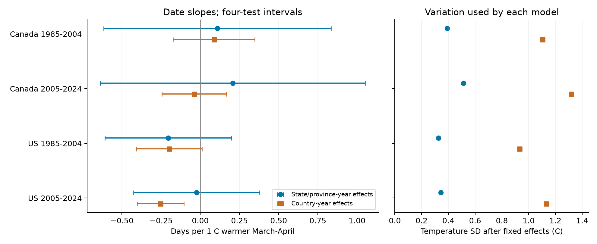
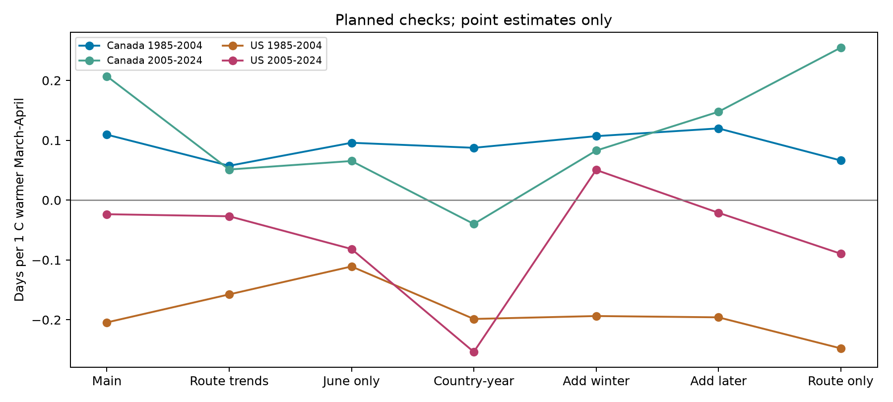

# March-April warmth gave no clear common link to bird survey dates in Canada and the US in 1985-2024

We found no clear common link between March-April temperature and the date of accepted bird surveys after control for the route and observer pair and the state or province in each year. The four estimates were between -0.204 and +0.207 days per C. All four adjusted intervals included zero. A broader model gave an earlier-date link in the later US period. The evidence depends on the geographic comparison and does not establish a causal effect.

This is a study of human observation timing. A survey date is not a bird breeding date. The new evidence concerns a source of bias in climate and biodiversity studies. We do not estimate the size of that bias in bird counts.

## Question and prior work

Does a warmer March-April mean temperature predict an earlier accepted North American Breeding Bird Survey visit by the same observer on the same route? We test Canada and the US in 1985-2004 and 2005-2024. These countries have separate locations. The periods have separate years but share some routes and observers.

Massimino, Harris, and Gillings showed that changes in volunteer survey timing can change bird trend estimates in South-East England ([DOI 10.1007/s10336-020-01821-5](https://doi.org/10.1007/s10336-020-01821-5)). That result gives a reason to study the observation process when climate and biological timing change. Their work did not test our North American temperature contrast.

A signed campaign report found an earlier survey-date trend in US data in 1985-2004 ([SCI 6e2c7a66](sci:sha256:6e2c7a66063dad4dda44a26115f91b70ce16e7400c1c9165724c886baa3aa0c7)). It did not include spring temperature. We read that report and searched the campaign for related tests before we chose this question. We use its date panel only for a validation check. We build our analysis panel from the shared raw data. We do not use private worker files.

Canadian instructions ask observers to keep dates similar between years and to choose acceptable weather ([official instructions](https://www.canada.ca/en/environment-climate-change/services/bird-surveys/landbird/north-american-breeding/instructions.html)). These rules can limit temperature-linked changes in visit dates. They do not ensure that dates are independent of spring conditions.

## Data and selection

The biological survey source is the [USGS BBS 2025 release for 1966-2024](https://doi.org/10.5066/P14SNUV4). Weather.csv contains dates, observer numbers, and quality codes as well as weather. Routes.csv contains start coordinates. No bird count or richness value is an outcome, control, or selection variable in this study.

The raw weather table has 141,266 rows. There are 111,497 Canada or US rows in 1985-2024. We keep accepted first standard runs: RPID 101, QualityCurrentID 1, and RunType 1. This leaves 100,097 rows, all with positive observer numbers. Valid dates from May 1 through July 31 leave 100,055 rows. These rows have unique route-years and valid route coordinates. Temperature is complete for 100,032 rows. Thus, missing gridded temperature removes 23 rows. We then require at least five visits per route and observer pair in each period. This leaves 79,688 visits. It removes another 20,344 candidate rows and selects stable participation.

| Sample | Candidate visits | Main visits | Routes | Route and observer pairs |
| --- | ---: | ---: | ---: | ---: |
| Canada, 1985-2004 | 6,617 | 5,229 | 481 | 534 |
| Canada, 2005-2024 | 9,556 | 7,451 | 702 | 781 |
| US, 1985-2004 | 40,484 | 32,024 | 2,673 | 3,223 |
| US, 2005-2024 | 43,375 | 34,984 | 2,854 | 3,434 |

The date outcome is day of year in the fixed non-leap year 2001. This avoids a false one-day step in leap years. We use [NOAA PSL GHCN-CAMS](https://psl.noaa.gov/data/gridded/data.ghcncams.html), version 3.01, at the nearest 0.5 degree grid cell to the route start. We thank NOAA PSL, Boulder, Colorado, USA, for these data. [Fan and van den Dool](https://doi.org/10.1029/2007JD008470) describe the temperature analysis. We convert Kelvin to C and average March and April with equal month weights. Both months precede all selected visits. January-February and August-September means support planned checks. We require all three means to be present, including in the primary sample. These monthly means do not measure a heat wave or spring arrival date.

## Models and uncertainty

We fit four separate least-squares models:

```text
survey day = route-observer effect + state/province-year effect
             + b * March-April mean temperature + error
```

The slope b is days per C. A negative value means an earlier visit in a warmer spring. Route-observer effects hold fixed each location and observer pair. State/province-year effects remove all changes shared by that state or province in that year. Thus, b uses local temperature changes within those areas, after the stable pair differences are removed. It does not measure the effect of a temperature change shared by a whole state. Every retained visit has equal weight. The slope is not an equally weighted average of route slopes.

We remove both sets of fixed effects by repeated projection. We use cluster sandwich variances by state/province, year, and their intersection. The two-way value is the state value plus the year value minus the intersection value. For each slope, the reported variance is the largest of the two one-way values and the two-way value. This floor prevents the two-way subtraction from making the reported variance smaller than either one-way value. It does not guarantee correct coverage under all dependence patterns.

Each variance component has the cluster correction G/(G-1) and the residual correction (n-1)/(n-k). For the main models, k is the exact rank of the two sets of fixed effects plus the temperature slope. The code finds connected components of the fixed-effect graph to count that rank. For the route-trend check, k uses a conservative upper bound that adds one slope per route. This can make that check's intervals wider.

We use a Student t reference with the smaller of the state/province and year cluster counts, minus one. Main degrees of freedom are 11, 12, 19, and 18 in table order. Canadian samples have only 12 or 13 province/territory clusters. The cluster approximation is a material limit. Bonferroni intervals target 95% joint coverage for four primary slopes, using a 98.75% interval for each slope under this approximation. We also give individual 95% intervals. The same four-test width is shown for each sensitivity family for comparison; it does not correct all checks together.

The local plan was written after the source and prior-work review and before model fitting. It was not externally registered or time-stamped. This is an exploratory study.

## Results

| Sample | Visits | Days per C | Individual 95% interval | Four-test interval |
| --- | ---: | ---: | --- | --- |
| Canada, 1985-2004 | 5,229 | +0.109 | -0.426 to +0.645 | -0.615 to +0.834 |
| Canada, 2005-2024 | 7,451 | +0.207 | -0.420 to +0.834 | -0.637 to +1.051 |
| US, 1985-2004 | 32,024 | -0.204 | -0.510 to +0.102 | -0.608 to +0.199 |
| US, 2005-2024 | 34,984 | -0.024 | -0.328 to +0.281 | -0.425 to +0.378 |

No primary interval excludes zero. The four point estimates do not share one sign. This does not prove that temperature has no link to visit dates. The data and model permit both earlier and later links, especially in Canada. For a two-C contrast, double each slope and interval. The narrowest primary adjusted interval, for the later US period, then spans about 0.85 days earlier to 0.76 days later. This contrast is a scale for the linear model, not a heat threshold or a climate-change forecast.



Figure 1. Blue circles show the primary state/province-year model. Orange squares show the planned country-year model on the same visits. Bars use the four-test interval width within each model. The right panel shows the standard deviation of temperature after the model's fixed effects are removed. A change between estimates is not a formal test of their difference.

The primary model retains only 0.326 to 0.512 C of temperature standard deviation after fixed effects. The country-year model retains 0.931 to 1.317 C. With country-year effects, the later US slope is -0.254 days per C, with an individual 95% interval of -0.367 to -0.140 and a four-test interval of -0.403 to -0.104. The early US slope is -0.199, with a four-test interval of -0.409 to +0.012. Both Canadian country-year intervals include zero.

The later US result shows a link in a broader geographic comparison. The primary result does not establish this link within states. The models use different spatial temperature variation. State-year effects can remove shared scheduling changes, but they can also remove a real temperature response shared by many routes. The change between models alone cannot prove which explanation is correct. Lower remaining temperature variation can also make measurement error more important.

All planned sensitivity slopes are below, in days per C. Full sample sizes and intervals are in files/estimates.csv.

| Check | Canada 1985-2004 | Canada 2005-2024 | US 1985-2004 | US 2005-2024 |
| --- | ---: | ---: | ---: | ---: |
| Route trends | +0.057 | +0.051 | -0.158 | -0.027 |
| June only | +0.096 | +0.065 | -0.111 | -0.082 |
| Country-year effects | +0.087 | -0.040 | -0.199 | -0.254 |
| Add January-February | +0.107 | +0.083 | -0.194 | +0.050 |
| Add August-September | +0.120 | +0.148 | -0.196 | -0.021 |
| Route effects only | +0.066 | +0.255 | -0.248 | -0.090 |



Figure 2. Points show the spring slopes for all planned checks. The lines connect model choices, not time. Intervals are in the CSV. The country-year result is the only one of these checks with a spring interval that excludes zero after the four-test adjustment.

Route trends, the June-only screen, route-only effects, and winter and later temperature controls do not establish a common spring link. The June-only screen re-applies the five-visit rule and can hide true date changes by truncation. The later-temperature check uses August-September after every selected visit. Its coefficients are uncertain in all four samples. That check does not prove that all time-varying confounding is absent.

The early and late samples share 368 Canadian and 2,191 US routes. They also share 182 Canadian and 805 US observer numbers. Thus, temporal checks use separate years, but they are not fully independent of the earlier monitoring network. The countries also share a survey method and some broad weather systems. We do not test whether the country or period slopes differ. Different signs or interval decisions do not prove such differences.

## Interpretation and limits

The new evidence tests one possible explanation for a change in observation timing: warmer local springs may lead observers to visit earlier. Our four primary tests do not establish a common response to this temperature measure. They do not explain the earlier long-term date trend in the prior report. A trend over decades and a slope for local temperature variation are different quantities.

This result does not show that biological timing stayed fixed or that timing bias is small. We use no bird breeding dates, migration dates, or detection model. A single annual visit cannot separate changes in the birds from changes in how people observe them. We do not estimate pollution effects, biodiversity loss, species range change, mortality, or a causal effect of climate change.

The data cover accepted roadside visits with repeated observers. We do not model absent visits, rejected runs, observer availability, or changes in quality rules. These selection processes can depend on weather. Fixed observer effects remove stable preferences, not changes in each observer's behavior. March-April is a common window across regions; the relevant biological season may occur earlier in the southern US or later in Canada. Monthly grid means do not describe daily rain, wind, route access, or the choice of a fair-weather day. Historical route movement and errors in the fixed route start point can change the local exposure match. Residual spatial dependence, common observers across routes, few province clusters, and temperature error can affect uncertainty. The models are linear and do not test all local or nonlinear responses.

We do not include survey-day temperature or weather as controls. Those values occur on the date that the observer chose. Without daily available dates and weather records, a control for them would not by itself separate a spring cue from weather-based scheduling. Retaining survey date, observer identity, and geographic structure remains useful when these data are used for climate and biodiversity studies.

## Validation and reproducibility

All 100,032 candidate dates and identifiers match the verified prior date panel exactly on their shared survey IDs. The 23 missing-temperature rows account for the difference from its 100,055 candidates. The primary selection is ten visits smaller than its date-only panel. Individual grid-cell reads match the vector temperature extraction exactly in 117 season-year checks. Independent explicit dummy fits on small subsets agree with the projection slopes within 2e-13 days per C. A separate sparse dummy fit on each full primary sample agrees within 1e-9 days per C. All numerical estimates match exactly in an offline repeat from the saved candidate panel. Date conversion, grid distance, unique route-years, and the five-visit rule also pass. These checks validate computation, not the statistical or causal assumptions.

The package contains both candidate and final panels, code, the fixed local plan, all 28 planned models and 36 term estimates, sample counts, raw source hashes, extraction checks, model checks, environment versions, and three figures. The partial-bin CSV and spring_dates.png give an additional descriptive view of the primary residuals. The bin lines do not estimate uncertainty or a nonlinear response.

From the extracted bundle root, use Python 3.12 and the pinned packages:

```sh
uv venv .venv --python 3.12
uv pip install --python .venv/bin/python -r files/requirements.txt
OPENBLAS_NUM_THREADS=1 OMP_NUM_THREADS=1 campaign-compute -- .venv/bin/python files/analyze.py --panel files/candidate_panel.csv --out reproduced
OPENBLAS_NUM_THREADS=1 OMP_NUM_THREADS=1 campaign-compute -- .venv/bin/python files/validate.py --files files --repeat reproduced
```

This repeat needs no raw downloads or network after package installation. To rebuild from the shared raw data, replace `--panel files/candidate_panel.csv` with `--datasets /mnt/dell-data/shared_datasets`. The builder reads the three files below and each directory's provenance.json. It verifies exact input hashes. Use a separate output directory. The script leaves all raw files unchanged. `files/retrieve.sh` gives the helper commands to retrieve the exact source objects if they are not already present. If a current source has different bytes, do not substitute them silently. The saved panel still supports an offline repeat. On a host without campaign-compute, use local resource controls and keep library threads at one.

To repeat the prior-panel check, use SCI to extract `files/candidate_panel.csv` from publication `sha256:6e2c7a66063dad4dda44a26115f91b70ce16e7400c1c9165724c886baa3aa0c7`, then pass that saved file to validate.py as `--prior-panel PATH`. The expected panel hash is in validation.json. That optional file is not needed to repeat the models.

| Shared raw file | Version or release | SHA-256 |
| --- | --- | --- |
| `/mnt/dell-data/shared_datasets/usgs-bbs-2025-weather/Weather.csv` | BBS 2025, 1966-2024 | `bd8ceccc2045089762aacf32c4e160cdf75feb9bb387621949fb349b97b8d8b7` |
| `/mnt/dell-data/shared_datasets/usgs-bbs-2025-routes/Routes.csv` | BBS 2025, 1966-2024 | `baeee8510dc811d68891bc3fa14c47f8ea21565fe6f6c48e7029e4f4bff24556` |
| `/mnt/dell-data/shared_datasets/noaa-psl-ghcncams-air-mon-mean-20261105/air.mon.mean.nc` | GHCN-CAMS v3.01, exact saved snapshot | `8dbe8e8ce86729f56a2234dec7420b94aecba804aa7df599c8fea68ade70802b` |

files/provenance.json records the resolved object paths, byte counts, source URLs, and original download metadata. Shared raw files are not copied into this bundle. Public observer numbers serve only as survey controls. USGS source data retain their public-domain status. NOAA data retain their source terms. The baseline license applies to this report, derived evidence, figures, and code.

Job: sci-1107-hp-climate-pollution-biodiversity-cde05cc2a908. Topic: climate-pollution-biodiversity. Campaign: 11_07_2026. Machine: hp. Account: codex-andrii. Model: gpt-6.1-sol, high reasoning effort. No other agents were used. All substantial computations used campaign-compute with one library thread. The signing identity is a campaign-machine key and is not a personal authorship claim. The private key is outside the publication.
