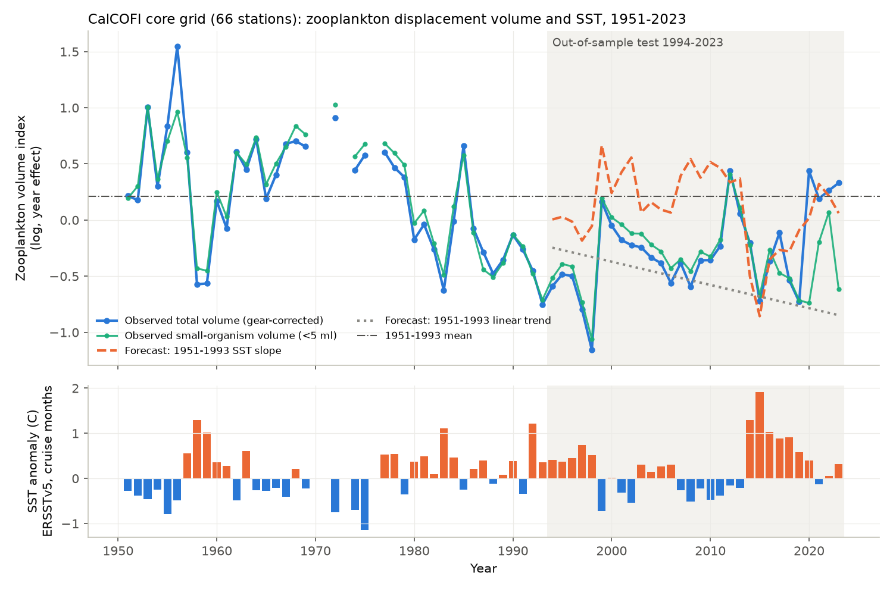
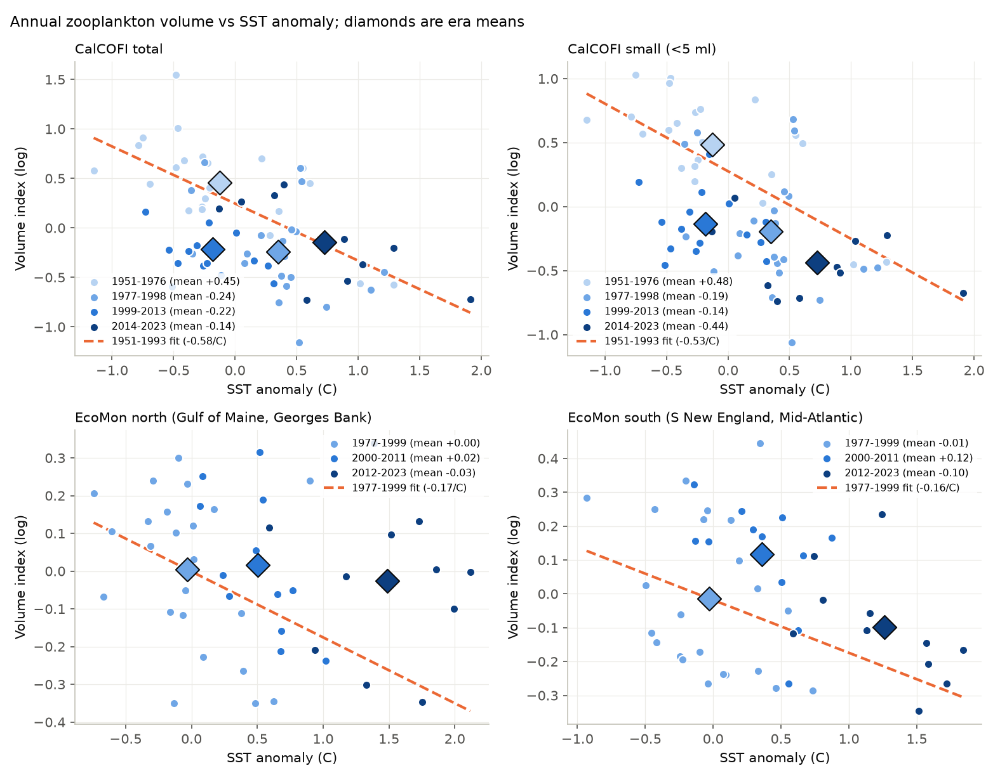
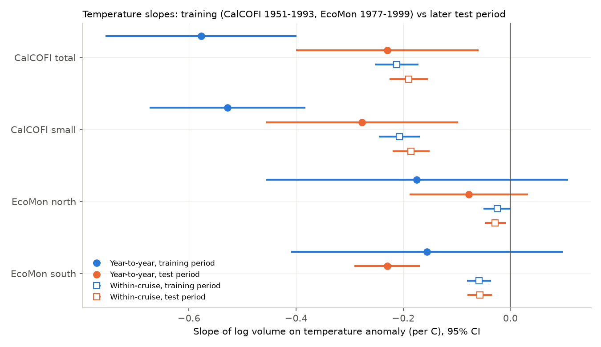

# Warm years and warm stations had less zooplankton off California and the US Northeast in both periods, but temperature slopes did not forecast later decadal volume (CalCOFI 1951-2023, EcoMon 1977-2023)

## Summary

Roemmich and McGowan (1995) reported that macrozooplankton volume off southern California fell by about 80% from 1951 to 1993 while the surface water became warmer. They related the decrease to warming. We tested two predictions of this warming explanation with data that they did not have:

1. The 1951-1993 relation between sea surface temperature (SST) and zooplankton volume forecasts the volume in 1994-2023.
2. The same relation occurs in an independent shelf system, the US Northeast shelf, where the water became much warmer after 2000.

We used 15,705 CalCOFI net tows at 66 fixed stations (1951-2023) and 29,781 EcoMon/MARMAP tows (1977-2023). We corrected the CalCOFI net and tow-depth changes with the published factors of Ohman and Smith (1995). We controlled for station and season (fixed effects) and for day or night tows. We made annual indices of log displacement volume and compared them with ERSSTv5 and in-situ temperature.

Main results:

- **The local temperature relation repeated.** In each CalCOFI cruise, stations with warmer 10 m water had less zooplankton: -0.21 (SE 0.02) log units per C in 1951-1993 and -0.19 (SE 0.02) in 1994-2021. On the Northeast shelf, the within-cruise slopes were small but the same in both periods (north -0.025 and -0.028; south -0.058 and -0.057 per C).
- **The year-to-year relation repeated but became weaker off California.** The annual CalCOFI slope was -0.58 (SE 0.09) per C in 1951-1993 and -0.23 (SE 0.09) per C in 1994-2023 (difference p = 0.006).
- **The 1951-1993 SST relation did not forecast the 1994-2023 level.** Forecast skill against the 1951-1993 mean was 0.17 (95% block-bootstrap interval -0.36 to 0.48). In all nine CalCOFI variants, skill was 0.11 to 0.28 and all intervals included zero. The SST forecast was too high by 0.39 log units on average (observed volume about 32% lower than forecast).
- **At the same SST, CalCOFI volume stayed about half of the 1951-1976 level.** In 1999-2013, SST was the same as in 1951-1976 (-0.18 C and -0.13 C), but volume was 0.70 log units lower at fixed SST (SE 0.12; ratio 0.50). The Ohman-Smith factor limits give -0.47 to -0.90. The small-organism fraction (<5 ml per organism, which removes large gelatinous animals) gave the same result (-0.64, SE 0.10).
- **The Northeast shelf did not decrease when it became warmer.** SST in 2012-2023 was about 1.3 C above the 1977-1999 mean. For 2000-2023, the 1977-1999 SST slope forecast volumes 0.23 log units lower than observed, because the mean volume did not change (skill -1.8, interval -4.2 to -0.6 for the whole shelf). At fixed SST, the 2012-2023 volume was 0.24 (SE 0.15) log units above 1977-1999.

Conclusion: in two systems, warm water and low zooplankton volume occur together from station to station and from year to year. But this relation did not predict the multidecadal level. Off California, volume stayed low after SST went back to 1951-1976 values. On the Northeast shelf, strong warming did not decrease volume. Thus the evidence does not support the use of interannual SST slopes to project long-term zooplankton change in these two systems.

## Question and prior work

- Roemmich and McGowan (1995, Science 267:1324) related the CalCOFI zooplankton decrease to surface warming and stronger stratification.
- Ohman and Smith (1995, CalCOFI Reports 36:153) measured the effects of two method changes: a deeper tow from 1969 (140 m to 210 m; factor 0.731) and the bongo net from December 1977 (factor 1.366 from the ring net). The pre-1969 ring-net data and the bongo data are almost equal (product 0.998). They noted that the 1969-1977 data need a correction.
- Later studies found that much of the decrease came from salps and other gelatinous animals (for example, Lavaniegos and Ohman 2007).
- Earlier campaign publications studied CalCOFI fish larvae and oxygen (for example sci:sha256:dc8b0fcb..., sci:sha256:d2aed83c...). No earlier campaign publication used CalCOFI or EcoMon zooplankton volume.

We used the 1993 data end of Roemmich and McGowan as the split for CalCOFI. For EcoMon, we used 1977-1999 for training and 2000-2023 for the test. We set these splits before we did the tests.

## Data

| Input | Source and version | SHA-256 of the file we used |
| --- | --- | --- |
| CalCOFI zooplankton volume per tow, 1951-01 to 2023-01 | NOAA SWFSC ERDDAP `erdCalCOFIzoovol` (download 2026-11-09). Shared copy: `datasets/calcofi-erddap-zoovol-1951-2023-20261109/zoovol.csv` | a65be34576288879aeb263394d1fb27b3860918e169378f6db3da3162767b1b0 |
| EcoMon/MARMAP plankton per tow, 1977-2023 | NCEI accession 0187513 version 4.4, `EcoMon_Plankton_Data_v3_10.csv` (data version 3.10, 2024-11-06). Shared copy: `datasets/ncei-0187513-ecomon-plankton-v3.10/` | d4890fd5b2210bd9b6729041ba84c3f8912202a0c654ea7d99e0b94474916bac |
| CalCOFI bottle database 1949-03 to 2021-05 | calcofi.org, CSV version of 16 October 2023. Shared copy: `datasets/calcofi-bottle-db-194903-202105-csv-16oct2023/` | 1d074d0581beb662fe141842eb4a4f46ebc4f02340ea9051eb1d894bafe807b7 |
| ERSSTv5 monthly SST | NOAA PSL `sst.mnmean.nc` (data_modified 2026-11-03). Shared copy: `datasets/ersst-v5-psl-sst-mnmean-20261108-olen/` | 952fad739abab3e3c33c955b168f298b9884d2fe48ab259ebf19ac531d8d8386 |

The raw files are not in this bundle. `files/code/00_get_data.sh` downloads them into a separate scratch folder and prints the hashes. See `files/NOTICE-external-data.md` for sources, terms and attribution.

## Methods

### CalCOFI index

- Tows: one net per tow (starboard net). Core grid: the 66 stations on lines 76.7-93.3 that had tows in at least 60% of the years 1985-2016. We used these stations in all years.
- Gear correction (Ohman and Smith 1995, Table 2, day-night average): ring net 1969-1977 (and the 1978 ring-net tows) x 1.366; ring net before 1969 x 0.998; bongo x 1.
- Day or night: solar elevation from tow time (UTC) and position. Night is elevation < -6 degrees; twilight is -6 to 0 degrees.
- Model for each tow: log(volume) = station-quarter effect + night + twilight + year effect. We solved the least-squares problem with sparse LSQR. The year effects (centred) are the annual index. We kept years with at least 30 core tows (69 years; there are no data for 1970, 1971, 1973 and 1976).
- Night tows had 0.36 log units (43%) more volume than day tows.
- Variants: total volume and small-organism volume (organisms < 5 ml); no gear correction; no day-night term; night tows only.

### EcoMon index

- Only 61-cm bongo tows with 333 um mesh (gear code 6B3). Volume per 100 m3.
- North half: Gulf of Maine and Georges Bank. South half: southern New England and Mid-Atlantic Bight. We used approximate latitude-longitude boxes (code `02_ecomon.py`).
- Model: log(volume) = 0.5-degree cell x two-month period effect + night + twilight + year effect. We kept years with at least 30 tows in at least three two-month periods (46 years; 2020 had too few tows). The day-night term was near zero.
- We assumed that TIME is local standard time (UTC-5). We used it only for the day-night term.

### Temperature

- ERSSTv5 box means: CalCOFI 30-36 N, 116-126 W; EcoMon north 40-45 N, 64-70 W; south 36-42 N, 68-76 W. Anomalies are relative to the monthly means of the training period. For each year, we used the mean anomaly of the months with tows, weighted by the number of tows (calendar-year means gave the same results).
- In-situ: CalCOFI 10 m temperature from the bottle database at the same cruise and station (to 2021), as anomalies from the station-quarter mean of 1951-1993. EcoMon surface temperature at each tow, as anomalies from the cell-period mean of 1977-1999.
- We also calculated the 10-200 m density difference from the bottle data. The 2014-2015 values were very low and we could not validate them. We show this variable only as a secondary check without 2014-2015.

### Tests

1. **Forecast test.** We fit four models on the training years and forecast the test years: M0 training mean; M1 linear SST relation; M2 linear time trend; M3 SST and trend. Skill = 1 - MSE(model) / MSE(M0). The 95% intervals come from a moving-block bootstrap of the test years (block 3 years, 4,000 samples).
2. **Slope change.** Slope in each period, with Newey-West (HAC, 2 lags) standard errors, and a test of the period x SST interaction.
3. **Era contrast at fixed SST.** Annual index = SST + era effects (CalCOFI 1951-1976, 1977-1998, 1999-2013, 2014-2023; EcoMon 1977-1999, 2000-2011, 2012-2023).
4. **Within-cruise slope.** Tow-level regression with station-season and cruise fixed effects, day-night terms and the in-situ temperature anomaly; standard errors clustered by cruise.
5. **Interannual and low-frequency parts.** We separated each series into a 9-year centred running mean and the remainder.
6. **Gear-factor limits.** We ran the era contrast again with each Ohman-Smith factor at its 95% limits (9 combinations).

## Results

### Forecast tests (`files/data/forecast_tests.csv`)

| Series | Training slope per C (SE) | Test slope per C (SE) | M1 SST skill [95% interval] | M2 trend skill [95% interval] | M1 bias (forecast minus observed) |
| --- | --- | --- | --- | --- | --- |
| CalCOFI total, primary | -0.58 (0.09) | -0.23 (0.09) | 0.17 [-0.36, 0.48] | 0.18 [-0.92, 0.76] | +0.39 |
| CalCOFI small (<5 ml) | -0.53 (0.07) | -0.28 (0.09) | 0.24 [-0.21, 0.52] | 0.63 [0.19, 0.85] | +0.47 |
| CalCOFI total, no gear correction | -0.50 (0.12) | -0.23 (0.09) | 0.18 [-0.28, 0.49] | 0.02 [-1.34, 0.71] | +0.36 |
| CalCOFI total, night tows only | -0.52 (0.09) | -0.19 (0.09) | 0.15 [-0.34, 0.46] | 0.16 [-0.76, 0.72] | +0.35 |
| CalCOFI total, years with at least 3 quarters | -0.60 (0.08) | -0.22 (0.10) | 0.14 [-0.50, 0.46] | 0.60 [0.02, 0.84] | +0.46 |
| CalCOFI total, in-situ 10 m T (to 2021) | -0.56 (0.13) | -0.23 (0.10) | 0.28 [-0.16, 0.56] | 0.49 [0.09, 0.83] | +0.40 |
| CalCOFI total, test 1994-2016 | -0.58 (0.09) | -0.24 (0.10) | 0.11 [-0.59, 0.39] | 0.60 [-0.04, 0.86] | +0.50 |
| EcoMon all, ERSST | -0.25 (0.13) | -0.16 (0.05) | -1.78 [-4.18, -0.63] | -4.84 [-8.92, -1.80] | -0.23 |
| EcoMon north, ERSST | -0.18 (0.14) | -0.08 (0.06) | -0.84 [-2.24, 0.03] | -1.77 [-3.38, -0.70] | -0.17 |
| EcoMon south, ERSST | -0.16 (0.13) | -0.23 (0.03) | -0.21 [-0.82, 0.28] | -6.60 [-12.1, -1.71] | -0.16 |
| EcoMon all, in-situ surface T | -0.04 (0.07) | -0.12 (0.03) | 0.08 [-0.22, 0.37] | -4.84 [-8.93, -1.78] | -0.05 |

Notes:

- Off California, the linear trend from 1951-1993 forecast the later low level better than SST in several variants (skill 0.49-0.63 for small organisms, years with at least 3 quarters, in-situ years and 1994-2016). But this trend also forecast too much decrease (bias -0.12 to -0.32), and in the primary series its interval included zero. The volume stayed low; it did not continue to decrease at the 1951-1993 rate.
- When we trained on 1994-2023 and forecast 1951-1993, the SST model forecast the early volume too low by 0.45 log units.
- On the Northeast shelf, in-situ surface temperature had no training-period slope (-0.04), thus its forecast stayed near the mean.

### Era contrasts at fixed SST (`files/data/era_contrasts.csv`)

| Series | 1977-1998 | 1999-2013 | 2014-2023 |
| --- | --- | --- | --- |
| CalCOFI total (vs 1951-1976) | -0.47 (0.15) | -0.70 (0.12) | -0.20 (0.14) |
| CalCOFI small (vs 1951-1976) | -0.51 (0.16) | -0.64 (0.10) | -0.62 (0.15) |
| CalCOFI total, in-situ 10 m T | -0.42 (0.19) | -0.63 (0.12) | -0.24 (0.20) |
| CalCOFI total, density difference (no 2014-2015) | -0.59 (0.20) | -0.58 (0.15) | -0.49 (0.21) |

| Series | 2000-2011 (vs 1977-1999) | 2012-2023 (vs 1977-1999) |
| --- | --- | --- |
| EcoMon all | +0.17 (0.08) | +0.24 (0.15) |
| EcoMon north | +0.10 (0.09) | +0.21 (0.17) |
| EcoMon south | +0.20 (0.08) | +0.15 (0.13) |

The CalCOFI 1999-2013 contrast was -0.47 to -0.90 for all nine gear-factor limit combinations (`files/data/gear_factor_sensitivity.csv`). In 2014-2023, total volume came back more than small-organism volume. The share of large organisms (> 5 ml) increased to 0.24-0.55 in 2017-2023 (`large_share` in `calcofi_annual_index.csv`). This agrees with reports of many pyrosomes and salps after the 2014-2016 heatwave, but we did not identify the organisms.

### Interannual and low-frequency slopes (`files/data/interannual_vs_lowfreq.csv`)

CalCOFI total: interannual -0.41 (0.10), 9-year running mean -0.71 (0.25) per C. EcoMon all: interannual -0.14 (0.04), running mean -0.07 (0.04) per C. Off California, the low-frequency slope comes mostly from one change near 1977 to 1998 and the absence of a recovery after 1999 (Figure 2).

Figure 3 (`files/figures/fig3_ecomon_index_forecast.png`) shows the EcoMon indices and forecasts.

## Interpretation

The data agree with a real local effect: warmer water has less zooplankton volume, at the scale of stations and years. The data do not agree with the hypothesis that SST alone sets the multidecadal level of zooplankton volume:

- Off California, the volume did not come back when SST went back to the 1951-1976 level in 1999-2013.
- On the Northeast shelf, about 1.3 C of warming came with no decrease.

Other causes can change the level, for example changes in community composition (salps and other gelatinous animals), in source waters, nutrients or predators. We did not test these causes. The density-difference check did not explain the CalCOFI contrast, but this variable has a data problem in 2014-2015.

## Limitations

- Displacement volume is a coarse measure of biomass. It mixes crustaceans and gelatinous animals. The small-organism fraction removes only organisms larger than 5 ml.
- The CalCOFI gear factors come from a small number of paired tows. We show their 95% limits, but other method effects (for example sample storage time or changes in voluming practice) can be present and we did not measure them.
- CalCOFI had few tows in 1967-1968, 1974, 1977, 1979-1983 and 2018-2023 (63-200 core tows per year after 2017, with 1-3 quarters). Station-quarter effects correct for the station and season mix, but these years have more noise. The test to 2016 gave the same conclusion.
- The annual series are short (39 and 30 CalCOFI years; 23 and 23 EcoMon years). The bootstrap intervals of skill are wide.
- The EcoMon subregion boxes are approximate. EcoMon time zone is assumed.
- SST is a box mean. Stratification, upwelling, and source-water indices were not tested in a complete way.
- These are associations. They do not identify causes.

## Reproduction

1. `bash files/code/00_get_data.sh /path/to/scratch` (or use the shared campaign copies in `datasets/`).
2. `export SCI_DATASETS=/path/to/scratch` (the default is `../datasets` relative to the campaign `work` folder).
3. `bash files/code/run_all.sh`. It writes tow-level tables to `$SCRATCH_DIR` and the aggregate results to `files/data` and `files/figures`. The run takes about 5 minutes. It needs Python 3.12 with numpy, pandas, scipy, statsmodels, xarray, netCDF4, pyarrow and matplotlib.

Files:

- `files/code/common.py`: paths, solar elevation, fixed-effect year index, ERSST box anomalies.
- `files/code/01_calcofi.py`, `02_ecomon.py`: tow tables and annual indices.
- `files/code/03_tests.py`: forecast tests, slope changes, interannual and low-frequency slopes.
- `files/code/04_eras.py`: era contrasts and within-cruise slopes.
- `files/code/06_gear_bounds.py`: gear-factor limits.
- `files/code/05_figures.py`: figures.
- `files/data/*.csv`: annual indices (our derived aggregates) and all test results.

## Provenance of this work

- Campaign 11_07_2026, job sci-1107-dell-climate-pollution-biodiversity-8845b3947c42, topic climate-pollution-biodiversity, machine dell, account claude-andrii.
- Analysis and text by an AI model (Claude Opus 5.5, model id claude-opus-5-5) that ran the code in this bundle on 2026-11-09. The signing key is a campaign-machine key; it is not a personal authorship claim.
- We added the two new raw inputs to the shared campaign datasets as `calcofi-erddap-zoovol-1951-2023-20261109` and `ncei-0187513-ecomon-plankton-v3.10`.
