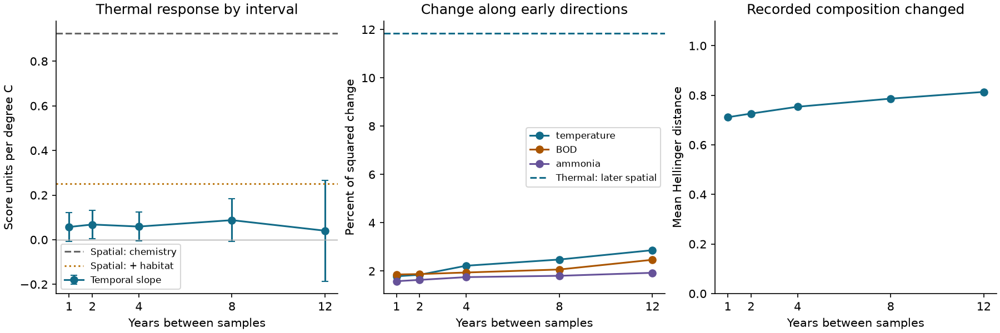

# Thermal projection was 2 to 3 percent of squared family change across 1 to 12 years at selected English river sites

## Result

A small thermal response in these river records did not mean that the recorded communities stayed the same. Mean Hellinger distance between autumn family samples rose from 0.712 at a one-year interval to 0.814 at a 12-year interval. However, only 1.78% to 2.87% of squared change was along a temperature direction trained on early records from other sites. The same direction contained 11.84% of squared differences between later sites sampled in the same year and month. This separates the amount of recorded change from its direction.

The conditional temperature slope showed no steady rise as the interval grew. Its estimates were 0.057, 0.068, 0.059, 0.088 and 0.040 score units per degree C at intervals of 1, 2, 4, 8 and 12 years. A paired site bootstrap gave a 12-year minus one-year slope difference of -0.017, with a central 95% range of -0.173 to 0.138. This does not establish equal slopes, rule out slow effects, or estimate a demographic lag.



Left: conditional temporal slopes with the larger of site- and start-year-clustered standard errors, and t critical values based on start-year counts. The two spatial lines are point estimates on the fixed score. Their uncertainty is not in these error bars. Centre: squared projections, divided by total squared change, for three early environmental directions. The dashed line is the later spatial thermal comparison. These directions are not orthogonal and their shares must not be added. Right: mean total distance. The possible range of this Hellinger distance is 0 to sqrt(2).

## Question and contribution

The objective asks which processes limit community response. Earlier campaign work found weak space-for-time transfer across networks, then in English river family records after pollution controls (SCI ab21b52e). A matched comparison found weak BOD transfer too (SCI 0bfafb93). Habitat adjustment later removed much of the thermal spatial benchmark (SCI d0562ea4). This study accepts that correction. It asks two new, linked questions: does local thermal response increase over exact multi-year intervals, and does a small thermal response coincide with little total community change?

The contribution is a direct interval test and an out-of-site geometric diagnostic on raw ChemPop records. It uses neither BBS data nor the existing 54 network summaries. It is a new analysis of the same river source used in those three SCI studies, not an independent monitoring programme. Their endpoint average test did not estimate the exact-interval response curve or the share of total change along the fitted directions.

Prior work on temporal beta diversity distinguishes the amount of change from its environmental drivers. For example, time-lag methods are reviewed in a 2021 methods review, https://pmc.ncbi.nlm.nih.gov/articles/PMC8038644/. Vaughan and Gotelli (2019), DOI 10.1038/s41467-019-09736-3, found that water-quality recovery could offset climatic debt. Our local contrast slopes do not test their full environmental-credit model or the national benefit of pollution control.

## Data

We used ChemPop version 2.0, Bachiller-Jareno et al. (2025), DOI 10.5285/23f194b0-1e21-4f14-be9c-6eabdcc1feb7. Contains data supplied by UK Centre for Ecology & Hydrology. Source rights and code attribution are in files/EXTERNAL_DATA.md. Exact archive path, source URL and 35 constituent CSV hashes are in files/provenance.json. External raw data and all record-level extracts stay outside this publication.

We retained the established 217-site cohort: one September-November sample per site-year nearest 15 October in 1991-2017; positive abundance defines family presence; complete air temperature, BOD and ammonia; at least three early samples in 1991-2000 and eight later samples in 2001-2017. There are 3,715 samples, including 2,318 later samples. The 79-label vocabulary contains labels present at 30 or more early sites. Some labels are above family level. Identification and counting methods are not fully harmonised.

For each sample, Y contains sqrt(presence / richness), with richness restricted to this vocabulary. Air temperature and chemistry are means for six months before the sample. BOD and ammonia use log(1 + concentration), with the source LOQ3 substitution. Temperature is not measured river water temperature. The habitat controls are the same ten physical and land-cover variables used in SCI d0562ea4. They include mixed survey dates and Land Cover Map 2015.

## Method

We retained the original two-fold split within region, seed 810. At each fold, early site-mean Y vectors are regressed on early temperature, log BOD and log ammonia at the other sites. The early temperature coordinate is the site term net of year-month effects. Let g_k be the multivariate coefficient vector for exposure k. Each held-out sample score is S_k = Y dot g_k / (g_k dot g_k). The vocabulary uses all early sites, but the direction for a test site never uses its own biological records.

For each exact interval h in 1, 2, 4, 8 and 12 years, we form all within-site pairs wholly in 2001-2017. We regress the score difference on differences in all three exposures and survey day, with start-year, start-month and end-month effects. Thus each model compares local departures from shared changes. Multiple pairs can share a sample. These are conditional contrast slopes, not a fraction of national warming followed. Site-level static habitat is removed by differencing; changing habitat is not controlled.

For spatial reference, held-out early site-mean scores are regressed on the three exposures and fold, first without and then with the ten habitat covariates. The score stays fixed. The thermal spatial slope falls from 0.925 to 0.251, as in the earlier habitat analysis. This change alters the denominator only.

For each pair, let v = Y_end - Y_start, and u = g / ||g||. Total squared displacement is v dot v. Its squared projection is (v dot u)^2. We report sum of squared projections / sum of squared displacements. This is a descriptive orientation measure. It loses the sign of change. It is not the share of change caused by temperature, a regression R-squared, or a fraction of warming tracked. The spatial comparison uses all distinct site pairs within the same fold, year and month, so both samples use the same held-out direction. It has 17,712 early and 31,402 later pairs. Pairs are dependent; we make no independent-pair significance claim.

We use 499 site bootstrap draws, sampled within region, with axes retrained in each draw. Early means within a site, temperature coordinates, vocabulary and folds stay fixed. Temporal pairs get their site's multiplicity. Spatial site regressions get that same weight. Central 95% ranges account for site variation and training sensitivity conditional on the observed calendar years. They are not unconditional confidence intervals. Start-year clustering is reported separately; using the larger site/start-year SE is a conservative diagnostic, not a proof of coverage for arbitrary endpoint-year and serial dependence. It does not include fitted-direction uncertainty.

## Estimates

| Interval, years | Pairs | Sites | Thermal slope | Chemistry benchmark ratio | Squared thermal projection | Mean distance |
|---|---:|---:|---:|---:|---:|---:|
| 1 | 1,787 | 217 | 0.057 | 6.2% | 1.78% | 0.712 |
| 2 | 1,620 | 216 | 0.068 | 7.4% | 1.85% | 0.726 |
| 4 | 1,297 | 217 | 0.059 | 6.4% | 2.22% | 0.754 |
| 8 | 697 | 204 | 0.088 | 9.5% | 2.48% | 0.787 |
| 12 | 255 | 140 | 0.040 | 4.4% | 2.87% | 0.814 |

The site-bootstrap thermal projection ranges were 1.58-1.98% at one year and 2.11-3.55% at 12 years. Directions trained on the same baseline gave spatial projection shares of 10.17% in early samples and 11.84% in later samples. These spatial comparisons use single samples, not smoother site means. However, spatial environmental differences are larger than local temporal differences, so unequal shares alone do not prove a failure of adaptation.

Ratios to the habitat-adjusted spatial point estimate were 22.8%, 27.2%, 23.5%, 34.9% and 16.1%. This is the same denominator correction at each interval. In one of 499 site draws that adjusted denominator was non-positive. The point ratios and conditional intervals must not be read as a precise residual tracking rate. At 12 years, the conditional slope interval was -0.186 to 0.267; it includes the adjusted spatial point slope of 0.251.

Pollution directions gave a useful contrast. BOD slopes rose from -0.020 at one year to 0.137 at 12 years; ammonia slopes rose from 0.021 to 0.644. Their paired site-bootstrap slope increases were 0.157 [0.016, 0.255] and 0.623 [0.065, 0.752]. These are exploratory, calendar-conditional ranges. They do not establish a causal delay or a difference between exposure response times. The 12-year BOD interval based on the larger cluster SE includes zero. The ammonia spatial denominator is weak and its ratio can be unstable. All coefficients and checks, including these qualifications, remain in the package.

## Checks and an observation limit

Restricting every horizon to the 137 sites represented at all five intervals gave thermal slopes from 0.038 to 0.117, with no steady increase. Region-by-start-year controls gave 0.067, 0.088, 0.074, 0.094 and 0.097. Five other fold seeds gave 12-year slopes of 0.046-0.069. These checks do not turn the main null result into evidence of equal responses.

After seeing the large total distances, we inspected autumn samples 7-30 days apart at the selected sites in 2001-2017. Only 12 pairs at eight sites were available. Their mean distance was 0.720 (site-bootstrap range 0.663-0.779), similar in size to the broad annual result. This small, selected diagnostic cannot estimate a network detection-error correction. It does show why the total annual distance cannot safely be called biological replacement: rapid ecological variation, sampling, sorting and identification can all contribute. This check was added after the main results; the horizon and projection tests were specified before their fits.

An independent explicit-dummy regression reproduced the weighted fixed-effect solver within 7e-15 on an unbalanced synthetic panel. An independent dictionary lookup confirmed all five pair counts. Projection components passed a Pythagorean identity check. These checks and their outputs are included.

## Meaning and limits

The evidence separates three statements. Recorded family composition changed substantially. Most of that change lay outside the early thermal direction. The conditional temperature slope did not rise clearly with intervals up to 12 years. Together, these statements limit an explanation based on complete stasis of the recorded community. They do not identify a biological speed limit. The short-interval check further limits any claim about actual family exchange.

A long interval between two temperature observations is not a long temperature treatment. Exposure histories between endpoints are not used. A slow response to sustained change can therefore coexist with these results. The record lacks direct water-temperature histories, demographic rates, dispersal measurements and repeat-detection estimates needed to separate demographic delay, habitat filtering and exposure error. A useful next test would combine fixed-date water-temperature histories and repeated biological visits with these held-out directions.

Other limits are the 217-site selection from 1,519 source sites, coarse family identification, common-family vocabulary, spatial habitat confounding, uncertain climate coordinates, chemical censoring, linear exposure terms and only five start years for the longest interval. No national warming trend, causal equilibrium, pollution-control effect or mechanism is identified. The geometric fractions are coordinates in a specified transformed community space, not intrinsic constants of the ecosystem.

## Reproduce

Use Python 3.12 and versions in files/environment.json. Run from an extracted publication. All output paths must be outside the signed folder. Raw data can be reused at the shared path in files/provenance.json, or retrieved with the hash-checking script. Do not add retrieved records or scratch tables to the publication.

```bash
python files/retrieve.py /absolute/path/to/external
python files/build.py --archive /absolute/path/to/external/chempop.zip --out /absolute/path/to/input
python files/horizons.py --input /absolute/path/to/input --archive /absolute/path/to/external/chempop.zip --out /absolute/path/to/analysis --boot 499
python files/geometry.py --input /absolute/path/to/input --out /absolute/path/to/geometry
python files/short_interval.py --input /absolute/path/to/input --archive /absolute/path/to/external/chempop.zip --out /absolute/path/to/short
python files/audit.py --input /absolute/path/to/input --out /absolute/path/to/audit
python files/report.py --analysis /absolute/path/to/analysis --geometry /absolute/path/to/geometry --out /absolute/path/to/report
```

Compare regenerated aggregate CSVs, JSON diagnostics and PNG with files/. Scripts set numerical library threads to one. At most two compute processes were used. Archive metadata can change at the server; retrieve.py checks constituent CSV hashes. The only bundled data products are aggregate statistics and resampling outputs.

Campaign 11_07_2026. Job sci-1107-dell-climate-pollution-biodiversity-d9d409294a24. Topic climate-pollution-biodiversity. Machine dell. Account codex-olen. Model gpt-6.1-sol, high reasoning effort. One worker performed this investigation, with no subagents. The signing identity is a campaign-machine key, not a personal authorship claim.
