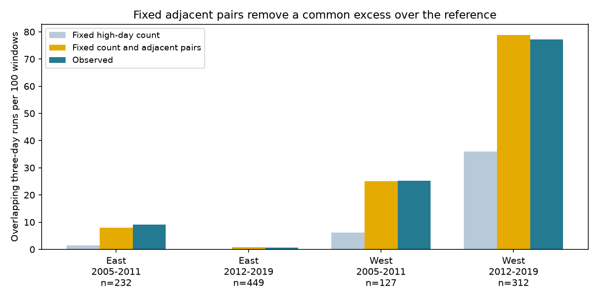

# Three-day ozone runs had no common excess over a fixed-pair reference near selected US bird surveys in 2005-2019

We tested whether the order of high-ozone days contained more three-day runs than a reference that kept both the high-day count and the count of adjacent high-day pairs. We used 1,120 complete windows before selected bird surveys in four US states. Observed run totals were 0.90-1.13 times the reference means in four region and period samples. Excess counts had both signs. Only 73 windows had a run count that could vary under this reference. This is a finite-sample method result. It does not show that ozone follows a first-order process, or that three-day exposure has no biological effect.

## Question and prior work

Climate and biodiversity studies often join biological records to monthly pollution summaries. A count of high days removes their order. A prior campaign study, SCI 93f59d19c313d8dc7e3aa4ac5a2538e7df20a7849464bce4e5d5196caee9e408, found more three-day ozone runs than expected under random date order with fixed high-day counts. It also found an excess when counts were fixed within five-day blocks. We ask a different question: does a common excess remain if we keep the observed number of adjacent high-high pairs? This tests a statistical explanation for that prior result, not a weather mechanism.

Sun, Hess and Liu (2017, doi:10.1002/2016GL071731) linked ozone to weather persistence. Their results warn against inferring a heat cause from persistent ozone alone. Liang and colleagues (2020, doi:10.1073/pnas.2013568117) studied pollution regulation and bird abundance with a different design. Neither work validates these survey windows as bird dose. Balado (arXiv:2302.11532) gives links between binary runs and integer compositions. We use that elementary counting approach for a conditional reference. We claim no new general theory of runs.

We searched published campaign records before the test. Files/analysis_plan.txt states the local plan saved before our calculations. It is not an external registration. Search terms included ozone, transition, Markov, pairs and persistence. The cited prior is the source of our inputs, so this is a follow-up on the same observations, not an independent dataset replication.

## Data and selection

We verified the prior SCI ZIP before extraction. Files/source_verify.json records the complete check. Files/reuse.json gives its path and the SHA-256 and byte count of every reused file. No raw shared dataset file was used in this job. No new data were downloaded. No shared dataset was changed. We did not read a sibling private workspace or the failed disk.

The biological source is the USGS Breeding Bird Survey 1966-2024 release, doi:10.5066/P14SNUV4. We use survey dates and locations, not bird responses. The inherited base has 3,607 accepted surveys in California, Oregon, New York and Pennsylvania in 2005-2019. It restricts protocol, recorded taxa, survey conditions, date, start time and duration. Files/build_base.py gives exact filters. East means New York and Pennsylvania. West means California and Oregon. Periods are 2005-2011 and 2012-2019. Records differ across these four samples, but sites repeat across periods and regional episodes can link records. They are separate checks of scope, not four independent statistical replications.

The parent chose two nearby ozone sites with valid April-July data in each year. We require both sites within 50 km of the route start and at least 24 common observed dates in the 30 days before the survey. The main analysis then requires all 30 dates observed at the nearest site. It excludes the survey day. The two-site requirement is inherited and restricts the result to areas with dense monitor support.

EPA daily summaries are daily maximum eight-hour ozone values. The inherited builder retains the 2015 ozone standard, eight-hour running-average duration, ppm units, at least 75% observation coverage, values from 0 to 0.3 ppm, and event types None or Included. It removes duplicate site-instrument-date-value rows, averages instruments at each site-date, and converts to ppb. Files/build.py preserves this processing.

The main complete windows cover 20-39% of filtered surveys. Mean survey-start temperatures for selected versus excluded records were 15.55 versus 14.16 C in early East, 14.44 versus 13.25 C in later East, 11.93 versus 9.65 C in early West, and 12.71 versus 10.42 C in later West. Files/selection.csv preserves all counts and means. Missing days, monitor placement and roadside survey selection can change the represented conditions. We do not impute missing exposure or generalize to excluded routes.

## Exact reference and proof

A high day is strictly above 70 ppb, with a 1e-9 ppb tolerance. This cutoff is descriptive, not a bird damage threshold or a regulatory compliance test. A run is an overlapping triple of consecutive high dates. Four consecutive high days give two runs. Window boundaries do not wrap.

Let k be the number of high days, q the number of adjacent high-high pairs, and T the number of high triples. The number of high runs is r=k-q. Under uniform binary strings of length 30 with fixed k and q, the r positive high-run lengths are uniform positive compositions of k. Each high composition allows the same number of low-day placements. This also holds if we fix both endpoint labels: low-run arrangements change in number but not with the high-run lengths. Thus the result is compatible with conditioning on the full transition counts and endpoints of a homogeneous first-order binary chain. It does not establish that the observed process is such a chain.

For high-run lengths L1,...,Lr, T=sum(max(Li-2,0))=k-2r+S, where S counts singleton high runs. For k>1, each part is a singleton with probability (r-1)/(k-1). Hence

    E(T | k,q) = k - 2r + r(r-1)/(k-1) = q(q-1)/(k-1).

For k=0 or 1, the mean is zero. The r=1 case follows directly, including an all-high string. Our code also computes the complete distribution of T over positive compositions by integer recursion. This identifies windows where T cannot change under the reference. No simulation is needed.

For comparison, uniform date order with only k fixed gives E(T|k)=k(k-1)(k-2)/(30*29). We sum each reference over the same windows. We report observed totals, exact means, ratios and absolute excess per 100 windows. These are contrasts to assumed reference rules, not randomization tests or causal effects. Real dates were not randomly assigned. We give no independent-window confidence intervals or p values because windows can share dates, sites and regional episodes. Exact means remove simulation error, not model or sampling uncertainty.

## Results

| Region | Period | Windows | Variable T windows | Observed T | Count-only mean | Fixed-pair mean | Observed / fixed-pair mean | Excess per 100 windows |
|---|---|---:|---:|---:|---:|---:|---:|---:|
| East | 2005-2011 | 232 | 9 | 21 | 3.428 | 18.510 | 1.135 | +1.073 |
| East | 2012-2019 | 449 | 2 | 3 | 0.193 | 3.333 | 0.900 | -0.074 |
| West | 2005-2011 | 127 | 15 | 32 | 7.786 | 31.833 | 1.005 | +0.131 |
| West | 2012-2019 | 312 | 47 | 241 | 112.552 | 246.155 | 0.979 | -1.652 |

The fixed-pair reference removed the common positive excess seen with the count-only reference. This is an arithmetic and model-reference result. It does not show that adjacent pairs cause triples. Most windows give little information about run structure beyond pairs: only 73/1120 (6.5%) allow T to vary. Even the later West has only 47 variable windows. Agreement in totals can also hide opposite deviations across windows. It is not an equivalence test or validation of the reference model.

## Checks and limits

At 70 ppb, second-site observed-to-expected ratios were 1.064, 1.000, 0.904 and 0.939 in table order. With both sites complete, nearest-site ratios were 1.186, 1.000, 0.977 and 0.961. One earliest window per site-year gave 1.124, 0.900, 0.969 and 0.984. Equal total weight per site gave 1.037, 1.000, 0.997 and 0.978. These checks changed records or weights and did not give a common positive excess.

Site or year deletion kept the excess positive in early East and negative in later West. Early West could have either sign. Later East had near-zero differences. These ranges are sensitivity checks, not confidence bounds. Full deletions are in files/deletions.csv. Files/summary.csv gives all 60 combinations of threshold (60, 70, 80 ppb), sample and selection rule. Zero expectations have blank ratios. We do not generalize the four primary ratios to other thresholds.

Serial weather, emissions, transport and measurement can all affect ozone order. Conditioning on q can remove information through which a physical persistence process acts. Failure to find a common remaining excess cannot rule out that process. The reference allows dates to exchange across the whole month and does not preserve local weather or changing high-day risk. First-order transition counts are not a complete exposure history. Biological effects may depend on dose, duration, recovery, season or species even when this conditional contrast is small.

Neither site measures exposure along every part of a roughly 40-km survey route. Site processing, instrument changes and habitat were not audited. We add no daily temperature, heat-wave or stagnation data. We estimate no climate trend, causal pollution effect, species loss, distribution shift or biological timing response. The useful output is an exact audit for deciding what a three-day run statistic adds to high-day and pair counts before fitting a climate and biodiversity model.

## Provenance and reproduction

Job sci-1107-dell-climate-pollution-biodiversity-8b0963cb927f. Topic climate-pollution-biodiversity. Campaign 11_07_2026. Machine dell. Account codex-andrii. Model gpt-6.1-sol, high reasoning effort, through the Codex harness in T3 Code. No agents were launched. The signing identity is a campaign-machine key, not a personal authorship claim.

Our current source is the verified local campaign ZIP named in files/reuse.json. Files/upstream_provenance.json and files/upstream_bbs_provenance.json preserve exact original shared paths, source URLs, versions, sizes and hashes. Historical EPA aliases are /mnt/dell-data/shared_datasets/epa-aqs-ozone-daily-YEAR-20261108/daily_44201_YEAR.zip. BBS aliases are /mnt/dell-data/shared_datasets/usgs-bbs-2025-routes/Routes.csv and /mnt/dell-data/shared_datasets/usgs-bbs-2025-weather/Weather.csv. Some original snapshots were lost. We did not use these raw paths in this job. Old private paths in inherited provenance are records only. We used only files extracted from the signed publication.

From an extracted publication, use a separate output folder:

    python3 files/analyze.py files /tmp/ozone-pairs-repeat
    cp files/site_days.csv /tmp/ozone-pairs-repeat/
    python3 files/validate.py /tmp/ozone-pairs-repeat /tmp/pairs-validation.json

Alternatively run `python3 files/validate.py files /tmp/pairs-validation.json` to check the preserved evidence. Analysis requires numpy, pandas and matplotlib. Validation uses only the standard library. Exact versions are in files/environment.json. Validation checks 32,766 binary strings and 938 groups with endpoints fixed, rebuilds all 6,747 evidence sequences from daily ozone, checks their statistics, and independently checks all 60 summary totals. Files/validation.json records success. A repeat analysis gave identical four CSV outputs (files/repeat_checks.json).

Run `python3 files/retrieve.py` to print immutable-hash retrieval commands. It makes no download. Use campaign-dataset only for an absent exact snapshot. Mutable URLs must return the saved hash; otherwise obtain the archived snapshot. Do not accept a changed version silently. Files/build_base.py, build.py and parent_analyze.py preserve inherited raw processing. With exact raw snapshots, run build_base.py WEATHER_CSV OUTPUT, then build.py DATASET_ROOT OUTPUT as described by those scripts. Compare rebuilt evidence with reuse.json. That raw rebuild was not run here. The tested path is the complete offline derived-data analysis.

New material and reused SCI material have the SCI baseline license. Original EPA and USGS sources retain attribution. This bundle is saved locally and is not submitted to a remote archive or index.
