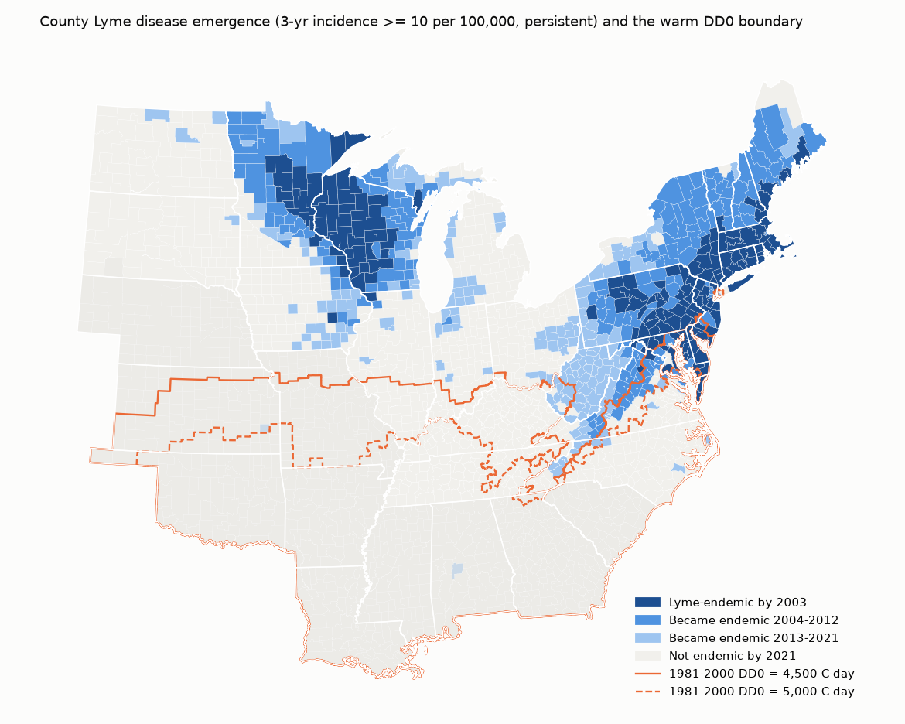
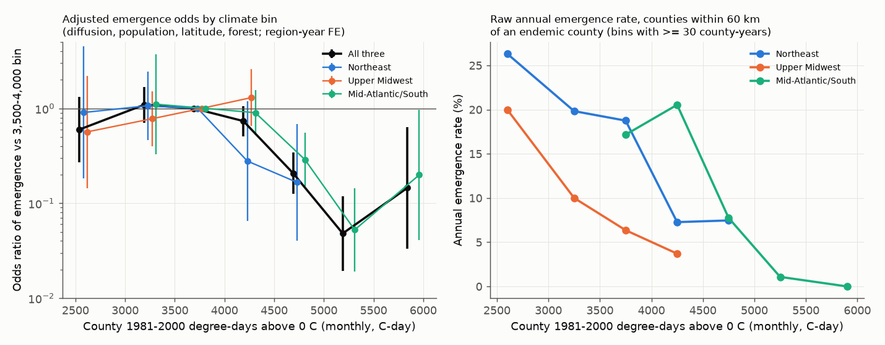
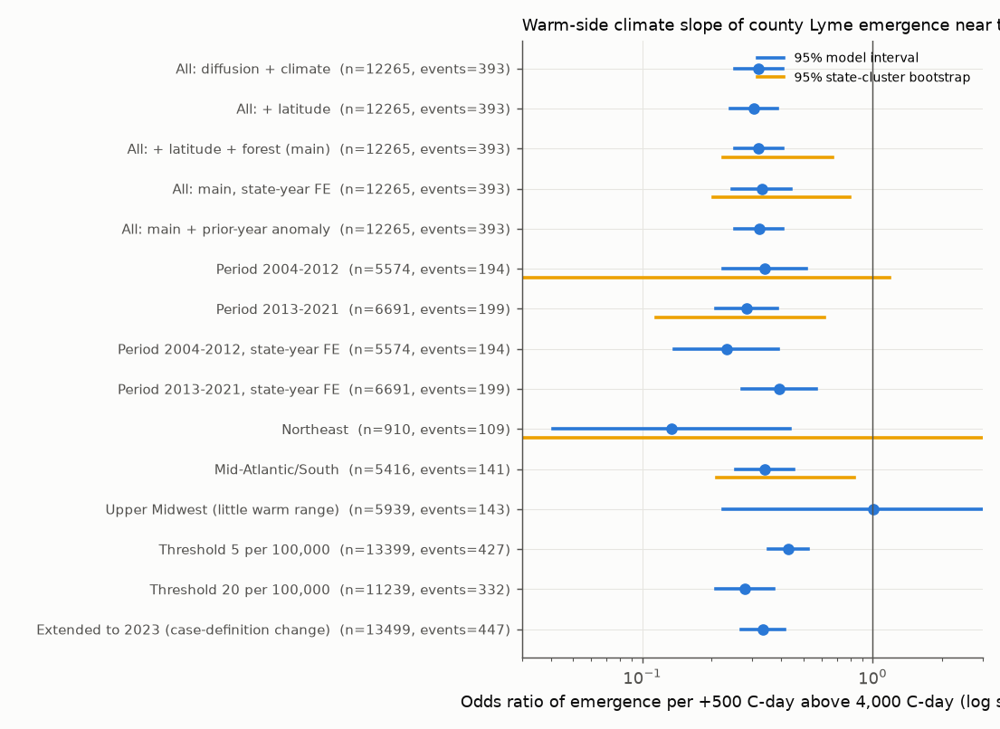

# Warm climate limited Lyme disease emergence in US counties near the spread front in 2004-2021

Job `sci-1107-dell-climate-pollution-biodiversity-de310a7d0112`, campaign 11_07_2026, topic climate-pollution-biodiversity, machine dell, model Claude Opus 5.5 (`claude-opus-5-5`), account claude-myxtap. The signing key is a campaign-machine key. It is not a personal authorship claim.

## Summary

We tested how climate controls where Lyme disease becomes established as it spreads across the eastern United States. Lyme disease cases are a proxy for the joint range of the blacklegged tick (*Ixodes scapularis*) and its pathogen (*Borrelia burgdorferi*). We used CDC county case counts for 2001-2021, Census population, NOAA nClimGrid temperature and a discrete-time hazard model. The model compares counties at the same distance from the spread front.

Main result: near the front, a warmer county climate strongly decreased the probability that a county became endemic. Above 4,000 degree-days above 0 C (1981-2000 mean, from monthly data), the odds of emergence fell by a factor of 0.32 per +500 C-day (95% model interval 0.25-0.41; state-cluster bootstrap 0.23-0.67). The decrease stayed with controls for latitude, forest cover, population and diffusion pressure, with state-by-year fixed effects (0.33), in 2004-2012 and in 2013-2021, in the Northeast and in the Mid-Atlantic/South, and with three incidence thresholds. Only 8 emergences occurred in 2,055 frontier county-years with a 1981-2000 climate above 5,000 C-day. CDC tick surveillance showed the same warm-side decrease in the presence of *B. burgdorferi* in ticks, which does not depend on physician diagnosis.

We found no cold limit inside the United States. The endemic area reached the coldest counties at the Canadian border by about 2008. We could not measure if 2004-2021 warming moved the warm limit. Warming in this period (about 130-380 C-day) was small compared with the spatial climate range, and our test of this was not identifiable.

## Question and prior work

Lyme disease spread from foci in the Northeast and the Upper Midwest (Kugeler et al. 2015, doi:10.3201/eid2108.141878). Discussion of climate change and Lyme disease is mostly about a cold limit and northward spread. For Canada, a degree-day model predicts that cold limits tick establishment (Ogden et al. 2006, doi:10.1016/j.ijpara.2005.08.016). In the southern United States, the tick is common but Lyme disease is rare. Studies explain this with tick host choice and questing behaviour (Ginsberg et al. 2021, doi:10.1371/journal.pbio.3001066; Arsnoe et al. 2015, doi:10.1371/journal.pone.0127450). Physician awareness and reporting are also lower in the south, which is an observation bias.

The campaign record had no study of the county spread of Lyme disease. One campaign study (sci:sha256:17f2e3230efd24a42593a2979804573e0525ba79b04e05d59faa21816ec9a2d5) tested forecasts of New York nymph density. It did not study the spread.

Our questions:

1. Near the spread front, at equal distance to endemic counties, does county climate change the probability of emergence? Is there a cold limit, a warm limit, or both?
2. Does the climate effect stay after controls for latitude, forest cover, and state-level reporting changes?
3. Does it repeat in independent regions (Northeast, Upper Midwest, Mid-Atlantic/South) and periods (2004-2012, 2013-2021)?
4. Does tick surveillance, which does not use human diagnosis, show the same pattern?
5. Did 2004-2021 warming move the climate limit?

## Data

| Source | Use | Version / hash | Rights |
|---|---|---|---|
| CDC Lyme disease case counts by county, 2001-2023 | Annual confirmed cases | `LD_Case_Counts_by_County_2023_updated.csv`, sha256 `e2fe2d71...5fae45` | US Government work; bundled as derived county-year table |
| Census county population estimates (2000-2010 intercensal, 2010-2020, 2020-2023 vintages) | Incidence | sha256 in `files/derived/raw_input_sha256.txt` | US Government work |
| NOAA nClimGrid monthly mean temperature (campaign store `datasets/noaa-nclimgrid-monthly-tavg-20261006`) | County climate 1981-2023 | sha256 `b781f5ee...59d83c7` | US Government work |
| Census 2014 cartographic county boundaries 500k (campaign store) | County polygons, centroids | sha256 `4176ae03...0ea7b` | US Government work |
| USFS FIA forest type group 250 m, ca. 2004 (campaign store) | County forest fraction | sha256 `5ef0fa82...7dfbf` | US Government work |
| CDC ArboNET Tick Module county tables (I. scapularis status; pathogens), status through 2025 | Observation-bias check | sha256 `e35a5066...` and `68baef5f...` | **Data-use agreement: no redistribution. Not bundled.** Only aggregate shares are bundled. |

Exact URLs are in `files/code/fetch_raw.sh` and `NOTICE` below.

## Methods

**Endemic status.** A county is endemic in year t when the 3-year (t-2 to t) incidence is at least 10 per 100,000 and the 3-year count is at least 3 cases. We also require persistence: at least half of the later 3-year windows to 2021 must meet the rule. The first such year is the emergence year. The status is absorbing. This rule protects against later reporting decreases. The 10 per 100,000 level is the CDC high-incidence level. We tested 5 and 20 per 100,000. The primary period ends in 2021 because the 2022 surveillance case definition changed counts in high-incidence states (cases rose from 24,383 in 2021 to 88,672 in 2023). We tested an extension to 2023.

**Regions.** Northeast (ME, NH, VT, MA, RI, CT, NY, NJ, PA); Upper Midwest (MN, WI, MI, IA, IL, IN, ND, SD); Mid-Atlantic/South (MD, DE, DC, VA, WV, OH, KY, NC, TN). 187 counties were endemic by 2003 and 582 by 2021 in these regions (5 more outside).

**Climate.** County means of nClimGrid monthly temperature (grid cell centres in county polygons). DD0 = sum over months of max(monthly mean, 0) x days in month. This is an approximation of daily degree-days above 0 C. It is lower than daily DD0 in cold months. The primary climate variable is the 1981-2000 mean DD0. Alternatives: June-August mean and December-February mean. The trailing 5-year DD0 (t-5 to t-1) is the "current" climate. In the frontier counties, DD0 4,000-4,500 corresponds to a median annual mean of 11.1 C and a June-August mean of 22.3 C; DD0 4,500-5,000 to 12.8 C and 23.3 C; DD0 5,000-5,500 to 14.3 C and 24.4 C.

**Hazard model.** Units are county-years at risk (not endemic at t-1) within 250 km of an endemic county at t-1: 12,265 county-years, 393 emergences, 2004-2021. Logit of emergence with:

- diffusion pressure: share of counties within 100 km (centroid distance) that were endemic at t-1, and log distance to the nearest endemic county;
- log population;
- climate: piecewise linear 1981-2000 DD0 with a hinge at 4,000 C-day (cold-side and warm-side slopes per 500 C-day);
- optional: centroid latitude, forest fraction (USFS);
- fixed effects for region x year (main) or state x year. State x year effects remove all statewide changes in surveillance, testing, case definition (2008), awareness and COVID-19 effects. Strata with no emergence or no non-emergence are removed; they give no information on the slopes.

Intervals: model-based 95% intervals and a state-cluster bootstrap (150 draws) for six key specifications. A free-form version uses climate bins (reference bin 3,500-4,000 C-day).

**Observation-bias check with ticks.** In the CDC ArboNET county table (cumulative to 2025), we computed by climate bin the share of counties with *I. scapularis* "established", and among these, the share with *B. burgdorferi* s.s. "present" in host-seeking ticks and the share Lyme-endemic by 2021. We fitted logits of pathogen presence and of Lyme endemicity on the same climate terms, latitude, forest and region.

**Warming tests.** (a) A model with trailing 5-year DD0 in place of 1981-2000 DD0. (b) Prior-year DD0 anomaly as an added term. (c) A climate-margin time series: the 10th (cold) or 90th (warm) percentile of DD0 among endemic counties per region and year, in 1981-2000 climate and in current climate, with county bootstrap. (d) A profile-likelihood tracking ratio lambda (climate index = 1981-2000 DD0 + lambda x warming anomaly, spline). Test (d) failed; see below.

## Results

### 1. The southern front stopped near the 4,500-5,000 C-day line

The Mid-Atlantic/South front moved south and west along the Appalachian highlands, which are cooler than the Piedmont and the coastal plain at the same latitude. The new endemic counties of 2013-2021 in Virginia, West Virginia, North Carolina and Tennessee lie mostly on the cool side of the 4,500 C-day line.

### 2. Emergence was flat across cool climates and fell steeply above about 4,500 C-day

Adjusted odds ratios relative to the 3,500-4,000 C-day bin (all regions, region-year effects, with latitude and forest): 2,000-3,000: 0.60 (95% interval 0.27-1.33); 3,000-3,500: 1.09; 4,000-4,500: 0.73 (0.51-1.06); 4,500-5,000: 0.21 (0.13-0.34); 5,000-5,500: 0.048 (0.019-0.12); 5,500-6,600: 0.15 (0.03-0.64). The emergence rate was 4.0% per year at or below 4,500 C-day and 1.4% above it. Above 5,000 C-day there were 8 emergences in 2,055 county-years.

### 3. The warm-side slope was robust

Odds ratio per +500 C-day above 4,000 C-day:

| Sample / specification | n | events | OR | 95% model | 95% state bootstrap |
|---|---|---|---|---|---|
| All, diffusion + climate | 12,265 | 393 | 0.32 | 0.25-0.41 | - |
| All, + latitude + forest (main) | 12,265 | 393 | 0.32 | 0.25-0.41 | 0.23-0.67 |
| All, main with state x year effects | 12,265 | 393 | 0.33 | 0.25-0.44 | 0.20-0.80 |
| 2004-2012 | 5,574 | 194 | 0.34 | 0.22-0.52 | 0.03-1.18 |
| 2013-2021 | 6,691 | 199 | 0.28 | 0.21-0.39 | 0.12-0.62 |
| Northeast | 910 | 109 | 0.13 | 0.04-0.44 | not stable (9 states) |
| Mid-Atlantic/South | 5,416 | 141 | 0.34 | 0.26-0.45 | 0.21-0.83 |
| Upper Midwest | 5,939 | 143 | 1.01 | 0.22-4.6 | - |
| Threshold 5 per 100,000 | | 429 events | 0.43 | 0.35-0.52 | - |
| Threshold 20 per 100,000 | | 335 events | 0.28 | 0.21-0.37 | - |
| Extended to 2023 | | 449 events | 0.34 | 0.27-0.42 | - |

With state x year effects, the 2004-2012 OR was 0.23 and the 2013-2021 OR was 0.39; both intervals exclude 1. The hinge location changed the slope size but not the sign (hinge 3,500: OR 0.45; 4,500: OR 0.17; frontier distance 100, 150 or 250 km gave similar values; `files/derived/sens_hinge_dist.csv`). The Upper Midwest frontier had few warm counties near the front, and its warm counties (Iowa, Illinois, Indiana) have little forest. After the forest control, it gave no information on the warm side. Its raw emergence rate also decreased with warmth (Fig. 2, right).

The cold-side slope was not consistent: OR 1.14 (0.80-1.62) in the main model, and its sign changed between periods. Latitude had no effect after the climate term (OR 1.06 per degree, 0.93-1.20). In a model without climate, latitude had a positive effect, so the climate term explains the latitude pattern. Forest fraction had a strong positive effect (OR 7.4 from 0 to 1). The June-August mean temperature fitted slightly better than DD0 (log-likelihood -1211.9 against -1217.6, same number of terms); its warm-side slope above 22 C was OR 0.31 per 1 C. The December-February mean fitted worse (-1223.0).

### 4. Tick surveillance showed the same warm-side decrease in the pathogen

Across the three regions, *I. scapularis* was "established" in 35-82% of counties in every climate bin. Among tick-established counties, *B. burgdorferi* s.s. was reported in 66-79% of counties below 4,500 C-day, 51% at 4,500-5,000, and 21-24% above 5,000 C-day. The logit warm-side slope of pathogen presence was -1.01 per 500 C-day (SE 0.14; OR 0.36), with latitude, forest and region controls. Lyme endemicity among tick-established counties fell faster (from 88% to 4%; slope -0.71, SE 0.16). Among counties with the pathogen reported in ticks, Lyme endemicity still decreased with warmth (slope -0.55, SE 0.23, n = 622). Tick surveillance has its own effort bias ("no records" is not absence). But the pathogen data do not depend on physicians. Thus the warm limit is not only a reporting effect. Part of the human-case decrease is probably additional reporting or transmission differences.

### 5. Warming tests: no clear answer

- Current (trailing 5-year) DD0 and 1981-2000 DD0 fitted equally well (log-likelihood -1216.8 against -1217.6). The data cannot separate them, because within a region and year the two variables differ little.
- The prior-year DD0 anomaly had no effect (OR 0.98 per 100 C-day, SE 0.08 in the log-odds; with state x year effects 0.94). Only the Northeast gave a negative value (-0.41 per 100 C-day, SE 0.19), and this was not repeated elsewhere.
- Climate margins (`files/figures/fig5_climate_margins.png`): the Northeast and Upper Midwest cold margins became stable after about 2008, because the endemic area reached the Canadian border. Thus the US data cannot show a cold limit. The Mid-Atlantic/South warm margin moved to cooler 1981-2000 climates (-6.6 C-day per year, county bootstrap -23.8 to -0.9) while it moved to warmer current climates (+8.2, -9.1 to 14.6). Local warming near this margin was +11 C-day per year. This agrees with a warm limit that follows current climate, but it can also come from the composition of new endemic counties (many new counties in the cool mountains). We do not make a claim from it.
- The profile-likelihood tracking ratio (step 04) was not identifiable. Within region-year strata, the warming anomaly had an SD of only 37-61 C-day. The estimates changed sign between periods (for example -1.5 to 5.0), and the intervals were not stable. The log is in `files/derived/tracking_ratio_test_log.txt`. We do not interpret it.

## Interpretation

At the same distance to endemic counties, Lyme disease did not become endemic in warm counties, while it spread fast in cool and forested counties. The climate boundary is near an annual DD0 of 4,500-5,000 C-day from monthly data (June-August mean about 23-24 C). Summer warmth fitted best, which agrees with hypotheses about nymph questing and survival in hot conditions. But this study cannot identify the mechanism: host communities (lizards), tick genetics and human behaviour also change along the same gradient. The results do not support a simple "warming moves Lyme disease north" model for the US. In the US the active limit is on the warm side, and the expansion that we observed was mostly diffusion into cool, forested counties. If the warm limit follows current climate, continued warming will slow or reverse the southern spread. Our data could not test this.

## Limitations

- Human case surveillance has strong observation bias (under-reporting, residence county not exposure county, 2008 and 2022 definition changes, COVID-19). We used state x year effects, an absorbing persistent status, thresholds, and an independent tick check. Within-state differences in awareness that correlate with climate can remain.
- The climate variable is correlated with other gradients (hosts, deer density, tick lineage, land use). Forest and latitude controls do not remove all of them.
- Monthly DD0 is an approximation of daily degree-days.
- The Northeast has few warm frontier counties (122 county-years above 4,000 C-day); its bootstrap was not stable.
- Few clusters: 26 states in total, 9 in the Mid-Atlantic/South. The cluster bootstrap is approximate.
- ArboNET tick data are cumulative and have no time dimension in our use. "No records" does not mean absence.
- We tested one main hinge (4,000 C-day) chosen after we saw the binned rates; the free-form bins and the hinge sensitivity show the result does not depend on this choice.

## What remains open

- Does the warm limit follow current climate? A test needs a longer series, daily climate, or an independent region with a warm edge (for example, the southern edge in Europe for *I. ricinus*).
- Mechanism: separate summer heat, humidity and host community with tick drag-sampling data (NEON tick data) on both sides of the 4,500-5,000 C-day line.
- The 2022-2023 data with the new case definition: a model of the reporting change by state type.
- The cold limit can only be tested in Canada (provincial data).

## Reproduction

1. From a workspace with the campaign `datasets/` link, run `bash files/code/run_all.sh` after you copy `files/code/` to `work/code/`. Raw downloads go to `work/scratch`, not into the publication. The ArboNET tables need your own agreement to the CDC data-use terms.
2. Step times on 1 CPU: climate extraction about 20 minutes, models with bootstrap about 40 minutes, other steps a few minutes.
3. Python 3.12 with numpy, pandas, xarray, geopandas, rasterio, statsmodels, matplotlib.

## Files

- `files/code/`: all analysis code (`01`-`09`), `fetch_raw.sh`, `run_all.sh`.
- `files/derived/county_tavg_monthly.csv.gz`: county monthly mean temperature 1981-2023 (nClimGrid).
- `files/derived/lyme_county_year.csv.gz`: county-year cases, population, incidence 2001-2023.
- `files/derived/status_panel*.csv.gz`, `hazard*.csv.gz`, `hazard_frontier*.csv.gz`: endemic status and hazard tables (main, thresholds 5 and 20, extension to 2023).
- `files/derived/county_forest.csv`: county forest fraction.
- `files/derived/warm_limit_table*.csv`, `warm_limit*.json`: model coefficients, bootstrap intervals, alternative climate variables.
- `files/derived/bin_effects.csv`, `sens_hinge_dist.csv`: free-form bins and sensitivity.
- `files/derived/tick_check_bins.csv`, `tick_check.json`: aggregate tick-surveillance shares and slopes (no county-level ArboNET data).
- `files/derived/margin.csv`, `margin_trends.json`: climate margins.
- `files/derived/envelope_curves.csv`, `tracking_ratio_test_log.txt`: spline envelope and the failed tracking-ratio test.
- `files/derived/raw_input_sha256.txt`: hashes of the raw downloads.
- `files/figures/`: five PNG figures.

## NOTICE: external data

The bundled derived tables come from US Government works (CDC Lyme disease county counts; US Census Bureau population estimates and cartographic boundaries; NOAA NCEI nClimGrid; USDA Forest Service FIA forest type groups). Please cite these sources:

- CDC, Lyme disease case counts by county, https://www.cdc.gov/lyme/media/files/2025/02/LD_Case_Counts_by_County_2023_updated.csv
- US Census Bureau, county population estimates, https://www2.census.gov/programs-surveys/popest/datasets/
- NOAA NCEI, nClimGrid monthly, https://www.ncei.noaa.gov/data/nclimgrid-monthly/access/nclimgrid_tavg.nc
- US Census Bureau, cb_2014_us_county_500k, https://www2.census.gov/geo/tiger/GENZ2014/shp/cb_2014_us_county_500k.zip
- USDA Forest Service, conus_forestgroup, https://data.fs.usda.gov/geodata/rastergateway/forest_type/conus_forestgroup.zip

CDC ArboNET Tick Module county tables (https://www.cdc.gov/ticks/data-research/facts-stats/tick-surveillance-data-sets.html) are used under the CDC data-use agreement. They are not in this bundle. The agreement asks users to reference the ArboNET Tick Module in publications: this work used ArboNET Tick Module data. Only aggregate shares and model coefficients derived from them are included.
