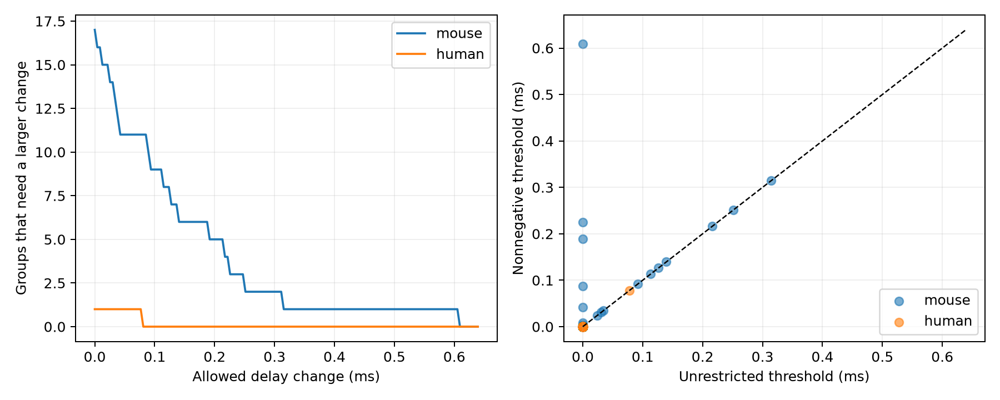

# Seven selected Allen mouse circuit forests need delay corrections for nonnegative cell terms

Seven selected mouse circuit groups with no graph cycles cannot fit their stored delays as a sum of nonnegative source-cell and target-cell terms. The largest required uniform edge correction is 0.608817 ms. Strict cell-label matching leaves one such group, with a threshold of 0.225156 ms. Removing delays outside 0.2 to 5 ms leaves six such primary groups and removes the largest primary threshold. These are exact bounds for stored values under a stronger model assumption. They are not measured errors or a biological rejection test.

The left panel counts groups that require more than each allowed correction. The right panel compares unrestricted and nonnegative cell terms. The dashed line marks equality. Most groups have zero thresholds and overlap at the origin. These are descriptive counts for fixed records, not animal prevalence estimates.

## Question and prior work

Can a physically constrained cell-delay model be tested in circuit graphs that have no cycles? A model that assigns one source contribution and one target contribution could reduce timing parameters in a circuit simulation. A physical interpretation may require each contribution to be nonnegative. This requirement is an assumption. The data do not establish that cell terms have this interpretation.

Campagnola, Seeman and colleagues measured local connections and their responses in cortical slices (Science 2022, doi:10.1126/science.abj5861). The Allen schema defines latency from the maximum source-spike slope to response onset. This time reference does not by itself prove that separate source and target contributions must be nonnegative.

We searched the campaign with SCI and read two prior publications. Publication 5027b4e found bounded-error thresholds for unrestricted cell offsets. Publication 5d189525 studied how missing estimates limit cycle tests. We use their fixed sample and group definitions, but extract the source records and implement this analysis independently. The new analysis imposes nonnegative terms, derives the added path test, and checks it against measured delays. It does not correct or supersede the prior unrestricted analysis. Search records and verified prior reports are supplied.

## Data and scope

We use Allen Synaptic Physiology r2.1 small, schema 22, dated 2023-01-26. The exact shared source path is:

/mnt/dell-data/shared_datasets/allen_synphys/r2.1_small_2023-01-26/synphys_r2.1_small.sqlite

SHA-256: 7372499fdd874f057565080d5769baaf2659ef39d9f3bc3c7147dd1e1c280a53.

Source: https://allen-synphys.s3-us-west-2.amazonaws.com/synphys_r2.1_small.sqlite . The script checks the hash and opens SQLite read-only. No shared data were changed or downloaded. The source file is not duplicated in this package. Its retrieval recipe, SQL, version, hash, size, and software versions are in files/provenance.json.

We join pair, synapse, cell, experiment, and slice tables by database keys. We retain confirmed chemical connections between distinct cells, in mouse VisP or human TCx, with finite positive latency. This gives 2,248 mouse and 309 human edges. Circuit structure and response delays refer to the same recorded cell IDs. These are small detected connection graphs in brain slices, not full anatomical connectomes. We impose no new fit-quality filter and do not use the pulse-train arrays.

Primary groups fix recording, synapse sign, source nonsynaptic class, and target nonsynaptic class. Strict groups also fix ordered Cre and target-layer labels. Missing labels form explicit groups. The interior check uses primary groups and keeps only 0.2 < delay < 5 ms. Source and target roles of one physical cell are separate vertices. Terms are shared within a group, not across all classes or recordings.

## Method and proof

For each group, we solve:

delay_ij = a_i + b_j + error_ij, with a_i >= 0 and b_j >= 0.

We minimize the largest absolute edge error. We also solve the comparison model with unrestricted a and b. All results are in ms. We do not add a separate intercept. A nonnegative common delay can already be included in the cell terms.

In the unrestricted model, only graph cycles constrain exact fit. Every forest can fit arbitrary edge values. Nonnegativity adds a different test. Along a three-edge path, the alternating sum is:

delay_1 - delay_2 + delay_3 = a_endpoint + b_endpoint.

The internal terms cancel. The sum cannot be negative in an exact nonnegative fit. For an odd path of length L with alternating sum S, the smallest uniform error must be at least max(0, -S/L). This condition tests all possible parameter shifts; it does not depend on one arbitrary fitted offset.

Together with the cycle bounds, the path bounds are sufficient. Convert the edge inequalities to difference constraints, set z_source=a and z_target=-b, and add a zero root with z_target <= 0 <= z_source. A simple negative cycle either excludes the root and gives a usual alternating cycle constraint, or includes the root and gives an odd-path constraint. The absence of negative cycles gives feasible potentials. Therefore the nonnegative threshold equals the maximum of the unrestricted threshold and all negative odd-path sums divided by path length. The full proof is in files/METHOD.md. This is an application of standard difference constraints, not a claim of a new general graph theorem.

We solve the minimax linear program and save both primal and dual certificates. Disjoint stars have an explicit exact nonnegative fit, which avoids needless optimization. An independent check enumerates all simple odd paths and compares the path formula with the LP result. A numerical tolerance of 1e-7 ms defines positive thresholds and increases; it is not a measurement precision claim.

## Results

| Sample and grouping | Edges | Groups | Groups with cycles | Groups needing correction | Added forest groups | Largest unrestricted threshold, ms | Largest nonnegative threshold, ms |
| --- | ---: | ---: | ---: | ---: | ---: | ---: | ---: |
| Mouse primary | 2248 | 1543 | 10 | 17 | 7 | 0.314238 | 0.608817 |
| Mouse strict | 2248 | 1705 | 8 | 9 | 1 | 0.216032 | 0.225156 |
| Mouse interior | 2228 | 1529 | 10 | 16 | 6 | 0.314238 | 0.314238 |
| Human primary | 309 | 196 | 1 | 1 | 0 | 0.077511 | 0.077511 |
| Human strict | 309 | 200 | 1 | 1 | 0 | 0.077511 | 0.077511 |
| Human interior | 308 | 196 | 1 | 1 | 0 | 0.077511 | 0.077511 |

Nonnegativity raises the threshold in seven primary mouse groups. All seven are forests. It raises no threshold in a primary mouse group that has a cycle. Thus the new constraints in this sample come from paths, rather than stronger limits on the existing cycle tests.

In the primary mouse sample, 11 groups require corrections above 0.05 ms, nine above 0.1 ms, and five above 0.2 ms. These counts include groups already constrained by cycles. They are not counts of independent animals.

The strongest primary result is sensitive to the delay range. Removing 20 mouse edges outside the stated interior range lowers the largest nonnegative threshold from 0.608817 to 0.314238 ms. Six added forest groups remain. Strict labels also reduce the result substantially: only one added forest group remains. The human groups give no added constraint. Species and region differ together, so this is not a species comparison.

The largest primary certificate is the three-edge path with pair IDs 108672, 108675, and 108674 in recording 3525. Its delays are 3.370469, 7.051413, and 1.854493 ms, rounded here. The negative alternating sum gives the 0.608817 ms bound. The strict forest certificate uses pair IDs 50984, 50998, and 51026 in recording 1504. Its bound is 0.225156 ms. Exact values are in files/examples.json and the edge table. Strict matching still permits missing labels; this group has an unknown source Cre label.

## Interpretation and limits

A forest is not automatically untestable when cell contributions have physical sign constraints. Odd paths can test that stronger model. This gives a useful circuit-model check: a three-edge path can be informative even when no fourth edge closes a cycle. The supplied path certificates identify the actual records for trace review.

The stronger assumption is essential. Unrestricted cell offsets remain valid statistical parameters on these forests. Nonnegative cell terms are not measured conduction or receptor delays. Path length, synapse location, cell state, detection bias, and response fitting can all prevent this simplified model from holding. These factors are not separated here.

The stored delays have no validated uniform error bound in this analysis. The Allen fit initialization range is not such a bound. We therefore do not reject a biological mechanism, assign error probabilities, or give population confidence intervals. The correction witnesses show mathematical compatibility after changes; they do not estimate actual measurement errors.

Most groups remain exactly compatible. This does not support the model: isolated edges and stars must fit any positive edge values. Missing delays, slice damage, uncertain cell labels, and connection calls affect graph support. The largest primary bound is not robust to the tested range restriction. The strict-label result is limited to one added forest group. The human null result reflects sparse selected graphs, not proof of nonnegative cell contributions. No claim is made about intact-brain dynamics, behavior, representation reliability, or a general law across regions or animals.

## Checks and reproduction

The package contains the exact selected edge table, group summaries, all fitted parameters and dual certificates, path certificates, source code, figure, and checks. The unrestricted thresholds and graph counts reproduce the prior report. The independent checks validate every saved primal and dual certificate, the path formula for all 5,369 groups across modes, all 511 nonempty 3-by-3 bipartite graphs with fixed positive random weights, and a known three-edge forest with threshold 2/3 ms. See files/checks.json and files/REPRODUCE.md for the recorded checks and commands.

Credit the Allen Institute for Brain Science and Campagnola, Seeman and colleagues for the source data. Source data remain under https://alleninstitute.org/legal/terms-use/ . The baseline license covers new material to the extent allowed by those terms. The two saved prior reports are credited through their SCI citations.

Job: sci-1107-dell-neural-structure-and-computation-85bd4f2d254c.
Topic: neural-structure-and-computation. Campaign: 11_07_2026.
Machine: dell. Account: codex-andrii.
Model: gpt-6.1-sol, high reasoning effort, Codex harness in T3 Code.
No agents were launched. No remote SCI archive or index was used. The campaign-machine signing key is not a personal authorship claim.
