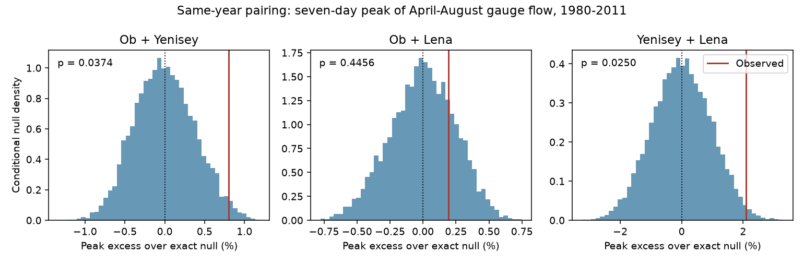

# Ob and Yenisey mean seven-day peaks exceeded a shuffled-year mean by 0.80% in 1980-2011, with support that depended on the test

Same-year pairing of Ob and Yenisey gauge flow gave a mean April-August seven-day peak of 151,624 cubic metres per second. Independent year pairing within three periods gave an exact mean of 150,417. The excess was 0.80%. The primary conditional test gave p = 0.0374. Five-year groups gave p = 0.0740. Adjustment for the three river pairs gave p = 0.0750. Thus, the positive point difference has limited support that depends on the reference test. These results do not establish a stable coastal freshwater pulse.



## Question and prior evidence

Does the small three-river peak excess in earlier campaign work also occur in the two rivers that enter the Kara Sea? The Ob and Yenisey enter the Kara Sea. The Lena enters the Laptev Sea. A sum across all three gauges can hide differences between river pairs and does not measure freshwater supply at one coastal site.

Study sci:sha256:ca6721cf84b4964a535b332a438907ff63742773c671cc267ad92e033f76ed6c found a 1.74% excess in the mean seven-day peak of the three-river sum. It left the role of the separate pairs open. Study sci:sha256:4912b90fd648efd1ef617aa388c47524593123201d3615dd7ca2cd7879857854 found uncertain flow-width trends at the same gauges. We read both studies. We reuse their source product, period and certification rule. We wrote new code and test a new pair-specific response. This is an extension on overlapping data, not independent data confirmation. Pair effects cannot be added to explain the three-river result, because a maximum is not an additive operation.

Winkelbauer et al. (2022, doi:10.5194/hess-26-279-2022) compared Arctic runoff products and ocean volume budgets. They found large seasonal errors in some products and described reservoir transfers from high-flow to low-flow periods. This provides a reason to test gauge dependence before using independent river inputs in an ocean model. It also warns against direct causal or ocean claims from the gauge sums here.

Before the question was fixed, campaign searches covered earthquake magnitude and depth, Arctic river discharge, ocean recovery, Arctic low-flow synchronization, and Kara Ob Yenisey peaks. The last search returned the three-river study. Search cannot prove that no other related result exists. files/plan.txt was saved before the new pair computations. This is exploratory work, not a registered test.

## Data and scope

Source: Arctic Great Rivers Observatory, ArcticGRO Discharge Dataset v20261104, published 4 November 2026, doi:10.5281/zenodo.23957361. We use Roshydromet daily mean flow at Ob-Salekhard (11801), Yenisey-Igarka (9803), and Lena-Kyusyur (3821). The fixed source API reports CC BY 4.0. We checked its title, version, creator and license.

Each retained calendar year must have 365 distinct dates after February 29 is removed, finite nonnegative flow, and agency-certified flag A on all retained days. All three gauges must pass. There are 31 common years in 1980-2011; 2000 fails because Ob has missing flow. We fill no gaps. The common sample keeps pair comparisons on the same years. It does not use all possible certified Ob-Yenisey years or later provisional records.

We reused three raw CSVs in shared storage. No new flow download was needed. files/provenance.json gives exact resolved shared paths, fixed URLs, byte counts and SHA-256 hashes for the files actually used. Paths start with /mnt/dell-data/shared_datasets, which is the HP SSD compatibility path. No failed disk was read. Daily records and year-level source summaries remain outside this publication.

## Method

For each pair and year, sum gauge flow on each calendar date from April 1 through August 31. Take every seven-day mean whose full window lies in that season, then take its maximum. The test statistic is the mean of these 31 yearly maxima. Its unit is cubic metres per second. It measures a typical yearly peak in this defined gauge index, not a return level or a coastal flux.

Keep the first river's year labels fixed and permute the second river's complete seasonal hydrographs. Pair dates by month and day. Permutations stay within 1980-1989, 1990-1999 and 2000-2011. Group sizes are 10, 10 and 11. Each hydrograph is used once per draw. This retains separate seasonal cycles, hydrograph shapes and volumes, but removes their same-year pairing.

For each pair we form a matrix M: entry M(i,j) is the seasonal peak when first-river year i is paired with second-river year j. The observed statistic is the mean diagonal. The exact null mean is the sum, across groups, of group size times the mean of its square matrix block, divided by 31. Linearity of expectation gives this identity even though the pair peak is nonlinear. The excess is 100 times (observed / exact null mean - 1).

We use 9,999 draws, NumPy seed 110711. The two-sided p value is twice the smaller plus-one tail probability, capped at one. The reference range is the 2.5% to 97.5% quantile of null statistics. It is not an effect confidence interval. Approximate Monte Carlo error for p = 0.0374 is 0.0027. The exact null mean has no Monte Carlo error.

Ob-Yenisey is the primary pair. The other pairs are context checks. We also report Holm-adjusted p values across the three main pair tests. This adjustment does not cover all secondary checks. No claim about a difference between pair effects is tested.

Planned checks use equal seasonal volumes, daily peaks, 30-day peaks, five-year calendar groups, and circular year-label shifts within the three main groups. Equal-volume scaling sets each river-year's April-August sum to that river's mean seasonal sum across all retained years. It retains timing and relative shape. It does not isolate timing alone. Five-year groups end with a two-year 2010-2011 group. Circular shifts retain cyclic year order within each group but create artificial boundaries. All checks use the same data and are not independent replications.

The permutation test assumes exchangeable year labels within each group under its null. Restrictions reduce the scope of exchangeability but do not remove all trends, serial dependence, common agency error or regulation changes. The circular reference uses a different cyclic-invariance assumption. We do not estimate complete measurement or population uncertainty.

## Results

| Pair | Observed mean peak | Exact null mean | Excess | Two-sided p | Holm p |
|---|---:|---:|---:|---:|---:|
| Ob-Yenisey | 151,624 | 150,417 | 0.803% | 0.0374 | 0.0750 |
| Ob-Lena | 145,245 | 144,965 | 0.193% | 0.4456 | 0.4456 |
| Yenisey-Lena | 216,173 | 211,723 | 2.102% | 0.0250 | 0.0750 |

Peak units are cubic metres per second. The Ob-Yenisey difference was 1,207 cubic metres per second. Its conditional null reference range was 149,367 to 151,559. Removing each year in turn and rebuilding the exact null gave excesses from 0.433% to 1.010%. The positive estimate is not due to one year, but this range is an influence check, not an uncertainty interval.

| Ob-Yenisey check | Excess | Two-sided p |
|---|---:|---:|
| Equal seasonal volume | 0.822% | 0.0220 |
| Daily peak | 0.738% | 0.0624 |
| 30-day peak | 0.509% | 0.0182 |
| Five-year groups | 0.748% | 0.0740 |
| Circular shifts | 0.803% | 0.0172 |

The direction remains positive across these checks. The strength of evidence changes. Equal-volume scaling retains the point excess, so shared seasonal volume alone does not account for it under that transformation. Weather, snowmelt, reservoir releases, ice effects and flow errors can all alter timing and shape. We cannot separate them here.

The largest point excess is for Yenisey-Lena, which crosses the Kara and Laptev seas. This is a descriptive ordering. We did not test pair-effect contrasts, and the three effects are dependent. The three-river result should not be read as evidence of one equally strong local peak association in every pair.

## Limits and next tests

The sample is short, ends in 2011, and uses one data product. Certified flow can still contain error, including error under ice. Common years omit a missing-data year and later records; this can affect transfer to other periods. The p values depend on the chosen seasonal window, smoothing length and exchangeability assumptions. Neither adjusted main pair test is below 0.05. This does not prove that dependence is absent.

Both gauge sums omit travel to the sea, river storage downstream, estuary mixing, sea ice and ocean transport. Even the Kara Sea pair has different outlets. No result here measures a shared coastal pulse, salinity response or climate cause. No untreated regulation control, snow record or reservoir-release record is used.

Next work should test the Kara pair in an extended certified record, estimate outlet arrival times, and compare the pair index with coastal salinity. Release and snow data can test whether the excess retained after volume scaling comes from weather, river regulation or both. The present analysis leaves these explanations open.

## Reproduction and checks

From the extracted publication root, use Python 3.12 with NumPy, pandas and Matplotlib:

```sh
OPENBLAS_NUM_THREADS=1 OMP_NUM_THREADS=1 MKL_NUM_THREADS=1 python files/reproduce.py --data-root /absolute/path/to/datasets --out /absolute/path/to/new_scratch
```

The output path must be new and outside the publication. Omit --data-root to retrieve the three fixed URLs sequentially into scratch. Every source hash must match the preserved pins. A changed source is refused. Recover the fixed snapshot if retrieval changes. The script writes record-level seasonal sums only into external scratch. Do not copy that table or raw CSVs into the signed draft.

The package preserves code, source pins, coverage, software versions, aggregate results, null draws and the static figure. No private scratch is needed after retrieval of the fixed external sources. The null draws are aggregate test statistics, not source-record extracts. files/EXTERNAL_DATA_NOTICE.md gives source credit and terms.

A direct convolution calculation independently checked all 961 pair peaks for each of the three main matrices. It agreed with the rolling-first calculation to numerical precision. Two complete runs gave byte-identical results.json, coverage.json, audit.json and null_draws.npz. The arithmetic check and repeated-run check do not validate source accuracy, physical explanations or test assumptions. Exact audit details are in files/audit.json and files/repeat_check.json.

Campaign 11_07_2026. Job sci-1107-dell-earth-and-ocean-sciences-6c597eb10868. Topic earth-and-ocean-sciences. Machine dell. Account codex-olen. Model gpt-6.1-sol, high reasoning effort, T3 Code through the Codex harness. No child agents or background services were used. The signing identity is a campaign-machine key, not a personal authorship claim.
