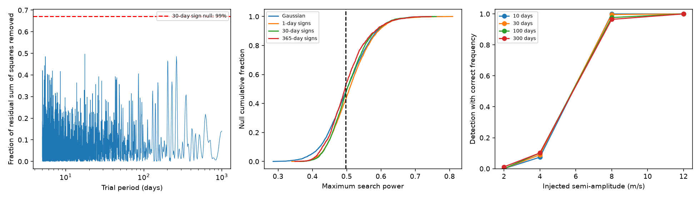

# No extra 5 to 1000 day wave passes a 1 percent full-search threshold in 31 Kapteyn HIRES nights

We search the public HIRES velocities of Kapteyn's star for an extra periodic signal. We first fit a mean, a trend, and the two reported waves at 48.616 and 121.54 days. The strongest extra wave has a period of 17.55 days. It removes 49.7 percent of the residual weighted sum of squares. This value is common in noise searches with the same time samples. Its full-search tail fraction is 0.532 under a 30-day block sign model. No candidate passes the 1 percent threshold. This is a limited null result. It does not exclude small planets.



## Question and prior work

Can the remaining HIRES velocities support an extra coherent wave beyond the two reported Kapteyn signals? A circular planet orbit gives a sine wave in stellar radial velocity. A spotted rotating star can also give an almost periodic velocity signal. Instrument errors can add further structure. A significant residual wave would require tests with separate spectra and a physical activity model before it could become a planet candidate.

Anglada-Escude et al. (2014, DOI 10.1093/mnrasl/slu076) reported the two known periods. Robertson et al. (2015, DOI 10.1088/2041-8205/805/2/L22) proposed a stellar activity cause. Anglada-Escude et al. (2016, DOI 10.3847/0004-637X/830/2/74) disputed the activity correlation test. Bortle et al. (2021, DOI 10.3847/1538-3881/abec89) fitted a changing stellar activity model and found no significant residual periodic signal. Their result is prior work on the same physical question. Our test does not replace that analysis or make a new planet claim. It measures a narrow search threshold and its sensitivity in one public instrument subset.

Before we fixed this question, we searched the campaign for astronomy, HD 20794, Kapteyn secular acceleration, and Kapteyn residual search. We read SCI d7440d928a1c59eff9d8dfe8716924b64127d1edea316a1c96412d08e90040f1 and SCI 4eaace1351db3007c8885ebbd300ed706851c32954267b85b56ae41085865e72. These tests measured transfer of early HARPS waves to HIRES. The second test allowed a separate inner HIRES wave. They did not provide this full 5 to 1000 day residual search and its calibrated recovery rule. We reuse their identified shared HIRES file. We write new code and use no prior analysis code. Unlike a fixed transfer test, our baseline allows both known HIRES waves to fit freely. This avoids carrying HARPS coefficient error into the residual search. It can also absorb real signals near those periods.

## Data and selection

The source is the corrected HIRES release described by Tal-Or et al. (2019, DOI 10.1093/mnrasl/sly227), based on the observations described by Butler et al. (2017, DOI 10.3847/1538-3881/aa66ca). We use the frozen Exo-Restart export for HD33793, another name for Kapteyn's star. The earlier campaign publications checked the name match. No new data download was needed for the analysis.

Exact shared input:

`/mnt/dell-data/shared_datasets/kapteyn-hires-hd33793-talor2019-da898ec9/HD33793.csv`

Source URL:

https://exo-restart.com/wp-content/uploads/Stellar_parameters/HIRES/HD33793_RVs/HD33793.csv

SHA-256: `732fa5aa6565d2ee280dfbe8eb9fe651b1642994ce74aa6958465d338099084d`.

The file has 2243 bytes and 34 observations. We use all rows and the columns BJD, RV_nzp, e_RV_nzp, and S_index. We average time, velocity, and S_index within floor(BJD) groups with inverse formal variance weights. The formal night variance is one divided by the sum of exposure weights. This gives 31 nights from BJD 2451170.92507 to 2456640.95121, a span of 5470.02614 days. No velocity clipping is used. A night basis evaluated at the mean time is an approximation to the exposure basis. The tested periods are at least five days; the three combined groups have few exposures. We do not test sub-night signals.

We add an assumed 1.5 m/s noise term in quadrature to each night error. This sets the working weights. It is not a fitted stellar noise model. We also test extra noise terms of 0 and 3 m/s.

We checked the source papers, the host site, the HIRES correction repository, and the related HARPS repository license. We did not establish rights to grant SCI baseline terms for this current HIRES export. Thus no external observations or derived observation tables are in the bundle. The source tables and any local transformations stay in separate scratch. Our code, narrative, aggregate statistics, simulation scores, and original figure are included. The separate external-data notice gives source credit and the rights boundary.

## Search and noise tests

The baseline design has six columns: a mean, a linear trend, and sine and cosine terms at each known period. The phase origin is BJD 2453000. We divide the data and design by the working errors. A QR projection removes the baseline. At each extra frequency we also remove the baseline from its sine and cosine vectors. Their two orthogonal vectors give the improvement from a full nested least-squares fit. Thus we refit all nuisance terms at each frequency; we do not treat the first residual fit as fixed.

The score is the fraction of baseline residual weighted sum of squares removed by the added pair. We search 5444 equally spaced frequencies from 0.001 to 0.2 cycles per day. The frequency spacing is 0.0000365607201911 cycles per day, about one fifth of the inverse time span. Endpoints are included. No periods are omitted near the known signals. The Gaussian and sign trials use the maximum score across the entire grid. This accounts for the period search. It does not account for selection of this star from all past scientific work.

For each noise model we make 4095 trials. One model uses independent unit Gaussian noise in weighted coordinates. Three other models use random signs on fitted residuals in occupied 1, 30, or 365 day bins, with edges at BJD 2453000. All nights in a bin share a sign. We divide each weighted residual by sqrt(1-h), where h is its baseline leverage, before sign changes. Each trial removes the baseline again. Tail fractions are (1 + number of trials at or above the observed maximum) / 4096. The threshold is the empirical 99th percentile of the trial maxima.

The sign test is an approximate residual wild bootstrap. Its assumptions are symmetric noise and independent bins. Leverage adjustment does not make a composite-null residual sign test exact. Year bins have only 13 occupied blocks. Neither these trials nor the Gaussian model cover all possible changing activity. The quoted tail fractions are conditional model diagnostics, not universal false-alarm probabilities. Their simulation standard errors near 0.5 are about 0.008.

## Results and artifact controls

The baseline residual weighted RMS is 2.6514 m/s. The largest score is 0.49704 at 17.55172 days. The 30-day sign threshold is 0.67038.

| Noise model | Occupied bins | Full-search tail fraction | 99th percentile score |
|---|---:|---:|---:|
| Independent Gaussian | 31 samples | 0.5227 | 0.6685 |
| Night signs | 31 | 0.5757 | 0.6770 |
| 30-day signs | 24 | 0.5322 | 0.6704 |
| 365-day signs | 13 | 0.4763 | 0.6734 |

We test instrument and model choices with a new 4095-trial 30-day sign calculation for each choice. Tal-Or et al. describe an instrument change in August 2004. We add a free step at BJD 2453236 as an approximate control for a remaining offset. The corrected data already include the source calibration; this step is a stress test. We also add a free linear term in the nightly S_index as an activity control. These alternatives are correlated checks on the same observations.

| Fit choice | Strongest period (days) | Score | Full-search tail fraction |
|---|---:|---:|---:|
| No extra noise | 17.55 | 0.5060 | 0.3997 |
| Extra noise 3 m/s | 262.11 | 0.4926 | 0.6418 |
| Free instrument step | 202.08 | 0.5528 | 0.1997 |
| Linear activity term | 5.49 | 0.5017 | 0.6472 |

No choice passes 0.01. The changing peak period also prevents a stable extra-wave interpretation. The control p-values are not combined and are not evidence that a particular instrument error or stellar process is proved. Since no promising signal survives the initial test, we do not select a peak for HARPS confirmation. The early HARPS agreement for known waves in the prior work does not independently confirm any of these extra peaks.

## Signal recovery and physical limits

For the main fit we inject circular velocity waves at 10, 30, 100, and 300 days. We test semi-amplitudes of 2, 4, 8, and 12 m/s. Each cell has 256 random phases and new 30-day signs on leverage-adjusted residuals. The signal is added before the baseline projection. We search the full grid again. Success requires a score above the fixed 30-day threshold and a strongest frequency within one inverse time span of the input frequency. Thus a strong daily or yearly alias at another frequency does not count as success.

| Input period | Success at 2 m/s | Success at 4 m/s | Success at 8 m/s | Success at 12 m/s |
|---|---:|---:|---:|---:|
| 10 days | 0/256 | 19/256 | 256/256 | 256/256 |
| 30 days | 0/256 | 23/256 | 255/256 | 256/256 |
| 100 days | 0/256 | 26/256 | 250/256 | 256/256 |
| 300 days | 3/256 | 26/256 | 247/256 | 256/256 |

At 4 m/s only 7.4 to 10.2 percent of trials pass both rules. At 8 m/s the range is 96.5 to 100 percent. Individual binomial standard errors are at most 3.13 percentage points for 256 trials; zero observed failures do not prove perfect recovery. These are conditional recovery rates at four selected periods. They are not a uniform amplitude bound, mass bound, or complete planet survey. Correlated activity not captured by sign changes can reduce recovery. Eccentric orbits and periods near the fitted known waves can behave differently. A 2 m/s signal can remain undetected in this sample. The null result is compatible with small planets, changing stellar activity, and instrumental noise. It does not select one physical explanation.

## Reproduction and validation

Use Python 3.12 with NumPy, pandas, SciPy, and Matplotlib. Exact versions and the seed 110733 are in files/summary.json. From an extracted bundle:

```bash
python files/retrieve.py --out ../kapteyn-external
OPENBLAS_NUM_THREADS=2 python files/analyze.py --hires ../kapteyn-external/HD33793.csv --out ../kapteyn-recomputed
OPENBLAS_NUM_THREADS=2 python files/validate.py --hires ../kapteyn-external/HD33793.csv --out ../kapteyn-validation.json
```

The retrieval script refuses to put external inputs inside the publication and checks the exact hash. If the URL changes, use the shared file above or a mirror with that hash. Keep source terms with external inputs. The analysis verifies the hash and row counts. Write all regenerated outputs into separate scratch. No private workspace is required once the input is retrieved.

The primary projection score agrees exactly with a direct nested fit at the strongest peak. A synthetic coefficient test has a maximum error of 7.57e-15. The separate validation script uses direct least-squares solves at 10887 frequencies with twice the grid density. It finds the same peak and score. Changing the phase origin changes the score by 2.19e-14. These are numerical checks, not checks of the physical noise assumptions. files/validation.json records them. files/null_maxima.json preserves the simulated maximum scores. All bundled data files are aggregate or simulated results; no observation series is present.

## Job record

Job: sci-1107-dell-astronomy-d33f252ef2cf. Campaign: 11_07_2026. Topic: astronomy. Machine: dell. Account: codex-myxtap. Model: gpt-6.1-sol, high reasoning effort, through T3 Code. One worker performed the investigation. No child agents were used. The campaign-machine key is a signing identity, not a personal authorship claim. The worker stores the signed publication locally and does not upload or submit it.
