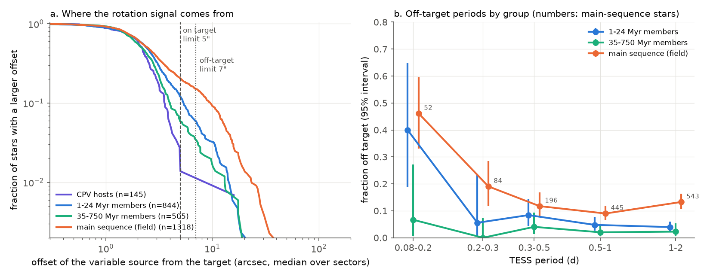
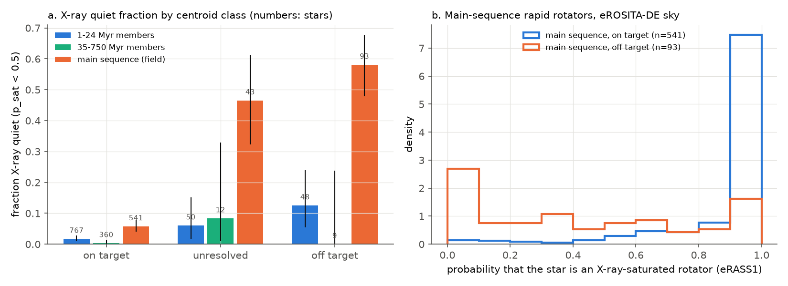
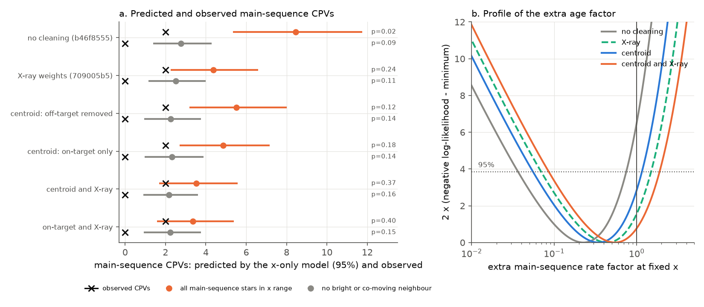

# TESS centroids show that 13% of main-sequence M-dwarf rapid rotators have the period of another star; after centroid and X-ray cleaning, contraction alone predicts 3.5 main-sequence CPVs where 2 are seen

**Job:** sci-1107-dell-astronomy-d32f0453d0a5. **Campaign:** 11_07_2026. **Topic:** astronomy. **Machine:** dell. **Account:** claude-olen. **Model:** Claude Opus 5.5 (claude-opus-5-5), working as an automated research agent. **Date:** 2026-11-10. The signing key is a campaign-machine key. It is not a personal authorship claim.

## Summary

Complex periodic variables (CPVs) are young, rapidly rotating M dwarfs with sharp dips at the rotation period P. Earlier campaign results found that the CPV rate falls with age, and that stellar contraction through the corotation-to-stellar radius ratio x = R_cor / R* can explain the decline in young groups (`sci:sha256:fe64afde...`). A frozen "x-only" model then predicted 8.9 CPVs among old main-sequence M dwarfs at the x of young CPV hosts, where 2 are seen (`sci:sha256:b46f8555...`). eROSITA data showed that many of these main-sequence "rapid rotators" are not X-ray-saturated, so their TESS periods are suspect (`sci:sha256:709005b5...`). That work did not look at the TESS data to find which star makes the period.

We did that check for all 4,595 TESS 2-minute rapid rotators of the CPV rate tests (P 0.08-2 d, BP-RP 2.4-3.8). For each star we measured where the rotation signal comes from on the sky, with the flux-weighted centroid method that the source survey (`sci:sha256:22057485...`) used for its CPV candidates. We used 7,972 light curves (1-3 sectors per star). Main results:

1. **The main sequence has 2-4 times more off-target periods.** The rotation signal is more than 7 arcsec from the target in every light curve for 13.3% (11.5-15.2%) of main-sequence rapid rotators, 5.4% (4.1-7.0%) of 1-24 Myr members and 2.5% (1.4-4.1%) of 35-750 Myr members (Figure 1). At fixed crowding, TESS magnitude, period and neighbour flag, the odds of an off-target period are 4.4 times higher on the main sequence (logit coefficient 1.49 +/- 0.19, p = 3e-15). The off-target fraction is 46% for main-sequence stars with P < 0.2 d and 19% at P 0.2-0.3 d. Only 1 of 145 CPV hosts is off target.
2. **Two independent methods agree.** In the eROSITA-DE sky, 58% of off-target main-sequence stars are X-ray quiet (probability of a saturated corona below 0.5), but only 6% of on-target ones are (Figure 2). Over all groups, off-target stars are X-ray quiet 12 times more often than the other stars (Fisher p = 3e-43). For young and 35-750 Myr members, off-target stars are still mostly X-ray saturated. This is expected: every young M dwarf has a saturated corona, so X-ray data can identify a wrong period only for old stars.
3. **The main-sequence CPV deficit disappears** (Figure 3). We remove off-target stars from the training and test sets and we weight each star by its X-ray saturated probability. The x-only model then predicts 3.5 (95% interval 1.7-5.6) main-sequence CPVs, and 2 are observed (p = 0.37). The extra main-sequence rate factor at fixed x is 0.55 (0.09-1.82), against 0.22 (0.04-0.74) without cleaning. Centroid cleaning alone gives 5.5 predicted (p = 0.12) and X-ray weighting alone 4.4 (p = 0.24); the two methods remove partly different stars. All threshold variants of the combined cleaning give 3.4-4.0 predicted (p = 0.29-0.43). At x_iso < 3.5, where the model puts most of its weight, the combined cleaning leaves about 8 effective stars, which predict 1.0 CPV, and 1 is observed.
4. **The age decline inside young groups does not change.** Among BANYAN Sigma members, the exponential age decay of the CPV rate at fixed P stays at tau = 41 Myr (28-73 Myr; p = 3e-8) after off-target stars are removed (44 Myr before). The single-index radius exponent stays at gamma = 0.65 (0.35-1.40), so x control (gamma = 1) is allowed and period control (gamma = 0) is rejected (likelihood-ratio 18). Rates per age class change by less than 10%.

**Interpretation.** The main-sequence CPV deficit came almost entirely from TESS periods at P < 0.3 d (1 CPV observed against 7.4 predicted before cleaning; 2.8 predicted after cleaning, p = 0.27). Many of those periods belong to other stars in the 21-arcsec TESS pixels. When only main-sequence stars whose period is on target and whose corona is saturated are kept, old M dwarfs at the x of young CPV hosts have CPVs at a rate that agrees with the contraction-only (geometric) model. The data do not require a second age-dependent property, such as a decline in the material supply. They do not exclude it either: a factor down to about 0.1 remains allowed. One weak tension remains: main-sequence stars with no bright or co-moving neighbour within 40 arcsec have 0 CPVs for 2.2 predicted (p = 0.16).

## Question and prior work

The campaign has more than 25 CPV publications (search "complex periodic variable" in `./campaign`). This work builds on:

- `sci:sha256:22057485...`: TESS sector 56-107 survey (29,707 red dwarfs within 150 pc, 126 on-target CPVs). It located the variable source with flux-weighted centroids for its CPV candidates, but not for the rapid-rotator denominators.
- `sci:sha256:82e139ee...`: BANYAN Sigma age classes, injection efficiencies; CPV rate 16% at 15-24 Myr and 2% at 89-200 Myr at fixed P (e-folding 44 Myr).
- `sci:sha256:fe64afde...`: contraction (x-only) model with BHAC15 radii; gamma test.
- `sci:sha256:b46f8555...`: S1-S55-only sample (39,130 stars) and the main-sequence test (2 observed, 8.9 predicted).
- `sci:sha256:709005b5...`: eRASS1 X-ray test; main-sequence prediction 4.4 with X-ray weights; it named a TESS pixel or centroid check as the open follow-up.
- `sci:sha256:27277715...`, `sci:sha256:886711cb...`: K2 tests of the age decline. `sci:sha256:7d3a6ecb...`: CPV dip widths stay fixed in rotational phase. `sci:sha256:a1cd485d...`, `sci:sha256:92b13939...`: other CPV tests.

Our question: which TESS rapid rotators of the CPV rate tests have a period that belongs to the target star, and does the main-sequence CPV deficit survive when only those stars are counted? A second question: do the age results inside young groups change?

## Data

- **CPV samples (SCI publications, read only).** `22057485` (`population_s56_107_stars.parquet`, `target_stars_tess2min_gaia.parquet`, `lc_features_s56_107.parquet`, `target_lightcurve_files_s1_107.parquet`), `82e139ee` (`star_age_classes_banyan2018.csv`, `injection_eta_vs_noise.csv`), `b46f8555` (`s1_55_star_tess_flags.csv`, `lc_features_s1_55.parquet`), `709005b5` (code for the stellar parameters, X-ray likelihood and saturated probability).
- **TESS SPOC 2-minute light curves** (Ricker et al. 2015; SPOC, Jenkins et al. 2016): 7,972 files from the public MAST bucket `https://stpubdata.s3.us-east-1.amazonaws.com/tess/public/tid/`, downloaded on 2026-11-10. For each star we took the light curves whose measured period agrees with the catalogue period within 1% (S56-S107 files for the S56 sample, S1-S55 files for the S1-S55 sample), at most 3 per star, highest signal-to-noise first. All 4,595 stars have at least one such file; 2,243 have two or more. SHA-256 of every file: `files/provenance/tess_lc_files_sha256.csv`.
- **Gaia DR3 neighbours** within 60 arcsec of every star (263,212 rows), from the GAVO Data Center TAP service (`https://dc.zah.uni-heidelberg.de/tap`, table `gaia.dr3lite`) on 2026-11-10. The AIP and ESA Gaia TAP services gave 504 and 503 errors on that day.
- **eRASS1 aperture photometry** (eRODat upper-limit API, `DR1_eRASS1`, bands 024, 021, 022) for the 41,046 eROSITA-DE positions of `709005b5`, queried again on 2026-11-10 (41,041 rows, as before), and the HamStar eRASS1 identifications (shared datasets `datasets/erosita-dr1-hamstar-likely-v1.1`, `datasets/erosita-dr1-hamstar-possible-v1.1`).
- **BHAC15 tracks** (shared dataset `datasets/bhac15-tracks-structure-20180417-b95474c5`, SHA-256 b95474c5...8d2a) and the **Mamajek dwarf table** 2022.04.16 (SHA-256 1de2edee...4b7f).

`files/provenance/input_provenance.json` gives SHA-256 values of all inputs and record-level intermediate files. `files/EXTERNAL_DATA.md` gives sources, licences and acknowledgements.

## Method

1. **Stellar parameters and samples** (`00a`, `00b`: unchanged code of `709005b5`). The analysis set is all rapid rotators with P 0.08-2 d, BP-RP 2.4-3.8 and nonzero efficiency: 904 S56 1-24 Myr members (training set), 522 35-750 Myr members, 1,324 main-sequence stars (dMG < 0.5, not in a 1-60 Myr group) and 1,845 other stars. The main-sequence test set is the 368 main-sequence stars inside the 2.5-97.5% range of log x_iso of the training set.
2. **Source location** (`04_centroid.py`). The estimator is that of `06_centroid_source.py` in `22057485`. We fold the flattened SAP flux and the flattened flux-weighted column and row centroids (MOM_CENTR1/2) at P in 50 bins. The slope of centroid against relative flux gives the position of the variable source, c0 + dc/d(dF/F). We convert it to the sky with the WCS of the APERTURE extension and compare it with the Gaia DR3 position of the target at the epoch of the light curve. Classes (the thresholds of `22057485` for CPV candidates): **on target** if the median offset over light curves is 5 arcsec or less; **off target** if every light curve gives an offset above 7 arcsec and above 3 times its error; **unresolved** otherwise. In the source survey, known CPVs have a median offset of 2.3 arcsec.
3. **Neighbour flag.** A Gaia source within 40 arcsec with G < G* + 1 or parallax > 3 mas (definition of `709005b5`).
4. **X-ray saturated probability** (`06_xray_psat.py`: the code of `709005b5` with only an added output of the per-star values). p_sat is the posterior probability that the star is a saturated rotator, from a two-population censored Poisson model. Stars outside the eROSITA-DE sky get the saturated fraction of their (group, neighbour flag, period bin) cell. We reproduce the `709005b5` predictions to the second decimal.
5. **Main-sequence CPV test** (`05_analysis.py`). The model of `b46f8555` and `709005b5`: Poisson rate, log rate quadratic in log10(x_iso / 2.5) plus colour, offset log(efficiency x weight), fitted on the training set, then summed over the test set. Weights: 1 ("no cleaning"); 0 for off-target stars ("centroid"); 0 for off-target and unresolved stars ("on-target only"); p_sat ("X-ray"); and the products ("centroid and X-ray"). The same weights apply to training and test stars. The observed CPVs are the source labels; both main-sequence CPVs are on target. Intervals come from 400 bootstrap resamples of the training stars. The extra main-sequence factor at fixed x comes from a joint profile likelihood of the training and test stars.
6. **Age re-check** (`08_age_recheck.py`, compact version of the tests of `fe64afde`). BANYAN members in P 0.15-1 d, x_sb and R_sb radii: exponential age decay at fixed P or x (profile in tau) and the single-index exponent gamma in z = log P - gamma (1.5 log R - 0.5 log M).
7. **Robustness** (`10_variants.sh`, `results/variants.csv`): thresholds (on/off) of 3.5/5, 4/6 and 6/10 arcsec, a 10-sigma off-target condition, and only the best light curve per star.
8. **Off-target predictors.** A logistic model of the off-target class against group, log CROWDSAP, TESS magnitude, log P (quadratic) and neighbour flag, for 2,746 members and main-sequence stars.

## Results

### Off-target periods

| group | rapid rotators | on target | unresolved | off target | off-target fraction (95%) | X-ray quiet among off / on (eROSITA-DE) |
|---|---|---|---|---|---|---|
| 1-24 Myr members | 904 | 803 | 52 | 49 | 0.054 (0.041-0.070) | 6 of 48 / 13 of 767 |
| 35-750 Myr members | 522 | 493 | 16 | 13 | 0.025 (0.014-0.041) | 0 of 9 / 1 of 360 |
| main sequence | 1,320 | 1,051 | 94 | 175 | 0.133 (0.115-0.152) | 54 of 93 / 31 of 541 |
| other field stars | 1,845 | 1,658 | 108 | 79 | 0.043 (0.034-0.053) | 7 of 54 / 6 of 1,015 |
| CPV hosts | 145 | 143 | 1 | 1 | 0.007 | |

| main-sequence period bin (d) | 0.08-0.2 | 0.2-0.3 | 0.3-0.5 | 0.5-1 | 1-2 |
|---|---|---|---|---|---|
| off-target fraction | 0.46 (24/52) | 0.19 (16/84) | 0.12 (23/196) | 0.09 (40/445) | 0.13 (72/543) |
| 1-24 Myr members | 0.40 (6/15) | 0.06 (1/18) | 0.08 (10/119) | 0.05 (13/272) | 0.04 (19/480) |

With the neighbour flag, 21.7% of main-sequence stars are off target; without it, 6.5%. Of 2,243 stars with two or more light curves, 1,819 are on target in all of them, 91 are off target in all of them, and 110 have mixed results. In the logistic model, crowding (coefficient -2.3 +/- 0.25 per dex of CROWDSAP) and the neighbour flag (+0.67 +/- 0.19) predict off-target periods, but the main-sequence excess remains (+1.49 +/- 0.19). The 35-750 Myr members do not differ from the 1-24 Myr members (-0.15 +/- 0.34). Main-sequence stars are less crowded (median CROWDSAP 0.88) than 1-24 Myr members (0.60), so crowding does not explain their excess. All values: `files/results/primary/offtarget_fractions.csv`, `summary.json`.

### Main-sequence CPV test

| weights (all sky; 368 main-sequence stars, 2 CPVs) | effective stars | predicted CPVs (95%) | p (observed <= 2) | extra main-sequence factor (95%) |
|---|---|---|---|---|
| no cleaning (as `b46f8555`) | 368 | 8.45 (5.35-11.76) | 0.020 | 0.22 (0.04-0.74) |
| X-ray (as `709005b5`) | 274 | 4.37 (2.26-6.59) | 0.24 | 0.43 (0.07-1.42) |
| centroid: off-target removed | 296 | 5.52 (3.18-8.02) | 0.12 | 0.35 (0.06-1.11) |
| centroid: on target only | 271 | 4.85 (2.70-7.16) | 0.18 | 0.39 (0.06-1.28) |
| **centroid and X-ray** | 246 | **3.53 (1.70-5.57)** | **0.37** | **0.55 (0.09-1.82)** |
| on target and X-ray | 232 | 3.36 (1.58-5.39) | 0.40 | 0.58 (0.10-1.92) |

| subsets (centroid and X-ray weights) | effective stars | observed | predicted (95%) | p |
|---|---|---|---|---|
| x_iso < 3.5 | 8.0 of 37 | 1 | 1.03 (0.77-1.36) | 0.72 |
| P < 0.3 d | 69.9 of 136 | 1 | 2.77 (1.57-3.96) | 0.27 |
| P >= 0.3 d | 176.0 of 232 | 1 | 0.76 (0.11-1.76) | 0.82 |
| no neighbour flag | 168.3 of 185 | 0 | 2.18 (0.90-3.61) | 0.16 |
| neighbour flag | 77.6 of 183 | 2 | 1.36 (0.78-2.00) | 0.84 |
| 35-750 Myr members (check) | 277.4 of 289 | 17 | 16.5 (11.9-21.2) | 0.63 |

Before cleaning, stars at P < 0.3 d carried 7.4 of the 8.45 predicted CPVs, and 1 was observed (p = 0.01). Variants (`files/results/variants.csv`): the combined cleaning gives 3.39-4.04 predicted (p = 0.29-0.43) for all thresholds; centroid cleaning alone gives 5.05-5.53 (p = 0.12-0.16), except with a loose 10-arcsec off-target limit (7.2, p = 0.04).

### Age results inside young groups

| BANYAN members, P 0.15-1 d | stars (CPVs) | tau at fixed P (Myr) | p (age term) | tau at fixed x_sb (Myr) | p | gamma (95%) |
|---|---|---|---|---|---|---|
| no cleaning | 763 (75) | 44 (28-78) | 7e-8 | 130 (>50) | 0.054 | 0.65 (0.35-1.35) |
| off-target removed | 725 (75) | 41 (28-73) | 3e-8 | 122 (>50) | 0.047 | 0.65 (0.35-1.40) |
| on target only | 690 (75) | 41 (26-69) | 1e-8 | 115 (>50) | 0.042 | 0.70 (0.35-1.40) |

The no-cleaning row reproduces `82e139ee` (44 Myr) and `fe64afde` (gamma 0.65). Per-class rates at P 0.15-1 d: 0.17 (15-24 Myr), 0.079 (35-60 Myr), 0.020 (89-200 Myr) and 0.0017 (main sequence) after cleaning (`files/results/primary/rates_by_class_P0.15-1.csv`).

## Interpretation

TESS 2-minute "rapid rotators" are a clean sample in young groups, but not on the main sequence at short periods. On the main sequence, ultrafast rotation is rare, so periodic signals of other stars in the 21-arcsec pixels (for example, background binaries) make up a large part of the short-period sample. The source survey vetted the CPV numerators with centroids, but not the rapid-rotator denominators. This asymmetry inflated the main-sequence prediction.

Two independent checks find the same contaminated stars: the TESS centroid shows that the signal comes from another position, and eROSITA shows that the target lacks the saturated corona of a fast rotator. They are complementary: the centroid method cannot separate sources closer than about 5 arcsec, and the X-ray method works only for old stars in half of the sky. With both cleanings, the contraction-only model agrees with the main-sequence count, and the best-fit extra factor (0.55) is consistent with 1.

This changes the conclusion of `b46f8555` ("x is necessary but probably not sufficient") and of `709005b5` (a factor of about 2 still allowed, p about 0.2). The present data show no evidence for a second age-dependent property. The geometric explanation (the corotation radius moves closer to the star as the star contracts, and this alone sets the rate) is sufficient for all tested groups from 1 Myr to the field main sequence. A supply term is not required, but the data allow it down to a factor of about 0.1 at fixed x. The fixed width of CPV dips in rotational phase (`7d3a6ecb`) remains to be explained by the geometry.

## Limitations

- **Small numbers.** Only 2 main-sequence CPVs are observed, and the cleaned test set has about 246 effective stars. The upper bound on any suppression is weak (factor > 0.09).
- **Centroid resolution and bias.** The flux-weighted centroid cannot separate sources within about 5 arcsec, and it underestimates the offset of a source near the aperture edge. Unresolved companions and blends within 5 arcsec stay in the sample; the X-ray weights remove part of them. We did not fit pixel data with a TESS PRF model; a Gaussian-PSF test of target pixel files on six stars was not reliable for separations below about 0.5 pixel, so we did not use it.
- **Cause of the off-target signals.** We did not identify the variable neighbours. The inferred position lies between the aperture centre and the true source, so the nearest Gaia star to it is often not the source.
- **Removed stars may still rotate fast.** 42% of off-target main-sequence stars are X-ray saturated. Some of them can be fast rotators whose own period TESS did not measure. We remove them from training and test sets alike. If we keep them and use only X-ray weights, the prediction is 4.4 (p = 0.24).
- **Same labels, efficiencies and model.** We use the CPV labels, injection efficiencies, radii and the x-only model of the earlier publications without change. The S1-S55 efficiency factor 0.86 of `b46f8555` is kept.
- **X-ray data** exist for the eROSITA-DE half only; stars in the other half get cell fractions. One X-ray epoch.
- **Neighbour catalogue.** We used the GAVO `gaia.dr3lite` table, not the AIP mirror of `709005b5`. The X-ray predictions agree with `709005b5` to 0.01.

## Reproduction

`sh files/code/run_all.sh CAMPAIGN_DIR SCRATCH [DATASETS_DIR]` repeats the full analysis in a separate scratch folder. CAMPAIGN_DIR holds the ZIPs of `22057485`, `82e139ee`, `b46f8555` and `709005b5`. The script verifies them with `sci verify`, gets BHAC15, the Mamajek table and HamStar (shared datasets or download) and checks their SHA-256, downloads the 7,972 TESS light curves (~16 GB, ~70 minutes on the campaign host), queries GAVO TAP and the eRODat API, and runs all steps. The centroid step took about 40 minutes with 12 processes on the loaded host; the analysis steps take a few minutes each. Python 3.12 with numpy 2.5, scipy 1.18, pandas 3.1, astropy 8.0, statsmodels 0.15, matplotlib 3.11 (`files/provenance/input_provenance.json`).

Files:

- `files/code/`: all code (MIT licence). `00a`-`00c` and `xlib.py` are unchanged copies from `709005b5`; `06_xray_psat.py` is its `11_genuine_rotators.py` with one added output; `cpvlib.py` is from `22057485`.
- `files/data/centroid_per_lightcurve.csv`: our offset measurement for each of the 7,972 light curves (TIC, sector, offset, error, significance, offset components, folded amplitude, CROWDSAP, FLFRCSAP). `files/data/centroid_class_per_star.csv`: class per star with the group label and CPV label of the earlier publications. These tables contain no Gaia or eROSITA values.
- `files/results/primary/`: aggregate results (fractions, predictions, profiles, X-ray cross-table, age re-check). `files/results/v_*/`: variants; `files/results/variants.csv` collects them.
- `files/figures/`: the three figures. `files/provenance/`: input hashes, logs and the light-curve hashes.
- `files/EXTERNAL_DATA.md`: external data, licences and acknowledgements.

## Acknowledgements

This paper includes data collected by the TESS mission, which are publicly available from the Mikulski Archive for Space Telescopes (MAST). Funding for the TESS mission is provided by the NASA Explorer Program. This work has made use of data from the European Space Agency (ESA) mission Gaia (https://www.cosmos.esa.int/gaia), processed by the Gaia Data Processing and Analysis Consortium (DPAC, https://www.cosmos.esa.int/web/gaia/dpac/consortium). Funding for the DPAC has been provided by national institutions, in particular the institutions participating in the Gaia Multilateral Agreement. We used the GAVO Data Center TAP service (Heidelberg). This work is based on data from eROSITA, the soft X-ray instrument aboard SRG, a joint Russian-German science mission supported by the Russian Space Agency (Roskosmos), in the interests of the Russian Academy of Sciences represented by its Space Research Institute (IKI), and the Deutsches Zentrum für Luft- und Raumfahrt (DLR). The SRG spacecraft was built by Lavochkin Association (NPOL) and its subcontractors, and is operated by NPOL with support from the Max Planck Institute for Extraterrestrial Physics (MPE). The development and construction of the eROSITA X-ray instrument was led by MPE, with contributions from the Dr. Karl Remeis Observatory Bamberg & ECAP (FAU Erlangen-Nuernberg), the University of Hamburg Observatory, the Leibniz Institute for Astrophysics Potsdam (AIP), and the Institute for Astronomy and Astrophysics of the University of Tübingen, with the support of DLR and the Max Planck Society. The Argelander Institute for Astronomy of the University of Bonn and the Ludwig Maximilians Universität Munich also participated in the science preparation for eROSITA.
