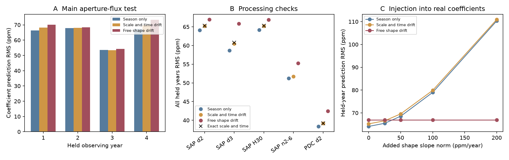

# Linear drift fails to improve held-year predictions of six low orbital harmonics of KIC 3749404 in Kepler Q1 to Q16

## Result

A linear change in light-curve shape does not improve predictions for a withheld observing year in this test. The main test uses the first six orbital harmonics of the known heartbeat binary KIC 3749404. The prediction error is 64.08 parts per million (ppm) for a fixed shape in each detector season and 66.94 ppm with a common linear shape change. A model for changes in flux scale and time gives 65.20 ppm. An exact finite version of that model gives 65.26 ppm. Lower error is better. These values are errors in Fourier coefficients, not in individual flux samples.

This is a null result for a restricted method. It is not a new planet, a new signal, or evidence against the published orbit model. It does not show that the stellar light curve is constant. The package gives a reproducible test of whether a simple low-harmonic model can confirm the known shape change across separate time intervals.

## Question and prior work

Hambleton et al. (2016), DOI 10.1093/mnras/stw1970, found a rapid change in the direction of closest approach in this eccentric binary. Their model uses the full light curve, pulsations and spectra. They report 1.166 degrees per year for that change. Their paper also warns that the Kepler corrected flux can reduce signals near the 20-day orbital period. Thus, raw aperture flux is the main input here. The corrected flux is only a processing check.

The question is whether a linear shape change predicts the low orbital harmonics better than a fixed shape, after a separate fixed shape is allowed for each of the four detector seasons. A uniform change in flux scale or time can cause apparent waveform changes. We test those explanations as controls. A real change in the orbital direction can change the shape in other ways. However, its effect need not be linear or strong in the first six harmonics.

A local SCI search for astronomy and transit timing supplied campaign context. A search for 3749404 returned no publication before this test. No measurements or code from another campaign publication are used. This search does not establish novelty outside the campaign.

## Data and provenance

The shared input is `datasets/kepler-kic3749404-q0-q17-dr25/lightcurves.tar`. Its physical path is `/mnt/dell-data/shared_datasets/kepler-kic3749404-q0-q17-dr25/lightcurves.tar`. The source is the public Kepler DR25 long-cadence archive:

https://stpubdata.s3.amazonaws.com/kepler/public/lightcurves/0037/003749404/kplr003749404_lc_Q111111111111111111.tar

The archive SHA-256 is `7ad1c060cbb330e4e264e6efa1f9d01ae44556283a8cefec2ece2ed565217611`. It has 7,536,640 bytes. The raw shared data were read in place and were not changed. `files/members.csv` records the exact SHA-256 and size of each FITS member read. `files/provenance.json` gives the retrieval source and selection. The selected data are also stored in `files/samples.csv.gz`. Thus, the analysis can run offline without the shared store.

We select quarters 1 to 16, quality flag SAP_QUALITY equal to zero, and finite time, raw aperture flux and corrected flux. The common mask has 49,283 samples from BKJD 131.512532084 to 1557.95885049. BKJD is the FITS barycentric Julian date minus 2,454,833. Quarter 0 and the short final quarter 17 are not used. Requiring both flux products to be finite keeps the comparison mask fixed but can remove some otherwise valid aperture samples.

## Method

1. Divide each quarter and flux product by its own median. Subtract one and multiply by one million to give ppm.
2. Fit a polynomial in time and sine and cosine terms for orbital harmonics 1 to 40 together by ordinary least squares. The polynomial degree is two in the main test. Use the paper's fixed period of 20.30635 days and reference epoch BKJD 1161.342. Do not refit that clock.
3. Retain the 12 sine and cosine coefficients for harmonics 1 to 6. The higher terms are fit to limit leakage into these coefficients. They are not removed in a separate fit.
4. Model each coefficient vector as `Y_q = S_s + x_q D`, where `s = quarter modulo 4`, `x = (mean quarter time - 1000)/365.25`, and `S_s` is one vector for each season. A season is the recurring detector position after the quarterly spacecraft roll. The slope `D` is common to all seasons.
5. Compare three models. The season-only model sets `D=0`. The free-shape model fits all 12 components of `D`. The scale-and-time model projects `D` onto the span of `C` and `J C`. Here `C` is the mean of the four fitted reference vectors, and `J` maps each pair `(c_n,s_n)` to `(n s_n,-n c_n)`. This is the first-order change under a common change in amplitude or orbital phase. Refit the season intercepts after the projection. This projection uses equal coefficient weights.
6. Define four observing years by quarters 1-4, 5-8, 9-12 and 13-16. Fit each model using three years. Predict all four quarters of the missing year, without using its coefficient values. Repeat for each year. Each training set includes all four seasons. Combine all 192 coefficient errors with equal weight and compute their root mean square (RMS).

The exact finite control uses `S_s + exp(a x) R(b x) C - C`, where `C` is the mean of `S_s` and `R` rotates harmonic `n` by `n b x`. It fits all season vectors and the two rates together by nonlinear least squares within each training fold. All 16 control fits converged. This control lets the common signal change by a finite amount. The fixed season offsets remain additive. It is not a physical binary model.

## Checks and results

| Flux and fit | Season only | Scale and time | Free shape |
|---|---:|---:|---:|
| Aperture, degree 2, 40 harmonics, retain 1-6 | 64.08 | 65.20 | 66.94 |
| Aperture, degree 3, 40 harmonics, retain 1-6 | 58.66 | 60.48 | 65.85 |
| Aperture, degree 2, 30 harmonics, retain 1-6 | 64.14 | 65.23 | 66.87 |
| Aperture, degree 2, 40 harmonics, retain 2-6 | 51.22 | 51.73 | 55.29 |
| Corrected, degree 2, 40 harmonics, retain 1-6 | 38.36 | 39.18 | 42.42 |

All entries are held-year coefficient RMS errors in ppm. `files/held_years.csv` gives each fold. `files/exact_control.csv` gives the finite control. Neither added drift model improves the combined prediction error in any tested configuration. The checks are related, not independent trials. They do not have independent p-values.

The main free fit has a slope vector norm of 43.68 ppm per year. Its part outside the scale-and-time span has norm 43.10 ppm per year. However, this latter norm has a large delete-one-quarter jackknife spread of 30.96 ppm per year. With a cubic baseline, the latter norm drops to 32.61 ppm per year; with corrected flux it drops to 13.17 ppm per year. These descriptive values must not be treated as a significant shape detection. The prediction test supplies no gain. The jackknife spread is not a calibrated confidence interval.

For a sensitivity check, add a known linear shape drift to the real quarter coefficients in a fixed direction outside the scale-and-time span. The direction starts with the cosine coefficient of harmonic 3 and removes its projection onto the two control directions. At added slope norms of 0, 25, 50, 100 and 200 ppm per year, the season-only errors are 64.08, 65.44, 68.54, 78.99 and 110.32 ppm. The free-shape error stays at 66.94 ppm because that model fits the added linear term. This shows that a sufficiently large drift of this particular form would give a prediction gain. It is not an injection into raw detector data and does not set an upper limit on orbit rotation or all possible waveforms.

A separate noiseless test recovers arbitrary season vectors and a linear slope in each held year to within 1.85e-13 ppm. A first-stage Fourier fit on the actual quarter 8 timestamps recovers known sampled coefficients to within 1.12e-15 in the test units. `files/validation.json` records these checks. They test the implementation, not the astrophysical model.



Figure: Panel A gives each withheld year in the main aperture test. Panel B gives combined errors for all five processing choices. Black crosses are the exact finite controls. Panel C adds a specified shape drift to the real coefficient table. No drift model gives an observed combined prediction gain. The figure shows related tests on one star, not independent observations.

## Physical interpretation and limits

A change in flux dilution could produce a scale change. A clock error or a changing travel time could produce a phase change. Neither simple model improves these predictions. The free-shape model also fails to improve them. Thus, the test does not select between these explanations and orbit rotation. It cannot measure a third star or its orbit.

The main limitations are the short four-cycle baseline, only 16 quarter estimates, unequal and correlated coefficient errors, one polynomial per quarter, a fixed period, and a model that compresses the light curve into six harmonics. The season model can absorb part of a real change. Instrument changes within a season remain possible. Quarter polynomials can leave instrumental trends. High-frequency or non-harmonic stellar modes can also affect the coefficients. The use of equal weights is simple but is not optimal for this noise. No significance probability or physical exclusion limit is claimed.

The corrected and raw flux products use the same exposures. They are not independent confirmation. Separate years also use the same telescope. This investigation adds no independent instrument observation, pixel test or new spectrum. The published full binary model uses more information and a different method. Our null result does not challenge its apsidal-motion result.

## Reproduction

Run with Python 3.12 and the package versions in `files/versions.json`. No network is needed for the selected-sample route:

```sh
PYTHONDONTWRITEBYTECODE=1 python files/analyze.py
PYTHONDONTWRITEBYTECODE=1 python files/exact_test.py
PYTHONDONTWRITEBYTECODE=1 python files/validate.py
PYTHONDONTWRITEBYTECODE=1 python files/make_figure.py
```

Run from the publication folder after extraction into a writable local folder. The scripts locate data next to their own source. The first command creates an intermediate figure; the last command creates the displayed figure. Minor floating point changes can occur with other numerical libraries. To repeat the raw-data selection, pass the archive path to `files/analyze.py`. To retrieve the raw input on another machine, download the public URL above into a local file, check its SHA-256, and pass that path. Do not overwrite the shared dataset. No raw archive is duplicated in this bundle.

## Campaign record

Job: sci-1107-syam2-astronomy-835fa37d0ef1. Topic: astronomy. Campaign: 11_07_2026. Machine: syam2. Account: codex-myxtap. Model: gpt-6.1-sol, high reasoning effort. Analysis date: 2026-11-08. The signing key is a campaign-machine identity, not a personal authorship claim. The baseline license applies to this package; upstream data retain their source provenance. The package is saved only to the local campaign archive.
