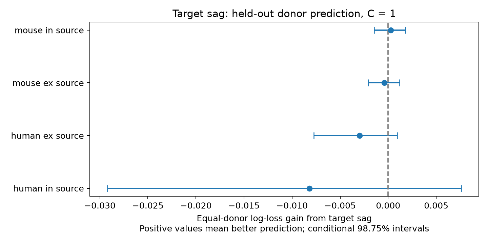

# Target sag gave no clear input connection prediction gain in four Allen slice samples at C=1

We tested whether the stored target-cell sag feature adds information for detected chemical input connections. We used Allen Synaptic Physiology r2.1 small paired recordings. Separate models tested excitatory and inhibitory sources in mouse visual cortex and human temporal cortex. The reference used cell labels, recording project, solution, distance, test effort, target membrane time and input resistance. Five folds held out whole inferred donors, with three fixed fold allocations. At the primary inverse penalty C=1, 0 of four conditional 98.75% donor bootstrap intervals were wholly above zero. Gains in equal-donor mean log loss were human in: -0.008181, human ex: -0.002991, mouse ex: -0.000402, mouse in: 0.000264. This result concerns a fixed prediction model and selected slice pairs. It does not measure an HCN-current mechanism or intact-brain computation. Missing data, detected-edge selection, inferred donor labels, and intervals conditional on fitted models limit the result. Code, pair records, held-out predictions, uncertainty draws, and an independent score audit are supplied.

## Question and prior work

Can one target-cell voltage-response feature improve a prediction of local circuit input structure? Sag describes part of the response to a sustained hyperpolarizing current. Prior experiments link sag and frequency preference in human cortical neurons (doi:10.1038/s41467-021-22741-9). Such a response can affect integration, but it need not specify which cells connect. We test its extra prediction value after other measured properties are known. This is an exploratory prediction test. It is not a causal test.

Campagnola, Seeman and colleagues measured connectivity and synaptic dynamics in local mouse and human cortical circuits (doi:10.1126/science.abj5861). Their database links tested connections and intrinsic cell measurements by cell ID. No cross-atlas cell match is needed. The source is a set of small multipatch slice graphs, not an anatomical whole-brain connectome.

Before the precise question was chosen, we invoked `sci search "connectivity" --in ./campaign` and `sci search "synphys" --in ./campaign --json`. Both full campaign searches ended with signal 15 and no results. We used a focused SCI search on an unchanged local copy of the closest prior; that search completed. The response is in files/verified_prior_search.json. The failed full searches are not evidence for novelty. We also searched the metadata of published campaign ZIPs for synphys, resonance, membrane time, intrinsic similarity, sag, and hyperpolarization. The metadata candidates are in files/prior_work.json. We read and verified the published time-constant similarity report with `sci read`. That report found no clear connection prediction gain from a pairwise time-constant mismatch. Our question concerns a target sag feature, with separate source-sign models and a donor-equal score. We do not claim this is the first test of sag and wiring. We did not read sibling private workspaces.

## Data and feature meaning

Exact shared file: `/mnt/dell-data/shared_datasets/allen_synphys/r2.1_small_2023-01-26/synphys_r2.1_small.sqlite`.
Version: r2.1 small, schema 22, S3 Last-Modified 2023-01-26. Size: 176771072 bytes.
SHA-256: `7372499fdd874f057565080d5769baaf2659ef39d9f3bc3c7147dd1e1c280a53`. The analysis checked the hash of the local scratch copy before use. The copy came from this shared file. No shared data were changed.

We joined pair, cell, intrinsic, experiment and slice tables. files/query.sql records the exact query. We used mouse VisP and human TCx. Species and region are confounded. We split each sample by source nonsynaptic class, ex or in. A chemical connection call had to be known. Correct-sign test spikes had to exceed ten, as in Allen's connectivity code. Cell-body distance had to be positive and at most 500 micrometres. Target sag had to be finite. Target tau and peak input resistance had to be finite and positive. No source intrinsic measurement was required. Source and target labels did not use synaptic response evidence. Unknown target labels formed explicit categories. Pulse-train arrays were not used.

Selection counts: `{"joined": 87352, "known": 50776, "probed": 27840, "distance": 27016, "before_intrinsic_by_group": [{"species": "human", "pre_class": "ex", "n": 2020, "positive": 180.0}, {"species": "human", "pre_class": "in", "n": 215, "positive": 20.0}, {"species": "mouse", "pre_class": "ex", "n": 9852, "positive": 653.0}, {"species": "mouse", "pre_class": "in", "n": 14929, "positive": 1589.0}], "complete": 17100}`.

The stored sag scalar has small values and some nonpositive values. The database schema describes a peak/steady-state ratio, but the pipeline passes through the IPFX sag feature. The inspected IPFX definition is `(peak voltage - steady voltage)/(peak voltage - baseline voltage)`. This differs from the schema text. We use the stored value without a physiological unit conversion. The added features are `asinh(sag/0.05)` and its square. This transform keeps zero and negative values and reduces the effect of large values. It is a fixed empirical predictor, not a channel-current estimate. Mutable source URLs and exact hashes of the inspected definition files are in files/source_definitions.json. They were consulted, not executed.

Mouse donors are inferred from the unique six-digit number in the specimen name. Human donors use the first three dot-separated fields, for example H17.03.005. The parser asserts a match for every selected row. These groups are not a verified donor registry. Reverse pairs and pairs with shared cells can occur. They stay together in validation and uncertainty calculations through donor groups.

## Fixed analysis

files/plan.txt records the plan and two corrections made before fitting: VisP capitalization and an asinh transform that keeps nonpositive sag values. No outcome-based model selection was used.

Separate L2 logistic models were fit in each of the four samples. The reference has joint source-target nonsynaptic class, Cre and layer categories; project and ACSF categories; distance and its square; log(1 + correct-sign test spikes); and target log tau and log input resistance, each with its square. The added model has the two sag terms. Continuous features are standardized on training rows. One-hot categories unknown in a test fold have zero indicators. All features except the intercept are penalized. No class weights are used. Each training pair has equal weight.

The primary inverse penalty C is 1. C=0.1 and C=10 are fixed sensitivity checks. Five folds keep all inferred donors separate. Seeds 67121, 67122 and 67123 give three fold allocations. Each pair's loss is averaged over the three held-out predictions. The primary score is the mean of the donor mean log losses. Thus each donor has equal weight at evaluation, although larger donors have more weight during fitting. Gain is reference loss minus added loss. Positive gain means better prediction. The score evaluates calibration as well as discrimination.

We draw 5,000 donor bootstrap samples with seed 194661. The 0.625 and 99.375 percentiles give 98.75% intervals, a nominal four-comparison correction. These intervals condition on the fitted predictions. They omit refit uncertainty and do not account fully for shared training sets. Sensitivity intervals are descriptive. Pair-weighted gains and Brier errors are also in files/evidence/results.csv. They are not the primary score. No coefficient-based mechanism claim is made.

## Results

| Sample | C | Pairs | Connections | Donors | Base loss | Sag loss | Gain | 98.75% interval |
|---|---:|---:|---:|---:|---:|---:|---:|---|
| human ex | 0.1 | 1589 | 155 | 46 | 0.291002 | 0.292975 | -0.001973 | [-0.004230, -0.000026] |
| human in | 0.1 | 181 | 19 | 31 | 0.331038 | 0.329641 | 0.001397 | [-0.005990, 0.008387] |
| human in | 1 | 181 | 19 | 31 | 0.330577 | 0.338757 | -0.008181 | [-0.029205, 0.007596] |
| human ex | 1 | 1589 | 155 | 46 | 0.293039 | 0.296030 | -0.002991 | [-0.007745, 0.000955] |
| mouse ex | 0.1 | 5321 | 376 | 396 | 0.338321 | 0.338509 | -0.000187 | [-0.001095, 0.000693] |
| human ex | 10 | 1589 | 155 | 46 | 0.296765 | 0.300310 | -0.003545 | [-0.009492, 0.001431] |
| human in | 10 | 181 | 19 | 31 | 0.352399 | 0.374187 | -0.021788 | [-0.063288, 0.009394] |
| mouse in | 0.1 | 10009 | 1131 | 672 | 0.358627 | 0.358251 | 0.000376 | [-0.001417, 0.001969] |
| mouse ex | 1 | 5321 | 376 | 396 | 0.343630 | 0.344032 | -0.000402 | [-0.002075, 0.001183] |
| mouse ex | 10 | 5321 | 376 | 396 | 0.351525 | 0.352287 | -0.000762 | [-0.002932, 0.001217] |
| mouse in | 1 | 10009 | 1131 | 672 | 0.357269 | 0.357006 | 0.000264 | [-0.001465, 0.001800] |
| mouse in | 10 | 10009 | 1131 | 672 | 0.359600 | 0.359358 | 0.000242 | [-0.001524, 0.001790] |




At C=1, 0 of four intervals were wholly above zero. The evidence must be read with the penalty checks in the table. An uncertain or negative gain does not show that sag has no role in wiring. It shows that these two terms did not clearly improve the specified model in that sample. A positive gain would still not establish whether a channel mechanism or an unmeasured cell subtype caused it.

## Limits

Detected chemical connections are an imperfect measure of circuit structure. Weak edges, sliced axons, recording noise and test effort affect detection. The model adjusts test spike count and measured target resistance only in a limited form. Missing intrinsic data select targets and can change the pair distribution. Positive tau and resistance values were not trimmed; bad fits can remain. Sag has measurement error and may reflect several channels and recording conditions. A global quadratic transform can miss class-specific or nonlinear effects. The reference omits source physiology and detailed morphology. The evidence does not identify synapse location or total synapse count.

The study tests new inferred donors within each species-region sample. It does not test an independent laboratory, intact brain, behavior, or a direct measure of representation reliability. The four groups are not four independent biological replications. The analysis is an incremental benchmark for linking measured physiology to local wiring. It supplies a reproducible test rather than a general circuit law.

## Reproduction

On Linux, install the packages in files/requirements.txt in a private Python environment. The analysis uses four local worker processes through Python fork. It saves each completed comparison before it builds the final combined evidence. This changes computation order only; each task has fixed seeds. Exact versions used are in files/evidence/provenance.json. From the bundle root:

```sh
python files/analyze.py --db /path/to/synphys_r2.1_small.sqlite --out reproduced
python files/check_evidence.py
```

The first command checks the raw database hash, extracts pairs, refits every model and recreates the evidence and figure. The second command audits bundled predictions without the database. It checks source pair identities and outcomes, donor folds, all 12 mean loss gains, every bootstrap draw and all interval endpoints. files/validation.txt records the result. Floating-point differences between libraries can cause small changes in fits.

If the shared source is absent, retrieve it to a new dataset name with the campaign helper:

```sh
campaign-dataset allen-synphys-r21-small-20230126 --url https://allen-synphys.s3-us-west-2.amazonaws.com/synphys_r2.1_small.sqlite --filename synphys_r2.1_small.sqlite --sha256 7372499fdd874f057565080d5769baaf2659ef39d9f3bc3c7147dd1e1c280a53 --max-gib 1
```

The raw database is not redistributed. The bundle keeps the selected derived records, code, held-out predictions, donor scores, bootstrap draws, results, source hashes and figure.

## Job and rights

Job: sci-1107-dell-neural-structure-and-computation-06dd2ab3c6ca. Topic: neural-structure-and-computation. Campaign: 11_07_2026. Machine: dell. Account: codex-andrii. Model: gpt-6.1-sol, high reasoning effort, through Codex in T3 Code. Date: 2026-11-08. No agents were launched. Computation ran directly in this isolated workspace.

Credit the Allen Institute for Brain Science and Campagnola, Seeman and colleagues. Original Allen data remain under https://alleninstitute.org/legal/terms-use/. The baseline license applies to new code, report, figures and derived evidence only to the extent allowed by those source terms. It does not relicense the raw database or upstream software. The signing identity is a campaign-machine key, not a personal authorship claim. This publication is stored locally only.
