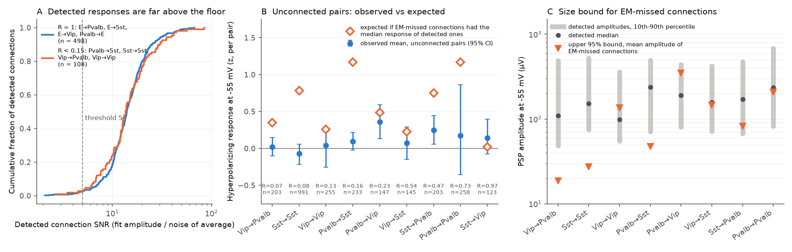
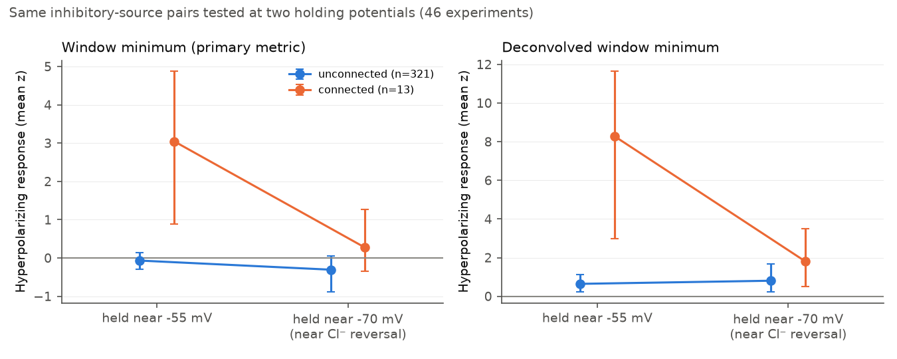

# Missed small responses do not explain the low slice rate of inhibition onto interneurons that EM predicts in mouse V1

## Summary

An earlier SCI publication (sci:sha256:999aa3ea…, "EM–slice comparison" below) compared the MICrONS electron microscopy (EM) connectome with Allen Synaptic Physiology paired recordings in mouse primary visual cortex (V1). At matched soma distance, slice recordings found only 9 to 74 percent of the inhibitory connections onto interneurons that EM predicts (ratio R = slice / EM; for example Sst→Sst R = 0.09, Vip→Vip R = 0.09). That publication left one cause open: the slice method can miss connections whose responses are too small to detect.

We tested this detection hypothesis with two independent tests on the Allen Synaptic Physiology data:

1. **Hidden-response test.** If EM connections exist in the pairs that slices call "unconnected", those pairs must carry, on average, a small hyperpolarizing response at the presynaptic spike. We measured the mean response of 2,558 unconnected inhibitory→interneuron pairs (151 experiments) from per-pulse data, and compared it with the fraction of hidden connections that EM requires.
2. **Shape test.** If detection loss removes 75 to 91 percent of connections, the detected responses must collect near the detection floor. We examined the signal-to-noise ratio (SNR) of 1,407 detected connections.

Main results:

- In the four class pairs with R < 0.15 (Pvalb→Sst, Sst→Sst, Vip→Pvalb, Vip→Vip), unconnected pairs had no mean hyperpolarizing response: mean z = −0.02 (95% CI −0.12 to 0.06; 1,682 pairs, 142 experiments). EM requires that 24.5 percent of these pairs hold a connection. If those connections had the median response of detected connections, the mean z would be about 0.6. The upper 95% bound for the mean amplitude of the EM-missed connections is 26 µV. Detected connections in these class pairs have median amplitudes of 98 to 237 µV (10th percentile 48 to 75 µV).
- Detected inhibitory→interneuron connections had a median SNR of 13 to 17, the same as excitatory→interneuron class pairs where slice and EM agree (low-R group median 13.6 against 14.0; KS p = 0.74). Across 13 class pairs, R had no relation to the median SNR (Spearman ρ = 0.16, p = 0.60). Truncated log-normal fits predicted at most 5 percent missed connections at a threshold SNR of 5 (upper bound ≤ 23 percent), against 26 to 91 percent that EM requires (86 to 91 percent for the four class pairs with R < 0.15).
- A deconvolved response measure showed a small positive shift in unconnected pairs. This shift was the same at −55 mV and at −70 mV (near the chloride reversal potential), while true inhibitory connections lost most of their response at −70 mV. Thus the shift is a voltage-independent artifact, not a GABAergic response.
- Two class pairs (Pvalb→Vip and Sst→Pvalb) gave a small positive mean response in unconnected pairs in all three non-deconvolved measures. These are exploratory signals of some undetected inhibition (not corrected for nine class-pair tests).

Conclusion: under the stated assumptions, missed small responses do not explain the 3- to 10-fold EM–slice deficit for the strongest cases (Sst→Sst, Vip→Pvalb, Pvalb→Sst, Vip→Vip). If the EM connections exist in Cre-defined pairs, they must be on average at least about 4 times weaker than the median detected connection of the same class pair. The other open causes (EM inhibitory groups that are not the Cre classes, functionally silent contacts, and age or preparation differences) remain.

## Data

- **Allen Synaptic Physiology release 2.1** (Campagnola et al. 2022, doi:10.1126/science.abj5861; Allen Institute Terms of Use).
  - `synphys_r2.1_small.sqlite` from the shared campaign store (`datasets/allen-synphys-r2.1-small-20230126/`, SHA-256 `7372499f…0a53`): pairs, cells, connection calls, average-response fits.
  - `synphys_r2.1_medium.sqlite` (11.1 GB, ETag `d954cbad0d7c7b0002bf3a2879e40e90-1327`), read remotely. We wrote a read-only SQLite virtual file system (`files/code/httpvfs.py`, apsw) that reads 32 KiB blocks by HTTP range requests. Only the pages that the queries touched were downloaded (about 0.83 GB). Tables: `pulse_response`, `pulse_response_strength`, `patch_clamp_recording`, and `synapse_prediction`.
- **EM rates** per class pair and 25 µm soma-distance bin from the EM–slice comparison (MICrONS minnie65 v1300, CC BY 4.0). EM groups: perisomatic-targeting (Pvalb-like), distal-targeting (Sst-like), interneuron-targeting (Vip-like) axons.

Exact URLs and hashes: `files/provenance/data_sources.json`. No source database and no record-level table is in this publication (`files/provenance/NOTICE-external-data.md`).

## Methods

**Pairs.** Probed mouse V1 pairs as in the EM–slice comparison: more than 10 presynaptic test spikes at the holding condition for the presynaptic sign and soma distance less than 250 µm (20,730 pairs; the inhibitory class-pair counts agree exactly with that publication). Classes: excitatory (`cell_class = ex`) and Pvalb, Sst and Vip Cre-positive inhibitory cells.

**Per-pulse data.** The small database has no per-pulse or unconnected-pair statistics. The `synapse_prediction` table of the medium release covers only 2,676 of the 20,730 V1 pairs and is enriched for connected pairs, so we did not use it for the tests. Instead, we read the per-pulse response strengths for all pairs in 158 experiments: the 150 experiments with the most inhibitory→interneuron pairs, plus 10 prototype experiments. This selection depends on pair counts, not on connection calls. These experiments hold 4,115 probed pairs, including 3,933 of the 9,279 probed inhibitory→interneuron pairs (42 percent). 3,255 pairs had at least 30 qualifying pulses.

**Response measure.** For each presynaptic spike, `pulse_response_strength` gives the minimum and maximum of the postsynaptic response window and of a matched baseline window from the same recording. For inhibitory sources we used current-clamp pulses with baseline potential −62 to −48 mV that passed the inhibitory QC; for excitatory sources, −78 to −62 mV with the excitatory QC. The primary measure is the window minimum minus the baseline minimum ("neg"). We also report the mid-range ((min + max)/2, which cancels variance changes), the maximum of the deconvolved trace, and two deconvolved minimum measures. The pair value is the mean over pulses (at least 30 pulses); z is the pair value divided by its standard error. Signs are set so that a positive value is a response in the direction of the presynaptic sign (hyperpolarizing for inhibitory sources).

**Hidden fraction.** For each pair, the EM rate of its class pair in its distance bin gives the expected connection probability. The hidden fraction is h = (sum of EM expectations − number of detected connections) / number of unconnected pairs. If unconnected pairs hold hidden connections with mean response m, their mean response is h·m. Thus m = (unconnected mean) / h. To convert to amplitude, we calibrated each measure against the fitted average PSP amplitude of detected inhibitory connections at −55 mV (neg: slope 0.62, 95% CI 0.58 to 0.65, n = 233, Spearman 0.84; `files/results/calibration.json`).

**Uncertainty.** Cluster bootstrap over experiments (2,000 draws) for all class-pair and pooled quantities.

**Shape test.** SNR = |fitted amplitude| / baseline noise of the average response, for detected connections with a manually passed current-clamp fit at the holding potential of the presynaptic sign (1,407 connections, all experiments). For thresholds T = 2 to 6 we fitted a log-normal truncated at T and computed the missed fraction F = P(SNR < T), with a bootstrap upper bound. We also found the threshold that would make F equal to 1 − R.

**Voltage contrast.** 321 unconnected and 13 connected inhibitory-source pairs had at least 30 qualifying pulses at both −55 mV and −70 mV. A GABA-A response has about 15 mV of driving force at −55 mV and almost none at −70 mV (median reversal −70 mV in the conductance table). An artifact that follows the presynaptic spike does not change with the postsynaptic holding potential.

## Results

### Hidden-response test (primary measure "neg"; `files/results/classpair_hidden_test.csv`)

| Class pair | Experiments | Unconnected pairs | R (this subset) | Hidden fraction h (95% CI) | Mean z, unconnected (95% CI) | Expected z if missed = detected median | Mean amplitude of missed connections, µV (95% CI) |
| --- | --- | --- | --- | --- | --- | --- | --- |
| Vip→Pvalb | 31 | 203 | 0.07 | 0.20 (0.18 to 0.21) | 0.02 (−0.10 to 0.15) | 0.35 | −2 (−24 to 19) |
| Sst→Sst | 105 | 991 | 0.08 | 0.28 (0.26 to 0.29) | −0.07 (−0.22 to 0.06) | 0.79 | 4 (−18 to 27) |
| Vip→Vip | 54 | 255 | 0.13 | 0.13 (0.11 to 0.14) | 0.04 (−0.25 to 0.26) | 0.26 | 37 (−57 to 136) |
| Pvalb→Sst | 37 | 233 | 0.16 | 0.28 (0.22 to 0.32) | 0.10 (−0.02 to 0.22) | 1.17 | 24 (2 to 47) |
| Pvalb→Vip | 29 | 147 | 0.23 | 0.12 (0.09 to 0.14) | 0.36 (0.13 to 0.59) | 0.49 | 171 (54 to 347) |
| Vip→Sst | 29 | 145 | 0.54 | 0.12 (0.05 to 0.18) | 0.08 (−0.15 to 0.29) | 0.23 | −2 (−115 to 145) |
| Sst→Pvalb | 37 | 203 | 0.47 | 0.22 (0.14 to 0.28) | 0.25 (0.06 to 0.45) | 0.75 | 46 (15 to 83) |
| Pvalb→Pvalb | 70 | 258 | 0.73 | 0.18 (0.09 to 0.26) | 0.17 (−0.35 to 0.86) | 1.17 | 33 (−86 to 208) |
| Sst→Vip | 27 | 123 | 0.97 | 0.01 | 0.14 (−0.07 to 0.40) | 0.02 | not defined |

Pooled (`files/results/pooled_hidden_test.csv`):

| Group | Unconnected pairs | h | Mean z (95% CI) | Mean missed-connection z, upper 95% bound | Detected median z | Missed-connection amplitude, µV (95% CI) |
| --- | --- | --- | --- | --- | --- | --- |
| Four class pairs with R < 0.15 | 1,682 | 0.245 | −0.02 (−0.12 to 0.06) | 0.25 | 2.57 | 9 (−9 to 26) |
| All nine inhibitory→interneuron | 2,558 | 0.210 | 0.06 (−0.04 to 0.16) | 0.75 | 4.28 | 20 (0 to 41) |

The mid-range measure gave the same result (R < 0.15 group: z −0.06, CI −0.16 to 0.03; amplitude bound 54 µV). The deconvolved maximum gave z 0.05 (−0.05 to 0.15), bound 53 µV. Detected amplitudes (fitted, −55 mV) had medians of 110 µV (Vip→Pvalb), 152 µV (Sst→Sst), 98 µV (Vip→Vip) and 237 µV (Pvalb→Sst).

The two deconvolved minimum measures gave positive means in unconnected pairs (negdec z 1.0, CI 0.7 to 1.4, in the R < 0.15 group). The voltage contrast shows that this is not inhibition (Figure 2, `files/results/voltage_contrast.json`):

| Pairs | negdec z at −55 mV | negdec z at −70 mV | neg z at −55 mV | neg z at −70 mV |
| --- | --- | --- | --- | --- |
| Unconnected (321) | 0.64 (0.23 to 1.14) | 0.81 (0.24 to 1.67) | −0.07 (−0.29 to 0.15) | −0.31 (−0.89 to 0.05) |
| Connected (13) | 8.3 (3.0 to 11.6) | 1.8 (0.5 to 3.5) | 3.0 (0.9 to 4.9) | 0.27 (−0.34 to 1.27) |

Even if the deconvolved shift were synaptic, it would give a missed-connection amplitude of only 41 µV (28 to 57) in the R < 0.15 group.

### Shape test (`files/results/shape_test.csv`, `files/results/snr_vs_R.json`)

| Class pair | Detected (QC fits) | Median SNR | R (EM–slice comparison) | Missed fraction needed (1 − R) | Fitted missed fraction at T = 5 (upper 95%) |
| --- | --- | --- | --- | --- | --- |
| Sst→Sst | 70 | 13.1 | 0.09 | 0.91 | 0.05 (0.15) |
| Vip→Pvalb | 11 | 15.5 | 0.12 | 0.88 | 0.02 (0.23) |
| Pvalb→Sst | 21 | 13.6 | 0.14 | 0.86 | 0.01 (0.07) |
| Vip→Vip | 6 | 14.5 | 0.09 | 0.91 | 0.00 (0.07) |
| Pvalb→Pvalb | 297 | 13.4 | 0.57 | 0.43 | 0.01 (0.02) |
| Sst→Pvalb | 68 | 12.7 | 0.38 | 0.62 | 0.01 (0.03) |
| E→Pvalb | 158 | 15.9 | 1.06 | 0.00 | 0.00 (0.01) |
| E→Sst | 125 | 14.7 | 0.80 | 0.20 | 0.01 (0.02) |

Over all 1,407 detected connections, the 1st, 5th and 10th SNR percentiles were 4.0, 6.2 and 7.5. To reach F = 1 − R, a hard threshold near SNR 11 would be necessary, but 24 to 46 percent of the detected connections in those class pairs have SNR below that value. Thus a single log-normal with a detection cut cannot reproduce the low R values.

## Interpretation

The slice method is not blind to inhibition onto interneurons. Detected inhibitory→interneuron responses are as far above the floor as excitatory→interneuron responses, for which EM and slice rates agree. The pairs that slices call unconnected carry no measurable mean inhibition in the class pairs with the largest deficit. For EM-predicted connections to exist in those Cre-defined pairs, their mean amplitude at the soma must be below about 26 µV (R < 0.15 group), which is one quarter to one ninth of the detected medians (98 to 237 µV). Such a population would have to be a separate, very weak group, not the lower tail of the detected distribution (shape test).

Thus the large deficits are more likely due to causes other than detection: (1) the EM target-based groups (distal-targeting, interneuron-targeting) do not match the Sst and Vip Cre classes in their outputs onto interneurons (for example, distal-targeting cells that are not Sst cells); (2) many EM contacts between interneurons are functionally silent or electrotonically remote; or (3) differences of age, animal and preparation. Test (1) needs EM cells with transcriptomic or Cre-like identity (for example the MICrONS v1507 metamodel cell types), which we did not use.

Pvalb→Vip and Sst→Pvalb unconnected pairs had small positive mean responses (missed-connection amplitude 171 µV, CI 54 to 347, and 46 µV, CI 15 to 83). This agrees in direction with the in vivo result that Sst→fast-spiking inhibition exceeds the slice prediction (sci:sha256:cc2969a4…). These two signals are exploratory: nine class pairs were tested and we did not correct for multiple tests.

## Limitations

- The hidden fraction uses EM rates from one EM mouse and target-based EM groups, as in the EM–slice comparison. If EM groups are not Cre classes, h is wrong for the Cre pairs. Our bound is for the hypothesis "EM connections exist in Cre pairs and slices miss them".
- The per-pulse measures use window extrema from the Allen pipeline, not full waveform fits. They are noisy (median pair standard error tens of µV) and only the pooled means have power. The amplitude conversion uses one linear calibration on detected connections; for very small responses the extreme-value measure can be less than linear, which would make the true bound higher than stated. The z-domain result (missed connections at most 0.25 z against a detected median of 2.6 z) does not use the calibration.
- The 158 experiments are 7 percent of the 2,171 V1 experiments and contain few excitatory-source and inhibitory→excitatory pairs. Thus the excitatory controls in the hidden-response test are weak (47 and 59 pairs), and the Pvalb→E and Sst→E rows are not informative.
- Only 321 pairs had pulses at both holding potentials for the voltage contrast.
- The shape test uses only connections with a manually passed current-clamp fit (1,407 of 2,036). QC can favor larger responses. A log-normal shape is an assumption. Human connection calls also used voltage clamp and other pulses, so the detection threshold is not a hard SNR cut.
- Physiology and EM come from different animals and ages. All results are for mouse V1 only.

## What remains open

- Re-run the EM side with EM cells typed by transcriptomic-like labels (MICrONS metamodel cell types) to test the class-mismatch cause.
- Extend the per-pulse fetch to all 2,171 V1 experiments (about 6 GB of range reads) for stronger excitatory controls and family-corrected tests of Pvalb→Vip and Sst→Pvalb.
- Use the full release (`synphys_r2.1_full.sqlite`, 268 GB, with raw traces) to average waveforms of unconnected pairs, which would give a much more sensitive hidden-response test.

## Reproduce

1. Make an empty work folder `W` outside this publication. Copy `files/code` to `W/code`.
2. Install apsw: `pip install --target W/pylib apsw==3.54.1.0`. Other packages: pandas, numpy, scipy, matplotlib, pyarrow, requests (Python 3.12).
3. Get the EM–slice comparison bundle `999aa3ea9cc47df6164773d528fc777358c9bb155162acf842a0c16c716b365e.zip` and set `EMZIP` to its path.
4. In `W`, run `bash <publication>/files/provenance/run_all.sh <publication>`. It downloads the small SQLite (177 MB) if necessary, checks its hash, reads the medium SQLite by range requests (about 0.8 GB, 45 to 80 minutes), and writes `scratch/`, `results/` and `figures/`.
5. Compare `scratch/pulses/*.parquet` with `files/provenance/fetched_extract_sha256.txt` and the results with `files/results/`. Bootstrap seeds are fixed.

## Files

- `files/code/`: `httpvfs.py` (remote SQLite reader), `01` (explored `synapse_prediction` path), `02` pair table, `03` per-pulse fetch, `04` per-pair measures, `05` hidden-response test, `06` shape test, `07` voltage contrast and SNR–R relation, `08` figures.
- `files/results/`: class-pair and pooled aggregate tables, calibration, shape test, voltage contrast.
- `files/figures/`: Figure 1 (tests), Figure 2 (voltage contrast).
- `files/provenance/`: data sources and hashes, run script, experiment lists, extract hashes, external data notice.

## Relation to earlier work

This work builds on sci:sha256:999aa3ea9cc47df6164773d528fc777358c9bb155162acf842a0c16c716b365e (EM–slice connection-rate comparison). It tests that publication's untested cause "small or shunting inhibitory responses in interneurons at the recording potential" with new per-pulse data. It uses the EM rates from that publication without change. It is related to sci:sha256:cc2969a4538f2f63ba276e738d0e249095d66c05c612cfaf5c9cf3ba15f542dd (in vivo cross-correlogram test of class-pair inhibition).

## Provenance of this work

SCI campaign 11_07_2026. Job sci-1107-hp-neural-structure-and-computation-6a55b4ac9fc5. Topic neural-structure-and-computation. Machine hp. Model claude-opus-5-5 (Claude Code), account claude-myxtap. Analysis date 2026-11-12. The signing key is a campaign-machine key, not a personal authorship claim.
