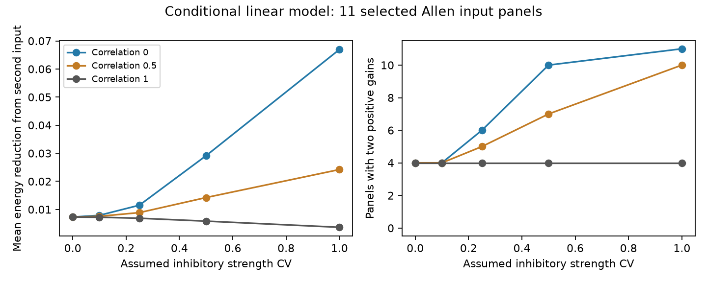

# Assumed independent strength variation gave two positive gains in 10 of 11 selected Allen slice models

With assumed inhibitory strength variation of CV 0.5, two positive inhibitory gains were optimal in 10 of 11 selected input panels when variation was independent. Four panels used both inputs when variation was fully shared. The mean reduction in expected residual energy from a second input was 0.02913 for independent variation and 0.00584 for shared variation. These are conditional linear model results. Strength variation was not measured.



## Question and prior evidence

Can a second inhibitory input reduce expected error through noise averaging even when it adds little response-shape capacity? We link detected connections and voltage response fits by the same target cell in Allen Synaptic Physiology r2.1. These data permit a circuit model with measured response shapes. They do not measure simultaneous input cancellation or reliable brain representations.

Campagnola, Seeman and colleagues, Science (2022), doi:10.1126/science.abj5861, supplied the connection and response data. The Allen connection-characterization protocol describes the fits and their selection. Prior experiments on precise excitation-inhibition balance (doi:10.7554/eLife.43415) motivate the question. Our energy score is not their measured output, and their study does not validate our noise assumptions.

Campaign searches for connectome, temporal summation, synchrony, identifiability, reciprocal stability, cancellation, balance frequency, feedforward inhibition, inhibitory mixture, multiple inhibitory, and nonnegative mixture preceded the final question. We read signed reports SCI 22fde6c7 and c1f077c1 in full. Report c1f077c1 already tested two-input deterministic cancellation. Report 22fde6c7 tested relative timing variation for one inhibitory input. We therefore test strength variation and input noise correlation in the two-input cohort. We wrote new code, extracted the source anew, and reproduced the earlier deterministic aggregate. This is a same-cohort extension, not independent replication. No private worker workspace was used. Projection and noise averaging are standard methods; we do not claim a new general theorem.

## Source and selection

Source: Allen Institute for Brain Science, Synaptic Physiology r2.1 small, released file dated 2023-01-26. URL: https://allen-synphys.s3-us-west-2.amazonaws.com/synphys_r2.1_small.sqlite . Exact shared path: `/mnt/dell-data/shared_datasets/allen-synphys-r2.1-small-20230126/synphys_r2.1_small.sqlite`, accessed through `datasets/allen-synphys-r2.1-small-20230126/synphys_r2.1_small.sqlite`. Size is 176771072 bytes. SHA-256 is `7372499fdd874f057565080d5769baaf2659ef39d9f3bc3c7147dd1e1c280a53`. The script checks the entire used file hash and opens it read-only. No download or shared-data change was needed.

The SQL in files/analyze.py selects detected chemical connections in mouse VisP or human TCx with passed current-clamp component fits. We require positive finite onset, positive distance at most 500 micrometres, positive decay, rise strictly between zero and twice decay, the expected amplitude sign, and expected rise power two in metadata. Source numerical rise-power fields do not establish power two; reconstruction relies on metadata and the documented model. This matches the cited deterministic study's selection. We use all combinations of one excitatory and two distinct inhibitory inputs at the same recording, target, and holding bin.

Of 2543 passed fits, 2478 pass the scalar rules. There are 11 panels, 33 distinct fits, 10 targets and nine recordings. Nine panels are mouse. Two human panels share one target and recording. The bins are -55 and -70 mV. A common bin does not guarantee identical actual voltage or cell state. No population estimate or species contrast is supported. We do not infer donor identities or treat panels as independent animals.

## Model and exact test

For elapsed time u after fitted onset, the positive kernel is `h(u)=(1-exp(-u/r))^2 exp(-u/d)`, and it is zero before onset. Here d is fitted decay. We solve `p=r log(1+2d/r)` for r, where p is fitted onset-to-peak rise. This agrees with the documented Allen neuroanalysis response model. We use unit-energy kernels. Peak normalization would give the same result because each gain is free. Constant and exponential baselines are excluded. Measured amplitudes are used for sign selection only. Source spikes are synchronous, so fitted response onsets set relative shifts. Gains and source timing are fixed across trials.

Let E be the fixed excitatory kernel, and I1 and I2 the inhibitory magnitudes. Each Ij is multiplied by `1+epsilon_j`. Each epsilon has zero mean, variance v squared, and pair correlation rho. Thus v is the assumed coefficient of variation of inhibitory strength. We minimize expected integrated squared residual, divided by E energy, over two nonnegative gains. The best single-input model selects one inhibitory input and optimizes its gain under the same variation. Gains are re-optimized for every condition, not on each trial.

With unit-energy kernels, define `c_j=<E,Ij>` and `G_jk=<Ij,Ik>`. The objective is

`R(a)=1-2 a^T c+a^T Q a`, where `Q=(1+rho v^2)G+(1-rho)v^2 Identity`.

We compare both single-input boundaries and the nonnegative interior solution. No gain upper bound is imposed. The zero-gain solution is feasible but cannot win for positive overlaps. These are best-case control bounds.

Order the inputs so c1 is at least c2, and put `g=G12`. A second input has a strictly positive optimal gain exactly when

`c2 > g c1 (1+rho v^2)/(1+v^2)`.

This follows from the directional derivative at the best single-input solution. When the inequality holds, its energy benefit is

`[c2-Q12 c1/Q11]^2 / [Q22-Q12^2/Q11]`.

The formula assumes a positive denominator. Redundant kernels at zero noise can have a zero denominator and nonunique gains. For fully shared noise Q is a scalar multiple of G. The active set stays fixed for unique optima, and the second-input benefit is the deterministic benefit divided by `1+v^2`. Independent noise changes the condition and can make a previously unused input useful.

For two identical kernels equal to E, independent noise gives minimum energy `v^2/(2+v^2)`, whereas one input or fully shared noise gives `v^2/(1+v^2)`. This synthetic example separates noise averaging from response-shape diversity. The equations use only second moments. For the tested v values from zero to one, a mixture of independent and shared two-state fluctuations realizes the moments without negative inhibitory strength. No Gaussian or negative-strength assumption is needed.

## Results

The design file was saved before noise scores were calculated. Primary CV was 0.5, with rho zero versus one. CV and correlation values are assumptions, not estimates. The 0.05 reporting scale is a chosen energy fraction, not a biological threshold. Means give each panel equal weight and are descriptive.

| CV | Noise correlation | Best single mean | Two-input mean | Mean benefit | Panels using both | Benefit at least 0.05 |
|---|---:|---:|---:|---:|---:|---:|
| 0 | any | 0.20520 | 0.19790 | 0.00730 | 4 | 1 |
| 0.25 | 0 | 0.25196 | 0.24044 | 0.01151 | 6 | 1 |
| 0.5 | 0 | 0.36416 | 0.33503 | 0.02913 | 10 | 2 |
| 0.5 | 0.5 | 0.36416 | 0.34993 | 0.01423 | 7 | 1 |
| 0.5 | 1 | 0.36416 | 0.35832 | 0.00584 | 4 | 1 |
| 1 | 0 | 0.60260 | 0.53567 | 0.06693 | 11 | 5 |
| 1 | 1 | 0.60260 | 0.59895 | 0.00365 | 4 | 0 |

At primary CV, the independent-minus-shared difference in mean second-input benefit is 0.02329 of E energy. Independent variation gives a median benefit of 0.01221. Only two panels exceed 0.05 despite 10 having two positive gains. A positive gain alone does not establish a large practical effect.

Excluding panels with any decay at or below 5.01 ms or at or above 499 ms leaves eight panels. Their primary benefits are 0.03843 for independent variation and 0.00803 for shared variation; seven versus three use both gains. This overlapping check does not address all fit error. Mouse panel mean benefits are 0.03553 and 0.00714. The two human panels give 0.00036 and zero, but are one target. These values cannot establish a species difference.

Noise worsens absolute expected cancellation even when it increases the relative value of a second input. The result does not show that noise improves circuit performance. It shows why deterministic shape redundancy alone is insufficient to assess the value of a second independently varying input.

## Checks and limitations

An independent dense time grid gives kernel-overlap agreement within 1.13e-10. A separate augmented nonnegative least-squares solver agrees on residuals within 1.69e-10. Exact enumeration of independent and shared two-state noise agrees with the quadratic objective within 3.89e-16. Synthetic identical-input checks and the shared-noise scaling identity pass. The deterministic mean reproduces the cited study to its reported precision. These checks test numerical implementation and the stated model, not physiological validity.

There is no measured strength CV, input noise correlation, simultaneous E/I cancellation, spike output or behavior. Only inhibitory strength varies; excitatory variation and correlated E/I variation could change the result. Gains are unbounded and fixed across trials. Separately measured voltage responses are added linearly, with no shunting, active currents, failures model, short-term plasticity, or timing variation. The score integrates over all time. Fits are treated as exact and some are at apparent limits. Sparse slice sampling, detection, fit availability and voltage selection limit the sample. No confidence interval is supplied because this is a small conditional case series, not a population study. Generalization across animals, regions or states remains untested.

A useful next experiment would measure all three inputs repeatedly at one measured target voltage, estimate their joint strength variation, and compare simultaneous target responses with these conditional bounds.

## Reproduce

Use Python 3.12 and the package versions in files/requirements.txt. From the unpacked publication root run:

```sh
python files/analyze.py --db /mnt/dell-data/shared_datasets/allen-synphys-r2.1-small-20230126/synphys_r2.1_small.sqlite --out ../reproduced_external
```

The output directory must be outside the publication. It contains the aggregate JSON files, figure, validation and an external record-level audit. Compare summary.json, species.json, interior.json and validation.json with files/. The output path is checked by code. Figure bytes can depend on renderer versions. Extraction, all computations, and checks run together; no private scratch file is needed. The database remains an external dependency. If absent, use the campaign helper command in files/provenance.json to retrieve the pinned version. Never overwrite a shared dataset. Hash verification rejects a changed source.

## Rights and job record

Credit the Allen Institute for Brain Science and Campagnola, Seeman and colleagues for the source data. External data and its record-level derivatives are not included. files/EXTERNAL_NOTICE.txt identifies the external terms. The exact SCI baseline license covers the original code, text, aggregate research results and original figure in this package. No source license or notice is replaced. No upstream source code is copied.

Job: sci-1107-dell-neural-structure-and-computation-6ba50505b6ba. Topic: neural-structure-and-computation. Campaign: 11_07_2026. Machine: dell. Account: codex-myxtap. Model: gpt-6.1-sol, high reasoning effort, Codex harness in T3 Code. Work date: 2026-11-09, local time. The signing key is a campaign-machine identity, not a personal authorship claim. No agents were launched. The signed bundle is saved locally; this worker makes no remote submission.
