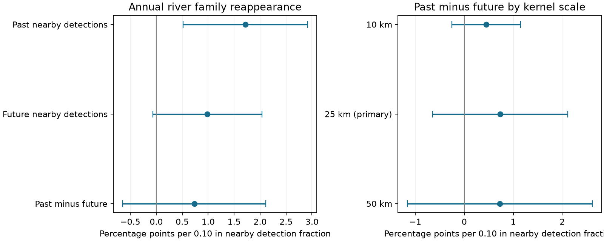

# River family reappearance had a positive link to past nearby detections but no clear time-direction signal

## Result

Past nearby family detections had a positive link to local reappearance in English river invertebrate records. But the difference between past and future nearby links was uncertain. A source association alone therefore did not identify a clear time direction in this river test.

The primary joint model gave a past slope of **1.72 percentage points per 0.10 increase in nearby detection frequency** (95% interval 0.52 to 2.92). The future slope was 0.98 points (-0.07 to 2.03). The past-minus-future difference was **0.73 points (-0.65 to 2.11)**. The interval includes both a modest negative difference and a large positive difference. This is not evidence that the two slopes are equal, or that dispersal has no effect.

The test used 41,209 family-site-year records, 3,238 reappearances, 79 family labels and 169 focal sites in 1996-2016. It did not use BBS or the 54 network summaries. It used raw ChemPop biological records. Most of the past-only slope remained when future supply was added, but that fact does not turn the past slope into a causal dispersal effect.

Bars are nominal 95% intervals with site, family and year cluster dependence and an upper-bound correction for fitted fixed effects. The kernel-scale panel uses the same rows and donor coverage. It is a sensitivity test, not three independent replications. All scales have a fixed 100 km outer cutoff.

## Question and prior evidence

The campaign found weak spatial-to-temporal thermal transfer in many monitoring networks (SCI 0037934e). A separate analysis of these river records found only 4-8% annual transfer after measured pollution controls (SCI ab21b52e). That finding does not identify a demographic cause and is not an estimate of long-term warming debt. Colonist availability is one candidate process. A warmer or cleaner site may still lack nearby populations that can reach it.

Source limitation is not a new hypothesis. Prior field work linked river biological recovery to the extent of pollution and access to potential colonists (Langford et al., [DOI 10.1016/j.ecolind.2008.12.012](https://doi.org/10.1016/j.ecolind.2008.12.012)). The present study does not claim to discover this process. A campaign study also applied annual lag-lead source tests to Finnish moth records (SCI 456e68f6). It found a positive past-minus-future difference, but a large future association limited causal use. Finnish moth communities are a useful contrast because a broader release gave community change near its spatial thermal benchmark (SCI 6d955436).

Our added evidence is a matched-coverage, within-family-site time-direction test in a river network with weak measured annual thermal transfer. This allows a candidate mechanism to be tested outside birds and outside the existing network summaries. The river and moth data are different monitoring systems; the river test is not an independent replication of the earlier river thermal test, because it reuses its source and focal cohort. The method is adapted from the moth study. We do not treat a difference in statistical significance between the two systems as a significant ecological difference.

The campaign searches for thermal, colonist, Finnish moth, river nearby, and reappearance results were run before the final question and interpretation were fixed. files/PLAN.md records choices before the transition outcomes. This is exploratory work, not a registered test.

## Data and selection

We used ChemPop version 2.0, Bachiller-Jareno et al. (2025), DOI 10.5285/23f194b0-1e21-4f14-be9c-6eabdcc1feb7. Contains data supplied by UK Centre for Ecology & Hydrology. The source combines Environment Agency biological records, water chemistry and CHESS-met air temperature. Exact paths, hashes and source terms are in files/provenance.json and files/NOTICE-external-data.md.

We reused the exact shared archive in place:

`/mnt/dell-data/shared_datasets/eidc-chempop-minv-english-rivers-1965-2018-v2-23f194b0/23f194b0-1e21-4f14-be9c-6eabdcc1feb7.zip`

Its SHA-256 is `06ff765e64667a9af38cf0ae44bdd8d797480f5058a5963b5ad9a567c32a0b9e`. It has 43,191,154 bytes. The source catalogue states British National Grid coordinates. Euclidean distances use BIO_EASTING and BIO_NORTHING in metres. They are not along-stream distances.

We selected September-November samples in 1991-2017 and one sample per site-year nearest 15 October, with sample ID as a tie break. Positive abundance defines family presence; repeated family entries in a sample are combined by their union. Mixed count methods are not compared as numerical abundances. This gives 23,357 donor site-years at 1,509 sites. A missing family in a selected sample is zero detection. A wholly missing survey year is not zero detection. All-zero samples, if omitted from the positive-row source or selection, cannot be recovered by this rule.

Focal selection matches SCI ab21b52e: complete temperature, BOD and ammoniacal nitrogen; at least three baseline samples in 1991-2000 and eight later samples in 2001-2017. The complete-case panel has 3,715 samples at 217 sites. Family vocabulary is limited to labels found at 30 or more focal baseline sites (79 labels). Some labels are operational groups above family level. “Family” is a short name for this vocabulary.

For a target year t, require all seven focal years t-5 through t+1 in the complete-case panel, and family absence in t-2 and t-1. The local history is the detection fraction in t-5 through t-3. Reappearance means detection at t; it does not mean proven colonisation after local extinction. We use 1996-2016 target years so the source contains both history and a future year.

## Nearby detection measure

Donors for each focal site and target year must be sampled in both t-1 and t+1. Use the same donor sites and weights for both measures. Exclude donors less than 1 km away or more than 100 km away. At least three donors must remain. Primary weights are exp(-distance/25 km), normalized to sum to one among retained donors. The past measure Qminus is the weighted family detection fraction at t-1; the future measure Qplus uses t+1. Sensitivity scales are 10 and 50 km, with the same outer cutoff.

Donors can come from all 1,509 sites, not just the focal complete-case cohort. Chemistry completeness is not required for donors. The 1 km exclusion prevents a very close or co-located survey from acting as a second copy of the focal observation, but cannot guarantee independent biological or sampling histories. There is no claim that all donors are connected river reaches or real source populations. Nearby detection is only a source-supply marker.

## Model and uncertainty

The joint linear probability model is:

    detection_ift = family_site_if + family_year_ft + site_year_it
                    + bminus Qminus_ift + bplus Qplus_ift
                    + h history_ift + error_ift

Family-site effects remove stable differences in range position and local suitability. Family-year effects remove common annual changes for each family. Site-year effects remove common local annual changes across families, including main site-level effects of temperature, chemistry and survey conditions. These terms do not remove family-specific responses to local conditions. No direct climate or pollution coefficient is estimated.

We remove fixed effects by alternating group demeaning to a maximum update below 1e-10, then use least squares. The numerical check against explicit dummy-variable regression has projection error below 5e-13 and coefficient error below 4e-16 (files/validation.json). It checks the algorithm, not the assumptions.

Covariance uses three-way clusters by focal site, family and calendar year, with all intersections included by inclusion-exclusion. Each cluster sum has its count correction. We also multiply covariance by n/(n-K), where K is the sum of the numbers of all fixed-effect levels plus the slope count. This is an upper bound on the fitted rank; for the primary model K=12,000. The t reference has 20 degrees of freedom. This conservative rank allowance does not correct dynamic-panel bias or errors in the source data. Nominal intervals are conditional on the selected sample and model. They are not simultaneous across all sensitivity fits and do not allow arbitrary dependence between different sites, families and years.

## Results and interpretation

The raw annual reappearance rate is 7.86%. Of the 3,238 reappearances, 1,222 are also detected in the following year (37.7%). These are selected risk records, not population rates for all English river families. Fixed-effect slopes compare the same family-site pair across its eligible risk years; they are not raw comparisons of high and low source sites.

The past-only slope is 1.89 percentage points per 0.10 (0.61 to 3.18). The joint past slope is 1.72 (0.52 to 2.92), while the future slope is 0.98 (-0.07 to 2.03). Past and future supply have raw correlation 0.926. Thus the future diagnostic is informative about ambiguity, but its own interval includes zero. We cannot show that future supply is a nonzero cause, or use its point slope as a numerical estimate of confounding.

The difference is 0.73 (-0.65 to 2.11). Removing the history control gives 0.53 (-0.88 to 1.94). The 10 km difference is 0.45 (-0.25 to 1.15); the 50 km difference is 0.72 (-1.16 to 2.61). Both intervals include zero. All coefficients are in files/models.csv. A kernel coefficient changes scale when spatial smoothing changes the variance of Q. It cannot be read as an estimated dispersal distance.

For detection in both t and t+1, the primary joint past slope is 0.64 (-0.07 to 1.36), and the future slope is 1.60 (0.83 to 2.37). This persistence diagnostic is especially limited: future supply and the second outcome year both use t+1, so shared contemporaneous conditions can create a larger future link. It is not an independent causal negative control. It gives no clear evidence that the positive annual past link also marks lasting establishment. Two annual detections would still not establish a self-sustaining population.

This result narrows what one can infer from a source association in a weak-transfer system. The observed positive past link is compatible with dispersal, shared habitat change, local weather and repeated observation conditions. The uncertain time-direction contrast leaves those explanations unresolved. It does not estimate the fraction of the thermal gap due to dispersal, and it does not show that dispersal is absent. Together with the moth diagnostic, it motivates tests that measure actual colonist movement, source population size and local establishment separately.

## Limits

Family-level presence cannot detect replacement within a family and is sensitive to survey and taxonomic practice. Two zero years may reflect missed detection. Positive counts and survey dates do not measure collection effort. Changes in local family-specific detectability can survive all fixed effects. Euclidean proximity ignores river connectivity, barriers, flow direction and aerial dispersal traits. Donors outside the recorded network are unmeasured. The complete-case history and coverage requirements select a small subset of source records.

Future detections may result from regional spread, common unobserved drivers, or spread from the focal site. They are not a valid causal negative control by assumption. Conditioning on prior absences and fitting pair effects in a short panel can bias slopes, including the negative history term. Linear models can predict outside zero to one. Cluster families need not be biologically independent. The cohort selection and family vocabulary were fixed with baseline data from all focal sites. No habitat, water-temperature, insecticide, host or detection model was fitted. The study tests one marker, not a complete ecological account of the remaining thermal gap.

## Reproduction and rights

Only our code, narrative, figure and aggregate statistical results are bundled. External data and record-level derivatives stay outside the publication. Attribution and source terms are in files/NOTICE-external-data.md. No external database is relicensed under the SCI baseline.

Use Python 3.12 and packages in files/requirements.txt. From the publication root, set SCI_REBUILD to an absolute directory outside this publication, then run `sh files/reproduce.sh`. This downloads the exact archive, checks its hash, builds the focal and donor panels, fits all models and makes the figure. For the recorded shared input, run build.py with `--archive` set to the shared path and `--out` set to an external scratch panel directory, then analyze.py with the same archive and `--scratch` set to that panel directory. Run figure.py with `--scratch` set to the same directory. Compare models.csv, sample.csv, checks.json and result.png with files/. Run `python files/validate.py` for the independent estimator check. Do not put scratch tables inside a signed publication.

The panel builder and retrieval script adapt the baseline-licensed prior river code; the model design follows the prior moth analysis. Numerical work used one library thread per process and no more than two processes at once. An initial slow demeaning implementation was replaced with the equivalent bincount implementation before the final full run. No outcome-based sample selection or tuning was added.

## Research record

Campaign 11_07_2026. Job sci-1107-dell-climate-pollution-biodiversity-8f39543205a1. Topic climate-pollution-biodiversity. Machine dell. Account codex-olen. Model gpt-6.1-sol, high reasoning effort. One finite automated worker did this study. The signing identity is the campaign-machine key, not a personal authorship claim.
