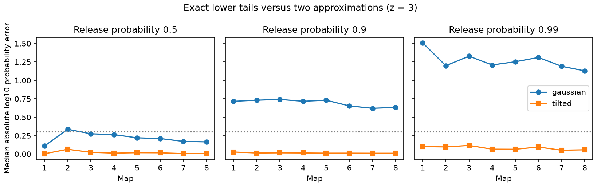

# Exponential tilting reduced lower-tail error in 499 selected worm release models at release probability 0.9

An exponential tilt followed by a lattice Gaussian approximation improved all 499 tested lower-tail estimates at release probability 0.9. The estimates were 0.816 to 1.388 times the exact probabilities. A Gaussian approximation with the correct mean and variance underestimated every probability. This is a finite model benchmark. It does not measure neural release or failure rates.

Figure 1. Each point is a median over selected sources in one map. The event is output at least three standard deviations below its mean, rounded down to an integer. The vertical axis is the absolute base-10 logarithm of approximate probability divided by exact probability. Zero is exact agreement. The dotted line is a factor-two error. The maps are separate animals. Lines do not show repeated measures or equal time intervals. No biological confidence interval is implied.

## Question and prior work

Can a simple change of probability law repair the Gaussian lower-tail errors in shared-site release models? This matters when a circuit calculation uses a rare low input to define a representation failure. The test concerns the numerical probability estimate, not whether the model describes a living circuit.

[Witvliet and colleagues](https://doi.org/10.1038/s41586-021-03778-8) released eight brain maps across worm development. [Liu and colleagues](https://doi.org/10.1002/dneu.20307) reported concurrent miniature currents at worm neuromuscular synapses. Such observations motivate shared release as one possible model. They do not establish complete sharing at the brain sites used here.

SCI 0a2a89fa derived shared-site covariance results for these maps. SCI a7369f2c tested exact large-loss probabilities. SCI 71bc200a showed large Gaussian approximation errors at standardized cutoffs. We read these published reports and reuse the first report's fixed cell panel. We use new code and directly test a correction to the last report's benchmark. This is not independent biological replication of those reports. The campaign search record is in files/search_record.json. The wider release search found the existing tail benchmark before the present calculation. The search for tilting returned no result. Search coverage is not proof of novelty.

Exponential tilting and local Gaussian expansions are standard methods. For prior lattice methods, see [Font-Segura, Martinez and Guillen i Fabregas, 2018](https://guillen.eng.cam.ac.uk/files/conferences/isita2018.pdf). [Kolassa and Li, 2010](https://doi.org/10.3150/09-BEJ237) address more general tail approximations. We do not claim a new probability identity or a new saddlepoint theory. The contribution is an inspectable implementation and a complete comparison on this released neural site benchmark. The method was fixed before the first numerical comparison; the minimum-20-site check was added after the main results. This was not an externally registered study.

## Data and model

We used commit 0646af9d25896ae660f97d462eab2d67282f5625 of dwitvliet/nature2021. All eight raw files were already available at:

    /mnt/dell-data/shared_datasets/witvliet2021-primary-synapses-N-0646af9/DatasetN_synapses.json

N runs from 1 through 8. files/provenance.json records absolute and resolved shared paths, exact URLs, bytes and SHA-256 hashes of each used file. No shared data were modified or downloaded. We checked hashes only for the files used. Maps 1 to 4 are L1, map 5 is L2, map 6 is L3, and maps 7 and 8 are adult in the source study.

The fixed panel contains 162 neuron names in files/panel.txt. It is attributed to baseline-licensed SCI 0a2a89fa. Retain a raw chemical site if its source is in this panel and it has a distinct target in the panel. Remove repeated target names within a site and omit self contacts. Do not merge separate site records. Let k_s be the number of distinct retained targets at site s. Select each source with at least 10 retained sites. The eight maps give 5, 12, 21, 45, 77, 83, 128 and 128 sources, for 499 source-map cases. Sources recur across maps, and all sources in a map belong to one animal. These cases are not independent biological replicates. Source sets change across maps.

For one source, each site releases with independent Z_s drawn from Bernoulli(p). Its summed output across retained targets is:

    X = sum_s k_s Z_s
    mu = p sum_s k_s
    v = p(1-p) sum_s k_s^2

Each contact has positive unit gain. One event reaches every retained target at that site. The readout is summed contact input, not recorded voltage. The exact distribution is given by coefficients of product_s (1-p + p u^k_s). We compute those coefficients by finite convolution in double precision.

For p in {0.1, 0.5, 0.9, 0.99} and z in {2,3}, define c = floor(mu-z sqrt(v)). The event is X <= c. We omit c <= 0 and c >= sum k_s from error summaries. These exclusions avoid endpoint-only probabilities. Exact zero-endpoint handling is implemented in the approximation but is not included in the benchmark. At p=0.9, z=3, all 499 cases remain. The primary setting follows the prior Gaussian study. It was not chosen to maximize the new method's gain. At p=0.1, z=3, only four cases remain, so this setting gives little coverage.

## Approximation and exact identity

The Gaussian reference is Phi((c+0.5-mu)/sqrt(v)). It has exact first and second moments and a half-unit continuity correction.

For the new estimate let g be the greatest common divisor of the integer site weights, and replace c by c_g = g floor(c/g). This leaves the event unchanged. Define:

    K(t) = sum_s log(1-p + p exp(t k_s))
    q_s(t) = logistic(log(p/(1-p)) + t k_s)

Choose t so that K'(t) = sum_s k_s q_s(t) = c_g. For these lower tails t is negative. Under the tilted law the site draws are independent Bernoulli(q_s(t)), and X has mean c_g and variance v_t = sum_s k_s^2 q_s(t)(1-q_s(t)). The exact change of measure is:

    P(X <= c) = exp(K(t)-t c_g)
                * sum_{j=0,g,...,c_g} exp(t(c_g-j)) P_t(X=j)

This follows by multiplying each original event probability by exp(tX-K(t)) to obtain its tilted probability, then undoing that factor. The approximation replaces only the tilted mass:

    P_t(X=j) approximately g / sqrt(2 pi v_t)
                              * exp(-(j-c_g)^2/(2 v_t))

The code evaluates the sum in log space. It does not normalize the local Gaussian masses, fit a correction, or force probabilities into [0,1]. All reported estimates lie inside [0,1]. The lattice can contain internal gaps that this local approximation does not model. The exact endpoint c_g=0 is (1-p)^(number of sites). There is no finite-sample error guarantee for the approximate mass.

The method needs root evaluations over the sites and a sum over c_g/g+1 points. It avoids the full coefficient array. We make no speed claim: small exact distributions are already cheap, and no runtime benchmark was performed.

## Results

Primary setting: p=0.9, z=3. The error metric is abs(log10(estimate/exact)). The median error factor is 10 raised to this metric. Smaller is better.

| Map | Sources | Gaussian median error | Tilted median error | Largest tilted error |
|---|---:|---:|---:|---:|
| 1 | 5 | 0.7160 | 0.02744 | 0.04639 |
| 2 | 12 | 0.7313 | 0.01345 | 0.05217 |
| 3 | 21 | 0.7416 | 0.01572 | 0.05217 |
| 4 | 45 | 0.7167 | 0.01434 | 0.05217 |
| 5 | 77 | 0.7307 | 0.01172 | 0.13744 |
| 6 | 83 | 0.6537 | 0.01186 | 0.13744 |
| 7 | 128 | 0.6212 | 0.01079 | 0.08320 |
| 8 | 128 | 0.6331 | 0.01073 | 0.14240 |

All 499 tilted estimates improved on the Gaussian estimate by the stated absolute log error. All were within a factor two of exact probability. The estimate/exact range was 0.81575 to 1.38802. Map median error factors were 1.025 to 1.065, compared with Gaussian factors of 4.18 to 5.52. Median absolute probability errors fell from 0.00433-0.00615 to 0.000129-0.000292 across maps. A median of ratios is not a ratio of medians.

The result has limits even within this model. At p=0.5, z=3, 374 of 386 retained cases improved; 377 were within a factor two, and the largest error factor was 2.478. At p=0.99, all 499 improved, but only 479 were within a factor two; the largest error factor was 2.803. At p=0.1 only four cases remained, and all improved. These are descriptive case counts, not tests with 499 independent animals. files/summary.csv gives the full grid, including z=2, maximum errors and absolute probability errors.

The stricter selection of at least 20 sites retained 191 sources at each of p=0.5, 0.9 and 0.99 for z=3. At p=0.9 all 191 improved, and estimate/exact ranged from 0.93877 to 1.08872. At p=0.5, 189 of 191 improved; at p=0.99 all 191 improved. All estimates in these three settings were within a factor two. files/sensitivity20.csv preserves the aggregate grid. This check reduces small-site errors but leaves very small samples in early maps. It does not establish a general minimum site count for accuracy.

## Validation and limitations

files/validate.py independently enumerates small Bernoulli examples and checks the unit-weight binomial case. It also checks all 499 primary tails by grouped binomial polynomial multiplication and verifies the exact change-of-measure identity with exact tilted convolutions. The largest relative errors were 2.22e-15 for grouped tails and 2.93e-14 for the change of measure. Primary analysis checks mass and first two moments; its largest scaled error was 4.50e-15. Results are in validation.json and environment.json. These checks validate the implementation, not biological assumptions.

No activity dataset was linked to these maps, and no Allen data were used in the final calculation. A useful next test would estimate actual shared release and unequal target gains before applying the tail method to measured response reliability. Unknown release probability, multiple release locations at one site, target-specific receptors, inhibition, unequal gains, correlated source activity and recurrent dynamics can all change the distribution. The maps are partial, from a single species, with only two adult animals. No transfer across species, regions or behavior is demonstrated. The correction requires the full site-size information and release law; second moments alone do not provide it. The method should be checked against exact calculations when possible, especially near support limits.

## Reproduction and rights

Use Python 3.12 and the versions in files/requirements.txt. The full environment is in files/environment.json. From an extracted package, write all rerun outputs outside that package:

    python files/analyze.py --datasets /absolute/path/to/datasets --output /tmp/tilt_main
    python files/analyze.py --datasets /absolute/path/to/datasets --output /tmp/tilt_20 --min-sites 20
    python files/validate.py --datasets /absolute/path/to/datasets --output /tmp/tilt_validation.json

Compare summary.csv and sensitivity20.csv to rerun summary files with tolerance 1e-10 for numeric fields. The source-level calculation table is generated externally as external_source_results.csv. It is deliberately not bundled. No exact anatomical site histogram is bundled. To retrieve the pinned raw files into a new private directory, run:

    python files/retrieve.py /absolute/path/to/new_external_data

The retrieval script refuses an existing directory or a path within the publication. It checks bytes and hashes. It writes external anatomy and minimal provenance, never into a signed draft. Reuse existing shared data where available. Do not modify the shared store.

The pinned repository root has no license file. Raw anatomy and record-level derivatives remain outside this bundle because we cannot grant baseline rights in them. See files/EXTERNAL_DATA_NOTICE.txt. The package includes our code, narrative, aggregate model-error results, figures and the attributed baseline panel. The exact SCI baseline license applies to these bundled materials. External papers and code are cited, not copied. Reproducibility depends on the continued availability of pinned external files.

## Campaign record

Job: sci-1107-dell-neural-structure-and-computation-fe735f355e1a. Topic: neural-structure-and-computation. Campaign: 11_07_2026. Machine: dell. Account: codex-myxtap. Model: gpt-6.1-sol, high reasoning effort, through T3 Code and the Codex harness. No agents were launched. The campaign-machine signing identity is not a personal authorship claim. The signed publication is saved locally. No remote upload or index submission is performed.
