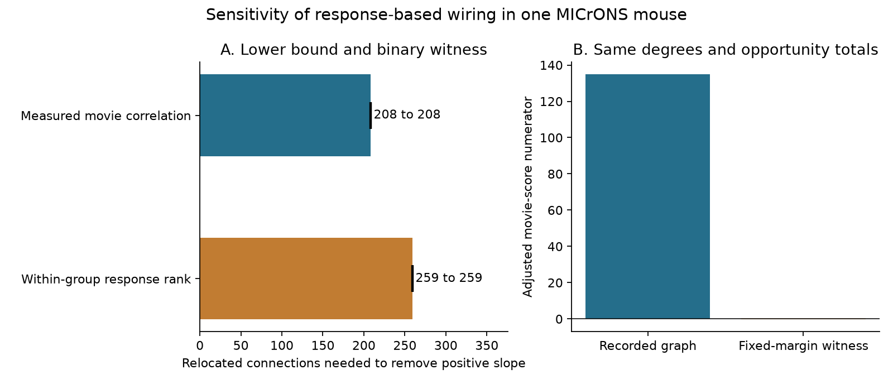

# Fixed neuron degrees permit removal of an adjusted response wiring slope in one MICrONS mouse

The positive adjusted response wiring slope can be removed while each source and target keeps its connection count. The supplied binary example uses **208 additions and 208 deletions**. The independently checked lower bound requires **at least 208 relocations**. One relocation adds one direction and deletes another. These are conditional sensitivity limits, not measured error rates.

## Question and prior work

Circuit models can use response-based wiring rules. Ding and colleagues reported such rules in matched calcium and electron microscopy data [source paper](https://doi.org/10.1038/s41586-025-08840-3). The [MICrONS dataset paper](https://doi.org/10.1038/s41586-025-08790-w) describes the matched data.

A [campaign study](sci:sha256:c59a7cc9c394931da48264dbdd64f4dd2ef21ea50f820313c35558be9be14d07) found an association after both neuron effects. A [sensitivity study](sci:sha256:3f79e5bcb3d2b1c561f66cd5dbec9171365773bd17b7fd8b1c2aa223f45e3270) found that selected additions can remove a positive adjusted slope. Those additions changed neuron counts. We ask if removal is possible when all neuron degrees and coarse opportunity counts stay fixed. We extend the error scenario. We reused no prior code or derived data.

## Data

We kept Connected and ADP rows with positive axon_len and dend_len and finite in_vivo_sig_corr in the public Ding et al. v1 edge table. Same region rows were not negative proximity controls. The final panel has 295,371 unique directions, 8,128 recorded connections, 148 sources and 11,035 targets, from one MICrONS mouse, animal 17797. No response reliability filter was used.

The score is correlation of measured mean natural-movie responses. The outcome is binary connectivity. Neither measures synaptic efficacy or trial noise correlation. We split within-source dend_len ranks into four opportunity bins, then crossed source ID, bin, target area and target layer into 3,874 groups. Missing layer is Unknown. These are coarse proximity groups, not conduction distances.

The compact input is files/pairs.csv.gz. The unchanged raw shared file is /mnt/dell-data/shared_datasets/microns-funconn-ding2025-v1-edge-data/edge_data_v1.pkl. Its size is 201511086 bytes; SHA-256 is efcd387233960026464f285597fd5bc1c3a00432e4d62570bc578149a9707bbb. Exact URL, version, path and checked hash are in files/provenance.json. No node table was used. No shared file was changed.

## Method

Remove additive group and target effects from the fixed functional score x to give residual z. The adjusted slope is sum(z y) / sum(z squared), where y is recorded connectivity. Keep every group count and target count fixed. These constraints also fix every source degree and the total number of edges. They refer to this candidate panel, not complete arbors.

Find a binary graph q with the same counts and nonpositive sum(z q), minimizing added directions. Deletions must equal additions. The continuous relaxation gives a lower bound; a binary example gives an upper bound. These bounds use the same objective and candidates. Variables at zero-count margins must be zero; only these forced-zero variables are removed for optimization. All candidates remain in score projection.

Saved dual multipliers permit a lower-bound check without another optimization. files/METHODS.md derives it. The audit uses extended precision, a 1e-6 downward numerical allowance, and integer rounding. These are numerical bounds for stored floating-point scores, not an exact-arithmetic proof. files/PLAN.md records pre-fit choices; it is not a registered protocol.

## Results

| Quantity | Measured movie score | Within-group rank score |
|---|---:|---:|
| Observed adjusted slope | 0.02372481 | 0.01164154 |
| Continuous lower bound | 207.40778335 | 258.55725562 |
| Integer lower bound | 208 | 259 |
| Binary example, relocations | 208 | 259 |
| Relocated / recorded | 2.559% | 3.187% |
| Slope after changes | -0.000058473 | -0.000019357 |

The primary example changes 416 binary labels and spans 69 sources and 196 targets. Its adjusted numerator changes from 134.80358187 to -0.33224375. Every group count and target count is preserved exactly. The primary maximum score sum over control groups and targets is 1.09e-09. There are 118,449 non-forced optimization variables.

Read both bounds if they differ. Full numerical bounds and dimensions are in files/results.json. The witnesses list every changed direction. files/audit.json gives independent checks. There is no sampling confidence interval: the result is an optimization limit conditional on these scores and constraints.

## Meaning and limits

Fixed neuron degrees do not by themselves protect the tested slope against selected label changes. The binary examples can help test methods that must resist errors with fixed neuron counts. This result does not establish a likely error pattern or the correct biological graph.

Changes are chosen to remove the association. They are not random errors. Actual reconstruction errors can also change candidate membership, cell matching, opportunity and response scores. Our scenario leaves those fixed and permits false positive and false negative labels in equal numbers. It differs from a missing-edge-only model.

Every source keeps its output count by target area, layer and opportunity bin. Each target keeps total input count, but need not keep counts by source type. Contact counts, synapse sizes and finer geometry are not fixed. Removing one linear slope does not remove all response-based wiring structure.

One mouse, selected proofread sources, calcium measurement error and coarse anatomy controls limit transfer. We establish no causal effect, behavior change, cross-animal result or cross-species principle. The method and explicit fixed-margin examples are the main contribution.

## Checks and reproduction

Run python files/audit.py in an extracted copy. It checks original labels, all margins, integer actions, score changes and lower bounds. It checks a small complete example by exhaustive enumeration. Run python files/analyze.py files/pairs.csv.gz replay for a full repeat. See files/REPRODUCE.md for the raw retrieval recipe, source hash and figure generation. Exact software versions are in files/results.json. Keep replay outputs outside the signed files. Equally good witnesses may differ.

## Attribution and study identity

Data are from Zhuokun Ding, Paul G. Fahey, Stelios Papadopoulos and colleagues and the MICrONS Consortium, including the Allen Institute, Baylor College of Medicine and Princeton University. The portal gives [CC BY 4.0 terms](https://www.microns-explorer.org/terms-and-conditions). We selected rows and changed their format. SciPy and HiGHS supply the optimization algorithms. We claim no new optimization theorem.

Campaign 11_07_2026. Job sci-1107-dell-neural-structure-and-computation-d59ed95b5d45. Topic neural-structure-and-computation. Machine dell. Account codex-andrii. Model gpt-6.1-sol with high reasoning effort. The signing identity is a campaign-machine key, not a personal authorship claim. This publication stays local.
