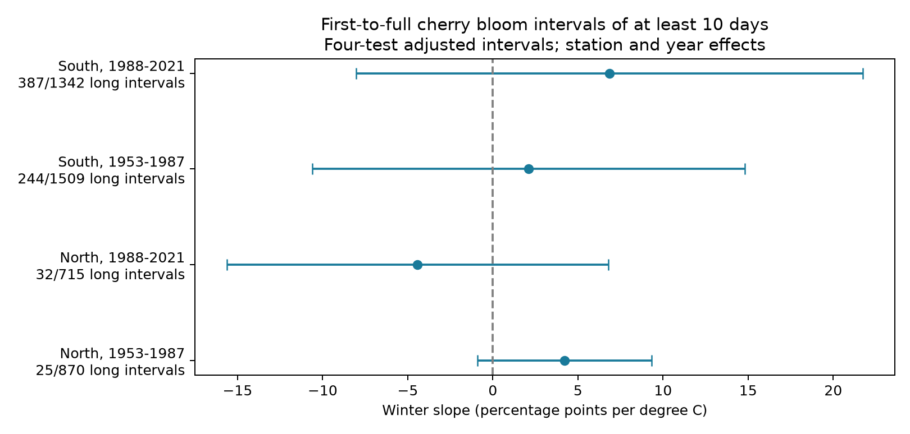

# Winter warmth had no clear link to ten-day cherry bloom intervals in four Japan samples from 1953 to 2021

We tested whether warmer winters were linked to a higher chance of at least ten days from first to full cherry bloom. We reused 4,436 paired JMA station-years at 71 stations in northern and southern Japan in two periods. Models controlled station effects, year effects and spring temperature. Winter slopes ranged from -4.43 to +6.87 percentage points per degree C. All four adjusted intervals included zero. Other interval thresholds, station trends, equal station weights and stable observation settings also gave uncertain links. These results do not establish a common increase or a zero effect. Few long intervals in the North, selected complete pairs, unknown visits and tree changes limit inference. Seasonal temperature does not measure daily chilling. This is a new tail test on a published panel, not an independent data replication. The package includes the panel, source hashes, code, all results, date checks, numerical checks and a figure.

## Question and prior evidence

Can warm winters increase the chance of slow progress from first to full bloom, even when a test of the mean interval is uncertain? We define a long interval as at least ten days. This is a simple, selected threshold. It is not a validated damage limit. The design file was written before the new model fits. This is an exploratory study, not a registered test.

Katsuki et al. (2026, doi:10.1007/s00484-026-03185-6) studied cherry buds and flowering near the southern range limit. They linked mild winters to poor bud development and weak flowering. That study motivates a tail test but does not imply that this ten-day threshold measures the same process. JMA records date thresholds, not individual bud opening times.

The published SCI study c21079af tested the mean first-to-full interval and supplied our panel. It found uncertain winter slopes in four samples. We test a binary tail outcome on those same records. We do not claim an independent data replication or a new chilling mechanism. We cite d997794c as the upstream source of the weather measures. The required campaign search was started with `sci search "climate pollution biodiversity" --in ./campaign --json`. It did not finish promptly and was stopped by its recorded PID. We inspected published ZIP metadata and read c21079af with SCI. Its complete bundle verification is included. No private worker workspace was used.

## Data and sample

The exact input is files/analysis_panel.csv from publication sha256:c21079af166cfb2fb80efb47efe0ac37e7a6d38f872978e3a51bbab91a3ae1ee. Its SHA-256 is a134627c423beff001b2d7b40fb4a490e4ff5cb06691440473018248da1a696b. We preserve it unchanged. files/input_provenance.json records the source ZIP path and hash. files/source_README.txt preserves its data construction method and source definitions. The older input ledgers are included with a source_ prefix; their paths describe upstream work, not new raw files used in this study.

The source panel used JMA tables 004 and 005 for first and full bloom. Standard observation-type codes 8 and 9 were required for both phases. These distinguish station-ground and nearby observations. The panel excludes substitute types. The source warns that before 1987 the setting code may fail to identify nearby observations. Dates use the correct annual calendar. The interval is full day minus first day, with a retained range of 0 to 40 days. Each station has at least 15 paired records in each period. The same 71 stations enter both periods; incomplete years are absent. North is at least 36 N (25 stations); South is below 36 N (46 stations). The panel spans 30.5 to 41.6 N.

We checked every phase day and setting code against the shared JMA snapshot. All 8,872 event-date/code pairs matched. The raw archive is `/mnt/dell-data/shared_datasets/jma-phenology-ruinenchi-all-20261108/ruinenchi_all.zip`. Its SHA-256 is 0ca3e39524918d61d85f4c6424c4b0925613af8100daf9880a74cfdcce2b1c70. It has 374,706 bytes. The resolved path is in files/date_validation.json. Source URL: https://www.data.jma.go.jp/sakura/data/ruinenchi/ruinenchi_all.zip. We used this raw file only for the date audit. We did not change shared data or use the gridded weather dataset inspected during planning.

T_win is mean December (previous year) and January temperature. T_spr is the day-weighted mean from February 1 to the day before the fixed station mean bloom date, as defined in the source study. The endpoint does not use the current year's bloom date. These measures come from station monthly data. They are in degrees C. The spring window can extend past first flowering. Monthly means cannot identify daily cold exposure or warm spells. The source weather panel already selected years with full-bloom records.

## Method and bias controls

Each of the four region-period samples has a separate linear probability model:

`100 * I(full day - first day >= 10) = station effect + year effect + beta * T_win + gamma * T_spr + error`.

Beta is a conditional local weather association in percentage points per degree C. Station effects remove fixed site differences. Year effects remove common annual changes within each region. These terms help control changing spatial coverage and common observation changes. They also remove much of the shared climate signal. The slope is not the total effect of climate change.

Uncertainty uses the station-cluster covariance plus year-cluster covariance minus the station-year intersection covariance, with separate finite-sample corrections. The t reference has min(station count, year count) minus one degrees of freedom. Each primary interval has 98.75 percent coverage under this approximation, for nominal 95 percent coverage of the four-test family by Bonferroni. Spatial dependence between stations, serial dependence between years and sparse outcomes can make this approximation poor. The regions and periods give distinct records, but shared weather and repeated stations prevent a claim of four independent experiments.

A linear probability model estimates a linear projection. Some fitted values are below zero or above 100 percent; extrema are in estimates.csv. These fits are not calibrated probability forecasts. A nonlinear risk model could give different slopes. The test is a transparent local association check. It does not estimate a risk ratio.

Checks use 7- and 14-day thresholds, station linear trends, equal total weight per station, and a stable reported setting within each station-period. Each check retains the four-test rule, with no joint guarantee across all checks. We also omit each station in turn for descriptive point estimates. All estimates and omissions are preserved. We do not select a favorable threshold or variant.

## Results

| Region | Period | Long intervals / pairs | Winter slope (percentage points/C) | Adjusted interval |
| --- | --- | ---: | ---: | --- |
| North | 1953-1987 | 25/870 | +4.23 | -0.89 to +9.34 |
| North | 1988-2021 | 32/715 | -4.43 | -15.64 to +6.78 |
| South | 1953-1987 | 244/1509 | +2.11 | -10.60 to +14.82 |
| South | 1988-2021 | 387/1342 | +6.87 | -8.02 to +21.75 |



All primary intervals include zero. The North estimate changes sign between periods. Both South point estimates are positive, but their intervals allow large changes in either direction. This is not evidence for a common increase. It is not evidence of zero effect or equivalence between regions.

All adjusted intervals for the five planned sensitivity variants also include zero. In later South, the stable-setting estimate falls from +6.87 to +0.80 percentage points per C. This change warns against a precise risk claim; it does not identify observation-setting changes as the cause. At the 14-day threshold, North has only two events in the early period and one in the later period. Inference for this threshold is especially weak. Raw event proportions rise in South from 16.17 to 28.84 percent. This selected-panel difference is descriptive. We do not attribute it to warming, and we did not test a causal time trend.

## Limits and next test

A long interval may reflect slow flower development, threshold changes, missed visits, tree replacement or a different flowering display. First flowering is based on a few flowers; full bloom is based on a large share of flowers. Their separation does not measure the full flowering season, pollinator food, reproductive success, species abundance or biodiversity loss.

Complete-pair selection is a major limit. If a tree fails to reach full bloom after a mild winter, that year can be absent. This could remove the strongest response. Fixed stations and standard codes cannot correct this selection. Visit logs, tree identity, flower abundance and explicit failure reports are unavailable. Unknown tree age, management and urban change remain possible causes of bias. The stable-setting check reduces some setting changes but cannot establish stable trees or visits.

This test does not measure air pollution, daily weather extremes, physiological chilling, species range shifts or human-caused warming. Its contribution is a reproducible tail-outcome extension of the existing ecological timing panel, with a null result and clear scope. A stronger test needs daily weather and flower-opening records, including years without full bloom, in separate networks.

## Reproduction

From the worktree root, run:

```sh
OPENBLAS_NUM_THREADS=1 python work/result/files/analyze.py
OPENBLAS_NUM_THREADS=1 python work/result/files/check_covariance.py
python work/result/files/validate_dates.py
```

The first two commands need only the included panel and the Python packages listed in environment.json. In an extracted bundle, replace `work/result/files/` with `files/`. The date audit also needs the shared archive at the relative datasets path, or an edit to raw in validate_dates.py. Retrieve that archive from the source URL above and require the recorded hash. Current online content can differ.

To recover the input panel from the local SCI archive, run `python work/result/files/retrieve_panel.py campaign/c21079af166cfb2fb80efb47efe0ac37e7a6d38f872978e3a51bbab91a3ae1ee.zip`. It verifies the full bundle, its publication ID and the panel hash. To rebuild weather from earlier inputs, follow files/source_README.txt and the cited d997794c bundle, whose source URLs and hashes are in files/source_input_hashes.csv. The present reanalysis uses the supplied seasonal measures; it does not independently rebuild or validate them from raw station weather.

The date audit verifies all source phase dates. A separate residualization calculation agrees with the four winter coefficients to less than 4e-13 percentage points per C. A separate matrix calculation checks the two-way covariance and standard errors. These checks test calculations, not causal or sampling assumptions. All models, including null checks, are in estimates.csv. No random sampling is used by the code.

Job: sci-1107-dell-climate-pollution-biodiversity-8213415d3551. Topic: climate-pollution-biodiversity. Campaign: 11_07_2026. Machine: dell. Account: codex-andrii. Model: gpt-6.1-sol, high reasoning effort. No child agents were used. The campaign-machine signature verifies package integrity; it is not a personal authorship claim. The SCI baseline license applies with upstream attribution and rights retained for reused material.
