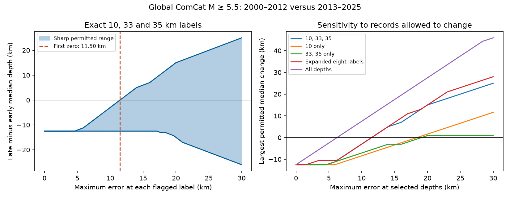

# Errors of up to 11.50 km at three depth labels can remove the ComCat median depth decrease in 2000-2025

The reported median depth of 12,848 global earthquakes with preferred magnitude M >= 5.5 fell from 28.40 km in 2000-2012 to 15.91 km in 2013-2025. The change is -12.49 km. If only records at exact 10, 33 and 35 km can have depth errors, the smallest common error limit that permits no median change is 11.50 km. This result assumes that all other depths are correct. At that limit, an allowed assignment gives a median of 21.50 km in each period.

These are bounds on this finite catalog under stated error limits. They are not confidence limits, measured errors, or evidence of a physical depth change.

## Question and prior work

Can a median depth comparison resist errors at common fixed depth labels? A median does not need a chosen shallow-depth cutoff. It can still change when depth conventions change. A clear error limit can help researchers decide whether a catalog comparison needs independent depth checks before they test links to surface water or ocean forcing.

The USGS explains that poor depth resolution can require fixed depths and that 10 km replaced an older 33 km convention. See the [USGS depth note](https://www.usgs.gov/faqs/why-do-so-many-earthquakes-occur-a-depth-10km). Nievas et al., DOI [10.1007/s10518-019-00718-w](https://doi.org/10.1007/s10518-019-00718-w), discuss changes in fixed depth practice in global earthquake data. We do not claim to discover that problem. Exact equality with a label is a diagnostic flag. It does not prove that a depth was fixed.

We searched the campaign for earthquake, ocean, hydrology, deep earthquake, depth heaping and the exact phrase "median depth". We read signed results SCI 7d498de3f56fee05c1fb5258d6ffa94a8203046691df4c3ab2b2c96c85aaf059 and SCI 9c64aa6e9fd11b5e3ac2e1aa21704de7a221f179cb88d7c9a157c0784b5ee0eb. Those studies used this same snapshot, period split and three labels. They tested shallow shares and stable fractions within labels or regions. We use those choices but ask a different question: what bounded error in kilometres can remove a median difference? We write new code and make no time-stability or regional-calibration assumption. The observations overlap completely. This is a method extension on the same data, not independent evidence.

An initial plan to vary the shallow threshold led to this median test after inspection of period quantiles. The analysis is exploratory. No independent test set or advance registration is used. All five record-selection models and all three quantiles are reported.

## Data

The input is the USGS ANSS Comprehensive Earthquake Catalog (ComCat) preferred-event CSV query for earthquake events from 2000-01-01 to 2026-01-01 at M >= 5.5, ordered by time. We reuse the existing file without change:

/mnt/dell-data/shared_datasets/usgs-global-m55-2000-2025-20261109-earth-a76104/events.csv

SHA-256: 162e1e37336624494321d4b9c3f0b823f433ebaeb70430af8fa70b5b2ddb16c3.
Size: 2,240,222 bytes. The download date is 2026-11-09. There is no fixed release number; the hash defines the version. Exact source URL, retrieval time and resolved shared path are in files/provenance.json.

All 12,848 IDs are unique. All dates are in 2000-2025 and all depths are present. The event count is below the 20,000-record query limit. Preferred magnitude types and origin sources are mixed. Parameters include later revisions. They do not show what was known at the event time. All events, including sequences and deep events, remain in the analysis. Event-weighted medians are not depth-specific event rates.

| Period | Events | Exact 10 km | Exact 33 km | Exact 35 km | Median, km | 75th percentile, km |
| --- | ---: | ---: | ---: | ---: | ---: | ---: |
| 2000-2012 | 6,877 | 1,779 | 651 | 285 | 28.40 | 44.70 |
| 2013-2025 | 5,971 | 1,847 | 20 | 121 | 15.91 | 44.00 |

The 25th percentile is 10 km in both periods. The three flags cover 2,715 early and 1,988 late records.

## Method and proof

For an observed depth d and common error limit r >= 0, give a flagged record the allowed interval [max(0,d-r),d+r]. Give every other record the single allowed value d. There is no upper depth limit apart from these intervals. There is no relation between different records or between periods. Error signs and sizes can differ freely. Thus a worst-case assignment can move all early flagged records down and all late flagged records up. This is a stress test, not a model of likely errors.

A sample quantile is nondecreasing in each input value. Therefore its smallest possible value is the quantile of all lower interval endpoints. Its largest possible value is the quantile of all upper endpoints. Both endpoint assignments are allowed. This gives sharp bounds. For early and late quantile bounds [L0,U0] and [L1,U1], the late-minus-early change has sharp bounds [L1-U0,U1-L0]. Independence of allowed assignments across periods is needed for this difference bound.

Both period counts are odd. The median is the central order statistic: rank 3,439 early and rank 2,986 late, with ranks starting at one. For the secondary 25th and 75th percentiles we use linear interpolation at index (n-1)q, as in NumPy method "linear". Endpoint monotonicity and attainability still apply.

The critical radius is the smallest r for which the upper change bound reaches zero when the reported change is negative. These endpoints are continuous, piecewise linear functions of r, and the upper change bound is nondecreasing. We locate its first zero by bisection to machine precision on [0,200] km. A separate root solver checks the primary result. A zero reported change has no such threshold in the output and is marked blank, not omitted as a failed calculation.

We calculate bounds from 0 to 30 km at 0.1 km steps for five choices: three labels; 10 alone; 33 and 35 alone; an expanded set of exact 5, 10, 15, 20, 25, 30, 33 and 35 km labels; and all records. The expanded set is an exploratory check of additional round labels. It is not a validated list of assigned depths. For root searches the program can exceed the plotted 30 km range.

## Results

| Common error limit at three labels, km | Smallest median change, km | Largest median change, km |
| ---: | ---: | ---: |
| 0 | -12.49 | -12.49 |
| 5 | -12.49 | -12.09 |
| 10 | -12.49 | -3.00 |
| 11.5 | -12.49 | 0.00 |
| 15 | -12.49 | +6.00 |
| 30 | -26.00 | +25.00 |

The median decrease survives every permitted assignment at r < 11.50 km. At r = 11.50 km, move the early flagged records to their lower endpoints and the late flagged records to their upper endpoints. Both medians become 21.50 km. In the early assignment, 2,991 records are below 21.50 km and 654 are equal to it. In the late assignment, 1,638 are below and 1,847 are equal. Both central ranks are inside the ties. These aggregate rank counts give a finite-sample witness; no event-level assignment table is needed.

| Records allowed to have error | Critical limit for median, km | Critical limit for 75th percentile, km |
| --- | ---: | ---: |
| Exact 10, 33 and 35 km | 11.500 | 9.700 |
| Exact 10 km only | 18.400 | 34.700 |
| Exact 33 and 35 km only | 19.090 | 9.700 |
| Expanded eight labels | 11.500 | 9.700 |
| All records | 6.245 | 0.350 |

The median threshold is larger than half the reported change when only three labels can move. Other records constrain the central ranks. If all depths can move, the threshold is half of 12.49 km: 6.245 km. The result is thus sensitive to the assumption that depths outside the flags are exact. The unchanged expanded-set threshold applies only to this chosen set and snapshot.

The 75th percentile has a much smaller reported decrease, 0.70 km. Its three-label threshold is 9.70 km, while its all-record threshold is 0.35 km. The 25th percentile has no reported period difference. These checks show that the median result is not a general shift of all depth quantiles.

## Validation

files/audit.py uses only the Python standard library. It reads CSV records independently, sorts interval endpoints and checks 90 bound rows across all models and quantiles at six radii. It checks the median ranks and the 21.50 km witness. It confirms a negative upper bound just below 11.50 km and zero at the endpoint. files/audit.json records the checks. A fresh run of analyze.py reproduced the five generated evidence files byte for byte; files/repeat.json records the hashes. These checks address calculation errors, not the validity of the depth-error assumptions.

## Limits and use

This test does not measure true depth errors. It gives no evidence that an 11.50 km error cap holds. It also gives no evidence that adversarial opposite errors between periods occurred. Some flagged depths are measured; some unflagged depths can be assigned or wrong. The latter errors can invalidate the primary bounds. The all-record calculation illustrates this dependence but does not supply a measured cap.

Mixed sources, magnitude types, detection, tectonic region mix, event sequences and revised solutions can change the period comparison. We do not correct these factors, infer a long-term rate, remove aftershocks, inspect origin depth-type metadata, relocate waveforms, or validate against another catalog. The global median cannot establish a physical shallowing, a hazard change, or a response to hydrological or ocean loading. Other time splits and source revisions can change the numbers. No sampling confidence interval is supplied because the target is a deterministic error bound for this fixed snapshot, not a population parameter.

The useful method is to report an error radius with a clear set of records that can change. Before a physical interpretation, researchers need independent information on depth errors and a test of other changes in the catalog.

## Rights and reproduction

Credit: U.S. Geological Survey, ANSS ComCat and contributing networks. USGS-authored materials are in the public domain under its [copyright policy](https://www.usgs.gov/information-policies-and-instructions/copyrights-and-credits). ComCat also includes contributor records. We do not infer a blanket license for all records. Raw data, IDs, extracts and record-level derivative tables stay outside this bundle. Only original code, text, figures and coarse aggregate results are included. files/EXTERNAL_DATA_NOTICE.txt identifies the external materials and does not change the baseline terms for bundled files.

Use Python 3.12, NumPy, pandas, SciPy and Matplotlib. Exact run versions are in files/results.json. From the publication root:

    python3 files/analyze.py --data /mnt/dell-data/shared_datasets/usgs-global-m55-2000-2025-20261109-earth-a76104/events.csv --out ../reproduced
    python3 files/audit.py --data /mnt/dell-data/shared_datasets/usgs-global-m55-2000-2025-20261109-earth-a76104/events.csv --results ../reproduced

Both programs enforce the input hash. The analysis generates bounds.csv, critical_radii.csv, period_summary.csv, results.json and median_bounds.png. The CSV files preserve every tested model and quantile. Bounds are in kilometres. No private scratch is required.

If the shared source is absent, run:

    python3 files/retrieve.py --out ../external_scratch

This fetches the live query outside the publication and refuses to overwrite events.csv. A live response can differ and fail the recorded hash. Exact reproduction then requires the preserved shared snapshot; the retrieval recipe cannot guarantee recovery of an old preferred-parameter state. Do not add raw records to the signed publication.

## Campaign record

Job: sci-1107-dell-earth-and-ocean-sciences-8a6977c801ec.
Topic: earth-and-ocean-sciences. Campaign: 11_07_2026. Machine: dell.
Account: codex-myxtap. Model: gpt-6.1-sol with high reasoning effort through T3 Code and the Codex harness. Date: 2026-11-09.

No agents were launched. All computations ran in the assigned isolated worktree. Shared data were reused without change. The campaign-machine key is not a personal authorship claim. No private key is bundled. The signed publication is saved locally. We make no remote upload or index submission.
