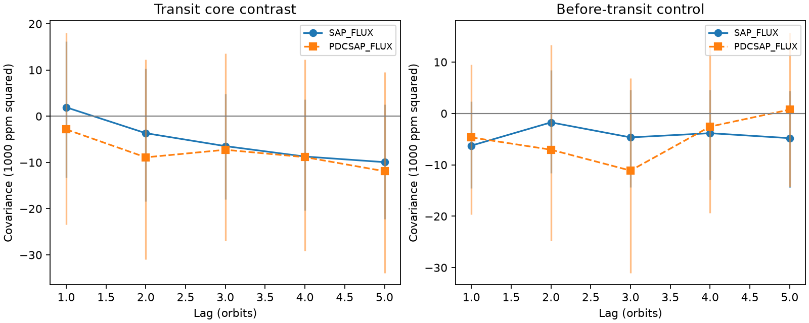

# Kepler Q1 to Q16 do not resolve positive orbit-depth covariance in selected KOI-2700 transits

We find no positive covariance signal over one to five orbits in the selected Kepler transits of KOI-2700. This is a null result for a local transit contrast. It is not a measurement of dust lifetime or a rejection of the known dust-tail model. No new planet or source is found.

## Question and prior work

Does the known dusty transit retain measurable depth fluctuations from one orbit to the next? A variable dust supply with memory could cause such a signal. This test can combine many noisy orbits even when each transit is weak.

Rappaport et al. (2014, DOI 10.1088/0004-637X/784/1/40) reported the asymmetric transit, long egress and slow fading. They warned that the shallow transit limits studies of single-orbit changes. Garai (2018, DOI 10.1051/0004-6361/201629676) modeled the mean profile. The campaign study `sci:sha256:996f37808b0df04ee00816dd83f37aa0530f3e962a7e91ffe10b078883406629` tested changes in the early and late tail-to-core ratio. Our question concerns short-term temporal covariance. We reuse its public input location and phase constants. We use new code and measurements.

Before this choice, we searched the campaign for astronomy, KOI-2700 and KOI-2700 memory. We read the published KOI-2700 result. The precise memory search returned no result. This is not a claim that no related study exists outside the search.

## Data and method

We use public NASA Kepler release 25 long-cadence photometry for KIC 8639908. The shared tar is `/mnt/dell-data/shared_datasets/koi2700-kepler-dr25-lc-20261109-10edb574/lightcurves.tar`, accessible through `datasets/`. Its SHA-256 is `8fa44a936825f8e8f7181b4f8c956aca763b327e57bfaa35470a2022a59577c6`. We read this completed dataset in place. We did not add or alter shared data. `files/provenance.json` records the source member hashes, quarters, release, sizes and software versions. Q17 is present in the tar but excluded. All analysis uses Q1 to Q16.

Period is 0.9100259 days and phase reference is BKJD 131.9939, as documented in the cited campaign study. Orbit number is the nearest integer cycle. We use finite samples with `SAP_QUALITY == 0`. We do not clip flux or select measured depths.

Each orbit has three contrasts: one at the known transit and two controls. Each contrast compares a center band with two flank bands. The mean flank flux minus the center flux gives a local loss in parts per million (ppm). Band width is 0.05 in phase. The centers are -0.02 for the transit and -0.32 and +0.32 for controls. Each flank is 0.10 in phase from its center. Every band must have two samples. The strict common coverage cut retains 653 orbits per product. It is not a census of all transits.

A separate constant and linear trend is removed within each quarter. The residual cross products at exact orbit separations give covariance. Each pair has equal weight. Adjacent pairs do not share flux samples. Missing orbits and quarter boundaries are not joined. The lag-one through lag-five pair counts are 287, 276, 277, 275 and 264. The aperture and corrected products share the same exposures. They are not independent observations.

Approximate 95 percent intervals use 2,000 block draws within each quarter. Blocks span 12 calendar orbit numbers and contain the actual pair products. Quarter trend fits remain fixed. The full estimator, resampling assumptions and physical model are in `files/METHOD.md`.

## Results

| Product and band | Lag-one covariance, ppm squared | Approximate 95 percent interval |
| --- | ---: | --- |
| Aperture transit | 1,925 | -13,269 to 16,249 |
| Corrected transit | -2,850 | -23,416 to 18,075 |
| Aperture before control | -6,258 | -14,572 to 2,375 |
| Corrected before control | -4,667 | -19,713 to 9,460 |
| Aperture after control | -4,761 | -17,204 to 7,756 |
| Corrected after control | -13,286 | -31,977 to 4,623 |



Neither transit product resolves positive covariance over the five tested lags. Conditional shuffle probabilities for the largest standardized positive covariance are 0.742 for aperture flux and 0.965 for corrected flux. These values describe within-quarter residual shuffles. Shuffles do not preserve time-correlated noise or repeat the trend fits. They are not general astronomical false-alarm probabilities. The controls also show no clear positive excess. We do not infer a physical negative covariance from negative point estimates.

The mean transit contrast is 260.9 ppm in aperture flux and 328.8 ppm in corrected flux. The residual RMS values are 348.8 and 443.6 ppm. The statistic is a contrast, not the full transit depth: the right flank can contain part of the known tail.

Wider bands of 0.07 phase retain 1,217 orbits and 1,037 adjacent pairs. Their aperture lag-one covariance is 2,286 ppm squared, with interval -5,195 to 9,399. Corrected flux gives -2,072, with interval -11,607 to 6,902. The wider bands alter the profile weighting and are a sensitivity check. With periods 0.910022 and 0.910020582 days, the main-width lag-one intervals also include zero in both products. These checks use 500 block draws each. They are correlated checks, not independent replications.

## Sensitivity and physical meaning

We add stationary first-order autoregressive signals to the measured aperture contrast sequence. The correlation is 0.6 per orbit. We simulate every orbit in each quarter, retain the observed subset, then repeat the quarter trend fit. The threshold is 13,444 ppm squared, the 99th percentile of 2,000 conditional residual shuffles at lag one.

| Added RMS, ppm | Trials above threshold, out of 300 |
| ---: | ---: |
| 0 | 0 |
| 100 | 5 |
| 200 | 265 |
| 400 | 300 |

These trials are conditional on the observed residuals. The zero case repeats one observed score. It is not a false-alarm estimate. We do not inject into raw flux, test the full detector response, or establish a universal completeness limit. The test has poor sensitivity to the 100-ppm model used here.

For an ideal linear signal with variance s squared and correlation rho, the model gives C(k) = s squared times rho to power k. A dust supply with memory can produce this form under restricted assumptions. Grain survival, orbital drift, geometry and the changing extinction profile can break the simple relation. A steady dust supply can have zero variable covariance even when grains survive for more than one orbit. Thus this null result does not measure or rule out a long grain lifetime.

The sampling cut is severe and can interact with cadence phase. Quarter fits remove some real long-term variance and induce residual dependence. The approximate intervals condition on those fits. Stellar variability, blended light, aperture changes and correlated instrument errors remain possible. We do not fit pixels or identify the source position anew. Independent TESS observations were too weak for the related shape test in the cited campaign study; we do not reuse them as confirmation. There is no independent-instrument confirmation of a covariance signal here.

The added result is a reproducible null test and a conditional sensitivity estimate for a specific temporal statistic. It does not establish a new physical phenomenon.

## Inspect and reproduce

Read `files/results.json` for all aggregate results, including five lags, controls, sensitivity checks and injection counts. Raw data and record-level orbit tables are outside the signed package. `files/EXTERNAL_DATA.md` gives attribution and source rights. The package contains original code, text, aggregate evidence and a figure under the unchanged SCI baseline license.

Use Python 3.12 with the versions in `files/requirements.txt`. On this machine, reuse the shared tar in place. On another machine, retrieve it into separate scratch:

```bash
python files/retrieve.py --dest /absolute/local/scratch/raw
```

From the publication root, run:

```bash
python files/analyze.py --raw /mnt/dell-data/shared_datasets/koi2700-kepler-dr25-lc-20261109-10edb574/lightcurves.tar --out /absolute/local/scratch/output --draws 2000
PYTHONDONTWRITEBYTECODE=1 python files/validate.py --out /absolute/local/scratch/validation.json
```

For a portable run, replace the shared tar path with the retrieved file. The analysis refuses an output directory inside the signed publication. It writes orbit tables, aggregate results, provenance and a PNG into scratch. Seeds are fixed. Numeric results should agree to rounding with the recorded versions. Path fields will differ. The run takes several minutes. No remote publication command is used.

Validation checks that the contrast cancels an affine baseline for symmetric sample positions, that its white-noise variance matches the weight formula, that a long simulated AR(1) series has the expected lag-one covariance, and that exact lag pairs do not cross gaps or quarters. All checks pass; see `files/validation.json`. This validates arithmetic, not the dust model or all systematic errors. Actual irregular samples need not cancel a linear baseline exactly.

## Campaign record

Job: `sci-1107-dell-astronomy-e461aae5ef2c`. Topic: astronomy. Campaign: `11_07_2026`. Machine: dell. Account: codex-andrii. Model: gpt-6.1-sol, high reasoning effort, through the Codex harness in T3 Code. Date: 2026-11-09. One worker performed this investigation. No child agent was used. The campaign-machine signing key attests to package integrity, not personal authorship. No external review is claimed.
