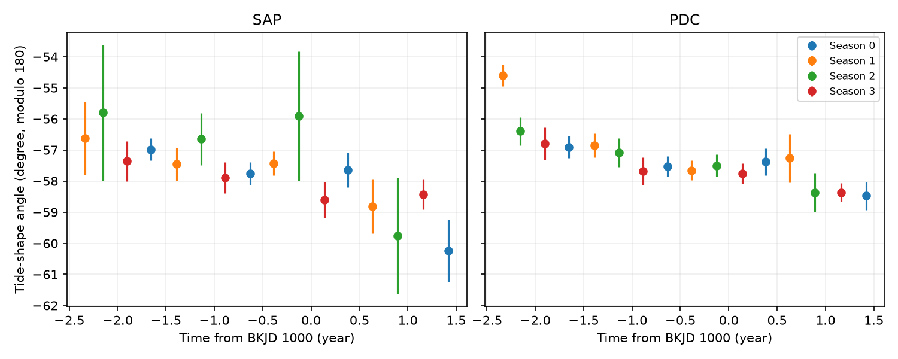
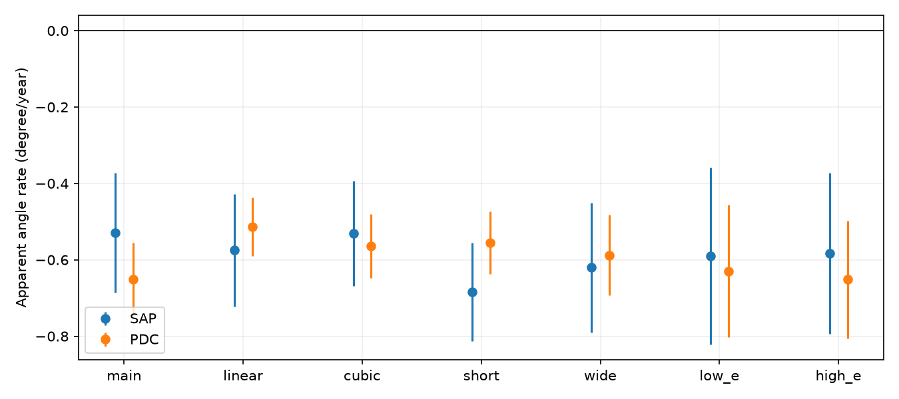

# Local tide fits give a falling shape angle in both Kepler flux products for KIC 3749404 in Q1 to Q16

A local analytic tide fit gives a falling shape angle in the known heartbeat binary KIC 3749404. The main rates are -0.529 +/- 0.157 degree/year in aperture flux (SAP) and -0.651 +/- 0.096 degree/year in corrected flux (PDC). The errors are conditional standard errors, not total errors. All seven tested local-fit choices give a negative rate in both products. This is a restricted shape diagnostic. It is not a new planet, third body, stellar mode, or a calibrated rate of apsidal advance.

## Question and prior work

Can a constrained tide-shape coordinate give a stable time trend when slow instrumental trends are fitted within each orbit? This can help assess changes in heartbeat profiles before a search for unseen companions.

Hambleton et al. (2016; DOI 10.1093/mnras/stw1970; arXiv:1608.02493v1) reported rapid apsidal advance with a detailed binary model and spectra. The public radial velocities in their Table 2 provide the epoch constraint used here. Their photometric reference at BKJD 778.342 marks a light-curve feature. It must not be used as periastron without a check. We initially used that coordinate in an exploratory fit, then found this distinction in the paper. The reported results use the radial-velocity epoch. No claim is based on the initial fit.

SCI 8cf7d9a2a3f5ca83d57e5d39560be6864464a6df066850c0bd2385dca24203c8 found that a scale-and-shift profile test rejected its null mainly in corrected flux. We read that report and use its verified samples. SCI 4ced923c2de3f93550a81f719af4dd679f24d4479f18973cbd1058d63fdfbea4 found that an empirical Fourier-shape trend did not improve its main held-year tests. We read that report too. These are different diagnostics. Our new test uses three constrained tide basis functions, orbit-specific local baselines, and a spectroscopic epoch, rather than a free Fourier shape with quarter baselines. It gives a stable trend sign in aperture flux as well. This does not overturn the earlier null results for their stated methods. Six target records were found in the local campaign search; IDs and titles are in files/search_record.json. Searches also covered TESS, eclipse timing, transit, and KIC 8164262 before this target was chosen.

## Data and external rights

We use Kepler DR25 quality-zero, finite samples from the cited SCI source. The sample file has 50,923 records. The main fit uses 24,487 records in Q1 to Q16 inside local windows. Each flux product was normalized by its quarter median and expressed in parts per million by the source study. SAP and PDC use the same exposures. They are not independent confirmation.

The exact used file is external scratch work/samples.npz, recovered with sci read from files/samples.npz in SCI 8cf7d9a2. Its SHA-256 is 6ef19305a7af4719f340fb7894b9bff2cd985c74dd2597ef5540d395fed98881. This is not a new extraction of the original FITS files. The source archive is the NASA/MAST Kepler public S3 light-curve tar for 003749404. Its hash is 7ad1c060cbb330e4e264e6efa1f9d01ae44556283a8cefec2ece2ed565217611. The exact URL and FITS hashes are in files/raw_provenance.json. The historical logical shared path is /mnt/dell-data/shared_datasets/kepler-kic3749404-q0-q17-dr25/lightcurves.tar. That dataset name was absent on this machine after the storage failure; we did not read or restore it. We reused the signed samples instead. No shared dataset was changed.

The second source is the 20 double-lined velocities in Hambleton et al. Table 2. files/get_rv.py retrieves the fixed arXiv v1 HTML into separate scratch and selects that table. files/provenance.json records the exact downloaded HTML hash. The source article declares an arXiv non-exclusive license. Neither its text, source table, HTML nor an exposure-level Kepler extract is included in this publication. The baseline covers our code, narrative, new figures and aggregate model results. files/EXTERNAL_DATA.md separates external source terms and attribution. Credit NASA, Kepler, MAST, Hambleton and colleagues, and the cited SCI source. Source records must be retrieved outside the signed draft.

## Radial-velocity epoch fit

Fit both velocity series at once with V1 = gamma + K1 [cos(nu + omega) + e cos(omega)] and V2 = gamma - K2 [cos(nu + omega) + e cos(omega)]. Solve Kepler's equation at fixed P = 20.30635 days. Fit e, periastron epoch, omega, K1, K2 and one common gamma. Use the published independent 1 km/s errors. Nine starts span three epochs and three angles. Keep the lowest sum of squared residuals within the code bounds. This is a local multistart calculation, not a proof of a global minimum.

The fit gives e = 0.63435 +/- 0.00277 and periastron epoch BKJD 777.99971 +/- 0.00920. Its chi-square is 13.96 for 34 degrees of freedom. This simple velocity-only fit is not the paper's joint binary fit. The fit covariance and six parameters are in files/rvfit.json. The observations span only about 44 days in 2011. They constrain an epoch, not a long-term precession rate. No new spectra were obtained. This fit checks the light-curve phase coordinate with a different observation type; it does not independently confirm its time trend.

## Local tide model

For each quarter, keep samples within five days of each nearest periastron on the fixed period grid. Set g = (1 - e cos E)^(-3), where E is the eccentric anomaly and nu is the true anomaly. Fit

    flux = b0*g + bc*g*cos(2*nu) + bs*g*sin(2*nu) + local baselines + pulsations.

Each orbit has a separate quadratic baseline on its retained window. Fit all terms at once by unweighted least squares. Include separate quarter sine and cosine coefficients at the seven published pulsation harmonics 18, 20, 21, 22, 23, 24 and 25. Do not fit other free low harmonics. Fix the epoch and eccentricity to the velocity fit. The coefficient b0 is free; we do not constrain an inclination or a positive physical tide amplitude.

The analytic equilibrium-tide form is proportional to g [1 - 3 sin(i)^2 sin(nu + omega)^2]. Thus its shape angle is one half of atan2(-bs, bc), modulo 180 degrees. We unwrap this angle over quarters. The code convention defines the sign. It is not a direct measurement of the paper's omega under its full binary and pulsation model.

For each quarter, estimate coefficient covariance with residual score sums in two-day time groups and a finite-group and residual-degree correction. Transform the covariance to an angle error with the first derivative of atan2. This assumes sufficient signal for local linear error propagation. It does not include calibration, model-family, ephemeris or long-time noise errors. Quarters are treated as independent. Fit four detector-season levels and a shared linear time slope, with inverse angle-variance weights. Season is quarter modulo four. Fixed season terms remove only a fixed seasonal offset. The common slope has 11 residual degrees of freedom. The coefficients and errors are in files/quarters.csv; rates and fit statistics are in files/summary.csv.

## Results and checks

The main two-day fits give the rates in the first paragraph. The season-plus-rate residual chi-square is 7.37 for SAP and 22.16 for PDC, each with 11 degrees of freedom. PDC has extra quarter scatter under this model. These errors must not be treated as a complete uncertainty budget. Per-exposure residual RMS ranges from 58 to 327 ppm for SAP and 56 to 89 ppm for PDC. The tide model is an approximation to the star.

Seven choices test linear, quadratic and cubic local baselines; four-, five- and six-day windows; and e changed by +/-0.02. With two-day groups, SAP slopes range from -0.685 to -0.529 degree/year and PDC slopes from -0.652 to -0.513. The main fit with one-, two- and five-day groups also retains a negative slope. The choices overlap and were not registered; they are sensitivity checks, not independent trials.

Leave each set of four consecutive quarters out. Fit the four season levels with or without a rate on the other twelve quarters. Compare unweighted mean squared angle error in the held quarters. The main trend/constant ratios are 0.080, 0.461, 2.221 and 0.491 for SAP, and 0.384, 2.783, 0.474 and 0.189 for PDC. The trend improves three of four held years for each product. Every omitted-year fitted rate stays negative, but prediction is not uniformly better. These tests reuse the externally fitted epoch and fixed eccentricity; they are not a fully independent observation test. files/predictions.csv preserves all folds and fit choices.

A noiseless analytic tide with a known angle at four real quarter samplings, plus local quadratic trends, is recovered to less than 2e-13 degree. This checks the basis, solver and sign convention. It does not test the real noise, model discrepancy or the stellar interpretation. files/validation.json gives the exact check result and software versions. Changing the period by +/-0.00015 day changes the main two-day-group SAP rate to -0.750 or -0.309 degree/year and PDC to -0.870 or -0.428. An epoch shift of +/-0.02 day gives SAP -0.569 to -0.496 and PDC -0.646 to -0.624. All signs remain negative, but the period contribution is large relative to the quoted conditional errors. Ephemeris sensitivity tests and their replay commands are in files/ephemeris_checks.json.

## Physical meaning and limits

A changing orientation of an eccentric orbit can change a heartbeat profile. The analytic shape angle supplies one constrained coordinate for that change. A downward trend appears in both flux reductions and survives the tested local detrending choices. This provides a useful follow-up to the earlier free-shape tests whose conclusions depended on flux product. It does not prove a third body or isolate apsidal motion.

The model omits Doppler beaming, irradiation, finite stellar surfaces, limb and gravity darkening, exposure integration, unlisted modes and changes of eccentricity or inclination. Its phase grid is fixed. Phase or period changes, an imperfect mode model, additive baseline errors, or evolving detector response can bias the angle. The velocity-only e differs from the published joint result. The geometric conversion and free b0 do not enforce a full physical binary. Residual correlations beyond the tested group length, correlations across quarters, and the choice of local polynomial are not fully modeled. No target pixels, neighbor control, independent telescope light curve, new spectrum or third-body orbit is tested. This report makes no discovery claim and does not replace the published apsidal rate.

Next steps are a joint finite-surface binary and pulsation model with local instrumental terms, a fitted ephemeris, and independent later light curves or spectra. The new coordinate and all fit choices can be replayed without this worktree.

## Reproduction

Use Python 3.12 with NumPy, SciPy, pandas, Matplotlib, requests, lxml and sci-protocol. Set OPENBLAS_NUM_THREADS=1 and OMP_NUM_THREADS=1. Run from an extracted publication, with all generated data in a new external scratch path:

    python files/get_samples.py --bundle /path/to/8cf7d9a2a3f5ca83d57e5d39560be6864464a6df066850c0bd2385dca24203c8.zip --out /scratch/local_tide/samples.npz
    python files/get_rv.py --out /scratch/local_tide/rv
    python files/fit_rv.py --table /scratch/local_tide/rv/table.csv --out /scratch/local_tide/rvfit.json
    python files/analyze.py --samples /scratch/local_tide/samples.npz --rv-fit /scratch/local_tide/rvfit.json --out /scratch/local_tide/results
    python files/predict.py --analysis /scratch/local_tide/results

The SCI source bundle can be obtained from the local campaign or a later campaign archive using its full ID. get_samples.py checks its signature and complete contents, then checks the extracted sample hash. No private worker path is needed. The fixed source version, sample hash, raw archive hashes, table retrieval code, aggregate evidence and all new analysis code are preserved. Downloaded source HTML can change its wrapper; check the table against the fixed v1 source if its HTML hash changes. No observation table is silently replaced.

## Job

Campaign 11_07_2026. Job sci-1107-dell-astronomy-b855ae359836. Topic astronomy. Machine dell. Account codex-olen. Model gpt-6.1-sol, high reasoning effort, through the Codex harness in T3 Code. No agents were launched. The signing key is a campaign-machine identity, not personal authorship. This publication is stored locally only. No remote submission is made by this job.
