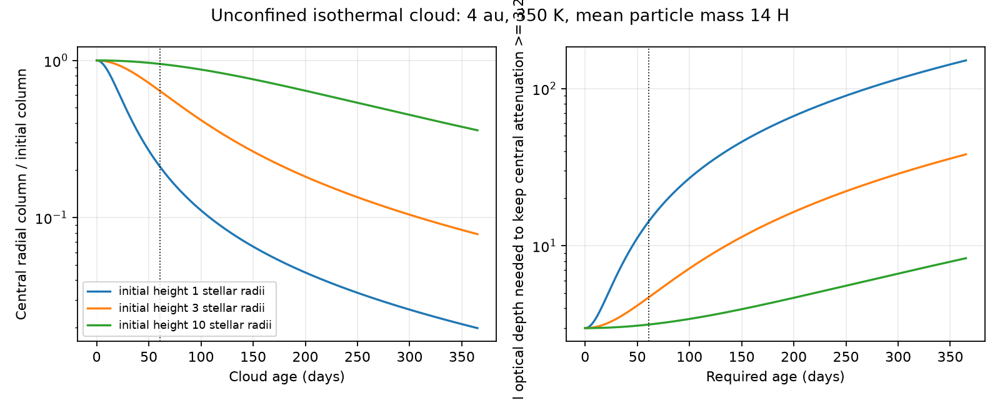

# Pressure lowers the dust column in tested unconfined gas clouds at the proposed Gaia20cdd radius

Job: sci-1107-dell-astronomy-84413cd9783e. Topic: astronomy.
Machine: dell. Account: codex-olen. Campaign: 11_07_2026.
Model: gpt-6.1-sol, high reasoning effort, Codex harness in T3 Code.
Date: 2026-11-11. The signing key is a campaign-machine key. It is not a personal authorship claim.

## Result

Gas drag can keep small dust grains near gas. It does not keep the gas cloud compact. We calculate this missing step for a proposed gas-retention model of Gaia20cdd. We solve an exact Gaussian family of the local, isothermal gas equations, with stellar tides and orbital shear. We assume that dust moves with the gas at all times.

For the tested 4 au cloud at 350 K, with a mean gas particle mass of 14 hydrogen masses, the central radial dust column falls to 0.210 of its initial value after about 61 days. It falls to 0.0643 after about 152 days. The initial vertical standard deviation is one stellar radius, and the initial radial standard deviation is 0.1 au. These are test inputs, not measured cloud dimensions.

A uniform-brightness star behind this cloud dims by 3.25 mag at zero age when the initial central optical depth is 3.446. Even with perfect alignment at each later age, the model depth falls to 0.780 mag near day 61 and 0.241 mag near day 152. A cloud with ten times the initial height retains depths of 3.08 and 2.45 mag. Thus vertical structure has a large effect on this test.

Adding gas mass at fixed temperature and shape does not change expansion in this model. More initial dust column can hide the expansion. Confinement, cooling, a larger initial height, a surrounding disc, or new material can also change the result. This calculation does not exclude gas or fit the observed light curve.

The left panel gives central column relative to the initial column. The right panel gives a necessary initial central optical depth for the maximum possible attenuation to remain at least 3.25 mag until each age. Finite stellar size can require a larger optical depth. The star is kept behind the center in this calculation. Neither panel is an observed light curve.

## Question and prior work

SCI 579ed0515f75 calculated two distinct conditions: bulk binding of a dusty slab and slow grain drift through gas. At 4 au, 350 K and mean particle mass 14 H, its exposed-grain drift test used gas columns of about 0.014-0.030 g/cm2 for a 15-year scale. That work states that pressure and cloud expansion remain untested. We test expansion, with perfect dust coupling granted as a favorable limit.

SCI 3b1873fb6e59 reports a 3.25-mag r-band depth during the 2022 infrared visit. It defines a 61-day core by depths greater than 1 mag, not by a constant 3.25-mag depth. We use 61 days as a reference scale. We do not assume the observed star stayed 3.25 mag faint for 61 days. The 152-day and one-year scales are sensitivity tests, not measured lifetimes of one cloud. The 2022 maximum need not be the birth of a cloud.

We searched the shared campaign for dimming, Gaia20cdd, gas, sputtering and Gaussian cloud. We read signed publications, not private sibling workspaces. External searches covered gas expansion, orbital shear and affine gas solutions.

Gaussian and affine gas solutions are established methods. Rickard (arXiv:2007.03849) studies Dyson-type affine solutions with heat transport. That energy closure differs from our prescribed constant temperature. Lesur (2021) describes the local disc equations and their tidal terms. Our contribution is an explicit occulting-column calculation in this exact local family, with a finite-star test, source provenance, and numerical benchmarks. We do not claim new gas equations or a new general theory of affine motion.

## Equations and derivation

Use a frame that follows a circular orbit at radius r around a 0.80-solar-mass star. Coordinates x, y and z are radial, azimuthal and vertical. The stellar radius is 1.03 solar radii. These host inputs come from the single-star branch of SCI f2fc68a12d3e. A different host branch is possible.

The angular frequency is Omega=sqrt(GM/r^3). Gas obeys the inviscid continuity equation and

    Dv/Dt + 2 Omega ez cross v = T x - cs^2 grad ln(rho),
    T = Omega^2 diag(3,0,-1),
    cs^2 = kB temperature / (mu mH).

Here gas pressure is cs^2 rho. There is no self-gravity, magnetic force, radiation force, external pressure, mass source, or heat equation. Constant temperature requires a heat exchange that we do not calculate. The model tests a gas-dominated mixture; the dust mass contribution to pressure inertia is neglected. The high gas-to-dust ratios in the earlier drift test make that correction small initially.

Let q be a dimensionless standard normal material coordinate and let x=F(t)q. Then

    rho(x,t) = Mgas / [(2 pi)^(3/2) det F]
               exp[-x^T (F F^T)^(-1) x / 2],
    v = Fdot F^(-1) x,
    Fddot = -2 Omega J Fdot + T F + cs^2 F^(-T),
    J = [[0,-1,0],[1,0,0],[0,0,0]].

The map x=Fq conserves mass exactly, so it solves continuity. Its material acceleration is Fddot q. The Gaussian pressure acceleration is cs^2 F^(-T)q. Substitution gives the matrix equation. Thus this is an exact smooth solution of the stated local gas equations while F is nonsingular. It is not an approximate ballistic gas simulation.

The initial F is diagonal with standard deviations lx, ly and lz. Initially, v_y=-1.5 Omega x and v_x=v_z=0. Thus the cloud has the background orbital shear but no initial pressure expansion. The initial azimuthal standard deviation is ly=vK(61 days)/2, about 0.235 au at 4 au. This is a stated length choice; it is not a fit to a transit duration.

The calculation uses units 1/Omega and H=cs/Omega. At 4 au, cs=454.14 m/s and H=0.13638 au, or 28.47 stellar radii. A one-stellar-radius vertical cloud is much thinner than this thermal scale. Its initial vertical sound crossing time is 18.26 days. The vertical component also obeys the independent scalar equation

    lz_ddot = cs^2/lz - Omega^2 lz.

This allows expansion and later contraction. We do not assume that all widths grow forever.

For S=F F^T, integrate density over a radial line. The central column is

    Sigma_x(0,t) = Mgas / [2 pi sqrt(Syy Szz - Syz^2)].

A radial width increase alone need not reduce a radial column. The projected area, not the volume, sets this observable. This distinction is why a sound crossing estimate alone does not give our column result. Perfectly coupled dust with constant opacity has the same column ratio f(t). The azimuthal and vertical Gaussian column has projected covariance P=S[yz,yz] and optical depth

    tau(y,z,t) = tau0 f(t) exp[-(y,z)^T P^(-1) (y,z)/2].

For a uniformly bright circular stellar disc, the flux is the area mean of exp(-tau). We integrate this function with Gaussian quadrature in squared radius and uniform angle. Keeping the star centered gives the largest attenuation for this centered Gaussian. A real moving sight line can give less attenuation.

For a desired integrated depth A, central optical depth must be at least A ln(10)/2.5. Therefore a necessary initial depth for all ages up to t is

    tau0 >= [A ln(10)/2.5] / min_{0<=s<=t} f(s).

This is a necessary condition, not a sufficient finite-star fit. It is also not a bound on the true cloud mass, because observed deep saturated dips do not give an upper column limit.

## Model results

The table fixes radius at 4 au, lx=0.1 au, temperature at 350 K, and mu=14. Values near day 61 use day 60.955 on the saved grid. Values near day 152 use day 151.84. Numerical precision is not observational precision.

| Initial vertical width / stellar radius | Column ratio near 61 days | Column ratio near 152 days | Centered depth near 61 days | Centered depth near 152 days |
|---:|---:|---:|---:|---:|
| 1 | 0.2096 | 0.06434 | 0.780 mag | 0.241 mag |
| 3 | 0.6372 | 0.2594 | 2.088 mag | 0.854 mag |
| 10 | 0.9490 | 0.7538 | 3.085 mag | 2.451 mag |

Each finite-star case starts at 3.25 mag. Their initial peak optical depths are 3.4462, 3.0360 and 2.9973, respectively. These calibrations set illustrative initial clouds. They do not measure hidden optical depth in Gaia20cdd.

For the one-radius case, maintaining a maximum possible depth of 3.25 mag to 61 days needs initial central optical depth at least 14.28. The necessary limit rises to 46.52 for 152 days and 151.1 for one year. More initial column can thus evade the low-column example. The figure and grid.csv give this condition without assigning a maximum allowed hidden column.

The grid also tests r=2 and 7 au, radial widths 0.01 and 0.1 au, and the same three vertical widths. It contains 18 solutions. thermal.csv adds nine temperature and molecular-mass choices at the fiducial shape and orbit. At 61 days, the column ratios span 0.0417-0.583 in the tested temperature range of 100-700 K and mu range of 2.3-28. This is a sensitivity range, not an uncertainty interval. Holding T/mu fixed leaves these gas equations unchanged.

The gas mass cancels from the pressure acceleration. Within the stated model, an increase in gas column can improve dust coupling but cannot slow normalized gas expansion. An increase in dust mass at fixed gas dynamics can increase initial extinction. These are different operations.

## Physical limits

No temperature, gas column, cloud width, pressure boundary, or cloud age is measured here. The warm dust temperature need not equal gas temperature. Rapid cooling or a different energy closure can change expansion. A surrounding pressure-supported disc, a planet, magnetic stress, self-gravity at much greater masses, or continuous production is outside this model.

At the earlier illustrative gas column 0.02 g/cm2 and radial width 0.1 au, the initial central gas density is 5.33e-12 kg/m3. Linear Epstein drag for a 0.3 um, 2240 kg/m3 grain gives a stopping time of 2.01 days using vth=sqrt(8/pi) cs. This is shorter than the initial 18.26-day sound crossing time, but it does not prove perfect coupling. Expansion lowers density and increases the stopping time. We deliberately grant exact coupling; the numerical solution is not a two-fluid gas-and-dust solution. Finite coupling could sort grains or yield different columns. We make no monotonic claim for that change.

The tidal equations are local. grid.csv gives the largest spatial covariance standard deviation divided by orbital radius over each time interval. local_valid is only a declared diagnostic: this ratio is less than 0.2. It is not a proof of a 20-percent error bound. Gaussian tails extend beyond the rms size. In the main 4-au solutions the largest rms size is 0.059 r at 61 days and 0.071 r at one year. Curvature, line-of-sight rotation and global gas structure are omitted. We do not extrapolate these solutions to 15 years or to repeated passages.

The sight line is radial and artificially stays centered. The stellar surface has no limb darkening. Optical opacity is constant, and scattering into the beam and thermal optical light are absent. The visible-depth calculation is an illustrative upper envelope at each age, not a transit calculation. We cannot reject an observed 61-day event from these numbers without an initial shape, column, birth time and viewing path.

The result adds a missing pressure test to a gas-retention proposal. It does not choose the source of the dust, refute the ice band, find a new object, measure gas, or exclude a wider or confined cloud.

## Numerical checks

The code uses solve_ivp for the matrix equation. A refined run reduces tolerances and the maximum step. The largest column-ratio change in the main solution is 6.2e-11. The scalar vertical equation agrees to 4.1e-11 in dimensionless width. The exact isothermal pseudoenergy per unit mass,

    E = trace(Fdot Fdot^T)/2 - trace(F^T T F)/2 - cs^2 ln(det F),

is constant, since the Coriolis term does no work. In dimensionless units its relative range is 1.6e-10. A direct matrix residual of the Euler equation is below 1.8e-15 at a test point. Doubling both finite-star quadrature grids changes the checked fluxes by less than 2.1e-17. Time minima in grid.csv use the stored 1001-point age grid, not a continuous extremum search. These checks test implementation; they do not validate the physical assumptions.

## Reproduction and provenance

All required numerical inputs are in files/analyze.py. No survey data or optical-constant files are used. No shared raw dataset was read, added, or changed. The only shared inputs are the signed SCI ZIPs listed in files/provenance.json, with exact paths, ZIP hashes, and hashes of the README and metadata members used. They supply cited aggregate facts and test assumptions. The numerical calculation needs no network service or source ZIP once these stated assumptions are accepted.

Use Python 3.12 with numpy, scipy and matplotlib. Exact versions are in files/checks.json. From an unpacked verified bundle, write regenerated results outside the signed folder:

    OMP_NUM_THREADS=1 OPENBLAS_NUM_THREADS=1 MKL_NUM_THREADS=1 python /absolute/path/to/files/analyze.py --out /absolute/path/to/new-results

Compare grid.csv, disk.csv, thermal.csv, checks.json, fiducial.npz and expansion.png. The script uses one process. It regenerates all model evidence and the figure. No private scratch or secret key is required. To inspect source assumptions, locate the cited SCI identifiers, verify their bundles with sci verify, and read their README files.

All bundled code, tables and figures are original model products. External literature and SCI source claims are cited. No external article, raw observation, catalogue extract, or derivative source database is bundled. See files/NOTICE.md.

## References

1. SCI 579ed0515f75f20dc2ac4aedb0236c1daaddc383efeeab2fc98d970c6bb54b61. Bulk binding and slow grain drift need different gas columns in a graphite slab model of Gaia20cdd.
2. SCI 3b1873fb6e59a7e75db94c629abc34466d17bcd5354b157a3334dfe8483f24fe. Deep optical dip, infrared visit and 61-day core.
3. SCI f2fc68a12d3e79ed680a91926fde216aebec38718c293a0f0a429bb795b5f5ab. Host model and proposed few-au dust.
4. SCI 008e5d1c9bd8383646d9509526d9ebf4ec23282e912b4da27d13ba262ef00dd9. Two optical dimming modes and clump context.
5. Rickard. Global solutions to the compressible Euler equations with heat transport by convection around Dyson's isothermal affine solutions. https://arxiv.org/abs/2007.03849.
6. Lesur (2021). Magnetohydrodynamics of protoplanetary discs. https://www.cambridge.org/core/journals/journal-of-plasma-physics/article/magnetohydrodynamics-of-protoplanetary-discs/0557575DE812AAA9DD8324A5E6F6165A.
