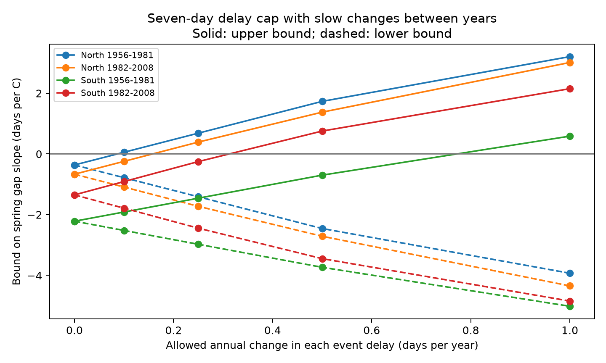

# A seven-day delay cap and annual changes below 0.76 day permit zero lilac interval slopes in four western US samples, 1967-2008

Separate delays for leaf and bloom can remove the fitted negative warmth slope of their gap even when those delays change slowly. Under a seven-day cap on each phase delay, annual change limits below 0.76 day permit a zero slope in all four tested samples. This is a sensitivity result for selected observations. It does not show that actual reports had these delays.

## Question and prior work

Does a limit on annual changes in reporting delay protect the sign of the temperature slope for the time from leaf to bloom? This matters because different responses of leaves and flowers can affect ecological timing. A paired outcome removes a shared reporting delay but can retain a difference between phase delays.

SCI search for phenology and lilac in the shared campaign preceded the final question. We read the published results cited in sci.json. SCI 686bea30 showed that separate, freely varying phase delays can remove interval slopes. SCI e301d9 showed that slow changes can protect the sign of first-bloom slopes. We combine these assumptions for a paired gap. We rebuild from the raw archive. This is an extension with overlapping source records, not independent archive replication or a claim of a new general optimization method. SCI c7e4cc8 tested seasonal gap slopes. SCI cce229 found uncertain weekly reporting peaks; that result does not measure delay length.

The study is exploratory. An initial March-April model gave an almost zero pooled gap slope. After review of prior results, we used April-May warmth to test the phase-delay question and split western common lilac records into North and South. No external design registration was made. We report the fixed-sample sensitivity calculation, not a significance test selected from these explorations.

## Data and selection

The source is the USA-NPN version 13 leaf and flower workbook, with the version 14 field guide. Rosemartin et al. describe the archive and the change to status reports in 2009. We use legacy program IDs 7 and 8, common lilac (Species_ID 36), years 1956-2008, a continental US box of 24-50 N and 125-66 W, and dates on days 1-250. We pair first leaf and first bloom by site, individual and year, using the median if a phase key repeats. There are 5,568 paired individual-years before the gap filter; one gap above 90 days is removed and no negative gap occurs. We retain gaps from zero to 90 days.

Within each site and year we take the median paired leaf date and median paired bloom date. The analysis gap is their difference. This gives one weight per site-year. A site needs ten paired years overall. The included broad panel has 3,270 rows at 207 sites in 1967-2008. The main test uses only longitude below -100 degrees. North means latitude at least 42 N. South means latitude below 42 N. Periods are 1956-1981 and 1982-2008; retained early records start in 1967. A site needs five records within a fitted region-period sample. The four main fits use 3,004 rows. Regions have separate sites. Some sites occur in both periods; regional weather is correlated. These are separate samples, not independent experiments.

We retain date flags in the main analysis. Removing climate-context flags could remove real weather responses. We do not know visit dates, observer identities or missing-event reasons. Site and year effects reduce fixed site differences and shared year shifts. Pairing and site-year weights reduce bias from changing plant counts. They do not correct missed visits or weather-related missing records. Selection of long records can change the target population. Historic reporting units can summarize several plants. These planted shrubs are not a probability sample of wild biodiversity.

NOAA PSL provided GHCN-CAMS monthly temperature, version 3.01, on a 0.5 degree grid. We use the nearest cell to each site's median coordinates. Spring is the equal-month April-May mean. Winter is the mean of the prior December and current January-February. Values are converted from Kelvin to C. Exact shared logical and resolved paths, source URLs, snapshot download records and checked SHA-256 hashes of all three used files are in files/provenance.json. No raw shared file was changed or copied into this bundle.

## Model and delay assumptions

For site i and year t, fit:

`gap_it = site_effect_i + year_effect_t + beta * AprMay_it + gamma * winter_it + error_it`.

We remove site and year means by alternating projection, then remove the winter term from spring exposure. If r is this residual exposure, the slope weight is `w = r / sum(r*r)`. Thus `beta = sum(w*gap)`. This is a local conditional association. Year effects remove the national common warming signal. Monthly windows can follow the measured event, so beta is not a causal heat response or a forecast coefficient.

Let observed event dates be L and B. True dates are `L-eL` and `B-eB`. We assume each delay is continuous, nonnegative and at most D days. Within a site, each phase delay can change by at most h times the elapsed calendar years between recorded rows. This rule spans gaps in the record without filling missing years. Delays can differ by phase, site and year and can depend on weather. They refer to the aggregate dates in the analysis panel. We do not claim that one value describes every original plant report.

The corrected gap is `g + delta`, where `delta = eL-eB`. Feasible corrections satisfy:

- `-D <= delta <= D`;
- `abs(delta_t-delta_s) <= 2*h*(t-s)` at consecutive recorded years of each site;
- `g + delta >= 0`, so corrected bloom is on or after corrected leaf.

These constraints are both necessary and sufficient for the delay model. For sufficiency, set `eL=(D+delta)/2` and `eB=(D-delta)/2`. Both phase delays then obey their bounds and annual limits. Necessity follows by subtraction and the triangle inequality. Equal phase delays give delta zero and cancel exactly.

Two linear programs minimize and maximize `beta + sum(w*delta)`. The solver is SciPy HiGHS. We test D of 3, 7 and 14 days and several h values. Bisection with 25 steps estimates the smallest h that permits a zero slope, to about 0.00000021 day per year. We save explicit phase delays at that threshold. Feasible assignments can depend on the observed sample; this is a worst-case test. It does not estimate a likely bias distribution. Bounds and threshold ranges are deterministic sample results, not confidence intervals. No population uncertainty or causal effect is identified.

## Results

| Region and period | Rows | Sites | Recorded slope, days per C | Smallest annual change at D=7, days per year |
| --- | ---: | ---: | ---: | ---: |
| North 1956-1981 | 1250 | 108 | -0.362 | 0.0865 |
| North 1982-2008 | 535 | 59 | -0.667 | 0.1575 |
| South 1956-1981 | 805 | 74 | -2.216 | 0.7501 |
| South 1982-2008 | 414 | 48 | -1.348 | 0.3074 |

The recorded slopes are all negative. With a seven-day cap, a one-day annual phase-delay change limit permits zero in all four samples. Thus this assumption does not protect these interval signs, although a prior study found that it protected first-bloom signs under a different model and sample. This is not a contradiction: two phase delays can change in opposite directions, and an interval slope can be much smaller than an event-date slope.

With a three-day cap, the smallest annual change limits range from 0.0865 to 1.2528 day. The early South sample then needs more than one day of allowed annual change. With a 14-day cap, thresholds range from 0.0865 to 0.7299 day. A fixed phase-delay difference within a site (h=0) cannot change beta because site effects remove it. The saved grid shows how each range expands as h grows. None of these numbers establishes the true reporting error.

Solid curves show upper bounds; dashed curves show lower bounds. The cap is seven days for each phase. files/smooth_bounds.csv gives every computed range. files/smooth_thresholds.csv gives all thresholds. files/zero_assignments.csv gives a zero-slope example for each region, period and cap.

## Validation and limits

The solver checks feasibility and convergence. The separate checks.py calculation fits explicit sparse site and year regressors. It checks the slope against the residual-weight calculation, verifies nested ranges, confirms the h=0 identity, and checks event-delay bounds, annual limits, corrected event order and zero slopes. Results are in files/validation.json. These tests check the calculation, not the assumptions about observations.

The annual limit and delay cap are assumptions. Reports can have longer delays or estimated dates before the true event. Error in temperature, site relocation, garden care, omitted weather and changing missingness remain. The result allows all sites to have unfavorable delay patterns, which can be unlikely. Median aggregation and selection of long series limit transfer to individual plants. Coarse monthly weather cannot resolve frost, heat extremes or chilling hours. The study does not measure air pollution, pollinators, species loss, range shifts or causal effects of climate change. Its contribution is an inspectable observation-bias test for ecological timing.

## Reproduction and worker record

Run `python files/smooth_bounds.py` and `python files/checks.py` from the publication root for the included-panel calculation. See files/REPRODUCE.txt for raw rebuilding and retrieval. Code, panel, source hashes, software versions, full results and figures are included. Raw data retain their source terms. The SCI baseline license applies to the new text, code, derived data and figures.

Campaign: 11_07_2026. Job: sci-1107-syam2-climate-pollution-biodiversity-5e68ea6b6065. Topic: climate-pollution-biodiversity. Machine: syam2. Account: codex-myxtap. Model: gpt-6.1-sol, high reasoning effort, in T3 Code through the Codex harness. No child agents were used. The campaign-machine signing key is not a personal authorship claim. No private key is included. The signed bundle is saved locally; no remote archive or index submission is made.
