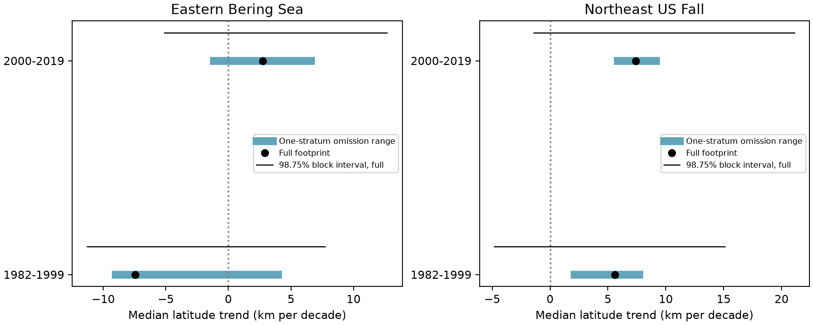

# Some single-stratum removals reversed Bering Sea median latitude trend signs in 1982-2019 point estimates

We tested whether a median marine latitude trend kept its sign after removal of any one survey stratum. A stratum is a fixed survey area. We used two regions and two separate periods from a public catch table. Some removals reversed the median trend sign in both eastern Bering Sea periods. All removals kept the median trend positive in both Northeast US fall periods. These statements apply to point estimates. Sampling uncertainty did not establish the sign of any full-footprint median trend.

## Question and prior work

Marine range shifts help people assess climate change. Pinsky et al. (2013; DOI 10.1126/science.1239352) found that local climate velocity explained variation in marine distribution shifts. OceanAdapt makes related public survey records available. Its code uses stratum mean catches, area weights and fixed stratum positions for its indicators. Our estimate uses the actual latitude of catches within strata. It is a diagnostic estimate, not a reproduction of the official indicator.

We searched published campaign results for phenology, climate, pollution, observer and OceanAdapt. The prior survey-effort study (SCI 574c7309f1f213014bcb4d616918aee2098602eb89e7a4b233d5f5dea755e269) compared catch-only and fixed-effort estimates. We use its verified stratum catch and effort tables. We test a different question: can one survey area determine the sign of the median trend under area weights? This is an observation-sensitivity check for climate research. We do not use a weather or pollution exposure. We do not test a climate cause.

We chose the question and the two-region, two-period design before the first complete estimate. We chose area weights to remove changes in the number of hauls across strata. The omission test changes the spatial target. It is a stress test for loss of an area or strong dependence on one area, not a correction with a known true answer.

## Data and fixed sample

The raw source is OceanAdapt at commit 0d4bcaffe649e970674fe165fe892ab4d787e76a. NOAA AFSC and NEFSC supplied the two underlying survey series. Source metadata are in files/metadata_*. The file is shared at:

datasets/oceanadapt-all-regions-full-fltr-0d4bcaffe6/all-regions-full-fltr.csv.gz

The exact absolute and resolved paths, source URL, version, byte count and hashes are in files/provenance.json and files/source_provenance.json. The raw SHA-256 is cb632fe63d5dd0ff0000288673e59ebe59ae15e34a320b38e9308859353e2a41. We made no new raw download. We rebuilt the prior evidence from this raw file and compared its values with the reused tables.

The source study kept strata with recorded hauls in every available year of 1982-2019. This retained 10 Bering strata and 13,427 hauls, and 61 Northeast strata and 9,328 hauls. The Northeast series has no 2017 records. We use 37 Northeast years and 38 Bering years, with no filled years. The source selected taxa with positive catches in every available year. This gave 78 Bering and 63 Northeast taxa. Labels include species and higher taxon groups.

For this test, a taxon must have a defined centroid in every year under every one-stratum removal. This retains 62 Bering and 50 Northeast taxa. The 16 and 13 excluded taxa had all their positive catch in one stratum in at least one year. The same retained set applies to every estimate and both periods within a region. This avoids changing taxon composition across removals. It also removes some of the most local taxa. Results do not apply to all source taxa, new arrivals, lost taxa or total biodiversity. Selection uses the full record and is not a prospective forecast rule.

## Estimate and uncertainty

For each taxon and year, the centroid is:

L = sum_s (A_s / n_st) sum_h(Q_h L_h) / sum_s (A_s / n_st) sum_h(Q_h).

A_s is stratum area. n_st is the number of distinct recorded hauls in that stratum and year, counted across all source records. Q_h is catch weight per unit effort. L_h is haul latitude. Missing focal taxa contribute zero catch, but their hauls remain in n_st. The catch table may omit completely empty hauls; this cannot be checked here.

For each omission, we remove that stratum's numerator and denominator in every year. Areas and haul counts in the remaining strata stay fixed at their source values. The code rejects a denominator at or below 1e-10. A separate check found that the retained taxon counts equal the counts with catches in at least two strata in every year. The threshold does not account for the exclusions by itself.

For each taxon, each footprint and each period, we fit latitude on actual calendar year by ordinary least squares. We multiply degrees per year by 111.195 and by 10 to give km per decade. Positive means north. We then take the median across the fixed taxon set. We report the minimum and maximum of these medians over all single-stratum omissions. This is a range of estimates, not a confidence interval. We also report the number of taxa whose individual slope sign changes under some omission. Individual counts are descriptive; they are not significance tests.

We fit each taxon and footprint series and resample the residuals in circular blocks of three observed years. Each draw uses the same year indices for all taxa and footprints. We add resampled residuals to each fitted line, refit slopes, take medians, and then take the minimum and maximum omitted-footprint medians. This retains shared annual variation. We use 4,000 draws per block length and seed 1512026. We report 98.75% percentile intervals, with a four-comparison Bonferroni intent of 95% family coverage for each summary type across four region-period samples. We do not claim joint coverage across the full, minimum and maximum summary types. The code also uses block lengths two and four. These are approximate intervals: short series, serial dependence, a missing year, median and extreme-value statistics can impair coverage. A block in the Northeast late series treats successive available surveys as successive indices across the 2017 gap. Stratum removal is not a random stratum bootstrap.

## Results

All slopes below are km per decade. The full-footprint and omission estimates use the same restricted taxon set.

| Region and period | Taxa | Full median | Omission range | Taxa with a slope sign change |
| --- | ---: | ---: | ---: | ---: |
| Bering, 1982-1999 | 62 | -7.43 | -8.99 to +3.97 | 26 |
| Bering, 2000-2019 | 62 | +2.73 | -1.15 to +6.61 | 29 |
| Northeast fall, 1982-1999 | 50 | +5.61 | +2.13 to +7.72 | 13 |
| Northeast fall, 2000-2019 | 50 | +7.39 | +5.85 to +9.14 | 15 |

Removing Bering stratum 31 gave the positive maximum in the early period and the negative minimum in the late period. Thus, the same area changed the median point-estimate sign in both periods. This does not identify that area as erroneous. Its catches may contain a real ecological signal.

The full-footprint 98.75% intervals were -11.27 to +7.74 and -5.11 to +12.70 in Bering, and -4.80 to +15.13 and -1.37 to +21.13 in Northeast. All include zero. The intervals for the minimum omitted-footprint median also include zero in all four samples. Thus, the positive Northeast omission ranges do not establish a positive population trend under every omission. Block lengths two and four give the same conclusions about these interval signs. The late Northeast maximum interval is positive, but a positive maximum does not establish that every omission gives a positive trend. All outputs are retained in files/uncertainty.csv.

There were 19 and 20 Bering taxa with positive slopes under the full footprint and every omission; 17 and 13 stayed negative. In Northeast, 23 and 28 stayed positive; 14 and 7 stayed negative. These finite-sample counts show which trend signs depend on one area. They do not estimate the fraction of true population trends with a known sign.

## Meaning and limits

A common taxon set and area weights did not make median trend signs insensitive to one area in Bering. In Northeast, point-estimate signs were stable to this test, while statistical uncertainty remained large. Area weights address changing haul allocation between strata under representative sampling. They do not fix changes within strata, gear, catchability, taxonomy, timing, fishing, habitat access or omitted hauls.

Omission removes possible biological information as well as possible observation bias. It changes the spatial target. The stress test cannot distinguish a biased area from a real local change. The two regions have separate surveys but share compilation methods. The periods share taxa and strata. They are useful scope checks, not fully independent experiments. The choice of a median weights taxa equally, regardless of catch, range size or conservation value. Restricted taxa and the old compilation limit wider use. We make no claim about warming, extreme events, air pollution, causality, total biodiversity loss or the correctness of the official OceanAdapt indicator.

## Reproduction and checks

Use Python 3 with NumPy, pandas and Matplotlib. Exact versions and input hashes are in files/provenance.json.

1. Run python files/verify_results.py from the bundle root. It reconstructs every saved annual centroid directly from stratum sums. It checks all taxon-period slope bounds with a separate polynomial fit and checks the four median ranges. It does not repeat bootstrap uncertainty.
2. Run python files/analyze.py --out reproduced from the bundle root. This reproduces all main output tables, bootstrap intervals and the static PNG using the included verified evidence. It needs no network or shared raw file.
3. For a raw rebuild, use the shared path above or retrieve the pinned URL in files/provenance.json to private scratch space. Check the raw hash. Run python files/source_build.py --raw RAW_PATH --out raw_rebuild. This original source-study script writes its own outputs as well as the two evidence tables. Compare stratum_catch.csv.gz by decompressed table values and stratum_effort.csv by values with the included versions. Gzip headers may differ. To run the new analysis on rebuilt inputs, copy the new analysis script into a private directory with those two tables, then run it there.

files/annual.csv.gz gives annual centroids for all footprints and retained taxa. files/taxon_slopes.csv gives individual full slopes and omission bounds. files/summary.csv gives the finite-sample summaries. files/validation.json records checks. The raw rebuild and the new analysis use different output directories to avoid replacing inputs. No shared dataset was changed.

Job: sci-1107-dell-climate-pollution-biodiversity-151b3eff888a. Topic: climate-pollution-biodiversity. Campaign: 11_07_2026. Machine: dell. Account: codex-andrii. Model: gpt-6.1-sol, high reasoning effort. No agents were launched. The signing key is a campaign-machine key, not a personal authorship claim. The baseline license covers our text, code and derived outputs, subject to source attribution and source terms.
