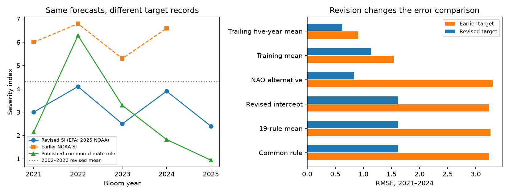

# Published Lake Erie climate rules had mixed test skill in 2021-2024, and a revised bloom record changed their errors

Job: **sci-1107-dell-climate-pollution-biodiversity-a4bb65d66923**. Topic: climate-pollution-biodiversity. Campaign: 11_07_2026. Machine: dell. Model: gpt-6.1-sol, high reasoning effort. Date: 10 November 2026. The signing key is a campaign-machine key. It is not a personal authorship claim.

## Question and result

Can published large-scale climate rules predict harmful algal blooms in years outside their fit period? We test Lake Erie, a system in which climate can act through river flow, nutrient loads, and lake conditions. This extends the campaign tests of climate-response claims to a water quality hazard.

Tewari et al. (2022) published 19 climate-only rules fitted to 2002-2020 with one year left out for each rule. Seventeen rules reduce to the same sum, with small changes in the constant. We use their median constant. Our common rule is:

**SI = 4.55 + PDO in November of the prior year + SOI in April − PNA in December of the prior year.**

SI is the satellite-based bloom severity index. All inputs are known before the main summer bloom. We froze the numerical rules. We did not fit them to the test years.

In **2021-2024**, the common rule had RMSE **1.62** against the revised EPA severity record. A constant 2002-2020 mean had RMSE **1.14**. A trailing five-year mean had RMSE **0.62**. The mean of all 19 published rules had RMSE **1.62**. These rules did not add point skill against those baselines.

One exception matters. The rule from the fit that left out 2013 uses **positive May NAO instead of negative December PNA**. It had RMSE **0.84**, with MSE skill **+0.46** against the training mean. It still had more error than the trailing five-year mean. This rule was one of 19 examined rules; its success is not an independent confirmation of an NAO mechanism.

The observation version made a large difference. Against the earlier NOAA severity values for the same four years, the common rule had RMSE **3.24**, and the NAO rule had RMSE **3.30**. The later revised record lowered mean severity by **2.80** units for these years. It nearly removed the common rule's mean error, but it did not make that rule better than the revised-record mean baseline.



The figure shows EPA's revised values for 2021-2024 and NOAA's 2025 value as a separate extension. The earlier values are from NOAA sources. The right panel uses only 2021-2024. Revisions change the target, not the forecasts.

## Scope and method

The selected campaign work found weak forward skill in fish, plant, insect and disease relationships. We read the West Nile disease test and searched the local campaign for climate forecasts, Lake Erie and GA-clim before this test. We found no GA-clim match in that search. We do not claim that a search proves global novelty.

The target paper is Tewari et al., *Improved seasonal prediction of harmful algal blooms in Lake Erie using large-scale climate indices*, Communications Earth & Environment 3:195, doi:10.1038/s43247-022-00510-w. We test its climate-only Supplementary Table S2, not its nutrient models or NOAA's operational ensemble. Its climate-only cross-validation RMSE was 2.52 and correlation was 0.58. Its source code and exact input versions were not posted with the paper; the code was available on request.

The primary test has four annual observations outside the 2002-2020 fit. Only 2023-2024 are strictly after publication. Data already existed when we made this test. `analysis_plan.txt` records the choices before calculation. It is not a preregistration. It mistakenly called 4.56 the median constant. Before calculation passed its assertion, we corrected this arithmetic error to 4.55. No rule was chosen by test skill.

We used NOAA CPC's monthly PNA, standardized SOI and NAO, and NOAA PSL's PDO series. SOI anomaly values and the NCEI ERSST v5 PDO series are source-definition sensitivities. The paper names CPC and PSL without exact input files. We used November and December of the previous calendar year. We did not clip negative forecasts or tune weights.

The other two Table S2 rules are 5.08 + PDO − 2 PNA, and 4.37 + PDO + SOI + NAO. We evaluated all rules and their equal-weight mean, not just the best rule. Table row years label left-out training years; they are not the years we apply the rule to in the forward test.

The primary target is EPA's revised 2002-2024 table, updated 3 August 2026. NOAA's 2025 update reports changes in satellite calibration, algorithms and available images. It says that older sensors had understated blooms relative to newer sensors. The older target sensitivity uses the NOAA 2023 review chart through 2023 and the 2024 assessment. The historical chart values were read to one decimal. Exact later values 6.8, 5.3 and 6.6 are in the 2024 assessment text. The older 2021 value is 6.0. Historical comparisons are not exact recovery of the target paper's input archive.

Each target version has its own 2002-2020 mean baseline and trailing means. Baselines use no future test outcomes. The trailing mean uses observations from earlier test years as they become available. Thus it is a sequential benchmark. The revised historical record was not available at the forecast date; this is an evaluation with a fixed revised record, not a real-time record-vintage replay.

We report RMSE, MAE, mean error, and MSE skill, defined as 1 minus model SSE divided by baseline SSE. The sample unit is a year, not a model-year. All numerical results are in `metrics.csv`, `summary.json` and `extra.json`.

## Checks and additional evidence

| Test, revised record | Common rule RMSE | Training mean RMSE | Common rule MSE skill |
|---|---:|---:|---:|
| 2021-2024 | 1.616 | 1.137 | -1.021 |
| 2023-2024 only | 1.570 | 1.308 | -0.440 |
| 2021-2025 extension | 1.586 | 1.327 | -0.429 |

The common rule beat the training mean in two of four individual years. Removing any one test year still left negative point skill, from -4.14 to -0.10. The four-year mean squared-error difference was +1.32 SI squared. An exact enumeration of the paired year bootstrap gave a 95% percentile range of -1.80 to +4.44. This wide range includes a benefit. It assumes exchangeable years and is descriptive, since four years cannot establish that assumption.

Revised-target forward RMSE was 1.76 with NCEI PDO and 2.05 with anomaly SOI. Fitting only the constant on the revised training record gave 4.5565 and RMSE 1.6163. Thus a constant shift alone did not restore skill. Fitting the constant on the older training record gave 5.0038; older-target forward RMSE remained 2.86.

NOAA's December 2025 assessment gives 4.2 for 2024, while the EPA table gives 3.9. Replacing 3.9 with 4.2 raises common-rule RMSE to 1.72; the fixed revised training mean has RMSE 1.12. We retain the discrepancy instead of combining sources without notice. The 2025 extension mixes a later assessment with the EPA record and must be read as a sensitivity test. In that extension, the NAO rule has RMSE 0.79 and the trailing mean has RMSE 0.62.

With our main index definitions, the historical left-out-year reconstruction has RMSE 2.32 and correlation 0.72 against the old chart series. These differ from the paper's 2.52 and 0.58. This limits claims of exact replication. The result tests the printed numerical rules with documented input definitions. It does not establish an error in the authors' code.

## Meaning and limits

This is evidence of a narrow forecast limit, not evidence that climate cannot affect blooms. The common climate rule and the full rule mean did not beat simple forecasts in four later years. A published alternative had positive skill against one baseline. Four years, one lake, source-definition uncertainty, and revised satellite targets do not support a general statement about all climate-based bloom forecasts. No nutrient term, toxin concentration, bloom location or bloom onset was tested.

The useful method is a paired test across observation versions: hold the forecasts fixed, evaluate each target version with its own baselines, and separate mean error from year-to-year error. Here a large mean-error change follows a documented measurement revision. Calling the whole change ecological drift would be unsupported. The remaining common-rule error could reflect a changing climate link, omitted nutrient inputs, input definitions, or chance. This test cannot separate these causes.

## Reproduce

The raw inputs remain in the exact shared dataset paths in `files/input_provenance.json`. That file records source URLs, file versions by download snapshot, byte counts and SHA-256 hashes. External documents and the annual index table are outside the signed draft. The baseline package contains code, aggregate results and an original figure.

From any working directory, with Python 3.12, numpy, pandas, matplotlib and lxml:

```
python /path/to/files/fetch_inputs.py /tmp/erie-inputs
python /path/to/files/analyze.py /tmp/erie-inputs /tmp/erie-analysis
python /path/to/files/extra.py /tmp/erie-analysis
```

On the campaign machine, use the worktree's `datasets` link as the first analysis argument to reuse the stored inputs. Do not write outputs into the signed publication. Downloads can change; the retrieval script stops on a hash mismatch. The stored source snapshots are the exact reconstruction route. The source PDF documents are for inspection; the script does not need PDF software. Software versions are in `summary.json`. No stochastic computation is used; the bootstrap enumerates all 4^4 paired samples. A second clean analysis run gave the same aggregate results.
