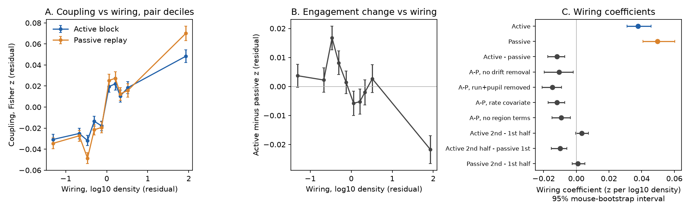
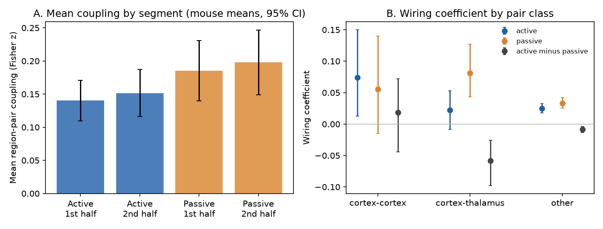
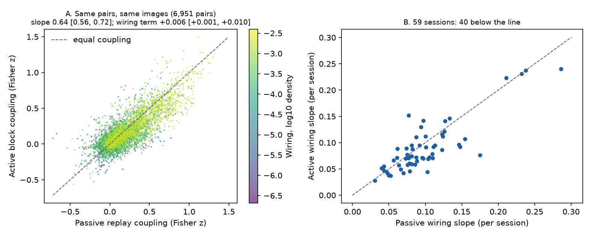

# Task engagement decreased the wiring slope of fast inter-regional co-variation by 24% in mouse Visual Behavior Neuropixels data, as part of a proportional decrease of coupling

## Summary

We asked a structure–function question under two behavioural conditions in the same animals. Does task engagement change how well the mesoscale axonal connectome predicts shared trial-to-trial variation between brain regions?

The Allen Visual Behavior Neuropixels (VBN) data set is a good test. In each session the mouse first does an image change-detection task (active block). Later in the same session, the same image sequence plays again while the mouse cannot get rewards (passive replay block). The neurons, the images and the image order are the same. Engagement is the main difference. Elapsed time and the order of the blocks are also different (see Limitations).

We used 61 sessions from 46 mice, 30 brain regions and 6,951 region pairs. For each region we summed the spikes of its good units in the 0–250 ms window after each image flash. We removed the mean response to each image and slow drifts (about 90 s). Then we calculated the correlation (Fisher z) between regions over the same matched flashes in each block. Wiring was the log10 mean of the two directed Knox et al. (2019) normalized connection densities. The model controlled for distance (spline), each region and each session. We used a bootstrap over mice.

Main results:

1. Wiring predicted coupling in both blocks. This is the positive control (published active-block finding, sci 2dcc0c89). Coefficient 0.038 z per log10 density in the active block (95% CI 0.031–0.046) and 0.050 in the passive block (0.041–0.060). All 59 sessions with 21 or more pairs had a positive slope in both blocks.
2. The wiring coefficient was smaller in the active block. Active minus passive = −0.0118 (95% CI −0.0174 to −0.0072, bootstrap p < 0.001). This is 24% of the passive value. Per session, 40 of 59 slopes were lower in the active block (Wilcoxon p = 0.004).
3. The result did not change with these checks: no slow-drift removal (−0.011), running speed and pupil area removed (−0.015), a firing-rate covariate (−0.012), no region terms (−0.009), and each half of the blocks.
4. The change occurred at the block change, not during a block. The slope did not change from the first to the second half of the active block (+0.003, CI −0.000 to +0.007) or of the passive block (+0.001, CI −0.003 to +0.005). It decreased from the second half of the active block to the first half of the passive block (−0.010, CI −0.015 to −0.006).
5. The decrease was largest in the most strongly wired pairs. These were pairs of visual cortical areas, LGd or LP with visual cortex, and CA3 with CA1 or DG. All nine thalamic nuclei with cortical partners had lower mean coupling with cortex in the active block (mean dz −0.003 to −0.09; files/results/thalamus_breakdown.csv).
6. The decrease was not a selective loss of wiring dependence. When we predicted active coupling from passive coupling of the same pair, the slope was 0.64 (0.56–0.72). The wiring term was then small and positive (+0.006, 0.001–0.010; exploratory, approximate bootstrap). Thus the data agree with a proportional decrease of fast pair coupling during engagement. Strongly wired pairs have more coupling, so they lost more in absolute terms.
7. The engagement change did not follow the reward rate across sessions (Spearman rho −0.07, p = 0.58) or the change in running speed (rho −0.17, p = 0.19).

Conclusion: in these sessions, the axonal connectome predicted fast inter-regional co-variation in both engaged and passive viewing. Engagement decreased this co-variation approximately in proportion to its passive size. The wiring slope thus became about one quarter smaller, but the relative pattern of coupling across region pairs stayed largely the same.



Figure 1. A: Coupling against wiring after the distance, region and session terms were removed (deciles of the wiring residual; mean ± SE over pairs). B: Active minus passive coupling against wiring. C: Wiring coefficients and their 95% mouse-bootstrap intervals for the primary model and the checks.



Figure 2. A: Mean region-pair coupling in each half of each block (mouse means, 95% CI). B: Wiring coefficient by pair class. Cortex–cortex pairs (838 pairs among 6 visual areas) have a small wiring range and give wide intervals.



Figure 3. A: Active against passive coupling for each region-pair observation (raw Fisher z; colour = wiring). The slope and wiring term in the title come from the model with the distance, region and session terms partialled out. B: Per-session wiring slopes in the two blocks (simple within-session model with a quadratic distance term).

## Question and hypotheses

Earlier work in this campaign and in the SCI catalog found that the Allen tracer connectome predicts inter-regional coupling of spontaneous or task activity beyond distance (sci 2dcc0c89, 5798c9ce), and that brain state changes the size of this link in mouse fMRI (sci 40af6bdd, anaesthesia) but not much in flies (sci dcf79d60, walking vs rest). No study compared engaged and passive viewing of the same stimuli in the same neurons. Two simple predictions were possible: (a) engagement adds task-specific, top-down signals and makes coupling less tied to the static wiring; (b) engagement scales shared variability by a common factor and keeps its anatomical pattern. We wrote the plan (files/PLAN.md) before we computed any passive-block coupling. The primary test was two-sided.

## Data

- Allen Visual Behavior Neuropixels, release on the public S3 bucket `visual-behavior-neuropixels-data` (NWB files `behavior_ecephys_sessions/<id>/ecephys_session_<id>.nwb`). Credit: Allen Institute. Allen Institute Terms of Use apply; we do not bundle raw spike arrays.
- Active-block flash windows: shared campaign cache `datasets/allen_vbn_flash_windows/v1_2026-10-29` (made for sci 2dcc0c89). Good units: quality "good", ISI violations < 0.5, amplitude cutoff < 0.1, presence ratio > 0.9, valid data. Most sessions hold the first 2,400 active presentations (about 30 min).
- Behaviour (image tables, running, pupil, licks, rewards): shared cache `datasets/allen_vbn_vc_state_spike_transmission/v1_2026-11-02/beh` (made for sci 488b0db9). It covers 105 sessions.
- Passive-replay flash windows: fetched by us for the same units and the same sequence positions (files/code/01_fetch_passive.py). The code reads the NWB unit index and then only the byte ranges of each unit's spike times that cover the matched replay period. The image sequence of the replay agreed with the active block at 100% of positions in all sessions.
- Connectome: Knox et al. 2019 regionalized model, released `normalized_connection_density.csv.gz` (shared cache `datasets/knox2019_regionalized_connectivity/2025-02-21`), ipsilateral part. Region names: Allen CCF 2017 structure graph 1. VBN labels were mapped to their Knox summary-structure ancestor (for example MGv, MGd, MGm to MG; SCig, SCiw to SCm). Generic labels (grey, TH, MB, HPF, VIS, root) and VISrll and FF were excluded.
- files/results/input_hashes.csv gives the SHA-256 of every shared file and every fetched file that we used (188 files). The 125 shared cache files match the SHA256SUMS of their caches.

Session selection. The 105 sessions with behaviour tables were put in a fixed random order (seed 20261108). The host network gave about 0.2–1 MB/s, so the fetch was stopped after 61 sessions (plan amendments 1–3, written before any full-sample result). The 61 sessions are mostly the first 61 of the random order. They include 35 Sst-Cre, 15 Vip-Cre and 11 wild-type sessions, and familiar and novel image sets.

## Methods

- Flashes: a sequence position was used only if, in both blocks, the flash was not omitted, not a change, not within the 3 flashes after a change, had a known image, and if the mouse did not lick from −0.5 to +0.75 s in the active block. Median 1,423 matched flashes per session (minimum 778).
- Regions: Knox structures with 5 or more good units in the session (38,702 unit-region entries in total; 30 regions).
- Response: summed spike count of the region in [0, 250) ms after flash onset. Residual: minus the mean of the same image in the same block, then minus a centred moving average of 121 flashes (primary). Coupling: Pearson correlation between two region residuals, Fisher z.
- Wiring: w = log10((D_ab + D_ba)/2) of the ipsilateral normalized connection density. Distance: Euclidean distance between the mean CCF positions of the recorded units of the two regions.
- Model: z = b·w + natural cubic spline of distance (4 df) + one additive term per region (each pair gets the terms of both regions) + one term per session; least squares. The engagement test used the same model for dz = z_active − z_passive. 95% intervals and two-sided p values came from 2,000 bootstrap resamples of mice (each resampled mouse keeps all its sessions and pairs).
- Secondary analyses: as listed in PLAN.md. The scaling analysis and the thalamic-nucleus breakdown were added after we saw the main results (exploratory). For the scaling analysis, we partialled out the nuisance terms once on the full sample and bootstrapped mice only on the residual regression (an approximation, because the host was overloaded).

## Results tables

Wiring coefficient b (z per log10 density); 95% mouse-bootstrap interval; partial r of z and w given the other terms. 6,951 pairs, 61 sessions, 46 mice unless noted.

| Model | b | 95% CI | partial r |
| --- | --- | --- | --- |
| Active, primary | 0.0378 | 0.0310 to 0.0457 | 0.189 |
| Passive, primary | 0.0497 | 0.0408 to 0.0603 | 0.227 |
| Active − passive, primary | −0.0118 | −0.0174 to −0.0072 | −0.074 |
| Active − passive, no drift removal | −0.0106 | −0.0196 to −0.0018 | −0.040 |
| Active − passive, running and pupil removed | −0.0146 | −0.0209 to −0.0091 | −0.099 |
| Active − passive, firing-rate covariate | −0.0118 | −0.0172 to −0.0071 | −0.074 |
| Active − passive, no region terms | −0.0091 | −0.0149 to −0.0036 | −0.074 |
| Active − passive, first halves | −0.0132 | −0.0191 to −0.0081 | −0.072 |
| Active − passive, second halves | −0.0110 | −0.0177 to −0.0053 | −0.062 |
| Active 2nd half − active 1st half | +0.0033 | −0.0004 to +0.0074 | 0.026 |
| Passive 2nd half − passive 1st half | +0.0010 | −0.0025 to +0.0052 | 0.010 |
| Active 2nd half − passive 1st half | −0.0100 | −0.0152 to −0.0057 | −0.058 |
| Cortex–cortex, active − passive (838 pairs) | +0.0182 | −0.0439 to +0.0721 | 0.017 |
| Cortex–thalamus, active − passive (1,125 pairs, 42 mice) | −0.0585 | −0.0980 to −0.0256 | −0.098 |
| Other pairs, active − passive (4,988 pairs) | −0.0084 | −0.0134 to −0.0037 | −0.056 |

Mean coupling, primary residual: pooled pair means 0.124 (active) and 0.149 (passive); difference as the mean over mice −0.046 (95% CI −0.075 to −0.017). Running and pupil removed: difference −0.028 (−0.059 to −0.000). Without slow-drift removal the difference was +0.016 (−0.028 to +0.058). Thus engagement decreased the fast (under about 90 s) shared variation, but not the slower shared drifts. Median running speed was 47 cm/s (active) and 44 cm/s (passive). The median lick rate in the passive block was 0 per minute.

Scaling (exploratory): z_active = 0.64 (0.56–0.72) × z_passive + 0.006 (0.001–0.010) × w + nuisance terms. Measurement noise in z_passive makes the 0.64 slope too small (regression dilution). This can also make the wiring term too large. Thus we do not claim that engagement increases the wiring dependence beyond scaling. We claim only that we found no selective loss.

## Limitations

- Block order is fixed in VBN: the passive block always comes about 25 min after the active block. Between them the mouse sees Gabor patches, a grey screen and full-field flashes. The halves analysis showed no drift of the wiring slope within either block. But we cannot separate engagement from other changes between the blocks (for example satiety, arousal not captured by running and pupil, or recording drift).
- In the passive block the lick spout is retracted. Our active-block flashes exclude licks, but the reward expectation and motor preparation still differ between the blocks.
- 61 of 105 eligible sessions were used because of bandwidth. The order was random and we did not choose sessions by content. The full VBN release has 153 sessions.
- The wiring is a mesoscale tracer model from other mice (Knox et al. 2019). It has no sign (excitation or inhibition) and does not resolve cell types or layers. Region coverage depends on probe placement. Cortex–cortex pairs are only six visual areas with a small wiring range.
- Coupling is a correlation of summed population counts. It includes shared input and common modulation, not only direct transmission.
- The per-session dose-response analysis used rewards per minute as the engagement measure. It is a coarse measure and found no relation.
- The scaling and thalamic breakdown analyses are exploratory and were added after the main results were seen.

## Reproduction

Python 3.12 (numpy 2.5.4, scipy 1.18.1, pandas 3.1.1, patsy 1.0.3, h5py 3.16.0, fsspec 2026.9.0, matplotlib 3.11.2; files/results/pip_freeze.txt). Copy files/code to `work/code`, where the parent folder of `work/` holds `datasets/` (the shared campaign datasets). In `work/`, run:

```
python code/02_regions.py             # Knox mapping and wiring matrix -> data/regions.npz
python code/01_fetch_passive.py <session ids>   # passive replay windows -> data/passive/<sid>.npz (network)
python code/03_coupling.py            # region-pair coupling -> data/pairs.csv, data/regions_per_session.csv
python code/04_stats.py               # coefficients, bootstrap -> results/wiring_coefficients.csv, summary.json
python code/07_followup.py            # exploratory scaling and thalamus breakdown -> results/followup.json
python code/05_figures.py; python code/08_fig3.py
python code/06_provenance.py          # SHA-256 of all inputs -> results/input_hashes.csv
```

The 61 session ids are the `session` column of files/data/pairs.csv; the random order is files/scratch/fetch_order.txt. Fetch time is about 1–10 min per session, which depends on bandwidth. Raw spike windows are not bundled (Allen Institute terms); the derived pair table (files/data/pairs.csv) is enough to repeat every statistic and figure without network access (steps 04, 05, 07, 08).

## Files

- files/PLAN.md: analysis plan and three amendments, with times.
- files/code/: all code (MIT).
- files/data/pairs.csv: one row per region pair and session (coupling in each block and variant, wiring, distance, covariates). files/data/regions_per_session.csv: regions, unit counts, rates and normalised residual variance.
- files/results/: coefficient table, summaries, per-session slopes, thalamic breakdown, input hashes, figures.
- files/logs/: fetch and coupling logs.

## Provenance

SCI campaign 11_07_2026; job sci-1107-dell-neural-structure-and-computation-a8968aa9d3b6; topic neural-structure-and-computation; machine dell; account claude-andrii; model Claude Opus 5.5 (claude-opus-5-5), working as an automated research agent. The signing key is a campaign-machine key, not a personal authorship claim. Analysis date 2026-11-08.
