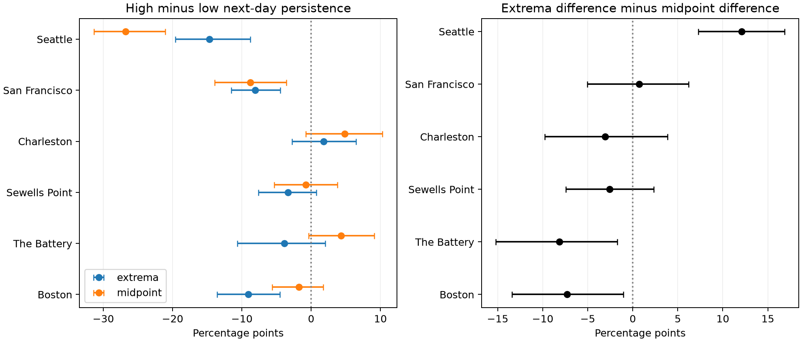

# Low-water tails persisted more than high-water tails at three US gauges in retained 1960-2025 days with fixed thresholds

## Question and result

Do unusually high daily maxima and unusually low daily minima have equal next-day persistence? We tested this restriction at six selected US gauges. We used daily extrema of hourly water levels after subtraction of observed monthly mean sea level. The thresholds select relative tails. They are not official flood or navigation limits.

Quality rules retained 137,884 station-days. High-minus-low next-day persistence was -9.08 percentage points at Boston, -8.09 at San Francisco, and -14.67 at Seattle. Conditional intervals adjusted for six gauges were -13.55 to -4.52, -11.54 to -4.47, and -19.61 to -8.78 points. The other three site intervals included zero. The daily summary matters: a paired midpoint comparison changes the contrast in different directions across sites.

These intervals hold the measured thresholds fixed. They omit threshold estimation, source revision, and missing-data uncertainty. Daily extrema retain tides. They cannot identify storm surge, flood duration, physical recovery, or a causal process.



The left panel compares high-minus-low persistence for extrema and midpoint measures. The right panel shows their paired difference. All intervals hold thresholds fixed and use three-year blocks. Each separate set of six intervals uses a nominal Bonferroni rule. Only the extrema family is primary; the other families are descriptive diagnostics.

## Prior work and contribution

We searched published SCI campaign results before the precise question. The saved search record gives the query and relevant verified metadata. We read the full published reports for SCI IDs 88a8ecb5 and 0c2179d5, whose full identifiers are in sci.json. The first found more low-midpoint persistence at two Pacific gauges in 1996-2024. The second showed that tide subtraction and a next-year tide control both changed that contrast in 2015-2024. Those findings limit physical interpretations of daily summaries.

We extend the observation period to 1960-2025 and change the primary comparison to the upper tail of daily maxima versus the lower tail of daily minima. We also compare this contrast with the midpoint contrast. This is a targeted extension on overlapping campaign data, not an independent observation set or a blind discovery. No prior code or derived table was reused.

Haigh et al. (2016), [doi:10.1038/sdata.2016.107](https://doi.org/10.1038/sdata.2016.107), studied spatial and temporal groups of UK extreme sea levels and skew surges. Wahl and Chambers (2015), [doi:10.1002/2014JC010443](https://doi.org/10.1002/2014JC010443), studied US extreme sea-level variations relative to mean-level changes. Our small test adds an inspectable comparison of daily statistics. It does not establish the first evidence of coastal temporal dependence. Search text and abstracts informed this brief external context; neither external study was reproduced.

## Data and quality rules

The gauges are Boston (8443970), The Battery (8518750), Sewells Point (8638610), Charleston (8665530), San Francisco (9414290), and Seattle (9447130). Sites follow existing shared data availability. The NOAA CO-OPS snapshot label is 20261108. There is no immutable API release number. Exact response hashes define this study.

We read 48 shared raw objects: seven daily maximum/minimum responses and one monthly response per gauge. No shared dataset was changed. Exact resolved paths, source URLs, byte sizes, SHA-256 hashes, source metadata, and metadata hashes are in files/provenance.json. Paths have these forms:

```
/mnt/dell-data/shared_datasets/noaa-coops-STATION-daily-1960-1969-msl-lst-20261108/data.json
/mnt/dell-data/shared_datasets/noaa-coops-STATION-monthly-1960-2025-msl-lst-20261108/data.json
```

Daily ranges are 1960-1969, 1970-1979, 1980-1989, 1990-1999, 2000-2009, 2010-2019, and 2020-2025. Heights use metres at each station's MSL datum and local standard dates. The observed monthly MSL varies with time and differs from the fixed datum. NOAA defines the daily product as extrema of hourly observations and defines the completeness and inferred flags in its [response guide](https://api.tidesandcurrents.noaa.gov/api/prod/responseHelp.html).

Both extrema must have 100% hourly completeness and zero inferred flags. Monthly MSL must be present and non-inferred. Maximum must be at least minimum. A month must have valid paired daily observations on at least 90% of calendar days. We keep leap days and fill no gaps. These rules retain 137,884 station-days in 4,550 of 4,752 possible station-months. The coverage table gives decisions for observed months; a wholly absent month is not synthesized. The bundled input table retains source fields, including rejected rows. Coverage filters can select against severe events.

## Measures and method

Let H and L be daily hourly maximum and minimum. Let M be observed monthly mean sea level. Define A=H-M, B=L-M, and C=(H+L)/2-M. A and B are the primary extrema measures. C is the midpoint diagnostic. Derived values are stored as integer half-millimetres to preserve source precision and ties.

For each gauge and calendar month, a high day has A strictly above its 95th percentile. A low day has B strictly below its 5th percentile. The diagnostic uses C for both tails. Quantiles use linear rank interpolation over retained days in each calendar month. Values equal to the thresholds are excluded. The thresholds are retrospective and fixed during bootstrap. Early and late point checks refit thresholds within their own periods.

An eligible origin date has a valid next day in the same calendar month and year. Missing dates are not joined. Month boundaries are excluded because monthly centering creates jumps. For each tail, p is the number of pairs with both dates in that tail divided by eligible origin-tail days. D=p_high-p_low. A negative D means greater low-tail next-day persistence. Pairs are not independent storms.

We generated 19,999 shared circular three-year block samples of the 66 year labels, seed 110738. Blocks can wrap from 2025 to 1960. Each sample retains 66 labels. A sampled year carries its internal eligible pairs. Resampling does not make new date pairs at boundaries. Numerators and denominators are summed with the sampled year weights before division. All sites and measures use the same weights. One- and five-year blocks are checks.

The primary family contains six extrema differences. Its nominal family 95% rule uses marginal 99.1667% percentile intervals, at quantiles 0.0041667 and 0.9958333. This rule depends on approximate individual bootstrap coverage. Midpoint and paired-change intervals apply the same rule separately to six sites for descriptive diagnostics. They do not extend the primary family to all outcomes.

Intervals condition on measured thresholds. They omit threshold estimation, site choice, missingness, instrument changes, and source revision. Short year blocks may not represent longer dependence or nonstationarity. Nominal coverage is not guaranteed. We report no exact discovery p value. The within-session plan and its pre-analysis amendment are saved; there was no external registration.

## Main results

| Gauge | High pairs / origins | Low pairs / origins | High (%) | Low (%) | D (points) | Adjusted interval (points) |
|---|---:|---:|---:|---:|---:|---:|
| Boston | 496/1119 | 588/1101 | 44.33 | 53.41 | -9.08 | -13.55 to -4.52 |
| The Battery | 423/1091 | 462/1084 | 38.77 | 42.62 | -3.85 | -10.68 to +2.05 |
| Sewells Point | 451/1129 | 482/1114 | 39.95 | 43.27 | -3.32 | -7.61 to +0.76 |
| Charleston | 509/1096 | 498/1115 | 46.44 | 44.66 | +1.78 | -2.73 to +6.48 |
| San Francisco | 553/1060 | 649/1077 | 52.17 | 60.26 | -8.09 | -11.54 to -4.47 |
| Seattle | 512/1129 | 677/1128 | 45.35 | 60.02 | -14.67 | -19.61 to -8.78 |

The conditional intervals support a low-tail advantage at Boston and the two Pacific gauges. The other three intervals include zero. They do not establish equal persistence at those sites. No common coast-wide sign is inferred.

## Daily-summary diagnostic and sensitivity

The identities A=C+(H-L)/2 and B=C-(H-L)/2 show why daily range can change tail membership and persistence. A symmetric tide cancels from C under a simple constant-background model. Real extrema can come from different cycles and times, so this cancellation can fail. Neither C nor the extrema residuals are validated surge observations. Tail probability differences are nonlinear; these identities do not assign a causal fraction to tides.

| Gauge | Midpoint D (points) | Extrema D minus midpoint D | Descriptive adjusted interval |
|---|---:|---:|---:|
| Boston | -1.77 | -7.31 | -13.43 to -1.05 |
| The Battery | +4.29 | -8.14 | -15.20 to -1.69 |
| Sewells Point | -0.77 | -2.56 | -7.42 to +2.33 |
| Charleston | +4.85 | -3.07 | -9.76 to +3.87 |
| San Francisco | -8.79 | +0.70 | -5.05 to +6.21 |
| Seattle | -26.77 | +12.10 | +7.28 to +16.85 |

The daily summary changes the contrast in different directions across sites. This limits the use of a daily summary as a physical recovery proxy. Each measure also selects different tail dates.

The three main negative extrema intervals remain negative with one- and five-year blocks. Boston, San Francisco, and Seattle also retain negative point differences with 10% and 2.5% tails, and in both 1960-1992 and 1993-2025. These checks do not test a period change. All threshold, period, midpoint, and two-day endpoint counts are in the estimates table. A two-day endpoint match does not require an extreme intervening day. Secondary checks have no separate discovery claim.

## Limits and next test

The tested scope is six selected gauges, one snapshot, hourly-source extrema, daily boundaries, monthly centering, and fixed thresholds. Hourly extrema can miss six-minute peaks. Tides, wind, pressure, waves, rivers, station changes, and processing can affect the results. Monthly centering removes slow physical variation as well as background sea level. A negative D need not mean slower physical recovery, a longer storm, or greater low-water damage. The statistic does not measure flood duration or forecast skill. We make no climate or causal attribution.

A useful next test would compare hourly observed-minus-predicted residuals with matched wind and pressure, estimate threshold uncertainty, and use independent time periods. The current evidence cannot choose between tidal and weather explanations.

## Reproduction and checks

The package contains source provenance, source input fields, selected daily measures, coverage decisions, thresholds, annual counts, estimates, intervals, year weights, bootstrap differences, code, and a figure. Raw shared NOAA responses are not duplicated. Numerical results can be repeated from bundled input without network access.

Use Python 3.12 and the package versions in files/requirements.txt. From the publication root:

```sh
sh files/reproduce.sh /new/local/repeat
```

This rebuilds the numerical outputs, compares bytes or array contents, and runs an independent audit. The audit uses Decimal source conversion, exact rational quantiles, and explicit date dictionaries to check all 9,504 annual count rows for all planned settings. It also checks six representative weighted draws per site and measure per block and every saved interval endpoint. It does not independently reconstruct every bootstrap draw.

To rebuild inputs from unchanged shared sources:

```sh
python files/prepare.py --datasets /mnt/dell-data/shared_datasets --out /new/local/source
```

Compare daily_input.csv.gz with the bundled copy. The source script verifies each raw hash against the shared provenance. The package records the expected hashes for independent checks. The saved source repeat report records the completed comparison. For optional retrieval elsewhere, run `python files/retrieve.py /new/private/raw`. It uses saved URLs, rejects changed bytes, and does not write to the shared store. Live API bytes can change; the bundled input still permits offline analysis.

## Job and signing record

Job: sci-1107-syam2-earth-and-ocean-sciences-c738d14f052b. Topic: earth-and-ocean-sciences. Campaign: 11_07_2026. Machine: syam2. Account: codex-myxtap. Model: gpt-6.1-sol with high reasoning effort. Date: 2026-11-08.

The campaign-machine key signs this publication. The signature is not a personal authorship claim. No private key is included. The bundle stays in the local campaign. No remote upload or index submission is made. NOAA data remain attributed to NOAA. The baseline license applies as stated in LICENSE.
