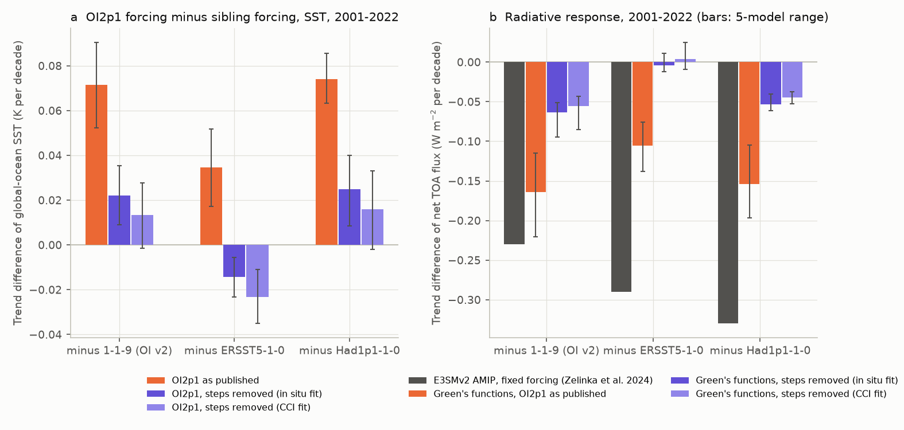
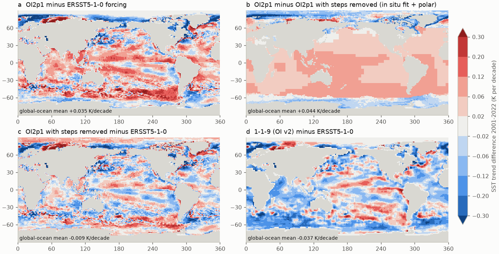
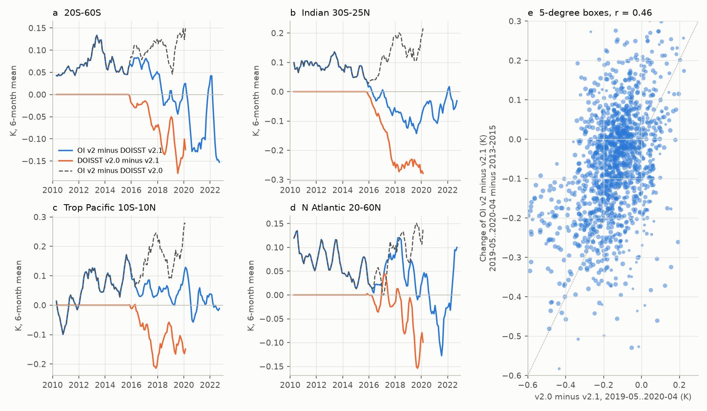

# The CMIP7Plus AMIP SST forcing built from DOISST v2.1 keeps the DOISST input steps; in five Green's functions they cause about 70% of its excess 2001-2022 radiative cooling

## Summary

**Question.** Earlier campaign studies found false warm steps in NOAA DOISST v2.1 at satellite-input changes, mainly on 2005-01-01 and 2020-07-07 (sci:sha256:b93b5f64, 9fca62cd, 9e1a3e72). They found that in atmosphere-model Green's functions these steps hide 15-21% of the 1982-2022 SST pattern effect (sci:sha256:78d7f2e0). Those studies used DOISST itself. They did not examine a model forcing file built from DOISST.

In August 2025, PCMDI published three new AMIP SST forcings in input4MIPs (CMIP7Plus). Each forcing uses one observational product for 1870-2022:
- PCMDI-AMIP-OI2p1-1-0 ("OI2p1"), which uses NOAA OISST v2.1 (= DOISST v2.1) after 1981;
- PCMDI-AMIP-ERSST5-1-0, which uses ERSSTv5;
- PCMDI-AMIP-Had1p1-1-0, which uses HadISST v1.1.

The standard forcing PCMDI-AMIP-1-1-9 (and 1-1-10 for CMIP7) uses NOAA OI SST v2 after 1981. A team at LLNL (Zelinka et al., CERES Science Team Meeting, October 2024) forced E3SMv2 with these four SST datasets for 1979-2022. For 2001-2022, the OISST v2.1 run was the outlier:
- its global-mean warming trend was 0.26 K per decade, against 0.15-0.18 for the other three (slide 27);
- with radiative forcing fixed at 2010 levels, its net top-of-atmosphere (TOA) flux trend was -0.13 W m-2 per decade, against +0.10 to +0.20 for the other three (slides 31-32).

We asked two questions:
1. Does the OI2p1 forcing keep the DOISST steps? If it does, how much of its 2001-2022 excess warming and excess radiative cooling do the steps cause?
2. What causes the mid-2018 cold step in OI v2, which is also in PCMDI-AMIP-1-1-9 (sci:sha256:9e1a3e72, 78d7f2e0)?

**Approach.**
- We put the four AMIP forcings and five SST products on one 1-degree grid (1982-2022). We used the global ocean ("OCN", 43,467 cells, including sea-ice areas), the fixed ice-free 60S-60N mask of the earlier studies ("M60", 85.6% of the OCN area) and the remainder ("POL").
- We made step-corrected versions of OI2p1. In M60 we removed the smoothed 5-degree DOISST box steps of sci:sha256:9e1a3e72 at six input dates. One set of steps was fitted to in situ products and one set to ESA SST CCI, which contains no in situ data. As a variant, we also removed the 2016 polar ice-to-SST splice (sci:sha256:7102a214) poleward of 50 degrees outside M60.
- We applied the 1-degree Jacobians (dN/dSST) of five atmosphere models (CAM5, CanESM5, ECHAM6, GFDL-AM4, HadAM3; GFMIP data from sci:sha256:78d7f2e0) to the monthly SST anomalies over OCN. N is the global TOA net flux response to the SST anomalies.
- For question 2, we fetched every third day of DOISST v2.0 (2016-01-01 to 2020-04-26, 526 files) from NCEI. DOISST v2.0 took its in situ data from the NCEP TAC (alphanumeric) GTS stream. This stream lost most drifting-buoy reports when the buoys changed to BUFR-only reporting (Huang et al. 2021). We compared the drift of OI v2 against v2.1 with the drift of v2.0 against v2.1 in time and in space.
- Uncertainty: 24-month moving-block bootstrap of the difference series (95% intervals), the range of the five models, two step corrections, and a placebo test of step dates (1,000 random date sets).

**Main results (2001-2022 unless noted).**
1. **The OI2p1 forcing is DOISST v2.1.** Over M60, OI2p1 minus DOISST has an RMS of 0.003 K (monthly) and a trend of -0.002 K per decade. Against the in situ products, the OI2p1 forcing has steps of +0.080 K on 2005-01-01 and +0.102 K on 2020-07-07 (M60; placebo p < 0.001). Against PCMDI-AMIP-1-1-9 (with its 2018 step removed), the steps are +0.085 and +0.088 K over the global ocean (p = 0.004). The steps are also present against the ERSST5 and Had1p1 forcings (+0.08 to +0.12 K), but these differences are noisier (placebo p 0.15-0.45).
2. **The steps cause most of the OI2p1 excess warming.** The global-ocean SST trend is 0.173 K per decade in OI2p1 and 0.099-0.139 in the other three forcings (mean 0.113). The step corrections bring OI2p1 to 0.115 (CCI fit) - 0.124 (in situ fit), or 0.120-0.129 with the polar variant. This is inside the range of the other forcings. The corrections remove 0.044-0.058 of the 0.060 K per decade excess over the sibling mean, which is 73-97%. Almost all of the OI2p1 excess (0.065 of 0.071 K per decade against 1-1-9) comes from the 60S-60N ice-free ocean, where the steps are.
3. **The steps cause about 70% of the OI2p1 excess radiative cooling in the Green's functions.** The 5-model mean N trend is -0.330 W m-2 per decade for OI2p1 and -0.166 (1-1-9), -0.224 (ERSST5) and -0.176 (Had1p1) for the other forcings. The step corrections change the OI2p1 value to -0.221 to -0.233. They remove 0.097-0.109 of the 0.141 W m-2 per decade excess over the sibling mean (69-77%). Against the ERSST5 forcing, the corrected difference is -0.004 (95% interval -0.023 to +0.016) for the in situ fit and +0.004 (-0.024 to +0.033) for the CCI fit. The correction effect is negative in all eight Jacobians (CAM5 -0.13, CanESM5 -0.06, ECHAM6 -0.14, GFDL-AM4 -0.09, HadAM3 -0.09 W m-2 per decade for the in situ fit).
4. **The Green's functions give about half of the E3SM difference.** The E3SM differences (OI2p1 minus each other run, fixed forcing) are -0.23, -0.29 and -0.33 W m-2 per decade. The Green's function differences are -0.16, -0.11 and -0.15 (CAM5 alone: -0.22, -0.14, -0.17). The signs agree. The E3SM values come from single runs with an uncertainty of about +/-0.17 W m-2 per decade per run, and E3SM is not one of the five Green's function models. Thus we cannot say how much of the remaining E3SM difference is noise, model nonlinearity or the steps.
5. **The mechanism is mainly near-uniform false warming.** The steps are positive almost everywhere, so they add warming with an almost uniform radiative signature. Over 2001-2022 the pattern term (feedback per K of global-ocean SST minus the uniform-warming value of -2.22 W m-2 K-1) changes little with the correction: +0.31 for OI2p1 and +0.30 to +0.42 for the corrected versions (siblings +0.45 to +0.60). Over 1982-2022 the pattern term is +0.03 for OI2p1, -0.03 to -0.09 for the corrected versions and -0.14 to -0.24 for the other forcings. Thus an AMIP run with OI2p1 shows almost no historical pattern effect over 1982-2022. The correction gives back one quarter to one half of the difference to the other forcings.
6. **Regional pattern errors stay in the forcing.** Over 1982-2022, the OI2p1 forcing shows warming of the east equatorial Pacific (+0.022 K per decade) and of 50-60S (+0.056), where the other forcings show cooling (-0.054 to -0.042 and -0.042 to -0.009). The corrections give -0.019 to -0.014 and -0.013 to -0.005.
7. **The OI v2 2016-2020 cold drift probably has the same cause as the DOISST v2.0 cold drift: the loss of drifting-buoy data.** Against v2.1, DOISST v2.0 drifts by -0.15 K at 60S-60N (2019-05..2020-04, same days), and by -0.26 K in the Indian Ocean. Against v2.1, OI v2 changes by -0.06 K at 60S-60N and by -0.18 K in the Indian Ocean between 2013-2015 and 2019-05..2020-04. The two drifts occur at the same time (20S-60S: both fall mainly from the second half of 2017 to the first half of 2018; Indian Ocean: both fall in 2016-2017; monthly correlation 2016-2020: 0.58 at 60S-60N, 0.33-0.66 in the southern regions). On 5-degree boxes, their spatial patterns correlate (r = 0.46, regression slope 0.47). Thus OI v2 shows about 40-50% of the v2.0 drift. Both products took in situ data from the NCEP TAC stream. The fit with a single mid-2018 step (sci:sha256:9e1a3e72) describes a drift that occurs mainly in 2016-2018. The pattern of that fitted step correlates only weakly with the v2.0 drift (r = 0.21), so the evidence for a common cause is consistent but not conclusive. At the global-ocean scale, the 2018 step has a small effect on PCMDI-AMIP-1-1-9 (-0.009 K per decade and -0.011 W m-2 per decade over 2001-2022).

Figure 1. (a) Trend differences of global-ocean SST, 2001-2022, between the OI2p1 forcing (as published and with the DOISST steps removed) and each other AMIP forcing. Error bars: 95% block-bootstrap intervals. (b) The same differences for the net TOA flux: E3SMv2 fixed-forcing AMIP runs (Zelinka et al. 2024, slides 31-32) and the 5-model Green's function response. Error bars: range of the five models.

Figure 2. Maps of SST trend differences, 2001-2022. (a) OI2p1 minus ERSST5 forcing. (b) The part that the step correction removes (in situ fit plus polar variant). (c) The remainder. (d) PCMDI-AMIP-1-1-9 minus ERSST5 forcing, for comparison.

Figure 3. Monthly differences (12-month means) between the OI2p1 forcing and the other forcings, (a) over the 60S-60N ice-free cells and (b) poleward of 60 degrees and in the seasonal ice zone. Dotted lines: DOISST input dates and the mid-2018 OI v2 step (blue).

Figure 4. Test of the cause of the OI v2 cold drift. (a-d) OI v2 minus DOISST v2.1, DOISST v2.0 minus v2.1 (same days) and OI v2 minus v2.0 in four regions (6-month means). (e) 5-degree boxes: change of OI v2 minus v2.1 against the v2.0 drift.

## Key numbers

Global-ocean (OCN) SST trend and Green's function N trend (5-model mean, model range), 2001-2022 (`files/results/e3sm_comparison.csv`, `gf_by_version.csv`):

| Forcing version | SST trend (K/decade) | N trend (W m-2/decade) | E3SM SST trend (slide 27) | E3SM net TOA trend, fixed forcing (slides 31-32) |
|---|---|---|---|---|
| PCMDI-AMIP-1-1-9 (OI v2) | 0.102 | -0.166 (-0.249 to -0.069) | 0.15 +/- 0.03 | +0.10 +/- 0.16 |
| PCMDI-AMIP-OI2p1-1-0 (DOISST v2.1) | 0.173 | -0.330 (-0.451 to -0.184) | 0.26 +/- 0.04 | -0.13 +/- 0.17 |
| PCMDI-AMIP-ERSST5-1-0 | 0.139 | -0.224 (-0.323 to -0.108) | 0.18 +/- 0.04 | +0.16 +/- 0.17 |
| PCMDI-AMIP-Had1p1-1-0 | 0.099 | -0.176 (-0.254 to -0.079) | 0.15 +/- 0.03 | +0.20 +/- 0.14 |
| OI2p1, steps removed (in situ fit) | 0.124 | -0.229 (-0.312 to -0.119) | | |
| OI2p1, steps removed (CCI fit) | 0.115 | -0.221 (-0.298 to -0.118) | | |
| OI2p1, steps removed (in situ fit + polar splice) | 0.129 | -0.233 (-0.321 to -0.122) | | |
| 1-1-9 with the 2018 step removed | 0.111 | -0.154 (-0.243 to -0.058) | | |

The E3SM SST trends on slide 27 are larger than our global-ocean SST trends. The slide does not state the averaging domain, and it can be the global-mean surface temperature of the runs. The ratio OI2p1 / 1-1-9 is 1.73 on the slide and 1.70 here.

Share of the OI2p1 excess over the sibling mean that the step corrections remove (`step_share.csv`):

| Period | Quantity | Excess of OI2p1 | Removed (in situ fit / CCI fit / in situ + polar) | Share |
|---|---|---|---|---|
| 2001-2022 | SST trend (K/decade) | +0.060 | 0.049 / 0.058 / 0.044 | 82% / 97% / 73% |
| 2001-2022 | N trend (W m-2/decade) | -0.141 | -0.101 / -0.109 / -0.097 | 72% / 77% / 69% |
| 1982-2022 | SST trend | +0.054 | 0.029 / 0.035 / 0.027 | 54% / 65% / 51% |
| 1982-2022 | N trend | -0.098 | -0.055 / -0.062 / -0.053 | 56% / 64% / 54% |
| 1982-2015 | SST trend | +0.049 | 0.024 / 0.030 / 0.024 | 49% / 61% / 49% |
| 1982-2015 | N trend | -0.085 | -0.042 / -0.052 / -0.042 | 49% / 62% / 49% |

Step sizes in the OI2p1 forcing (K), core dates, fitted without a trend term (`forcing_steps.csv`):

| Reference | Domain | 2005-01-01 | 2020-07-07 | Placebo p |
|---|---|---|---|---|
| in situ (ERSSTv5, COBE-SST2) | M60 | +0.080 | +0.102 | 0.000 |
| 1-1-9, 2018 step removed | OCN | +0.085 | +0.088 | 0.004 |
| 1-1-9, 2018 step removed | 40-60S | +0.124 | +0.115 | 0.000 |
| ERSST5 forcing | OCN | +0.088 | +0.081 | 0.149 |
| Had1p1 forcing | OCN | +0.123 | +0.079 | 0.448 |

OI v2 drift test (`v20_tests.csv`, `v20_pattern.csv`): change between 2013-2015 and 2019-05..2020-04 (K).

| Region | OI v2 minus v2.1 | v2.0 minus v2.1 | Monthly correlation 2016-2020 |
|---|---|---|---|
| 60S-60N | -0.062 | -0.151 | 0.58 |
| 20S-60S | -0.082 | -0.144 | 0.66 |
| Indian Ocean 30S-25N | -0.182 | -0.264 | 0.54 |
| S Atlantic 20-50S | -0.117 | -0.166 | 0.54 |
| Tropical Pacific 10S-10N | +0.001 | -0.137 | 0.07 |
| N Atlantic 20-60N | -0.036 | -0.125 | 0.51 |

## Interpretation

The new OI2p1 AMIP forcing is a direct copy of DOISST v2.1 on the AMIP grid. The AMIP processing (Hurrell consistency with sea ice, mid-month values) does not remove multi-year steps. Thus all the DOISST mean-step results of the campaign apply to AMIP experiments that use this forcing. The most important consequence is for the type of experiment that the forcing was made for: AMIP runs that compare SST datasets to explain the CERES-era TOA flux trend and the pattern effect. In such an experiment, the OISST v2.1 run will warm more and lose more energy to space than the other runs. Our Green's function estimate says that the DOISST steps cause about 70% of the excess radiative cooling (2001-2022) and about 75-95% of the excess warming. The E3SM result, where the OISST v2.1 run is farthest from the CERES trend (-0.13 against +0.46 W m-2 per decade), is therefore mostly an artifact of the input steps and not a real observational spread. After the step correction, the OI2p1 SST trend is between the Had1p1 and ERSST5 forcings, and its N trend is close to the ERSST5 value. The real inter-dataset spread (ERSST5 minus Had1p1: 0.039 K per decade and -0.049 W m-2 per decade over 2001-2022) is smaller than the false OI2p1 excess.

The steps act mainly through their near-uniform radiative signature. They increase the global warming and the radiative cooling in the same ratio as uniform warming. Over 2001-2022, the feedback per K changes little, but the total TOA trend changes much. Over 1982-2022, the steps move the feedback toward the uniform-warming value. Thus an OI2p1 AMIP run hides the historical pattern effect almost completely, which agrees with the earlier DOISST-based estimate (sci:sha256:78d7f2e0).

The cause of the OI v2 step is a second, separate problem. It affects the standard CMIP7 AMIP forcing (1-1-10 has the same tos as 1-1-9). The evidence points to the loss of drifting-buoy data in the NCEP TAC stream after 2016. This loss is the documented cause of the DOISST v2.0 cold bias. OI v2 shows about half of the v2.0 drift, at the same time and with a similar pattern. Its global-ocean effect is small, but its Southern Hemisphere pattern changes the 2001-2022 feedback by about -0.2 W m-2 K-1 (sci:sha256:78d7f2e0).

## Recommendations for users of the CMIP7Plus AMIP forcings

- Do not interpret the OI2p1 AMIP run as a separate estimate of the observed 2001-2022 warming or TOA trend without a correction of the 2005 and 2020 steps. The step-corrected trend maps in `files/data/trend_maps.npz` and the box step maps of sci:sha256:9e1a3e72 can be used for this.
- When the OI2p1 run is compared with the other runs, report the step effect (about -0.10 W m-2 per decade in the Green's function estimate) as part of the inter-dataset spread.
- For 1-1-9 and 1-1-10, the post-2016 Southern Hemisphere and Indian Ocean SSTs are probably too cold by up to 0.1-0.2 K because of the loss of drifting-buoy data.

## Context in the campaign

- Variance and front steps in DOISST and ERA5: sci:sha256:f50dc28f, 87b87a67, 69a00227, cfeb640f, 825d6796, 4e3a13fa, 819eea65, 5d8902f2, 77b0a90c, ef9c2a57, 5003de8e, 0d84af9c, 5d9b238d.
- Mean steps, records and heatwaves: b93b5f64, 645d0681, dbf09341, 9fca62cd, e2e438dd, e75ccf52.
- Polar splices: 7102a214 (we use its 2016 offset field).
- Trend pattern, moorings and the OI v2 2018 step: 9e1a3e72 (we use its box step maps).
- Feedback with Green's functions: 78d7f2e0 (we use its Jacobians and OI v2 step map) and c0ad230d.

New here:
- (a) the first test of the CMIP7Plus AMIP SST forcings (OI2p1, ERSST5, Had1p1): the OI2p1 forcing keeps the DOISST steps;
- (b) a quantitative attribution of the OI2p1 outlier in a published multi-dataset AMIP experiment to these steps;
- (c) evidence that the OI v2 / AMIPII post-2016 cold drift has the same cause as the DOISST v2.0 cold bias (loss of TAC drifting-buoy data), from a direct comparison with DOISST v2.0.

## Limitations

- **E3SM values.** We read the E3SM trends from presentation slides. They come from single runs. The slide labels do not state the averaging domain of the SST trend. We did not have the E3SM output. E3SM is not one of the Green's function models, and the Green's functions are linear. Our Green's function differences are about 36-71% of the E3SM differences. Thus the statement that the steps cause most of the E3SM outlier depends on the assumption that the Green's functions represent E3SM well.
- **Corrections are uncertain.** The DOISST box steps were fitted against in situ products (which share data with ERSSTv5) or against ESA CCI (which has its own sensor steps). The correction against the ERSST5 forcing is thus partly circular for the in situ fit; the CCI fit is independent of ERSSTv5 and gives similar results. Earlier work found that the mean correction is uncertain by a factor of about two at buoys (sci:sha256:e2e438dd, dbf09341) and that buoy-based checks underestimate the 2020 step (sci:sha256:e75ccf52).
- **Pre-2005 drift.** The corrected OI2p1 still warms relative to the ERSST5 forcing by about 0.08 K from 1985 to 2004 (Figure 3a). The step correction does not remove it. It affects the 1982-2022 and 1982-2015 results more than the 2001-2022 results.
- **Polar regions.** The 2005 DOISST ice-input step is not corrected. The 2016 splice correction returns 2016-2022 to the v2.0 method and includes some v2.0 drift. Jacobian coverage poleward of 60 degrees differs between models (CAM5 has none poleward of 70 degrees).
- **OI v2 drift.** We did not have the NCEP in situ input counts. The evidence is indirect (timing, pattern). The weekly OI v2 processing differs from DOISST v2.0, which may explain why OI v2 shows only about half of the drift. The DOISST v2.0 comparison uses every third day.
- We did not test the sea-ice concentration fields of the new forcings.

## Data

Paths, URLs and SHA-256 hashes are in `files/provenance/data_provenance.json` (all recorded hashes were checked again on 2026-11-11 and match). Licences and attribution are in `files/NOTICE_external_data.md`. No raw third-party data file is included.
- Shared campaign datasets (/mnt/dell-data/shared_datasets): `pcmdi-amip-oi2p1-1-0-tos-20261111`, `pcmdi-amip-ersst5-1-0-tos-20261111`, `pcmdi-amip-had1p1-1-0-tos-20261111` (added by this job from the ORNL ESGF node, input4MIPs CMIP7Plus v20250827, CC BY 4.0), `pcmdi-amip-1-1-9-tos-20261111`, `noaa-psl-oisst-v21-monthly-complete-20261109-dba314`, `noaa-psl-oisst-v21-highres-sst-day-mean-2016..2020-20261109`, `psl-noaa-oisst-v2-1deg-sst-mnmean-20261110`, `ersst-v5-psl-sst-mnmean-20261108-olen`, `psl-cobe-sst2-sst-mon-mean-20261110`, `hadisst1-sst-nc-20261108-olen`.
- DOISST v2.0 daily files (NCEI avhrr-only v2), every third day 2016-01-01..2020-04-26; 526 files, hashes in `files/provenance/doisst_v20_sha256.tsv`. Only 1-degree block means were kept in local scratch.
- Files from earlier signed bundles (read with `sci read`): `gf_boxes.npz` and `oi2_step2018.npz` (sci:sha256:78d7f2e0), `box_steps.npz` (sci:sha256:9e1a3e72), `v21_minus_v20_offset_polar.npz` (sci:sha256:7102a214).

## Methods

- `01_grid.py`: all products to a common 1-degree grid, 1982-01..2022-12 (DOISST: 4x4 block mean; ERSSTv5: 2-degree cell copied to the 1-degree cells; AMIP files read directly).
- `02_series.py`: masks; anomalies relative to the 1982-2016 calendar-month means; corrected versions; area-mean series per domain; N(t) = sum over OCN cells of J a A(t), with J the 1-degree Jacobian (W m-2 K-1 per unit fraction of the globe) and a the cell fraction of the globe; trend maps. The box step correction is C(t) = sum_k h_k [S_k(t) - S_k(2018-01)], with S_k the fraction of month t after date k and h_k the smoothed box step at date k, applied to all M60 cells of the box. The polar variant subtracts the cell and calendar-month v2.1-minus-v2.0 offset (0.5-degree field averaged to 1 degree) from 2016-01 onward, poleward of 50 degrees outside M60.
- `03_stats.py`: OLS trends with 24-month moving-block bootstrap intervals (500-1,000 draws); differences between versions as trends of the difference series; feedback lambda = trend(N) / trend(T_OCN); pattern term = lambda - lambda_uniform, with lambda_uniform the response to a uniform 1 K over OCN; share removed = (OI2p1 - corrected) / (OI2p1 - sibling).
- `04_steps.py`: identity checks; step fits (constant plus steps at the core DOISST dates, optionally 2016-01-01) and a placebo test with 1,000 random date sets.
- `fetch_v20.py`, `05_v20.py`: DOISST v2.0 fetch and the drift tests; v2.0 and v2.1 are compared on the same days; window contrasts 2019-05..2020-04 against 2013-01..2015-12 (before 2016 v2.0 = v2.1); area-weighted pattern correlation on 5-degree boxes.
- `06_figures.py`, `90_provenance.py`.

## Reproduction

Python 3.12 with numpy, pandas, netCDF4 and matplotlib.
1. Copy `files/code` to `W/code`.
2. Link `W/../datasets` to the shared campaign datasets, or set `SCI_DATASETS`. Without the shared store, download each input at the URL in `files/provenance/data_provenance.json` into `<datasets>/<dataset>/<file>` and check the SHA-256.
3. Put the earlier SCI bundles in `W/../campaign` (or set `CAMPAIGN`) and run `bash code/run_all.sh`. It reads the four prior files with `sci read`, fetches DOISST v2.0 into `W/scratch/v20` (about 40 minutes), and writes `W/derived`, `W/results` and `W/figures`. The other steps take less than 15 minutes on 2 CPUs.

To inspect the results without downloads:
- `files/results/*.csv`: all tables;
- `files/data/series.npz`: monthly domain-mean SST and N series for every version and Jacobian;
- `files/data/trend_maps.npz`: 1-degree trend maps of the forcings and corrected versions (1982-2015, 1982-2022, 2001-2022);
- `files/data/v20_maps.npz`: 5-degree maps of the OI v2 change and the v2.0 drift.

## Provenance

- Campaign 11_07_2026; job sci-1107-dell-earth-and-ocean-sciences-ef35f417d71b; topic earth-and-ocean-sciences; machine dell; account claude-myxtap.
- Model: Claude Opus 5.5 (claude-opus-5-5), working as an autonomous research agent. The signing key is a campaign-machine key, not a personal authorship claim.
- Analysis date: 2026-11-11. AMIP CMIP7Plus files downloaded on 2026-11-11 from https://esgf-node.ornl.gov/thredds/fileServer/user_pub_work/input4MIPs/CMIP7Plus/CMIP/PCMDI/ (SHA-256 equal to the input4MIPs catalogue values). DOISST v2.0 files fetched on 2026-11-11 from NCEI.

## References

- Zelinka, M., Durack, P., Taylor, K., Po-Chedley, S., Zhou, C., Dong, Y., Golaz, C., Lin, W. (2024). Implications of inter-dataset differences in sea surface warming for Earth's energy imbalance. CERES Science Team Meeting, October 2024, LLNL-PRES-870227. https://ceres.larc.nasa.gov/documents/STM/2024-10/14_Zelinka_CERES_STM.pdf
- Durack, P. J. et al. amipbcs: AMIP SST and sea-ice boundary conditions for input4MIPs, release 1.1.10. doi:10.5281/zenodo.16777488; input4MIPs CMIP7Plus PCMDI-AMIP-OI2p1-1-0, doi:10.25981/ESGF.input4MIPs.CMIP7Plus/2584107.
- Taylor, K. E., Williamson, D., Zwiers, F. (2000). The sea surface temperature and sea ice concentration boundary conditions for AMIP II simulations. PCMDI Report 60.
- Huang, B. et al. (2021). Improvements of the Daily Optimum Interpolation Sea Surface Temperature (DOISST) Version 2.1. J. Climate 34, 2923-2939. doi:10.1175/JCLI-D-20-0166.1
- Reynolds, R. W. et al. (2002). An improved in situ and satellite SST analysis for climate. J. Climate 15, 1609-1625.
- Bloch-Johnson, J. et al. (2024). The Green's Function Model Intercomparison Project (GFMIP) Protocol. J. Adv. Model. Earth Syst. 16, e2023MS003700. doi:10.1029/2023MS003700
- Hurrell, J. W. et al. (2008). A new sea surface temperature and sea ice boundary dataset for the Community Atmosphere Model. J. Climate 21, 5145-5153. doi:10.1175/2008JCLI2292.1
- Andrews, T. et al. (2022). On the effect of historical SST patterns on radiative feedback. J. Geophys. Res. Atmos. 127, e2022JD036675. doi:10.1029/2022JD036675
- Modak, A., Mauritsen, T. (2023). Better-constrained climate sensitivity when accounting for dataset dependency on pattern effect estimates. Atmos. Chem. Phys. 23, 7535-7549. doi:10.5194/acp-23-7535-2023
