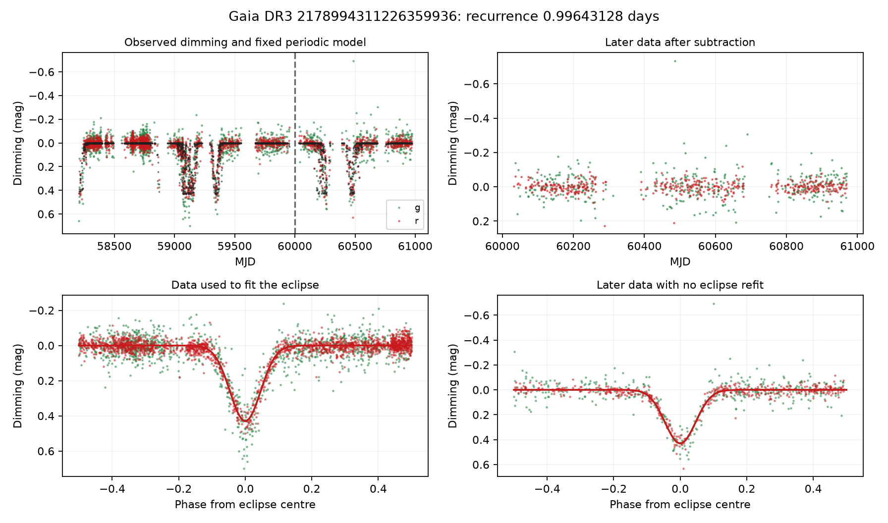
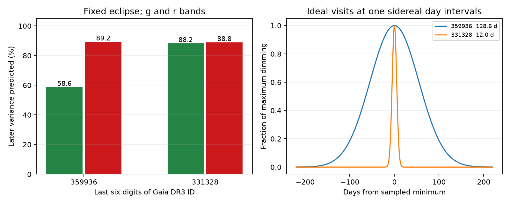
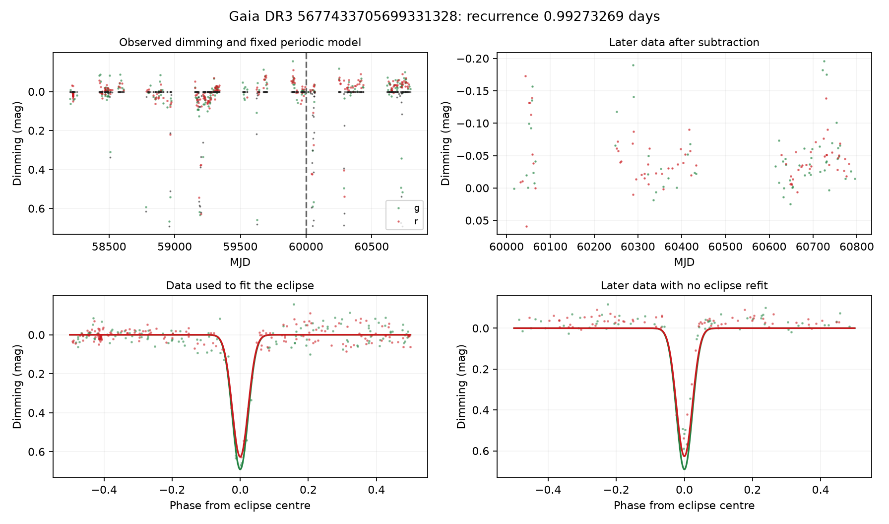

# Eclipse models with periods near one day predict long dips in two ZTF dimmer candidates

Job: **sci-1107-hp-astronomy-78fec6b6534d**. Topic: astronomy. Campaign: 11_07_2026. Machine: hp. Account: codex-olen. Model: gpt-6.1-sol, high reasoning effort, through the Codex harness in T3 Code. Analysis date: 2026-11-11 UTC. The signing key is a campaign-machine key. It is not a personal authorship claim.

## Result

A fixed eclipse model explains the apparent long dimming of **Gaia DR3 2178994311226359936**. A fit to ZTF observations before MJD 60000 gives a recurrence time of **0.99643128 days** and an eclipse width at half depth of **2.59 hours**. It predicts **89.2% of the weighted variance in later r observations**, and 58.6% in later g observations. The later observations do not set the period, phase, width, or depth. Only a constant offset for each ZTF object is fitted in these data.

In one early event, 32 sampled nights are faint by more than 0.15 mag over a span of **128.6 days**. The same short eclipse, evaluated at the actual observation times, accounts for this group and for two later groups that span 55.8 and 61.9 days. A span of faint samples does not show that the source stayed faint between the samples.

A second case, **Gaia DR3 5677433705699331328**, provides a check. Tzanidakis et al. (2025, hereafter TZ25) had already noted its possible 0.992-day eclipsing-binary signal and named it ZTF19adgqwvh. Our early-data model has a recurrence time of 0.99273269 days. It predicts 88.2% and 88.8% of the later g and r variance. This is not a new discovery of that binary candidate.

The new result is a test of the cause of the apparent long events. Short, fixed eclipses and the actual observation times reproduce them. The evidence supports an eclipsing-binary explanation for these two unresolved sources. It does not establish the mass or nature of their companions. It does not show that the other 79 TZ25 candidates, or Gaia20cdd, have this cause.



Figure 1. The main case. The black points in the upper left panel are the fixed periodic model at the actual observation times. The vertical line is the training cut. The lower right panel uses later data without an eclipse refit. The upper right panel shows the later residuals. Each ZTF object has its own constant reference level. No slow baseline is fitted.

## Why this test matters

The campaign has strong evidence for rare dust dimming in several field dwarfs, including infrared extinction, excess emission, and an ice band in Gaia20cdd. That evidence does not make every optical dipper candidate a dust source. TZ25 found 81 candidates in a large ZTF search. Their discussion used long event lengths as evidence against ordinary stellar eclipses. Their period test also removed peaks near the daily cadence.

A near-day eclipse can defeat this argument. At a fixed local sidereal time, successive nights sample almost the same orbital phase. That phase changes slowly. A series of short eclipses can then look like one long event. Thus an observed event length can be a property of the observing pattern, rather than the length of one physical eclipse.

The prior campaign metallicity study, SCI 6a7a7f85, found the Gaia ECL classification of 2178994311226359936. It also described its faint Gaia epochs as dip-like. We test the origin of those fades and of the ZTF events. The Gaia catalogue itself is prior evidence for an eclipse; we do not claim a new catalogue classification. The use of a locked model to predict later ZTF events, and the explicit link between hour and month scales, are the added evidence.

## Selection and scope

We first searched the campaign and read the relevant publications. We planned a period test across the 81 TZ25 candidates. The archive was slow, so we reduced the scope to two cases with specific prior eclipse evidence: the candidate noted by TZ25, and the candidate with a Gaia ECL classification. This choice was made before their eclipse-model prediction scores were known. The preliminary Fourier screen covered ten downloaded light curves. It used periods from 0.2 to 50 days and did not give a strong two-band forecast for these narrow eclipses. The source list, its statistics, the plan, and the screen code are retained. An eleventh light curve was downloaded but was not screened before we stopped the broad search.

This is a selected two-case test. It is not a completed survey of the 81 candidates. The result cannot give a contamination rate, a dust occurrence rate, or a revised metallicity relation.

## Data and method

We use public ZTF DR24 light curves from IRSA. The main file has 3996 detections; 3797 pass our primary cuts. The check file has 513 detections; 432 pass. No duplicate filter/exposure pair occurs in either input file. We retain finite g and r magnitudes with catflags = 0 and 0 < magnitude error < 0.15 mag. We add a 0.02-mag error floor in quadrature. This floor limits the weight of precise measurements. It is not a measured noise model.

The primary clock is the supplied heliocentric Julian date. The training cut uses the supplied MJD: training MJD < 60000; test MJD >= 60000. The final test sets contain 404 g and 439 r observations for the main case, and 64 g and 72 r observations for the check case. They extend into 2025. This is a retrospective split, not a prospective observing test. The source list and Gaia classification helped select the cases. We did not use the later ZTF measurements to fit the eclipse.

The geometric model, in magnitudes, is

    m(t) = C_object + A_band exp[-0.5 (wrap(f(t-t0)-phase)/sigma)^2].

Here wrap returns a phase in [-0.5, 0.5), t0 = HJD 2458000.5, f is in cycles per day, and sigma is a phase width. The reference level C is separate for each ZTF object. The eclipse phase and width are common to both bands. The g and r depths are separate. This is a geometric model, not a physical binary solution.

We search f within 0.001 cycle/day of the Gaia catalogue frequency for the main case. For the check case, the search is within 0.001 cycle/day of 1/0.992. The phase range is one cycle; the initial width range is 0.008-0.15 cycles. Differential evolution finds the nonlinear parameters. A local least-squares fit then refines them. At each step, linear least squares gives the object levels and band depths. All random seeds are fixed. No global period uniqueness is claimed.

For later data, the eclipse parameters stay fixed. We profile a constant offset for each ZTF object in both the eclipse model and the constant model. The score is

    skill = 1 - weighted_residual_sum_squares(eclipse) / weighted_residual_sum_squares(constant).

It measures prediction of the variable signal after removal of the same constant nuisance terms. It does not mean that the model explains that fraction of the total stellar flux. There is no time-dependent test baseline. For the main case, the r residual rms falls from 0.1112 to 0.0337 mag. For the check case it falls from 0.1181 to 0.0380 mag.

We resample whole observing nights in the training data 200 times. Each resample refits the model near the selected solution. The percentile interval is conditional on this model and frequency branch. It does not include untested aliases, physical shape error, or a possible factor of two in the orbital period.

## Measured results

| Quantity | 2178994311226359936 | 5677433705699331328 |
| --- | ---: | ---: |
| Recurrence time, days | 0.99643128 | 0.99273269 |
| 95% night-bootstrap interval, days | 0.99642671-0.99643548 | 0.99271357-0.99274511 |
| Fitted g depth, mag | 0.428 | 0.691 |
| Fitted r depth, mag | 0.430 | 0.627 |
| Width at half depth, hours | 2.59 | 1.31 |
| Later g prediction score | 0.586 | 0.882 |
| Later r prediction score | 0.892 | 0.888 |
| Ideal sidereal beat time, days | 1185.4 | 218.2 |
| Ideal sampled width at half depth, days | 128.6 | 12.0 |

The source suffixes used in some campaign files are 359936 and 331328.

The following sampled event groups use r-night medians. A group contains nights for which the fixed model exceeds half of its r depth. A gap above 30 days starts a new group. Groups with fewer than three nights are not listed. All nights in each listed group have observed dimming above 0.15 mag. These rules were set for description after the model fit; they are not a detection-completeness test.

| Source suffix | First MJD | Last MJD | Nights | Sampled span, days |
| --- | ---: | ---: | ---: | ---: |
| 359936 | 59042.49 | 59171.11 | 32 | 128.62 |
| 359936 | 59320.49 | 59391.32 | 14 | 70.83 |
| 359936, later data | 60207.31 | 60263.13 | 12 | 55.82 |
| 359936, later data | 60432.49 | 60494.37 | 17 | 61.87 |
| 331328 | 59185.54 | 59200.40 | 4 | 14.85 |
| 331328, later data | 60043.26 | 60057.17 | 3 | 13.91 |

The full table also includes a 12.94-day group of five nights for the main case in 2018. Gaps and changes of observing time explain why actual groups need not follow a simple beat curve.

### Sampling calculation

Let f_sid = 1.00273790935 cycles/day. At ideal visit times t_n = n/f_sid, the phases of f and f - f_sid are identical modulo one. Thus a periodic source has an apparent beat period 1/|f-f_sid| on this observing grid. A Gaussian eclipse with phase width sigma has an ideal sampled width

    sampled FWHM = 2 sqrt(2 ln 2) sigma / |f-f_sid|.

The physical width is the same numerator divided by f. For the main case, the ratio is about 1190. This calculation does not use any source magnitudes. A numerical identity check at 4000 visits passes with maximum complex-phase error below 1e-10. The actual-time prediction, rather than this ideal grid, is the empirical test.



Figure 2. Later-data scores and the ideal sampled profiles. The right panel is a sampling calculation, not a claim of continuous observed dimming.

### Gaia agreement

We retrieve Gaia DR3 epoch photometry for the main case. Of 57 transits, 53 have finite magnitudes and positive flux/error and are not rejected by the Gaia variability flag. We do not apply an additional noisy-data flag. All four transits more than 0.15 mag below the median fall in the eclipse predicted from the early ZTF fit. With the ZTF phase and width fixed, a G reference level and G depth give a score of **0.9757** and a depth of **0.388 mag**. Keeping the ZTF r depth fixed, with only the G level fitted, gives 0.9641.

Gaia helped select this source and its frequency neighborhood. Its phase agreement is useful cross-survey evidence, but it is not a blind discovery test. Gaia times are BJD(TCB); we apply the documented Julian-date origin and do not make the much smaller HJD/BJD and TCB time-scale corrections. These differences are short compared with a 2.59-hour eclipse. The epoch plot and record-level Gaia data are regenerated only in external scratch. They are not bundled.

### Sensitivity tests

A stricter cut, chi < 4 and |sharp| < 0.25, leaves the main-case later r score at 0.8924 and the width at 2.61 hours. Fitting only early r gives a recurrence time of 0.99643236 days and a later r score of 0.8929. Using MJD in the model gives 0.99643023 days and 0.8900. For the check case these three later r scores are 0.8839, 0.9284, and 0.8795. The full results are in `files/results/sensitivity.csv`. The r-only fit does not predict g depth; its zero g score is not a failed test of a fitted g model.



## Interpretation and limits

The selected models account for the large apparent long events in these two sources. They require no separate long dust screen. Near-day peaks deserve a source test, even when they lie close to a survey window peak. Long spans in sparsely sampled light curves cannot by themselves reject ordinary eclipses or set the radius of occulting dust.

These are unresolved photometric sources. We have no radial velocities, binary light-curve solution, or image-based proof that the eclipse belongs to the catalogued star rather than a close blend. A strictly periodic dust structure is not logically excluded. A photometric recurrence time can also be half the orbital period when two eclipses are alike. The Gaussian shape is approximate; residual scatter remains, especially in the faint g data. No posterior odds among all physical causes are claimed.

The successful test does not weaken the direct infrared evidence for small dust grains or ice in Gaia20cdd. It also does not revise the prevalence of deep, large-amplitude dust dimming. The present cases have their own selection history and shallower eclipses. A complete contamination study would need the remaining TZ25 light curves, source-image checks, and an injection test of the full selection process.

## Reproduction

Python 3.12 with numpy, pandas, scipy, astropy, matplotlib and requests is sufficient. The software versions used here are in `files/results/summary.json`. Set BLAS and OpenMP thread counts to one. The code uses one compute process. No private service or key is needed to reproduce the analysis.

From the extracted publication, use separate scratch directories. For example:

```sh
python files/code/retrieve.py --raw /tmp/dimmer_78fec6_raw
python files/code/analyse.py --raw /tmp/dimmer_78fec6_raw --out /tmp/dimmer_78fec6_results --bootstrap 200
python files/code/diagnostics.py --raw /tmp/dimmer_78fec6_raw --out /tmp/dimmer_78fec6_results
```

Both raw and output directories must be outside the publication. The scripts enforce this rule. The retrieval script records new hashes and compares exact input bytes. ZTF responses should match while the release stays fixed. Gaia VOTable wrappers can contain new query timestamps or table names, so byte hashes can differ without a change to their scientific values. Inspect version and table values if a hash changes. The original file hashes, exact URLs, and ADQL queries are in `files/provenance/inputs.json`. No shared raw dataset was used. All downloads used local scratch in this job.

Optional research history: `retrieve.py --pilot` also downloads the other exploratory light curves. Run `pilot_screen.py --raw RAW --out OUT` for the broad Fourier screen. It will also screen the eleventh file, which the original pilot did not analyse. This screen is not the eclipse-model fit and should not replace it.

The signed package contains our code, aggregate statistics, bootstrap parameter draws, figures from unrestricted ZTF data, and provenance. It contains no raw ZTF light curve, Gaia extract, Gaia-derived record database, or externally licensed source text. `files/NOTICE-external-data.md` gives source credits and terms. Raw source data and a regenerated Gaia epoch plot remain outside the signed draft.

## References

Tzanidakis et al. 2025, ApJ 991, 118, doi:10.3847/1538-4357/adf5bb. Mowlavi et al. 2023, A&A 674, A16, doi:10.1051/0004-6361/202245330. Masci et al. 2019, PASP 131, 018003, doi:10.1088/1538-3873/aae8ac. Bellm et al. 2019, PASP 131, 018002, doi:10.1088/1538-3873/aaecbe. Gaia Collaboration 2023, A&A 674, A1, doi:10.1051/0004-6361/202243940. SCI citations and their roles are in `sci.json`.
