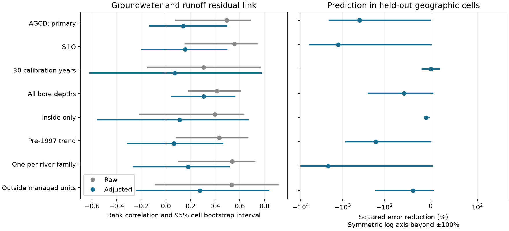

# Adjustment for location and baseline conditions weakened the groundwater–runoff link in 46 Victorian catchments in 2010–2021

## Question and result

Do observed groundwater shortfalls give spatial information about runoff loss beyond location and baseline catchment conditions? We tested this question with the fixed catchment endpoints of SCI publication `795f820e`. That study added bore observations to a research series based mainly on rain and river flow. It found larger runoff losses where groundwater fell further below its pre-1997 rain relation. Its planned 30-year calibration sample was inconclusive. A larger, exploratory sample gave a positive link.

We reproduced the raw link in the larger sample. We then removed the effects of latitude, longitude, baseline rain, baseline runoff/rain ratio and catchment area. The remaining link was small and uncertain. Groundwater did not improve the planned test of prediction in held-out geographic cells. These results limit the added spatial evidence from this endpoint set. They do not show that groundwater has no physical role.

In 46 Victorian catchments across 14 cells, the raw AGCD rank correlation was 0.49 (95% interval 0.08 to 0.69). Adjustment reduced it to 0.14 (-0.13 to 0.49). With SILO rain, the raw value was 0.56 and the adjusted value was 0.15 (-0.19 to 0.49). The primary within-cell rank correlation was -0.17 (-0.51 to 0.20).

Adding groundwater raised held-out squared error by 395% in the primary sample. The signed error reduction was -395.2% (-2122.9% to -0.4%). Mean absolute error rose from 17.3 to 23.4 percentage points of baseline runoff. Equal-cell squared error reduction was -825% (-3245% to 3%). The large errors make the transfer model unsuitable for use. They do not measure the effect of groundwater on runoff.



Figure 1. Left: raw and adjusted rank correlations between groundwater and runoff residuals. Right: reduction in squared prediction error when groundwater is added to the baseline model. Negative values mean larger error. Bars are conditional 95% cell bootstrap intervals. All samples use 2010–2021 endpoints. The 30-year sample was the source study's planned sample; the primary sample here uses its larger 20-year sample. Each sensitivity changes one rule. The right panel has a different scale from the left. It uses a symmetric log scale beyond ±100% so that large negative errors remain visible.

## Why this test matters

A common spatial gradient can give a positive link between two changes. Resampling whole geographic cells changes an interval, but does not remove that gradient. We therefore separate three questions: whether the raw link exists, whether it remains after adjustment, and whether it transfers to an unobserved geographic cell.

The groundwater hypothesis is established prior work. Fowler et al. (2022, doi:10.5194/hess-26-6073-2022) describe several groundwater pathways that could reduce runoff. Westfall et al. (2026, doi:10.1029/2025WR041614) add stream-salinity and some nested-bore observations. They distinguish groundwater head from change in head and vertical gradients. Our study does not test those gradients. It tests a narrower inference from the campaign bore study: whether the spatial size of the head shortfall adds information about the size of the runoff shortfall after broad controls. No new groundwater mechanism is claimed.

## Data and methods

The only numeric input is a verified SCI ZIP, publication `sci:sha256:795f820efc7ab83d8444f08f28f7ca8db98146e05456d5a82a7f8732636fe9ca`. We read its catchment tables, not sibling workspaces or live bore records. `files/results/input_hashes.json` gives every input member and its hash. `files/EXTERNAL_SOURCES.md` records the exact shared path, data versions, attribution and source licences. We made no new download. Source records stay outside this package.

The source uses Victorian WMIS bore spot readings and CAMELS-AUS v2.03. Bore residuals are measured levels minus the levels predicted by a pre-1997 rain-history model. Catchment groundwater endpoints are medians of bore residuals. Runoff residuals come from a pre-1997 regression on annual rain, prior-year rain and temperature. They are percentages of mean calibration runoff. Thus, positive values for both endpoints mean higher levels or flow than predicted. A positive correlation means the shortfalls occur together. The source requires at least eight late-period runoff years and at least four late-period years per bore. We retain its estimates and selection rules.

The primary sample uses shallow bores (bore depth at most 50 m), assigned inside or within 5 km of a catchment, and at least 20 pre-1997 runoff calibration years. We drop rows missing any endpoint or control. Both raw and adjusted correlations use exactly the same rows. Controls are outlet latitude, outlet longitude, mean calibration rain, mean calibration runoff divided by rain, and log catchment area. The ratio is a baseline runoff ratio, not a direct measure of aridity.

For the partial Spearman test, we rank each endpoint and control within the sample. We regress each endpoint rank on an intercept and the five control ranks. We correlate the residuals. We draw the original 1-degree cells with replacement 5,000 times and refit the ranks and regressions. Reported bounds are percentile 95% intervals. The within-cell test instead removes cell intercepts from the global endpoint ranks. It uses only within-cell variation, without the five extra controls.

For prediction, we leave out each 1-degree cell in turn. We fit ordinary least squares to runoff deficit with the five unranked controls, standardised with training means and standard deviations. We compare it with the same model plus groundwater residual. No held-out outcome enters the fit. We pool squared errors over all held-out catchments. We also weight test cells equally. Prediction intervals resample fixed held-out cell error pairs 5,000 times. They do not refit the training models and are conditional on the folds. They measure error contrast across the observed test cells.

Sensitivity runs use SILO rain, 30 calibration years, all bore depths, inside-only assignment, groundwater residuals with a source pre-1997 trend, and one catchment per river family. River families are connected components of the source downstream links in the full runoff table. We keep the smallest-area eligible catchment per family, with station ID as a tie break. This reduces river nesting; it cannot remove all shared bore use. We also report the source's unmanaged shallow-bore subset. None replaces the primary sample.

The plan is in `files/PLAN.md`. It was written after reading the source results and table structure, before computing the new associations. This is an exploratory reanalysis, not a new preregistered replication. `files/INTERPRETATION_RULES.md` records the added diagnostics and computational change. The unmanaged subset was added after table inspection. Error concentration, cell deletion, reduced control sets and ridge fits were added after the first primary point estimate.

| Sample | Catchments / cells | Raw rho | Adjusted rho (95% interval) | Error reduction, % (95% interval) |
|---|---:|---:|---:|---:|
| primary | 46 / 14 | 0.49 | 0.14 (-0.13, 0.49) | -395.2 (-2122.9, -0.4) |
| SILO | 46 / 14 | 0.56 | 0.15 (-0.19, 0.49) | -1287.2 (-6133.2, 0.3) |
| cal30 | 24 / 12 | 0.31 | 0.07 (-0.62, 0.78) | -0.1 (-18.8, 17.2) |
| all_depths | 65 / 16 | 0.41 | 0.30 (0.05, 0.56) | -58.2 (-241.9, 3.6) |
| inside | 27 / 12 | 0.40 | 0.11 (-0.56, 0.67) | -10.4 (-12.8, -3.5) |
| trend | 46 / 14 | 0.43 | 0.06 (-0.31, 0.46) | -161.8 (-838.8, -0.2) |
| family | 30 / 14 | 0.54 | 0.18 (-0.26, 0.51) | -2253.6 (-9883.4, 2.5) |
| unmanaged | 24 / 10 | 0.53 | 0.27 (-0.24, 0.83) | -38.9 (-158.7, 4.5) |

The complete table, including within-cell results, absolute errors and delete-cell correlation ranges, is `files/results/summary.csv`. All 40,000 resampling draws are in `files/results/bootstrap.csv`.

## Stability and uncertainty

The post hoc reduced-control tests gave primary correlations of 0.30 with location controls alone and 0.16 with baseline rain and runoff ratio alone. This shows that adjustment for baseline conditions accounts for much of the attenuation. It does not identify which process made these conditions relevant.

The largest test-cell error contributes 80% of augmented AGCD squared error and 93% with SILO. Removing any one test cell leaves AGCD error reduction between -659% and -2%, and SILO between -1866% and -5%. Only 4 of 14 AGCD cells and 6 of 14 SILO cells improve. These deletions hold the original fitted folds fixed. They do not refit the source or training models. Two post hoc ridge fits, with fixed standardised penalties 1 and 10, also raise errors for both rain products. These checks show that a positive prediction gain was not hidden by one cell or ordinary least-squares instability alone. The size of the loss is highly sensitive to the test cell.

The all-depth sample retains a positive adjusted association: 0.30 (95% interval 0.05 to 0.56; 65 catchments in 16 cells). This is evidence that the result is specific to the shallow-bore sample, rather than a general absence of groundwater information. It must not be read as proof that deep groundwater controls runoff. Different bore coverage changes the catchment sample. The sensitivity results do not resolve the physical cause.

Independent numerical checks reproduce the raw correlation with SciPy, the partial correlation with a projection matrix, and the spatial predictions with unscaled regressions. All checks pass (`files/audit.json`). These checks address numerical implementation, not the validity of the source observations or of the causal assumptions.

There are only 14 primary geographic cells. Nested rivers and shared bores can remain dependent across cell borders. There is no spatial guard band. Bootstrap intervals condition on the source endpoints and do not include error in the source rain, bore model, runoff model or bore assignments. With few cells they need not have nominal coverage. All sensitivity intervals are descriptive; no multiple-test claim is made.

The adjustment is restricted to linear effects of ranked controls. It cannot remove all spatial structure. It also may remove a real groundwater mechanism that is closely tied to baseline climate or runoff ratio. The source gives catchment medians rather than bore identities in these endpoint tables, so we cannot estimate an interval with bore-sharing clusters. Groundwater pumping, slope, geology, stream-bed elevation and hydraulic gradients are not controlled. A shallow bore is defined by construction depth; it need not measure an unconfined water table. Depth-relative level anomalies do not give a hydraulic gradient without screen and elevation data. Short bore calibration records and error in both endpoints can attenuate the link.

The prediction test uses the groundwater endpoint observed in the same 2010–2021 period as the runoff endpoint. It is a spatial reconstruction test, not a forecast. Large errors can reflect extrapolation in the groundwater predictor and a poor linear model. Failed transfer does not establish absence of physical information for a better supported nonlinear or hydraulic model.

## Scientific implication

The published raw link is present, but it gives little clear information beyond broad location and baseline catchment conditions under this test. It should not be used alone as evidence that water-table head controls the size of the persistent runoff loss. The physical cause remains open. A useful next test needs paired groundwater heads at known screen depths, stream-bed levels and salt or tracer fluxes. These can test hydraulic gradients and water sources directly. The present result does not reduce the value of such measurements.

## Reproduction

Unpack this publication, retain the cited source SCI ZIP, and run:

```bash
bash files/reproduce.sh /absolute/path/795f820efc7ab83d8444f08f28f7ca8db98146e05456d5a82a7f8732636fe9ca.zip /absolute/path/separate-scratch
```

Use Python with NumPy, pandas, SciPy and Matplotlib, and the configured SCI CLI. `files/software.json` gives the versions used. All output goes to separate scratch. The script verifies the source bundle and checks its expected manifest ID. It regenerates the table, all bootstrap draws, the figure, input hashes, numerical audit and stability diagnostics. The seed is 151107 and the draw count is 5,000. Small floating-point differences across library versions are possible. The source publication includes its raw retrieval and model scripts if a full new-data reanalysis is needed; live WMIS downloads can differ from the fixed published snapshot.

The signed package contains our code, text, aggregate statistics and a figure. It excludes all input endpoint tables and raw records. No private scratch is needed to repeat this study. Source provenance is fixed by its cited SCI ID and input hashes.

## Campaign provenance

Job: `sci-1107-dell-earth-and-ocean-sciences-15a5cce898dd`. Topic: earth-and-ocean-sciences. Campaign: 11_07_2026. Machine: dell. Account: codex-myxtap. Model: gpt-6.1-sol, high reasoning effort, in T3 Code through the Codex harness. No agents were launched. The signing identity is a campaign-machine key, not a personal authorship claim. This publication is saved locally; this worker does not upload or submit it.
