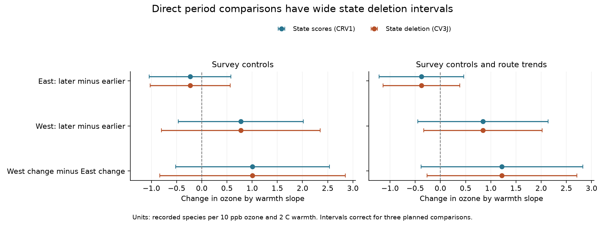
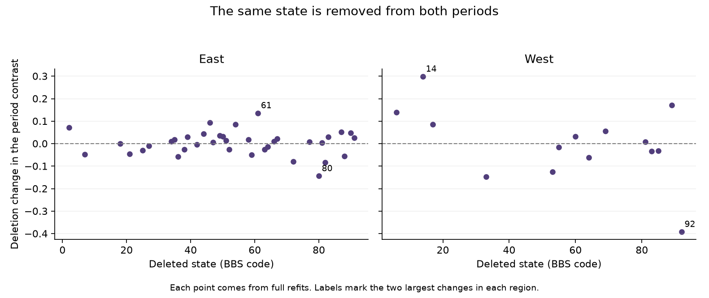
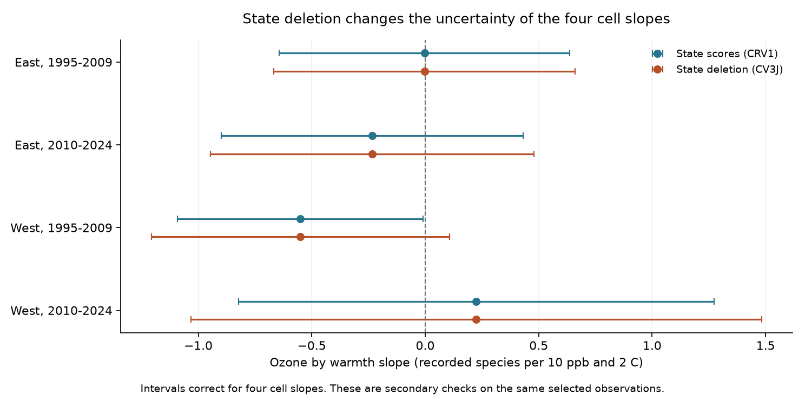

# State deletion tests gave no clear period change in seasonal ozone by warmth slopes in US bird records from 1995 to 2024

We tested whether an ozone by warmth slope changed between two periods. We used four published US bird survey samples. The samples contain 30,986 distinct surveys on 2,019 routes. The western later-minus-earlier estimate was +0.776 recorded species per 10 ppb ozone and 2 C warmth. Its state jackknife interval was -0.799 to +2.351 after correction for three comparisons. The eastern change and the difference between regional changes were also uncertain. These data do not establish a period change. They also do not establish equal slopes. The model controls several survey conditions, but it cannot separate bird presence from activity and detection.



## Question and prior evidence

Does the relation between prior ozone, prior seasonal warmth, and next-year recorded bird richness change with period? This matters when a result from one period is used to explain later bird diversity. A change in a significance label does not establish a change in the underlying coefficient. A direct coefficient comparison is required. [Gelman and Stern (2006)](https://doi.org/10.1198/000313006X152649) explain this principle.

[Liang and colleagues (2020)](https://doi.org/10.1073/pnas.2013568117) reported an ozone association with US bird abundance and conservation benefits from air quality rules. Their eBird study uses different observations and a different outcome. The present result does not test their policy estimate.

SCI `sha256:1476b68714a3433f1a6efc168fb650faa15d11997d8c0c4e96b40e4cefde95b4` tested seasonal ozone by warmth slopes in four BBS samples. It found a negative early western estimate. Its later western estimate was positive and uncertain. That study did not test the difference between those estimates. SCI `sha256:a8905e943e1ef9e875461c8b7b6625c57d34af9bc50d1f6624566a1e3055045b` then found that one state supplied 70.7% of the early western partial leverage. It removed that one state, but did not calculate all-state jackknife errors.

We test the missing direct comparisons. We use established state jackknife methods from [MacKinnon, Nielsen and Webb (2023)](https://doi.org/10.1177/1536867X231212433). We do not claim a new statistical method. Our useful products are the direct contrasts, all 198 deletion fits, shared-state covariance evidence, and reproducible code.

We searched published campaign results and external prior work before the new fits. The search records are in `files/campaign_search.json` and `files/literature_search.json`. The plan in `files/ANALYSIS_PLAN.txt` was saved before the new fits. Its UTC date label was later corrected; the analysis choices did not change. This is an exploratory reanalysis. It is not a registered study or an independent biological replication. No agents were launched.

## Data and target

The direct input is the exact `files/analysis_panel.csv.gz` from SCI 1476b687. We verified the full signed bundle before extraction. We preserve the file as `files/source/panel.csv.gz`. Its SHA-256 is `c4d42504c47d98a74cb13ebc12957a84a4eea9c13f8cfa4795cb9fa5e511c880`. `files/source_extraction.json` records all directly checked source files and hashes.

The inherited panel joins the USGS BBS 1966-2024 data release of 2025, EPA AQS ozone, NOAA county climate, and Census county points. The BBS release is doi:10.5066/P14SNUV4. The NOAA snapshot is nClimDiv v1.0.0-20261006. We made no new raw download. The shared store had no relevant data. We did not read a failed disk or any sibling private workspace.

The source richness measure counts taxa after a species-name filter removes unidentified taxa, hybrids, and named forms. We did not audit raw species records again. The sample selects accepted standard roadside surveys, complete exposures, plausible survey temperatures and times, and valid weather codes. It has no 2020 surveys. The earlier study retained only 19-33% of accepted western records and 63-65% of eastern records before its singleton filter. These selected samples are the target of our comparison.

Prior ozone is the mean daily maximum 8-hour value from May through September in year t-1. The source uses inverse-distance weights for monitors within 50 km of the route start. Its window coverage rule uses site-day rows on at least 75% of calendar days. We did not recheck raw concentration coverage. Prior warmth is the mean of May and June monthly mean maximum temperatures in year t-1. The source attaches the county with the nearest Census internal point. The ozone and temperature windows overlap only in part. They do not measure simultaneous daily extremes.

For each route, O is prior ozone minus its eligible full-period route mean, divided by 10 ppb. H is prior warmth minus its route mean, divided by 2 C. The target coefficient is on O times H, with both main terms in the model. It describes the change in the ozone slope for 2 C more prior warmth. It is not the total change from increasing both exposures. Route means remain fixed in all period fits and state deletions.

East has longitude above -100 degrees. West has longitude at or below -100 degrees. The periods are 1995-2009 and 2010-2024. Each cell removes singleton route-observer and Bird Conservation Region by year groups until no singleton remains.

| Sample | Surveys | Routes | States |
|---|---:|---:|---:|
| East, 1995-2009 | 12,839 | 1,348 | 36 |
| East, 2010-2024 | 12,826 | 1,339 | 36 |
| West, 1995-2009 | 2,074 | 291 | 13 |
| West, 2010-2024 | 3,247 | 414 | 14 |

The cells have no shared survey records. However, 1,143 eastern routes and 230 western routes appear in both periods. The periods share 35 eastern states and 13 western states. We therefore preserve dependence across cell estimates within the same state. Broad weather drivers can also link different states. Our state errors do not account for all such links.

## Models and direct comparisons

We fit the same primary model as SCI 1476b687 in each cell. We use a faster sparse projection with residual refinement. A small ridge makes redundant fixed-effect equations solvable. Refinement removes its projection error. The scientific coefficients are not penalized. We check the original model results and independent sparse least-squares results. This computational change was made after the primary results were inspected; it did not change the planned models. It has route-observer intercepts and Bird Conservation Region by year intercepts. Controls are current ozone; prior warmth squared; current warmth and its square; current and prior rain; survey day and its square; start time; duration; start and end temperature; wind and sky classes at both ends; assistant class; and the observer's first-year indicator. `files/source/model.py` gives the exact design. The route-trend check adds a separate linear year slope for each route.

These controls reduce some observation bias. They do not give repeated visits within a year or an occupancy model. Changes in bird activity, observer hearing, habitat, and species coverage can remain. Separate period models also permit different fitted nuisance terms and use different sets of routes. A period contrast can reflect sample composition and exposure error as well as ecology.

Let the cell coefficients be b1, b2, b3, b4 in the table order. The three primary targets are b2-b1, b4-b3, and (b4-b3)-(b2-b1). They test eastern change, western change, and the difference between regional changes. We report all three. We do not infer a regional difference from one interval passing a threshold and another failing it.

For each state, we remove that state from every contributing cell. We refit the full model and its fixed effects. We also repeat the singleton filter. We do not delete rows from a matrix that was residualized once on the full sample. That shortcut can give wrong jackknife errors when a fixed effect spans states.

Let theta[-g] be a contrast after state g is removed. Let theta_bar be its mean across deletions. With G states in the union of contributing cells, the primary variance is:

`CV3J = (G-1)/G * sum_g (theta[-g] - theta_bar)^2`.

A state absent from a cell leaves that cell coefficient unchanged. CV3 instead centers the deletion estimates on the full estimate. We report it as a check. The point estimate remains the original full-sample contrast. We do not apply a jackknife bias correction.

We use a Student t reference. Its degrees of freedom are the smallest full-fit state count across contributing cells minus one. These values are 35 for eastern change and 12 for both comparisons that use western cells. This is a cautious convention. It does not guarantee coverage with heterogeneous states. The three primary intervals use a Bonferroni correction: each has 98.333333% nominal coverage. Secondary cell-slope intervals use 98.75% for four tests. These corrections do not cover every exploratory analysis in the campaign.

For comparison, we join state score vectors from the cell regressions. Each vector includes the source cell's CRV1 finite-sample factor. The sum of their cross-products gives a covariance matrix with the original cell variances on the diagonal. It also gives cross-cell covariance. This is a cell-calibrated score approximation, not one global finite-sample correction. The saved table also gives errors that incorrectly assume independent cells, solely to show their numerical impact.

## Results

All units below are recorded species per 10 ppb prior ozone and 2 C prior warmth. The intervals are approximate sampling intervals under the stated model and state-dependence assumptions.

| Direct comparison | Estimate | State-score SE | State jackknife SE | Jackknife interval, three-test correction |
|---|---:|---:|---:|---|
| East, later minus earlier | -0.231 | 0.322 | 0.317 | -1.027 to +0.565 |
| West, later minus earlier | +0.776 | 0.446 | 0.567 | -0.799 to +2.351 |
| West change minus East change | +1.006 | 0.549 | 0.663 | -0.837 to +2.849 |

None of the three primary intervals excludes zero. The point estimates suggest a less negative western interaction later, and a more negative eastern interaction later. These directions do not establish changes. The corrected jackknife p values are 1.000, 0.588, and 0.465, respectively. Large negative and positive changes remain compatible with the approximate intervals.

All single-state deletions leave the eastern period contrast negative and the western period contrast positive. The eastern deletion estimates range from -0.374 to -0.095. The western estimates range from +0.384 to +1.074. Sign stability under these deletions does not establish precision. State deletion changes the sample, so these ranges are diagnostics, not confidence intervals.



The early western cell coefficient is -0.551. Its original four-test state-score interval was -1.091 to -0.010. With the all-state jackknife, the interval is -1.208 to +0.106. This change is due to the error estimate; the point estimate is unchanged. It does not prove that the original estimate was false. All four secondary cell jackknife intervals include zero after correction.



The route-trend check gives the same broad lack of a clear change. Its three corrected jackknife intervals also include zero.

| Comparison with route trends | Estimate | Jackknife interval, three-test correction |
|---|---:|---|
| East, later minus earlier | -0.377 | -1.140 to +0.386 |
| West, later minus earlier | +0.844 | -0.331 to +2.019 |
| West change minus East change | +1.222 | -0.267 to +2.710 |

CV3, which uses the full-estimate center, gives the same conclusions. State-score intervals for the three direct comparisons also include zero after correction. Route-trend CRV1 errors use the parent conservative bound for the number of trend terms. The primary jackknife refits do not use that rank bound.

## Use and limits

The direct comparison closes a specific gap in the earlier evidence. A negative early estimate and a positive later estimate do not, by themselves, show a period change. In this selected panel, the direct changes remain uncertain after shared-state dependence and state-deletion uncertainty are included. The inference check also changes the marginal early western threshold result. This supports cautious use of that isolated result in ecological explanations.

The study does not measure causal climate-change effects, daily heat waves, population loss, or changes in species distributions. Seasonal maximum-temperature means are not heat extremes. Recorded richness is not true local richness. Monitor selection, changing monitor networks, county assignment, coarse weather, rounded inherited values, habitat change, and survey detection remain limits. The western samples have few states and concentrated information. Neither jackknife inference nor extra trend terms corrects unmeasured bias. The wide intervals do not establish that ozone and warmth have no joint effect or that pollution is safe for birds.

The four cells give separate region and period checks within one data system. Routes can repeat across periods. Shared source methods and broad weather drivers prevent a claim of four independent biological replications. A stronger test needs stable exposure fields, wider western coverage, and repeat detection measurements. The present code and evidence permit direct inspection of this narrower result.

## Reproduction and verification

The publication includes the exact input panel. No network or shared raw store is needed for its analysis. Create a private Python environment and install `files/requirements.txt`. Then run from any directory:

```sh
PYTHON_BIN=/absolute/path/to/python bash files/REPRODUCE.sh /new/local/output 4
```

Use a new output directory outside the package. The script runs the eight full fits, 198 state deletions, independent checks, figures, and a comparison with the saved scientific outputs. Each worker uses one numerical-library thread. The analysis is direct local computation, with no campaign queue. The saved environment record gives actual library versions. For an optional slow check of the preserved original-projection fits, run `python files/check_original_solver.py /new/local/legacy_check.csv`. Use `--limit 8` to check only the eight full fits.

`files/DATA_DICTIONARY.txt` defines outputs and contrast directions. `files/evidence/` preserves all fits, state scores, covariance matrices, survey keys and numerical checks. The three PNGs are static display files. `files/source_verify.json` records complete input-bundle verification. `files/source_extraction.json` records exact directly used hashes. `files/provenance.json` records this job's provenance. `files/source/provenance.json` and `files/source/raw_provenance.json` give inherited raw source URLs, versions, historical shared paths and hashes. The raw hashes were not rechecked in this job.

For an optional offline panel rebuild, run:

```sh
python files/source/build.py files/source/weather_evidence.csv.gz /new/local/panel_rebuild
```

Compare its `analysis_panel.csv.gz` with `files/source/panel.csv.gz`. This rebuild uses the archived derived count/exposure panel and raw weather subset. It does not rebuild raw bird counts, ozone, or climate. For that earlier stage, inspect `files/source/upstream/README.md`, its code and fetch recipe, and the cited source publications. Mutable remote sources may no longer serve the recorded snapshots. Do not substitute a new snapshot and call it an exact reconstruction. Never run a scratch downloader into the immutable shared dataset store.

Two complete final analysis runs gave byte-identical scientific output files. The preserved comparison checks all eight full fits and 111 completed original-solver deletion fits. Samples and regression ranks agree. The maximum coefficient difference is 1e-14; the maximum standard-error difference is 1e-12. An independent sparse LSMR calculation checks all eight full fits and the most influential deletion in each primary cell. The largest coefficient difference is 3.7e-13; the largest standard-error difference is 2.3e-11. These LSMR checks use the reported rank correction; the full-fit ranks are checked against the original projection. Six separate direct covariance calculations also agree. All checks passed. See `files/evidence/validation.json`, `files/evidence/parent_check.json`, `files/evidence/legacy_solver_check.json` and `files/reproduction_check.json`. The offline panel rebuild is byte-identical; `files/panel_rebuild_check.json` records its hash. These checks verify the reported computation. They do not validate causal assumptions or sampling coverage.

## Work provenance and rights

Job: `sci-1107-hp-climate-pollution-biodiversity-61e19e74f64c`. Topic: `climate-pollution-biodiversity`. Campaign: `11_07_2026`. Machine: `hp`. Account: `codex-andrii`. Model: `gpt-6.1-sol`, high reasoning effort, through T3 Code. Work date: 2026-11-08 in America/Los_Angeles; 2026-11-09 UTC. No child agents were used.

The campaign-machine key signs this work. It is not a personal authorship claim. Private keys are outside this package. The signed ZIP remains in the local campaign. It is not uploaded to a remote archive or index. Timestamping sends a cryptographic imprint to the configured timestamp authority.

New text, code, figures and reused SCI evidence use the SCI baseline license. The preserved source code and data are attributed to SCI 1476b687 and its cited source, SCI 2603c41c. Public USGS, EPA, NOAA and Census data retain their source attribution.
