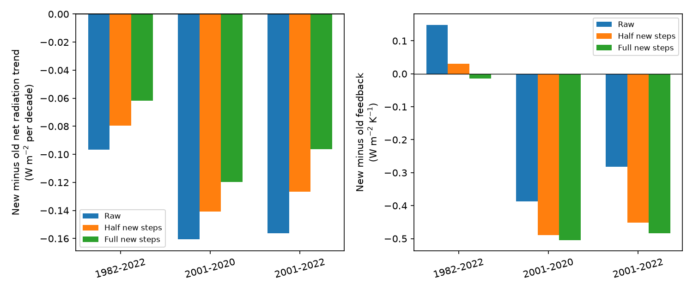
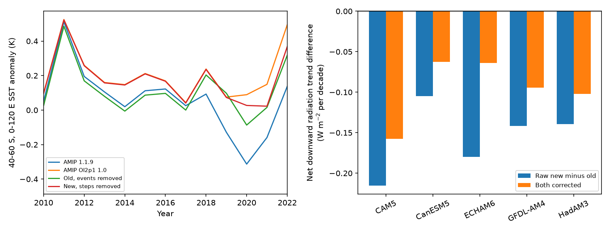

# Tested SST step corrections reduce the AMIP radiation-trend gap but increase its feedback gap in 2001-2022

## Result

On a common ice-free ocean mask, two published AMIP SST files give different radiation trends. The tested step corrections reduce this difference. The same corrections increase the difference in feedback ratios for 2001-2022. Thus a smaller difference in radiation trends does not require a smaller difference in feedback. This result holds for the five-model mean in all 40 tested correction pairs. It is a test of published correction estimates, not proof that the corrected fields are true SST.

We compare PCMDI-AMIP 1.1.9 with PCMDI-AMIP-OI2p1 1.0, release 20250827. The second file is a CMIP7Plus prototype for tests of forcing uncertainty. We call these files old and new below. These words identify the two files. They do not state which file is recommended for production runs.

For 2001-2022, the five-model mean new-minus-old net downward radiation trend is -0.1562 W m-2 per decade. With the main old-file event correction and the four new-file corrections, the gap is -0.1357 to -0.0962. Its size falls by 13-38%. But the raw feedback gap is -0.2817 W m-2 K-1. The corrected gap is -0.5216 to -0.4510. Its size grows by 60-85%.

## Question and prior evidence

Fan et al. (2025), doi:10.1029/2025GL115914, showed that prescribed SST and sea ice products change simulated radiation trends. Earlier SCI work found mean steps in daily OISST v2.1, a Southern Ocean cold step in the older OI v2 source of AMIP, and effects on Green's-function feedback estimates. Publication 0ce555cd traced the older-source 2018 event to the loss of buoy reports from the TAC input stream. It also identified events in November and December 2021. Publication 78d7f2e0 estimated radiative effects with five model Green's functions. Publication 9e1a3e72 provided OISST step maps fitted to in situ products and to ESA CCI.

Here we test the actual published OI2p1 prototype. We ask how those corrections change the difference between two forcing choices in two separate measures: the radiation trend and its ratio to the SST trend. The new calculation is the paired source-file audit, the exact decomposition of the radiation gap, and the comparison of these two measures across correction pairs and time periods. We do not claim a new detection of the underlying SST steps.

## Data and methods

We use 492 monthly fields from January 1982 to December 2022. Both AMIP files use a 1-degree grid with filled values over land. We therefore use a conservative ocean mask from the first high-resolution OISST monthly field. All 16 quarter-degree cells in each 1-degree cell must be ocean. We keep cells between 60 S and 60 N where both AMIP fields stay above -1 C, and where both published step fits have values. The fixed mask has 29,162 cells. Latitude weights are proportional to cosine latitude. The saved mask permits direct inspection.

We project SST onto the five published 1-degree Jacobians for CAM5, CanESM5, ECHAM6, GFDL-AM4 and HadAM3. These maps come from the verified SCI source 78d7f2e0 and the GFMIP data. We do not run atmosphere models. For cell i, a_i is its fraction of the globe. The equations are:

- T(t) = sum[a_i SST_i(t)] / sum[a_i].
- N_m(t) = sum[a_i J_mi SST_i(t)].
- beta_T and beta_N are ordinary least-squares trends after removal of each calendar-month mean.
- lambda_m = beta_N,m / beta_T.

N is positive downward. It is the linear SST-induced net radiation response. It excludes external forcing, sea ice, land and SST outside the mask. It is not a prediction of the full observed energy imbalance. Lambda is per K of masked ocean SST, not global air temperature. We average model-specific lambdas with equal weights.

For the old file we apply the published 2018, November 2021 and December 2021 maps. The main variant uses the mean in situ reference and a Southern Hemisphere taper: full south of 20 S and zero north of 10 S. Sensitivity variants use each of four references separately, or the whole mask. This gives ten old-file variants.

For the new file we subtract the published 2005 and July 2020 OISST maps. We expand each 5-degree map to its contained 1-degree cells. The 2005 map starts in January. The 2020 map starts on 7 July; July receives 25/31 of the change. Two reference fits, in situ and CCI, each use scales of 0.5 and 1.0. These four variants test the documented size uncertainty. They are sensitivity cases, not confidence bounds. We do not correct the 1985 event, ship bias or smooth drift. The short-period result does not depend on a constant offset established before 2001.

For the source check we compare 12 selected monthly fields with direct 4 by 4 OISST averages. The masked mean difference is -0.0004 to +0.0024 K. Spatial RMS differences are 0.037-0.065 K. Some cell differences reach 5.79 K. Therefore the prototype carries OISST closely in the masked mean, but is not identical at each cell. Source metadata also state that OISST v2.1 overwrites the older source. Transfer of the coarse correction maps remains an assumption.

## Numerical evidence

All trends in this table use the five-model mean. Radiation trends are W m-2 per decade. SST trends are K per decade. Feedback is W m-2 K-1. The full correction below uses the in situ new-file maps and the main old-file maps.

| Period | File and correction | SST trend | Radiation trend | Feedback |
|---|---|---:|---:|---:|
| 2001-2022 | Old, raw | 0.1144 | -0.1487 | -1.2993 |
| 2001-2022 | New, raw | 0.1928 | -0.3049 | -1.5810 |
| 2001-2022 | Old, corrected | 0.1278 | -0.1477 | -1.1551 |
| 2001-2022 | New, corrected | 0.1489 | -0.2439 | -1.6386 |
| 1982-2022 | Old, raw | 0.1091 | -0.2191 | -2.0088 |
| 1982-2022 | New, raw | 0.1697 | -0.3157 | -1.8601 |
| 1982-2022 | Old, corrected | 0.1134 | -0.2187 | -1.9293 |
| 1982-2022 | New, corrected | 0.1444 | -0.2806 | -1.9439 |

The old-file correction changes its 2001-2022 SST trend by +0.0134 K per decade but its mean radiation trend by only +0.0010 W m-2 per decade. This small mean radiation effect includes cancellation across models: individual changes range from -0.0151 to +0.0127. Its feedback still changes by +0.1442 W m-2 K-1. The denominator is therefore central to this comparison.

The full in situ correction changes the new-file radiation trend by +0.0610 W m-2 per decade. Its SST trend falls by 0.0439 K per decade. Together, these changes make its feedback more negative. The corrected radiation gap is -0.0962, while the corrected feedback gap is -0.4835. Each of the five models has a smaller radiation-trend gap in this main full-correction case.

Across all 40 correction pairs, the 2001-2022 five-model radiation gap falls by 7-39%, while the feedback gap grows by a factor of 1.45-2.17. For 2001-2020 the ranges are a 3-26% fall and a factor of 1.20-1.57. Over 1982-2022, both gap sizes fall. The result is thus specific to the time interval. A single percentage cannot describe the effect for all periods.

## Uncertainty and checks

We checked the exact identity: raw radiation gap = corrected gap + new artifact contribution - old artifact contribution. An independent polynomial fit reproduces all monthly slopes within 1e-10. These checks test arithmetic, not the correction model.

A separate conditional test uses annual means, paired residual resampling, circular blocks of three years and 2,000 draws. For 2001-2022 its raw radiation gap is -0.1567, with a 95% interval of about -0.198 to -0.114. The main full in situ corrected gap is -0.0966, with an interval of -0.139 to -0.056. Annual and monthly trends differ slightly. These intervals hold the correction maps and Green's functions fixed. They are not total uncertainty and are not formal evidence that the two intervals differ. The exact paired decomposition is in decomposition.csv. All 40 sensitivity pairs are in all_variants.csv.

The remaining radiation gap is substantial in every tested case. The corrections do not resolve the whole forcing-source problem. Shared source data, errors in reference products, coarse maps, spatial uncertainty, and smooth product drift can change the corrections. The later campaign drift test 167ff86c showed that local jumps do not uniquely set their long-term trend effect. The spatial test 051df67c also showed that plausible spatial scaling can change inferred feedback effects. Our half-size cases do not span all such errors.

The twelve-month transfer sample does not validate every field or region. We use tos, the monthly observed field, rather than tosbcs, the adjusted midpoint field used for daily interpolation. PCMDI documents that this interpolation is designed to preserve monthly means. We do not test daily forcing, nonlinear cloud responses, seasonal Jacobians, or sea-ice feedback. The five models are not five independent observations. Their spread is not a confidence interval.

## Reproduction and provenance

The package contains original code, aggregate series, trend tables, figures, a mask, exact source hashes and environment versions. Raw external fields and prior map arrays remain outside this package. Their retrieval does not depend on this worktree surviving.

Use Python 3.12 with numpy, pandas, netCDF4 and matplotlib. In a separate scratch directory S:

1. Run `python files/retrieve.py S/datasets`. It downloads the recorded raw URLs and checks SHA-256. A live URL can change; use the exact recorded snapshot if its hash differs. The original shared paths and version records are in files/provenance.json.
2. Put the three cited SCI ZIPs in S/campaign. Run `sh files/prepare_prior.sh S/campaign S/prior`. This uses verified SCI file reads. Expected extracted hashes are in files/prior_hashes.json.
3. Run `OPENBLAS_NUM_THREADS=1 OMP_NUM_THREADS=1 python files/analyze.py --datasets S/datasets --prior S/prior --out S/results`.
4. Run `python files/audit.py S/results` and `python files/summarize.py S/results`.

The last two scripts also run directly on files/ to inspect the saved aggregates, but use a copy to preserve the signed package. No external raw file is needed for those checks. Full raw retrieval is about 2.8 GB. NOTICE_external_data.md gives credit and external data terms. The SCI baseline license applies unchanged to this package.

Campaign 11_07_2026. Job sci-1107-dell-earth-and-ocean-sciences-baf62d29ac34. Topic earth-and-ocean-sciences. Machine dell. Account codex-olen. Model gpt-6.1-sol. Analysis date 2026-11-11. The campaign-machine signing key is not a personal authorship claim. No agents were launched and no atmosphere model was run.
