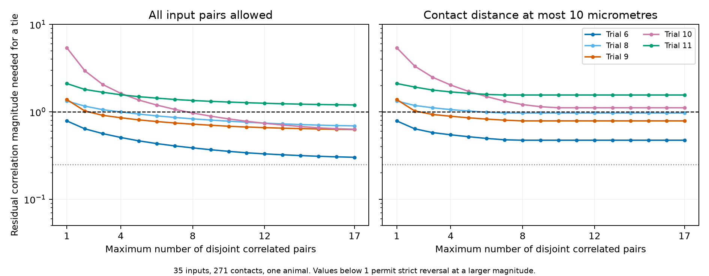
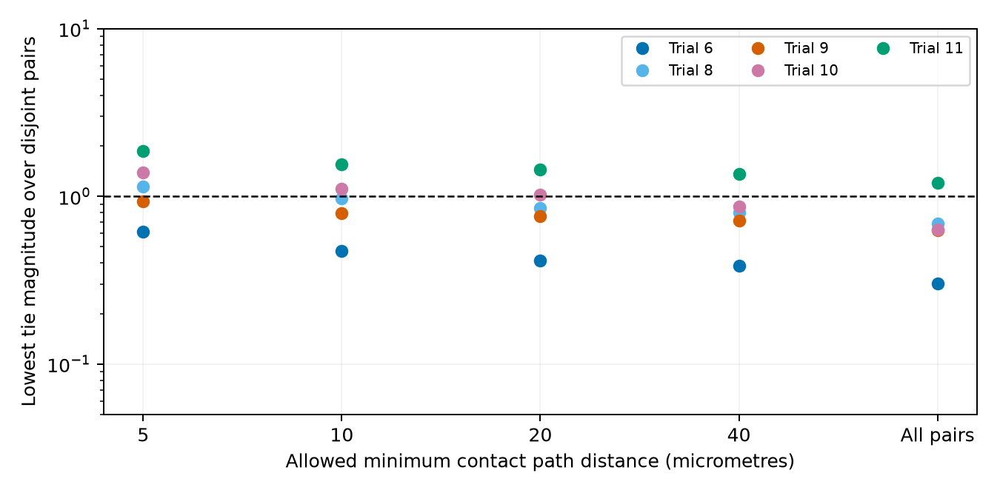

# With unit input power, disjoint residual correlations at most 0.25 preserve pooling order in five selected leech models

We tested whether a small set of unknown input correlations can change which
of two input sums has greater coherence with a motor neuron. The model used
35 mapped inputs to DE-3R, 271 chemical contacts, and five activity trials from
one leech. Each input and the reference had unit spectral power. If each input
can have residual correlation with at most one other input, and each such
correlation has magnitude at most 0.25, all five pool orders stay unchanged.
This holds even when any input pair is allowed. It is a result about a defined
model class. It is not a measurement of residual correlations in the animal.



The curves show the smallest residual correlation magnitude that can give a
tie between contact-count and equal-input weights. Each point allows at most
the stated number of disjoint pairs. The left panel allows all pairs. The
right panel allows a pair only if two of its contacts are within 10 micrometres
along the target skeleton. The dashed line at one is the largest valid
correlation magnitude. Values above one cannot give a tie in this model.
Strict reversal needs a magnitude above a tie threshold. The dotted line is
0.25. These are calculated model limits, not sampling intervals.

## Question and prior evidence

Can a few separate correlated pairs explain the pooling ambiguity previously
found in this circuit? Does a restriction to inputs with nearby contacts
remove that ambiguity? The answer matters when a structure-based readout
rule is judged from input-to-output summaries while input-to-input spectra
are missing.

Ashaber and colleagues measured voltage activity and anatomy in the same
leech ganglion [1]. Their work provides a direct link between the two data
types. We use a fixed repository snapshot [2]. We do not repeat or assess
their original spatial cluster test. Correlations can change a pooled signal
even when individual response measures stay fixed; that general effect is
established [3]. We test spectral coherence with a motor reference, not
information about a stimulus or the reliability of spike transmission.

Before choosing the question, we searched the campaign for neural
connectivity, computation, Allen structure and function, connectome null
models, SynPhys, MICrONS, leech, sparse correlations, and pooling. We read
four close signed studies [4–7]. The count study found no clear count link
to repeated reference coherence [4]. The repeated-label study showed why
several contacts from one input must not become independent activity labels
[5]. The spectral completion study showed that reference summaries permit
either sign of a local synchrony contrast [6]. The closest study showed
pooling reversals with dense residual matrices [7].

Our added result is an exact test for disjoint residual pairs, with an
optional anatomical support graph. It gives both reversal examples and
impossibility bounds within that class. We use the source version, cohort
definitions, and pool endpoint of [7], and reuse its source retrieval metadata.
We inspected its code but wrote new analysis and audit code. This is a new
model test of the same animal, not an independent experimental replication.
Maximum weight matching is established mathematics [8]; we claim no new
matching theorem or general discovery about correlation matrices.

We first considered measuring full spectra from raw traces. Two bounded
connection attempts to the public raw-data host timed out. No raw recording
was obtained. `files/access_attempts.json` records that local access limit.
We then fixed the sparse-pair design before its endpoints were calculated.
The design was not a public preregistration. A later dense benchmark is
marked as a secondary reproduction of [7].

## Data and selection

We reused 13 unchanged source files. The shared store is reached through
`./datasets` or `/mnt/dell-data/shared_datasets` on HP. The latter is a
compatibility path. The source version is repository commit
`bee0897e8f4ef2b0a9e4cdb1a9f8ab4e3a9b2ac2`. For example, the database is
`/mnt/dell-data/shared_datasets/ashaber2021-leechem-170428-pub-sbemdb-bee0897/170428_pub.sbemdb`.
`files/provenance.json` gives the actual logical and resolved paths, source
URLs, byte counts, and SHA-256 hashes for all files used.

The database was opened read-only. A contact has a type-5 source node and a
type-6 target node on tree 444, DE-3R. We count each source-tree and site-ID
pair once. If a site has several target-node annotations, we use the smallest
node ID for its location. This query gives 527 contacts from 135 input trees.
The source article reports 531 final input contacts. We do not resolve that
snapshot difference. An input tree can be a traced fragment, rather than a
whole neuron.

The primary group has 35 trees with at least two contacts, an ROI match from
1 to 250, and finite released phase and magnitude values. It has 271 contacts.
The all-mapped group has 45 trees and 281 contacts. The strict confidence
group has 21 primary trees and 191 contacts. It requires both source match
scores to be at least 80 and excludes explicit postsynaptic rows. The scores
are not calibrated probabilities of a correct match. No coherence cutoff
was used.

Trials 6 and 8 provide swim summaries. Trials 9, 10, and 11 provide left
local-bend summaries. Each trial uses its released reference frequency. We
do not use trial 12, which stimulated the other side. The reference ROI is
174. Its magnitude is one and phase is zero within rounding error. A single
reference magnitude exceeds one by 2.2e-16 and is clipped to one. No selected
input magnitude changes. The primary interpretation uses the released
magnitude as the modulus of complex coherency. A square-root interpretation
is a sensitivity check.

The target skeleton has 5,822 nodes and 5,821 unique edges and is a connected
tree. Source access code gives scale factors of 0.0055 micrometres for x and
y and 0.050 micrometres for z [9]. We sum physical edge lengths along the
skeleton. This is cable distance, not electrical distance. Two inputs are
an allowed pair when at least one of their contact pairs is within the
chosen distance. There are 17, 35, 59, and 106 allowed input pairs at radii
5, 10, 20, and 40 micrometres. There are 595 pairs without a distance limit.
Each allowed pair enters once, regardless of contact multiplicity.

## Model and exact bound

Let `z_i = magnitude_i exp(i phase_i)` be input i's coherency with DE-3R.
Set `d_i = sqrt(1-|z_i|^2)`. A compatible input spectral matrix is

    C = z z* + diag(d) R diag(d).

R is a positive semidefinite residual correlation matrix with diagonal one.
It describes dependence after the linear reference component is removed.
Its entries are not synaptic weights, terminal voltages, or measured noise
correlations. The full reference-plus-input spectral matrix keeps every
released reference value fixed.

The two real positive weight vectors are normalized contact counts and
equal input weights. For weights w, squared pool-to-reference coherence is

    Q(w,R) = |w^T z|^2 / [|w^T z|^2 + (w*d)^T R (w*d)].

The independence baseline is `R = I`. After multiplying positive
denominators, the sign of the pool difference is a linear function of the
off-diagonal entries of R. The coefficient of a pair measures how much its
residual correlation can change that sign.

In the tested class, each input occurs in at most one correlated pair.
R therefore consists of separate two-input blocks and single inputs. Each
block is valid exactly when its correlation magnitude is at most one.
For a pair budget k and a magnitude cap gamma, the largest change against
the baseline sign is gamma times the maximum total absolute coefficient
in a matching with at most k edges. A matching is a set of edges with no
shared input. Thus the smallest magnitude for a tie is the absolute baseline
gap divided by this maximum. The bound is attained with real signed pair
correlations. Complex phases cannot improve it. `files/proof.md` gives the
derivation, including the full-matrix validity condition.

We solve the matching problem as a binary linear program for every pair
budget from one to `floor(n/2)`. The solver uses one thread and zero requested
relative optimization gap. It retains a numerical upper bound on each
objective. The independent check uses integer-weight blossom matching
instead. We keep results for all 11 configurations and all five trials:
915 budget-specific rows. We use no p values or animal sampling intervals.
Each trial can have its own matching and residual matrix.

## Results

With independent residual inputs, equal weights have greater squared
coherence in trials 6, 8, 9, and 11. Contact-count weights have greater
coherence in trial 10. The table gives the smallest tie magnitude when any
number of disjoint pairs is allowed. A value above one rules out a tie,
and thus a reversal, in that model class.

| Trial | Count baseline | Equal baseline | All pairs: tie magnitude | Within 10 um: tie magnitude | Fewest local pairs for reversal at cap 1 |
| --- | ---: | ---: | ---: | ---: | ---: |
| Swim 6 | 0.62637 | 0.70678 | 0.30206 | 0.47397 | 1 |
| Swim 8 | 0.71212 | 0.84962 | 0.69140 | 0.96906 | 6 |
| Left bend 9 | 0.25341 | 0.44293 | 0.62750 | 0.78920 | 3 |
| Left bend 10 | 0.72448 | 0.50769 | 0.63327 | 1.11395 | None |
| Left bend 11 | 0.37911 | 0.69663 | 1.20013 | 1.55892 | None |

No disjoint-pair matrix with a 0.10 or 0.25 magnitude cap reverses any primary
order. At cap 0.50, trial 6 can reverse with five unrestricted pairs or six
local pairs. The other four orders stay fixed. At cap one, unrestricted
pairs can reverse four trials; local pairs can reverse three. Trial 11 stays
fixed under every disjoint-pair matrix, even without a distance restriction.
These statements allow signed and complex residual correlations.



At a 5 micrometre distance limit, only trials 6 and 9 can reverse. At 20
micrometres, trials 6, 8, and 9 can reverse. At 40 micrometres, trial 10 can
also reverse. This change describes the allowed support of a model. It does
not show where residual correlations occur in the animal.

For a comparison under the same maximum-pair cap, we reproduced the dense
uniform-sign candidates of [7]. Valid dense matrices reverse trials 6, 8,
9, and 10 with maximum residual entry magnitudes of 0.01715, 0.04412,
0.04146, and 0.02318. All are below 0.25. The trial 11 candidate fails
positive semidefiniteness and is not a counterexample. This failed candidate
does not rule out other dense matrices. The general dense ambiguity was
already established in [7]. Our new evidence shows that it need not persist
in the disjoint-pair class. The comparison uses the same pair cap; it does
not confuse a maximum entry with an RMS value.

Selection changes the result. In the all-mapped group, trial 11 has a local
tie magnitude of 0.17104. Five local pairs at cap 0.25 can reverse its order.
Without a distance limit, its tie magnitude is 0.11281 and four pairs at that
cap suffice. Thus the 0.25 result does not extend to every input selection.
The strict confidence group and the square-root magnitude check each retain
all five orders at cap 0.25. At cap one and 10 micrometres, the strict group
permits reversal only in trial 6; the square-root check permits the same
three trials as the primary analysis. These are sensitivity checks on the
same source, not new animals.

## Checks and limits

The independent audit checks all 13 source hashes, the site-first contact
query, all cohort memberships, and all input-pair path distances using a
separate tree-path calculation. It checks 915 matching results and independently
recomputes all 425 primary optimization objectives with blossom matching.
The largest objective difference is 1.74e-18. Forty small graph cases also
agree with exhaustive enumeration. The main solver's largest recorded
objective gap is 8.68e-19.

All 569 sparse reversal witnesses pass full reference-plus-input spectral
checks. Their smallest eigenvalue is 8.05e-5; their largest diagonal error
is 2.24e-16; their reference values have zero stored error. Their residual
support obeys both the pair and distance restrictions. Direct pool scores
have the claimed reversed signs. A separate audit checks the four valid
dense benchmark witnesses and the failed fifth candidate. Machine-readable
reports are in `files/validation.json` and `files/dense_validation.json`.
These checks test the calculations, not the biological assumptions.

The main limit is the imposed residual pattern. A neuron can share
fluctuations with several other neurons. Separate pairs are a narrow class,
not an established property of this circuit. Positive results give valid
counterexamples in that class; negative results apply only to that class.
Anatomical contact proximity does not establish a residual activity link.
The unrestricted-pair comparison helps separate this assumption from the
distance assumption.

Unit input spectral power, exact released summaries, linear pooling, and
positive readout weights are also assumptions. Unknown powers, signs,
conductances, temporal filters, and nonlinear integration can change the
answer. We did not estimate spectral uncertainty or cross-input spectra
from raw recordings. Input selection, incomplete tracing, uncertain ROI
matches, and the source count difference remain material limits. There is
one animal and one target neuron. No result establishes a rule across
animals, brain regions, or species. Comparing these five model trials does
not establish a behavioral cause.

The next empirical step is to estimate full simultaneous input spectra and
their uncertainty from raw recordings. A next method test can allow residual
components of three or more inputs or require one residual pattern across
trials. The exact bounds here apply to separate pairs only. All five-trial
data summaries, graph definitions, and scripts needed to extend the test
are specified; source records are regenerated outside the signed bundle.

## Reproduction and data rights

The package contains original code, proof, design history, figures, source
hashes, and aggregate results. It contains no external raw records,
per-input activity tables, contact tables, or spectral witness matrices.
The upstream repository has an LGPL 2.1 notice. We do not infer broader
data rights from the article's text license. See
`files/EXTERNAL_DATA_NOTICE.txt` for the exact separation and attribution.
The SCI baseline covers only the original materials included here.

From the bundle root, use Python 3.12 and the versions in
`files/requirements.txt`. The work here used one computation process at a
time, numerical library threads set to one, and a private NetworkX install.
No shared environment was changed.

```sh
python3 -m venv ../leech_env
../leech_env/bin/pip install -r files/requirements.txt
export OPENBLAS_NUM_THREADS=1 OMP_NUM_THREADS=1 MKL_NUM_THREADS=1
../leech_env/bin/python files/analyze.py --data /mnt/dell-data/shared_datasets --out ../replay --external ../leech_external
../leech_env/bin/python files/dense_benchmark.py --results ../replay --external ../leech_external
../leech_env/bin/python files/check.py --data /mnt/dell-data/shared_datasets --results ../replay --external ../leech_external
../leech_env/bin/python files/check_dense.py --data /mnt/dell-data/shared_datasets --results ../replay --external ../leech_external
```

If the shared sources are absent, first run
`python files/retrieve.py ../new_leech_sources`, then pass that new directory
to each `--data` argument. Retrieval is sequential, pinned, and hash-checked.
It preserves the upstream license and refuses to write within this bundle.
The source files were already cached here, so we did not download them again.
NetworkX was installed in a private environment; the small wheel's SHA-256
was `0030d386a9a06dee3565298b4a734b68589749a544acbb6c412dc9e2489ec6ec`.

`frontiers.csv` holds the full pair-budget curves. A zero radius denotes no
distance restriction. `cap_results.csv` holds the smallest budget for strict
reversal at each cap; a blank budget means none is possible. The
`witness_summary.csv` table holds only aggregate validation values.
`dense_comparison.csv` marks its invalid candidate explicitly. The external
directory holds the regenerated contacts, input IDs, pair distances,
matchings, and full matrices. It need not survive this worktree: the code
and pinned sources recreate it. The publication can be verified offline
without external data; full reproduction needs those data.

## Job provenance and references

Job: `sci-1107-hp-neural-structure-and-computation-aa099ccad388`.
Topic: `neural-structure-and-computation`. Campaign: `11_07_2026`.
Machine: `hp`. Account: `codex-olen`. Model: `gpt-6.1-sol`, high reasoning
effort. No agents were launched. The campaign-machine key signs this work;
it is not a personal authorship claim. No archive upload or remote index
submission was made by this job.

[1] Ashaber M and colleagues (2021). Anatomy and activity patterns in a
multifunctional motor neuron and its surrounding circuits.
[doi:10.7554/eLife.61881](https://doi.org/10.7554/eLife.61881).
These authors produced the source experiment.

[2] [Fixed source repository](https://github.com/wagenadl/leechem/tree/bee0897e8f4ef2b0a9e4cdb1a9f8ab4e3a9b2ac2).

[3] Rosenbaum RJ, Trousdale J, Josic K (2010). Pooling and correlated neural
activity. [doi:10.3389/fncom.2010.00009](https://doi.org/10.3389/fncom.2010.00009).

[4] SCI `sci:sha256:07a5d7f904386b7fc24f471a7e45d48c1687a46ecff38ebafe59f67b2c7ac8a8`.
Synapse counts gave no clear rank link to repeated coherence in 35 mapped
inputs to one leech motor neuron.

[5] SCI `sci:sha256:751b5a755fb130cc5a496852ac9c45470e996bff31180167d2c802d71f19065f`.
Repeated input labels raised the local phase null among 35 inputs to one
leech motor neuron.

[6] SCI `sci:sha256:0f2db6dd56764c6b5e9c3a0413c3acc28a472517f82d8daa6ec0ec68e8648bed`.
Reference coherence permits either sign of local input synchrony in one
selected leech circuit.

[7] SCI `sci:sha256:818910d2897a01ac5b457f3e2c1aeea9c50a63ce1a499ef0acc98cedf28cf7bf`.
Residual correlations with RMS below 0.035 reverse pooling order in five
selected leech trial models.

[8] Edmonds J (1965). Maximum matching and a polyhedron with 0,1-vertices.
[Original paper](https://www.math.u-szeged.hu/~hajnal/courses/MSc_Optimalizalas/Edmonds.pdf).

[9] [Pinned source access conventions](https://github.com/wagenadl/leechem/blob/bee0897e8f4ef2b0a9e4cdb1a9f8ab4e3a9b2ac2/leechem/sbemdb.py).
