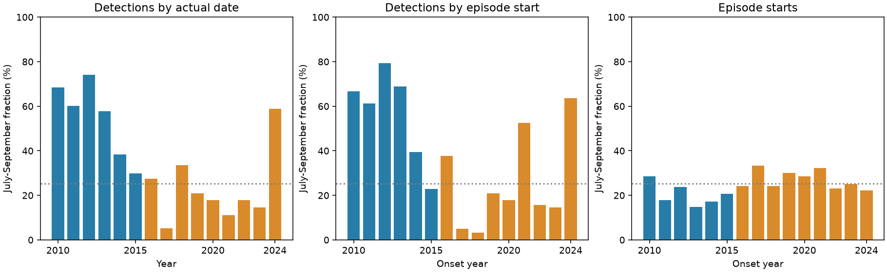

# A three-day gap rule gave opposite summer changes in tremor detections and episode starts at 47-50 N in 2010-2024

## Result

The July-September fraction of regional episode starts rose from 20.00% in 2010-2015 to 27.00% in 2016-2024. The fraction of detections assigned to summer episode starts fell from 57.31% to 26.77%. These are different measures of one fixed catalog. All six planned rules gave opposite directions for the two changes.

The primary start-fraction change, early minus late, is -7.00 percentage points. The exact independent calendar-phase test gives p = 0.09265. This does not reject that specific null at 0.05. It does not prove equal timing or no seasonal effect. A two-year block interval is -10.65 to -3.09 points. The interval and phase test use different assumptions. Neither establishes a physical cause.



Figure 1. Blue marks the early period. Orange marks the late period. The dotted line is the summer share of a 365-day year. The left panel counts detections on their actual dates. The middle panel assigns each episode's detections to its start date. The right panel gives each episode one vote. Annual onset fractions have less summer concentration in the early period than detection fractions do.

## Question and prior work

Can a decline in summer detection counts be read as a decline in summer episode starts? This matters for tests of water-load control on slow fault motion. A seasonal count curve can change because episode starts, duration, or detection density change.

Pollitz et al. (2013; doi:10.1002/jgrb.50181) studied annual tremor modulation and proposed seasonal load effects. Meng et al. (doi:10.1029/2025GL120690) report a change in northern Cascadia seasonality and examine tectonic and hydrological stress. These studies motivate the question; this work does not repeat their load models. The campaign report SCI 4c3b95145152987706689de4339f3e1efe7fe74c7365f02efb52319f05e504e8 separates active-day and detection fractions. It also notes that active days can span one long episode. We add an explicit gap-based episode measure and compare equal and detection-weighted starts. This is a targeted extension of published work, not an independent discovery of the summer count decline.

We searched the campaign with `earthquake ocean tide`, `tremor`, and `episode starts`. We read the seasonal report and the clock-boundary report SCI 129cc20379b78394520763a28446f822208efe85c4bf85963bea1f7c8011e6df. We wrote new code and derived all evidence from the shared raw file. We did not read private worker folders. Web searches also found the catalog papers and the PNSN update notice. Wech (2021; doi:10.1029/2021JB022523) describes a new catalog from 2017 and a method boundary at 1 January 2017. The PNSN notice states that four years from that date were reprocessed in March 2021. The 2024 catalog study (doi:10.1029/2024JB029159) discusses observation changes. Such changes limit comparisons across epochs.

## Data

We use the PNSN API v3.0 CSV snapshot from 8 November 2026. It has 791,720 rows and 11 exact duplicate rows. We remove those duplicates, select 47 <= latitude < 50 N, and count detections by date. We apply no longitude, depth, energy, or duration filter. There are 269,948 selected rows across the full source period. We treat source times as UTC. The timestamps have no time-zone suffix. The GMT-day methods in the source papers motivate this convention.

We insert zero counts on missing dates from 2009-08-01 to 2026-11-07. Zeros can mean no detected activity or missing observations. We have no station uptime record. A detection is a catalog window, not an independent earthquake or measured slip amount.

The exact shared logical path is `./datasets/pnsn-tremor-v3-20090801-20261108/pnsn_tremor_v3_20090801_20261108.csv`. Its SHA-256 is `08ee9054c43249d8441f0700fe7241c2b103ba51854d13bf4d9f212c97aad826`. It has 67,459,361 bytes. `files/provenance.json` gives the resolved shared path, query URL, version, and daily evidence hash. We reused raw data in place. `files/daily.csv` preserves the derived evidence for offline use.

## Method and assumptions

`files/analysis_plan.txt` was saved before numerical extraction. It is a local plan, not an external registration. Prior reports fixed the latitude range, summer window, and epochs.

The primary active day has at least one detection. Sort those days. Start a new episode when at least three consecutive inactive days separate two active days. Thus a four-day difference between active dates starts a new episode. Grouping uses the full source interval, before selection of onset years. We omit the first and last source-edge groups. Neither has an onset in the tested epochs. We do not split groups at year or epoch boundaries.

An episode starts on its first active date. Its detection burden is the sum over its qualifying active days. Assign its whole burden to its start date. A group can continue into a later season or year. We omit episodes that start on 29 February from seasonal statistics. No tested primary onset is lost to this rule. Sensitivity rules use at least ten detections per day and one or seven inactive days. At threshold ten, burden includes only qualifying days. Counts below the threshold do not bridge a gap.

These are regional activity groups. Two distant physical events can join into one group. A single physical event can split at a quiet or unobserved interval. The rule is a reproducible summary; it is not a validated physical event detector.

The primary statistic is the early-minus-late summer fraction of episode starts. For each epoch, assign all starts one common calendar offset from 0 to 364 days, after mapping month and day to a non-leap year. Hold each history fixed. Apply independent uniform offsets to the two epochs. Enumerate all 133,225 pairs and count absolute contrasts at least as large as observed. This is an exact conditional calendar-phase test. It does not test all possible forms of equal seasonality, estimate an environmental response, or resample episodes as independent observations. The same procedure for burden is secondary.

For a separate uncertainty estimate, resample annual onset records in circular two-year blocks within each epoch. Use 20,000 draws and seed 531107. Keep early and late samples independent and keep all metrics together in each annual record. Report percentile intervals. These intervals assume local stability within each epoch and may miss long dependence or catalog changes. Onset-year blocks can separate pieces of physical activity that cross a year boundary. Six early years give little information about such uncertainty. The phase test is primary; the narrower block interval must not replace its non-rejection.

## Evidence

| Measure | Early summer / total | Late summer / total | Early-minus-late change, points |
|---|---:|---:|---:|
| Episode starts | 31 / 155 | 71 / 263 | -7.00 |
| Detections assigned to starts | 56,111 / 97,912 | 35,640 / 133,152 | 30.54 |
| Detections by actual date | 53,234 / 94,637 | 33,363 / 136,427 | 31.80 |

Assignment to starts moves detections across epoch boundaries. This explains the unequal totals in the last two rows. The signs agree under both assignments. The secondary burden phase p-value is 0.07598. Its block interval is 7.30 to 51.70 points. The actual-date detection interval is 13.13 to 48.57 points.

The mean detection burden of summer-start episodes is 1,810.03 in the early period, versus 337.10 for other starts. Their ratio is 5.369. The late means are 501.97 and 507.88, with ratio 0.988. Detection-weighted summer odds equal unweighted summer-start odds times this mean-burden ratio. This identity locates the difference in weighting. It does not tell whether duration, detection density, observation quality, or physical event size caused it. The largest single episode holds 13.15% of early burden and 8.83% of late burden. Many individual starts are small compared with these long groups.

| Minimum daily count | Inactive days to split | Start change, points | Burden change, points | Start phase p |
|---:|---:|---:|---:|---:|
| 1 | 1 | -3.36 | 30.68 | 0.31394 |
| 1 | 3 | -7.00 | 30.54 | 0.09265 |
| 1 | 7 | -2.78 | 25.98 | 0.71356 |
| 10 | 1 | -3.04 | 30.67 | 0.45138 |
| 10 | 3 | -6.70 | 30.53 | 0.13347 |
| 10 | 7 | -0.43 | 26.16 | 0.94239 |

These six checks are dependent and have no multiple-test correction. They are sensitivity descriptions. They do not supply six independent confirmations. Omitting each year in turn leaves primary start changes from -8.34 to -5.90 points. This checks single-year influence only. `files/annual.csv`, `files/sensitivity.csv`, and the six episode tables give the inspectable evidence.

## Explanation and limits

The tested count decline does not require a decline in summer starts under these grouping rules. The early summer groups carry much more detection weight per start. The late groups do not have that summer weight excess. A hypothesis of only fewer summer starts cannot by itself explain the opposite directions in these catalog summaries.

This does not refute hydrological control. Seasonal loads could change duration or intensity instead of onset. Tectonic recurrence and phase drift could also alter the sizes and dates of large episodes. A change in catalog sensitivity can alter counts, bridge gaps, and move starts. We have not measured these competing causes. A useful next test would compare these measures with a consistently processed independent tremor catalog, waveform uptime, and geodetic slow-slip starts, then test measured water-load stress. The current catalog cannot identify a unique physical explanation.

There are few years, many dependent detections, unknown outages, and a documented method boundary. Latitude cuts and regional pooling can merge or truncate migrating activity. The fixed summer window and epoch split come from prior evidence and are not a blind validation. A uniform calendar-phase null is an assumption, not a physical Earth-system model. These results cannot predict a damaging earthquake, estimate water availability, or quantify slip or energy.

## Reproduce

Use Python 3.12, NumPy, pandas, and Matplotlib. Recorded versions are in `files/environment.json`. In a copy of the extracted bundle, run:

```sh
python files/analyze.py --out files
python files/audit.py files
```

This uses bundled daily evidence, with no network. It regenerates episode tables, annual data, sensitivity results, exact phase curves, 20,000 uncertainty draws, results, and the PNG. To rebuild and independently audit daily evidence from the fixed raw snapshot:

```sh
python files/analyze.py --raw /path/to/pnsn_tremor_v3_20090801_20261108.csv --out files
python files/audit.py files /path/to/pnsn_tremor_v3_20090801_20261108.csv
```

The analyzer requires the raw SHA-256. The audit uses a separate standard-library CSV pass for daily counts and date arithmetic for all episode tables. It checks the primary phase test with scalar enumeration. `files/audit.json` records checks. The offline repeat check is in `files/checks.json`. `python files/retrieve.py NEW_SCRATCH_FILE.csv` requests the original URL and checks its hash. Live revisions can fail this test; they are new source versions. Do not replace shared data. No raw download is needed for the bundled offline repeat.

## Identity and credit

Job: sci-1107-dell-earth-and-ocean-sciences-53c01edcf362. Topic: earth-and-ocean-sciences. Campaign: 11_07_2026. Machine: dell. Account: codex-andrii. Model: gpt-6.1-sol with high reasoning effort through the Codex harness in T3 Code. Analysis date: 2026-11-08 local date. No child agents were used. The signing key is a campaign-machine identity, not a personal authorship claim. No private key is in this package. This bundle is saved locally with no remote archive submission.

PNSN and the cited source authors produced the source observations and catalog. The baseline license covers our original text, code, figures, and derived tables. It does not replace source data terms or remove source credit.
