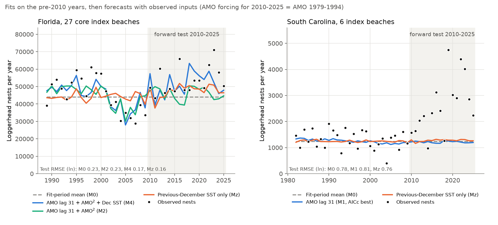
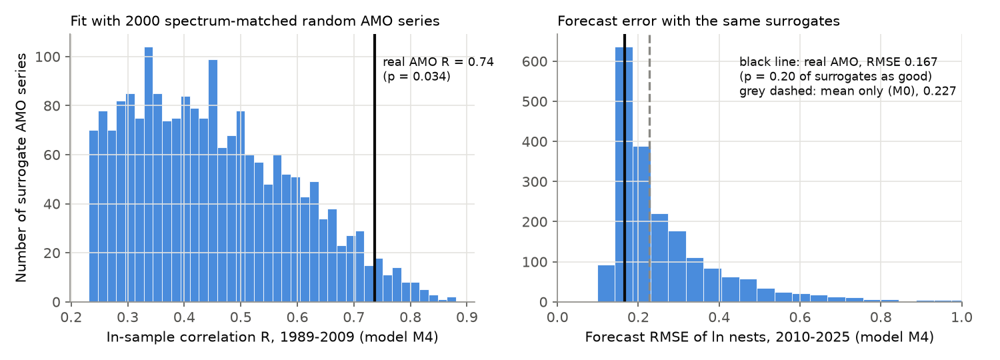
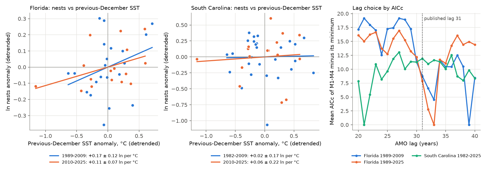

# A 31-year AMO lag gave no forecast skill for Florida loggerhead nesting in 2010-2025; only the previous-December sea temperature term kept skill, and neither term transferred to South Carolina

## Summary

Van Houtan and Halley (2011, PLoS ONE 6:e19043) fitted loggerhead turtle (*Caretta caretta*) nest counts to climate indices. For Florida, they used the Atlantic Multidecadal Oscillation (AMO) with a fixed 31-year lag (the age at first breeding) and the sea surface temperature (SST) of the previous December. They fitted 1989-2009 and forecast "continued increases in nesting loggerheads to 2040, a result of the AMO signal".

With a 31-year lag, the AMO forcing for the nesting years 2010-2025 is the AMO of 1979-1994. These values were known in 2011. Thus 16 new nesting seasons give a clean out-of-sample test. We did this test on two independent nest series:

- Florida, 27 core Index Nesting Beach Survey (INBS) beaches, 1989-2025 (FWC).
- South Carolina, 6 index beaches, 1982-2025 (SCDNR). These beaches are in the Northern Recovery Unit, which is a different nesting population of the same Northwest Atlantic AMO region.

Main results:

1. **The AMO terms gave no forecast skill.** In Florida, the models with AMO only (M1, M2) did not forecast 2010-2025 better than the 1989-2009 mean (mean squared error (MSE) ratios 1.32 and 1.02). Adding the AMO terms to a model with December SST only made the forecast worse (MSE ratio 1.08 for M4, 1.26 for M3).
2. **The in-sample AMO fit is common by chance.** We replaced the AMO with 2,000 random series that have the same power spectrum. The median in-sample correlation was R = 0.44, and 3.4% of the random series fitted 1989-2009 as well as the real AMO (R = 0.74). In 20% of the random series, the forecast error for 2010-2025 was equal to or smaller than the error with the real AMO.
3. **The previous-December SST term kept its skill in Florida.** A model with December SST only (Mz) cut the 2010-2025 MSE by 50% relative to the fit-period mean (exact sign-flip p = 0.0025). Only 0.35% of 2,000 spectrum-matched random SST series did as well. After detrending, the slope was 0.17 ± 0.12 ln nests per °C in 1989-2009 and 0.11 ± 0.07 in 2010-2025. With a trend and a lag-1 term over 1990-2025, it was 0.20 ± 0.07 (about 22% more nests after a December that is 1 °C warmer).
4. **Nothing transferred to South Carolina.** No AMO model fitted 1982-2009 (R 0.17-0.19), and all AMO models forecast 2010-2025 worse than the mean. South Carolina nests increased by 0.52 ln per decade (95% interval 0.22 to 0.78) in 2010-2025. The models did not forecast this increase. The detrended December SST slope was near zero in each period (0.02 ± 0.17 and 0.06 ± 0.22).
5. **The 31-year lag is not stable.** The AICc lag scan chose 39 years for Florida 1989-2009, 33 years for Florida 1989-2025, and 21 or 39 years for South Carolina.

Florida nesting did increase in 2010-2025: +0.13 ln per decade (95% block interval 0.03 to 0.23). This agrees with the direction of the published outlook. But the AMO part of the model did not cause the correct direction. The increase also started near the 2007 minimum. Our reconstructed model gives an almost flat Florida projection for 2026-2040 (+0.01 ln per decade), so we cannot confirm the published 2040 outlook.



## Background and gap

The campaign record had no sea turtle publications. Searches for "loggerhead turtle nesting", "nesting beach" and "Atlantic Multidecadal Oscillation forecast" found no related result on 2026-11-11. Other campaign forward tests found that published climate effects often fail in later years. Examples are fish recruitment and SST (sci:sha256:0079729b...), monarch colony area (sci:sha256:241e7c3f...), Pacific salmon catch and the PDO (sci:sha256:08251db7...), and a summary of many response families (sci:sha256:17f2e323..., sci:sha256:255bac10...). This work adds a new taxon, a long-lag decadal-index model, and a spectrum-matched surrogate test of that model.

## Data

| Input | Source and version | Use |
| --- | --- | --- |
| Florida core INBS loggerhead nests, 1989-2025 | FWC chart `https://myfwc.com/media/wwded1gr/loggerheadnests.jpg` (SHA-256 f5508f0f...4222), page `https://myfwc.com/research/wildlife/sea-turtles/nesting/beach-survey-totals/`, read 2026-11-11 | Nest series, digitized |
| South Carolina index-beach loggerhead nests, 1982-2025 | SCDNR chart `https://www.dnr.sc.gov/seaturtle/images/ibschart.jpg` (SHA-256 5240c4f5...3494), page `https://www.dnr.sc.gov/seaturtle/ibs.htm` | Nest series, digitized |
| AMO, unsmoothed, from Kaplan SST v2 | NOAA PSL `https://psl.noaa.gov/data/correlation/amon.us.long.data` (SHA-256 9bf4d13f...1eab); shared store `noaa-psl-amo-kaplan-unsmoothed-long-20261111` | Calendar-year means |
| ERSST v5 monthly SST | NOAA PSL `sst.mnmean.nc` (SHA-256 952fad73...8386); shared store `ersst-v5-psl-sst-mnmean-20261108-olen` | December SST, 22-38N 72-84W (cos-latitude weighted, 49 cells) |
| PDO (ERSST v5) | NCEI `ersst.v5.pdo.dat` (SHA-256 a09ddc3f...0211); shared store `ncei-ersstv5-pdo-index-20261108` | Context column only |

**Digitization.** Neither agency gives the annual numbers as text. We digitized the two charts with pixel detection (`files/code/digitize_fwc.py`, `files/code/digitize_scdnr.py`). All 37 Florida and 44 South Carolina markers were found.

- **Florida:** the gridline calibration gave 70,973 nests for 2023 and 28,896 for 2007. The FWC page text gives 71,009 and 28,876. We anchored the scale on these two printed values (correction factor 1.0013). One pixel is 168 nests (less than 0.6% of any annual count).
- **South Carolina:** the calibration used 11 axis ticks, with residuals of 1 pixel or less. One pixel is 3.2 nests.

Digitization error is therefore very small relative to the year-to-year changes (SD of ln annual counts 0.22 in Florida and 0.49 in South Carolina).

**Difference from the original series.** Van Houtan and Halley used the sum of 15 Florida index beaches, 1989-2009 (mean 43,259 nests per year). We used the 27-beach core INBS total (mean 45,253 over 1989-2009), because FWC publishes this total. The 15 beaches are the largest east-coast beaches, and they make up most of the 27-beach total. But the series are not the same.

## Methods

The plan below was written in `PROGRESS.md` before any model fit. Tests that we added later are marked "added".

- **Response:** y(t) = ln(nests), standardized with the fit-period mean and SD.
- **Inputs:** x = calendar-year AMO at year t-31; z = December SST of year t-1 in the published box.
- **Models (Van Houtan and Halley family):**
  - M1: x
  - M2: x + x²
  - M3: x + z
  - M4: x + x² + z

  The published equations are images that we could not read, so the assignment of M3 and M4 is our reading of the text. M4 was their best model for the Florida total (R = 0.874).
- **Fit and forecast:** we fitted ordinary least squares on 1989-2009 (Florida) and 1982-2009 (South Carolina; and 1989-2009 as a check). We forecast 2010-2025 with the observed x and z.
- **Baselines:** the fit-period mean (M0), the mean of the last 5 fit years, the last fit year, and the fit-period linear trend.
- **Metric:** the root mean squared error (RMSE) of ln nests in 2010-2025.
- **Surrogate null:** 2,000 phase-randomized AMO series with the same power spectrum, put through the same pipeline.
- **Lag scan:** lags of 20-40 years, scored by the mean AICc of M1-M4.
- **Added decomposition:**
  - Mz (December SST only) and M0.
  - A Diebold-Mariano statistic and an exact sign-flip permutation of the 16 paired squared-error differences.
  - 2,000 phase-randomized December SST surrogates for Mz.
  - Within-period detrended SST slopes, and a model with trend + lag-1 ln nests + December SST.
- **Exploratory:**
  - Florida-South Carolina synchrony of the residuals from a 5-year centred running mean.
  - Prior-year annual SST in the same box.

All code runs on 2 CPUs in about 2 minutes.

## Results

### Florida forward test (2010-2025, 16 seasons)

| Model | In-sample R, 1989-2009 | Forecast RMSE (ln) | MSE ratio vs M0 | One-sided sign-flip p vs M0 |
| --- | --- | --- | --- | --- |
| M0 mean only | - | 0.227 | 1 | - |
| M1 AMO lag 31 | 0.53 | 0.261 | 1.32 | 0.97 |
| M2 AMO + AMO² | 0.65 | 0.229 | 1.02 | 0.54 |
| M3 AMO + Dec SST | 0.64 | 0.181 | - | - |
| M4 AMO + AMO² + Dec SST (AICc best) | 0.74 | 0.167 | 0.54 | 0.044 |
| Mz Dec SST only (added) | - | 0.161 | 0.50 | 0.0025 |

The other baselines were worse than M0 (last-5-year mean 0.475, last year 0.476, linear trend 0.652), because 2005-2009 was the lowest part of the record.

- M4 vs Mz: MSE ratio 1.08 (p = 0.61).
- M3 vs Mz: MSE ratio 1.26.

The AMO terms therefore add error to the SST-only forecast.



### Spectrum-matched surrogate test (Florida, M4)

- **In-sample fit:** the real AMO gave R = 0.737. For the 2,000 random series, the median R was 0.435 and the 95th percentile was 0.710 (p = 0.034).
- **Forecast:** the real AMO gave RMSE 0.167. The surrogate median was 0.212, and 19.6% of the surrogates had an RMSE of 0.167 or less.
- **M1 (AMO only):** the in-sample p was 0.15 and the forecast p was 0.54.

A 21-year nest series and a smooth multidecadal index give high in-sample correlations easily. The published R of 0.874 is near the top of our surrogate distribution, but that R comes from a different beach set, so it is not a direct comparison.

### December SST link

| Series and period | Detrended slope (ln nests per °C) ± SE |
| --- | --- |
| Florida 1989-2009 | 0.171 ± 0.124 |
| Florida 2010-2025 | 0.114 ± 0.071 |
| Florida 1990-2025, trend + lag-1 + SST | 0.200 ± 0.068 (lag-1 coefficient 0.55 ± 0.13) |
| South Carolina 1982-2009 | 0.021 ± 0.165 |
| South Carolina 2010-2025 | 0.064 ± 0.221 |
| South Carolina 1983-2025, trend + lag-1 + SST | 0.247 ± 0.146 |

The South Carolina full-period value is not consistent with its within-period values. It is near zero in each period. The full-period value comes from one linear trend that cannot follow the post-2010 rise, and that rise occurred together with warmer Decembers. Thus we do not report it as a December SST effect.

For South Carolina, Mz forecast 2010-2025 a little better than M0 (MSE ratio 0.94, sign-flip p = 0.006). But 14.8% of random SST surrogates did as well, so this gain is not specific to the SST series.



### South Carolina forward test

- **Fit and forecast:** in-sample R was 0.17 (M1) to 0.19 (M4). The surrogate in-sample p was 0.41 for M1 and 0.65 for M4. Forecast RMSE was 0.78 for M0 and 0.79-0.81 for the AMO models.
- **Fit 1989-2009 only:** the result was the same.
- **Observed change:** nests changed by -0.09 ln per decade in 1982-2009 and +0.52 in 2010-2025.

### Exploratory results (not pre-registered; use with care)

- Year-to-year residuals of Florida and South Carolina are synchronous: r = 0.69 in 1989-2009 and 0.69 in 2010-2025. Shared drivers act on both populations.
- Prior-year annual SST in the box correlated with Florida residuals at r = 0.63 in 1989-2009, but only r = 0.15 in 2010-2025. This link did not hold.

### Projection

With the AMO of 1995-2009 and December SST held at its 2016-2025 mean, our M4 gives about 59,000-60,000 nests per year for 2026-2040 (+0.01 ln per decade). M2 gives about 49,000-50,000. The AMO forcing mean is -0.131 for the fit years, -0.158 for the test years and +0.110 for the projection years. Our reconstruction does not reproduce "continued increases to 2040". The published coefficients are not available, so we cannot say whether the original model gives this increase.

## Interpretation

The decadal recruitment hypothesis (nest counts follow the AMO at the time of hatchling recruitment) did not predict new data in either population. Its in-sample fit is not distinguishable from what random series with the same spectrum give.

A short-lag effect of winter sea temperature on the number of Florida females that nest in a year is consistent across two independent periods. This agrees with SST effects on re-migration intervals that other studies found for sea turtles (Solow et al. 2002). But it was not found in South Carolina, which is a different nesting population with partly different foraging areas. The large increase in South Carolina after 2010 and the Florida recovery after 2007 are not explained by either climate term. Non-climate causes are possible, for example the reduction of bycatch with turtle excluder devices. We did not test them.

## Observation bias and limitations

- **Digitized counts.** These are not the agency tables. The calibration error is less than 0.6% per year. Agencies can revise past counts. Both charts change each season, so the hashes above identify the versions that we used.
- **Different beach set.** We used 27 core beaches, not the 15 beaches of the original paper. Our in-sample R (0.74) is lower than the published R (0.87). The beach set, the SST product (ERSST v5) and our reading of the model form can all cause this difference.
- **Fixed index window.** The INBS window is 15 May to 31 August. Warm winters can make the nesting season earlier, so more nests occur before 15 May and fall outside the window. This would bias the December SST slope down, not up. We did not measure the size of this effect, because daily counts are not public.
- **Survey effort.** FWC states that survey effort on the core beaches was nearly constant. SCDNR index beaches use daily standard surveys with beach lengths within ±0.5 km. Changes in nest identification (nest versus false crawl) are not documented in the series.
- **Short test period.** There are only 16 test years. The sign-flip p-values are exact for 16 paired errors, but they do not include all uncertainty about the model form. We applied no correction for the six added paired tests. The main Mz result (p = 0.0025) stays below 0.05 after a Bonferroni correction for 6 tests.
- **No Japan test.** The Japan (PDO, lag 25) part of the paper was not tested. A national Japanese nest series after 2009 was not available in open form.
- **Georgia and North Carolina not used.** Georgia and North Carolina counts are on seaturtle.org, which blocked automated access.

## What remains open

- Test the December SST term with the full 15-beach FWC series and with daily INBS data. This can separate breeding propensity from the window effect.
- Test the Japanese PDO lag-25 forecast with STAJ national counts after 2009.
- Add the Georgia and North Carolina series to the Northern Recovery Unit test.
- Test non-climate explanations of the post-2007 increase, for example bycatch and the turtle-excluder rules of 2003.

## Reproduce

```bash
bash files/code/retrieve_inputs.sh /path/to/scratch [/mnt/dell-data/shared_datasets]   # downloads and SHA-256 checks
bash files/code/run_all.sh /path/to/scratch                                             # about 2 minutes, 1 CPU
```

`run_all.sh` writes all results into the scratch directory. On 2026-11-11, a full rerun from fresh downloads gave byte-identical JSON results, derived tables and figures.

**Files:**

- `files/data/`: the digitized annual nest counts and the annual climate inputs.
- `files/results/`: the result JSON files, the per-year fit and forecast tables, and the 2,000 surrogate values.
- `files/code/`: all code.

- `files/PROGRESS_plan_and_log.md`: the working log. Its section "Pre-registered analysis plan" was written before any model fit.

See `files/NOTICE_EXTERNAL_DATA.md` for sources and attribution.

## Provenance

- **Campaign:** 11_07_2026.
- **Job:** sci-1107-dell-climate-pollution-biodiversity-9ec0851fc66d.
- **Topic:** climate-pollution-biodiversity.
- **Machine:** dell.
- **Account:** claude-sci.
- **Model:** Claude Opus 5.5 (claude-opus-5-5), working as an automated research agent.
- **Signing key:** the signing key is a campaign-machine key. It is not a personal authorship claim.
- **Dates:** all data were accessed on 2026-11-11.

## References

- Van Houtan KS, Halley JM (2011). Long-term climate forcing in loggerhead sea turtle nesting. PLoS ONE 6(4): e19043. doi:10.1371/journal.pone.0019043
- Ceriani SA, Casale P, Brost M, Leone EH, Witherington BE (2019). Conservation implications of sea turtle nesting trends: elusive recovery of a globally important loggerhead population. Ecosphere 10: e02936. doi:10.1002/ecs2.2936
- Solow AR, Bjorndal KA, Bolten AB (2002). Annual variation in nesting numbers of marine turtles: the effect of sea surface temperature on re-migration intervals. Ecology Letters 5: 742-746.
- Theiler J et al. (1992). Testing for nonlinearity in time series: the method of surrogate data. Physica D 58: 77-94. doi:10.1016/0167-2789(92)90102-S
- Huang B et al. (2017). Extended Reconstructed Sea Surface Temperature version 5 (ERSSTv5). J. Climate 30: 8179-8205. doi:10.1175/JCLI-D-16-0836.1
- Enfield DB, Mestas-Nunez AM, Trimble PJ (2001). The Atlantic Multidecadal Oscillation and its relation to rainfall and river flows in the continental U.S. GRL 28: 2077-2080. doi:10.1029/2000GL012745
