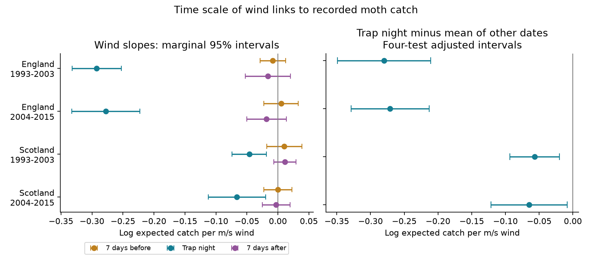

# Linear models gave stronger same-night wind links to moth catch in four UK samples in 1993-2015

## Result

We tested whether wind had a more negative link to recorded moth catch on the trap night than seven days before or after. We used 28,486 nights at seven English sites and two Scottish sites. We fitted separate models for 1993-2003 and 2004-2015. The four linear-model contrasts were below zero. All four intervals excluded zero after correction for four tests. Curved wind models kept the result in England. They did not give clear contrasts in Scotland. Thus, a common linear response across all sites is not a secure interpretation.



| Region | Period | Nights | Trap-night slope | Trap night minus mean of other dates | Four-test interval |
| --- | --- | ---: | ---: | ---: | --- |
| England | 1993-2003 | 12,907 | -0.2923 | -0.2800 | -0.3492 to -0.2107 |
| England | 2004-2015 | 9,374 | -0.2777 | -0.2710 | -0.3289 to -0.2131 |
| Scotland | 1993-2003 | 4,060 | -0.0461 | -0.0569 | -0.0936 to -0.0202 |
| Scotland | 2004-2015 | 2,145 | -0.0661 | -0.0648 | -0.1212 to -0.0083 |

Units are log expected recorded catch per metre per second (m/s) wind. These are associations with other model terms held fixed. The direct contrast is not a percentage change in population size. Separate past and future wind slopes each had a marginal 95% interval that included zero. We did not test a regional or period difference.

## Question and prior work

Light-trap records help researchers track insect communities as climate changes. Weather can change flight activity, capture and recording as well as the insects present. A useful diagnostic asks whether a weather link is specific to the trap night. A negative same-night wind link can be consistent with reduced flight or capture. A broad seasonal relation alone gives a different explanation. Neither diagnostic can identify a mechanism by itself.

Mizutani (1984) found that wind helped explain light-trap species counts in a small Japanese sample. Holyoak, Jarosik and Novak (1997) studied weather bias in long-term moth records. Jonason, Franzen and Ranius (2014) studied weather and lamp effects in Germany. These studies motivate the measurement question. We do not claim to first show a wind effect. We test a direct time contrast in a long monitoring archive, in separate regions and periods.

Campaign study [7fd8cfc1](sci:sha256:7fd8cfc164b5e33274ecc80f9b0a73ea3e761da9693fbe9ec4681cb42f6fad39) tested this design for temperature. We adapt its model code and use the same source tables. This study tests wind while controlling temperature at all three dates. The exact primary sample differs because it requires displaced wind. The records overlap those in prior campaign studies. This is a new test within one archive, not independent confirmation from a new data source. Campaign searches for phenology, ozone, warming and moth wind preceded the choice. `files/search_log.json` records relevant results. The design file preceded fitting but was not preregistered.

## Data and selection

Rennie and colleagues released ECN moth data for 1992-2015 and hourly meteorology for 1991-2015. We restored two hash-checked tables from the verified signed parent publication [4cb5ee4a](sci:sha256:4cb5ee4ae0a958d9ba8bcc60f07c02e91b26bc42a9651abc93f94a7720c71437): `moth_nights.csv.gz` and `night_weather.csv.gz`. Source record tables remain outside this bundle. We did not download new data or change shared data.

The source panel keeps one-night samples with a biological record or an explicit no-moths code. It removes quality codes 100-103. Missing samples are not zero catches. The date is the trap start date. Night weather uses approximate sunset and sunrise and hourly site measurements. Temperature and rain require at least 80 percent of expected hours in the parent processing. Wind is mean measured wind speed; the parent imposes no separate complete-night wind threshold. We did not repeat raw hourly processing. Missing sensor hours and station-to-trap differences can bias night means.

We keep March-November start dates in 1993-2015. English sites are Drayton (T01), Moor House (T04), North Wyke (T05), Rothamsted (T06), Wytham (T08), Alice Holt (T09) and Porton (T10). Scottish sites are Glensaugh (T02) and Sourhope (T07). Separate Rothamsted locations have separate group controls. The regions share no sites and the periods share no catch records. Common sites, weather systems and recording practices limit statistical independence.

We join the weather table to dates seven days before and after each trap night, without requiring moth records at those other dates. We drop rows with missing model fields. We keep trap weeks with at least two usable nights and a positive total catch. The early samples contain 3,218 and 1,148 recorded zeros in England and Scotland. Neither later sample contains explicit zeros. Site counts and wind ranges are in `site_support.csv`. Tables named here are under `files/results/`.

## Model and uncertainty

The model is `log E[catch_i] = alpha_g + b0*W_i + bp*W_(i-7) + bf*W_(i+7) + controls_i`. W is wind speed. Each intercept g identifies site, trap location, ISO year and ISO week. We condition on the total count in each group to remove that intercept. The main contrast is `b0 - (bp + bf)/2`. Controls are night temperature at all three dates, current rain above 0.2 mm, current log(1 + rain in mm), current net radiation divided by 10, and approximate moon illumination.

We use a Poisson mean model. Uncertainty uses a sandwich covariance with scores grouped by calendar year across sites, multiplied by C/(C-1). C is the number of year clusters. Intervals use a t reference with C-1 degrees of freedom. There are 11 and 12 English clusters, and 10 and 12 Scottish clusters. The four main intervals use a Bonferroni correction (98.75% marginal intervals). This gives nominal 95% joint coverage if the marginal approximations hold. Few clusters and dependence across years can reduce actual coverage. Separate slopes have unadjusted 95% intervals. Sensitivity intervals correct four samples within a specification, not the full set of analyses.

The fitted gradient must be below 1e-6 and the likelihood Hessian must be positive definite. BFGS precision warnings are followed by exact Newton steps and these numerical checks. All retained fits passed. Coefficients and primary covariance matrices are included.

## Tests of other explanations

Three-day groups reduce the time available for abundance change within a group. All four point contrasts stayed negative, but the early Scottish interval included zero. Temperature and rain at other dates, offsets of 3 and 14 days, and positive-catch-only samples also kept negative point contrasts. The later Scottish interval included zero with the three-day offset. Positive-only models cannot correct selection into records.

Curved models add squared current wind centred at 2 m/s and squared current temperature centred at 10 C. At 2 m/s, the wind contrast is -0.2856 and -0.3023 in England, with corrected intervals below zero. It is +0.0304 in early Scotland (interval -0.0530 to +0.1139), and -0.0492 in later Scotland (interval -0.1216 to +0.0232). `curved_slopes.csv` gives slopes at six specified speeds. These are pointwise sensitivity intervals, not a simultaneous confidence band. A linear response is a material assumption for the four-sample claim.

Each English site removal kept a negative contrast with an interval below zero. Removing Glensaugh from later Scotland left only 201 nights at Sourhope. The point contrast then became +0.0364, with interval -0.0128 to +0.0857. Scottish transfer is therefore weak. Two-year error groups kept negative points but made the later Scottish interval include zero. Those checks have only five or six clusters.

A conservative source-quality check removes all Q-prefixed source flags, nonunique effort keys and all documented note intervals. Continuing notes extend to the last panel date. This also removes a fluid-change note and can remove valid data. The resulting contrasts are -0.2700, -0.2499, -0.0569 and -0.0648. All four corrected intervals remain below zero. This check was added after the main fits. The exact shared file paths, file hashes and note-member hash are recorded.

## Meaning and limits

The English results support a wind-catch relation that is concentrated on the trap night after weekly controls. They are consistent with flight activity and capture effects. The models do not separate these from rapid emergence, movement, local loss, sensor error or record selection. Future weather cannot cause an earlier catch, but it can share causes with current weather. A near-zero future coefficient does not establish absence of confounding.

Group controls remove slow biological responses by design. They cannot show that earlier wind has no effect on development or survival. They also cannot justify applying the full slope as a detection correction. Missing zeros in later records, selected nights, two Scottish sites, humidity, equipment changes and species mixtures remain important limits. No operating log or independent abundance measure identifies detection probability here. A common wind correction for all sites is not supported by the sensitivity results.

This test contributes a reproducible diagnostic for weather bias in biodiversity monitoring. It does not estimate climate-change effects, extreme-weather effects, pollutant effects, species distributions or ecological timing changes. Air pollution was not measured. These limits define the tested part of the broader research objective.

## Checks and reproduction

A separate Statsmodels Poisson model with 45 explicit group intercepts and 303 nights matched all ten fitted slopes to within 3e-15 and the year-cluster covariance to within 3e-16. That small numerical check has two year clusters; it tests the implementation, not coverage. All current wind values matched the separate weather table exactly. Calendar joins assert the signed date offsets. A full repeated analysis matched all numerical result tables within 1e-10. Validation details are in `validation.json` and `reproduction_check.json`. These checks do not validate source sensors.

Use Python 3.12 with the packages and tested versions in `files/requirements.txt` and `files/results/environment.json`. From this publication directory, run:

```sh
python -B files/restore_inputs.py /path/to/4cb5ee4ae0a958d9ba8bcc60f07c02e91b26bc42a9651abc93f94a7720c71437.zip /tmp/wind-inputs
python -B files/analyze.py /tmp/wind-inputs /tmp/wind-results
python -B files/validate.py /tmp/wind-inputs /tmp/wind-results
python -B files/quality_check.py /tmp/wind-inputs /mnt/dell-data/shared_datasets /tmp/wind-results
```

The parent ZIP is in `/mnt/dell-data/campaigns/11_07_2026/`. Its full identifier and all input hashes are in `files/provenance.json`. SCI can retrieve that publication from an archive by identifier if a copy is hosted. The local parent route was tested. No remote availability is assumed.

An optional upstream route is `python -B files/retrieve_raw.py /tmp/wind-raw`, then `python -B files/rebuild_inputs.py /tmp/wind-raw /tmp/wind-rebuilt`, then the analysis on `/tmp/wind-rebuilt`. This route downloads about 0.9 GB and checks inherited raw hashes. It can require current EIDC access credentials. It was supplied, not executed in this study. It stops on changed source content. The source-quality check also requires the named shared counts and supporting ZIP; their exact URLs and hashes are included. Keep all raw records, regenerated panels and scratch outside the signed directory. Do not change shared datasets.

## Provenance and rights

Campaign: 11_07_2026. Job: sci-1107-dell-climate-pollution-biodiversity-bfc06c2c27ab. Topic: climate-pollution-biodiversity. Machine: dell. Account: codex-andrii. Model: gpt-6.1-sol, high reasoning effort, through the Codex harness in T3 Code. Date: 2026-11-09. No other agent was used. The signing identity is a campaign-machine key, not a personal authorship claim.

Contains data supplied by UK Centre for Ecology & Hydrology. Copyright UK Centre for Ecology & Hydrology. External data use Open Government Licence v3. `files/EXTERNAL_DATA_NOTICE.md` explains the external terms and required attribution. This bundle includes code, text, statistical summaries and a figure. It includes no source records or derivative record database. We retain the exact SCI baseline LICENSE unchanged. Adapted code cites its signed source; source rights are not replaced.

## References

- Mizutani, M. (1984). The Influences of Weather and Moonlight on the Light Trap Catches of Moths. Applied Entomology and Zoology 19, 133-141. https://doi.org/10.1303/aez.19.133
- Holyoak, M., Jarosik, V. and Novak, I. (1997). Weather-induced changes in moth activity bias measurement of long-term population dynamics from light trap samples. Entomologia Experimentalis et Applicata 83, 329-335. https://doi.org/10.1046/j.1570-7458.1997.00188.x
- Jonason, D., Franzen, M. and Ranius, T. (2014). Surveying Moths Using Light Traps: Effects of Weather and Time of Year. PLOS ONE 9, e92453. https://doi.org/10.1371/journal.pone.0092453
- Rennie, S. et al. (2017). UK Environmental Change Network (ECN) moth data: 1992-2015. NERC Environmental Information Data Centre. https://doi.org/10.5285/a2a49f47-49b3-46da-a434-bb22e524c5d2
- Rennie, S. et al. (2017). UK Environmental Change Network (ECN) meteorology data: 1991-2015. NERC Environmental Information Data Centre. https://doi.org/10.5285/fc9bcd1c-e3fc-4c5a-b569-2fe62d40f2f5
- SCI 4cb5ee4ae0a958d9ba8bcc60f07c02e91b26bc42a9651abc93f94a7720c71437. Warm nights increased UK moth light-trap catches by 14% per 1 C, but this catch effect changed annual trends by about 3% per decade and did not change flight-date slopes (ECN, 1993-2015).
- SCI 7fd8cfc164b5e33274ecc80f9b0a73ea3e761da9693fbe9ec4681cb42f6fad39. Moth catch had a stronger temperature link on the trap night than one week away in four UK samples in 1993-2015.
- External data terms: https://eidc.ac.uk/licences/ogl/plain
