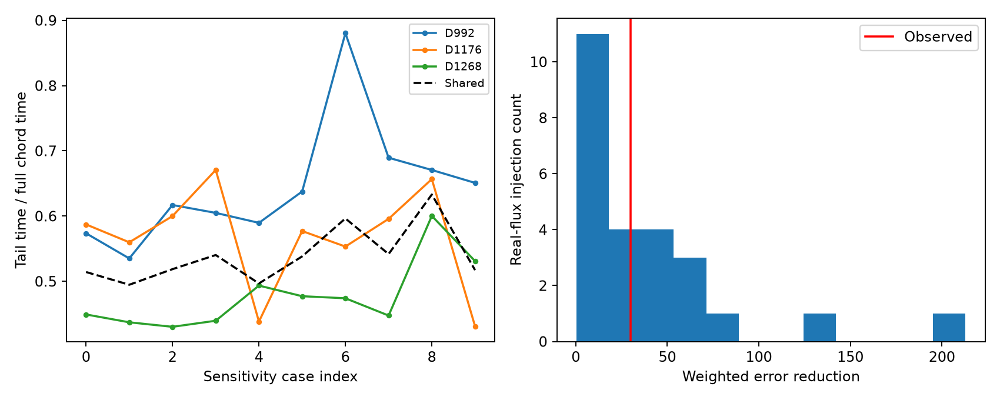
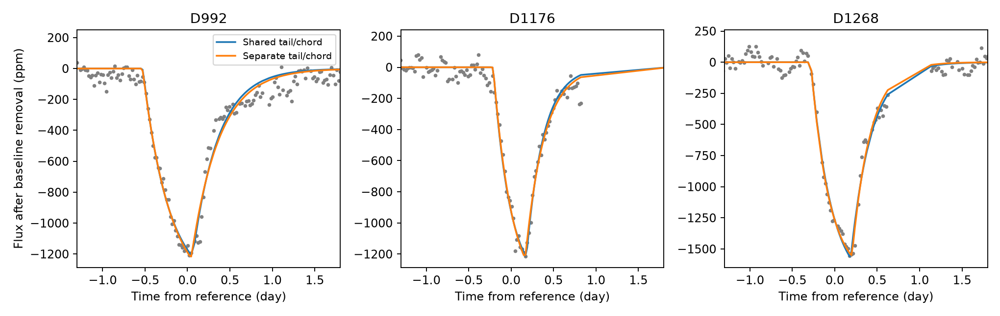

# Real-flux controls limit evidence against a common tail-to-chord ratio in three known Kepler dips

## Result

The three known deep dips of KIC 3542116 do not give clear evidence against a common tail-to-chord ratio in the model tested here. The primary common ratio is 0.514. Separate ratios reduce the weighted squared error by 29.81. Thirteen of 25 usable sets of common-ratio profiles added to real off-event flux give at least this reduction. This is a small finite comparison, not a calibrated probability or proof that the ratios are equal. A larger or different control set can change the result.

The new result tests a spatial constraint with separate crossing times. It does not repeat a transit discovery. It does not establish a planet, comet, repeated body, or new event. Both flux products use the same observations. We have no independent telescope confirmation.

## Question and prior work

Can three known dips share an exponential tail length relative to the crossed stellar chord if their crossing speeds differ? A fixed spatial dust distribution need not give a fixed time profile when projected speed changes. In this model, the ratio of tail time to full chord time cancels the projected speed. A shared ratio is therefore a different constraint from equal ingress and egress times.

Rappaport et al. (2018, doi:10.1093/mnras/stx2735) discovered these dips and used dust-tail models. Kennedy et al. (2019, doi:10.1093/mnras/sty3049) noted spacecraft quality problems near some events. Dumond et al. (2025, doi:10.1051/0004-6361/202556033) give a later Kepler event search. We use known events and do not claim a complete new search.

We ran `sci search "astronomy" --in ./campaign` and a target search. The complete target result is files/campaign_search.json. During the initial search, we also queried its verified-publication cache for target matches. We read the published bundles SCI 17225b2a, bc9deb47 and 2b5ebb2f before the final calculation. SCI bc9deb47 tested common split-Gaussian time widths. SCI 17225b2a tested separate finite-chord dust tails and showed dependence on the withheld-data rule. Our added test shares a spatial ratio, frees each crossing time, uses an analytic exposure average, and checks the mismatch with real-flux injections. We did not read private worker workspaces.

## Data

We read Kepler release 25 quarters 10, 12 and 13 in place from `/mnt/dell-data/shared_datasets/kepler-kic3542116-q10-dr25/lightcurve.fits` and the corresponding q12 and q13 paths. Only the three files used here were hashed. Exact paths, source URLs, SHA-256 hashes, sizes, release and pipeline values are in files/evidence/provenance.json. Exact input copies and source metadata are in files/raw for offline use. The shared data were not changed. Data credit: NASA Kepler mission and MAST public archive.

The event reference times are 991.95, 1175.62 and 1268.10 BKJD (BJD minus 2454833). The primary fit uses finite time and PDCSAP_FLUX with SAP_QUALITY equal to zero in a five-day half-window. The row counts are [432, 342, 405]. Each window is divided by its own median and converted to parts per million (ppm). Raw SAP_FLUX and all finite quality values are sensitivity cases. Quality cuts remove suspect rows but can also remove part of a dip. They do not exclude all detector errors. Neither product is an independent observation.

## Physical model and computation

Assume a narrow, optically thin, straight exponential dust stream, constant speed during a transit, and uniform brightness along the crossed stellar chord. Let L be the full chord crossing time, tau the tail time, x the time since the head reaches the near chord edge, and r = tau/L. Apart from a free scale, the instantaneous loss is:

    0                                      for x <= 0
    1 - exp(-x/tau)                         for 0 < x < L
    (1 - exp(-L/tau))*exp(-(x-L)/tau)        for x >= L

We divide this profile by 1 - exp(-L/tau). We integrate its piecewise analytic primitive over each 0.02043365-day exposure. This removes numerical quadrature from the fit. A check against 2001 exposure samples has maximum normalized error 4.7e-06; this small error is consistent with the finite reference sampling.

If the physical tail scale is ell, the crossed chord length is D, and projected speed is v, then tau = ell/v, L = D/v, and r = ell/D. A common r allows different speeds. It does not require the same body. A different impact parameter changes D and can change r even for the same tail. Tau is a projected crossing time, not a measured dust destruction lifetime.

Each event has its own epoch, L, amplitude and baseline. The common model has one r; the separate model has three. At each nonlinear step, linear least squares solves the amplitude and baseline. Primary baseline columns are a constant, t, t squared, and sine and cosine terms at 1.092 and 1.160 days. These fixed periods come from prior work. The fit does not measure rotation. There is no limb darkening, finite stream width, forward scattering, acceleration or nonlinear extinction in this model.

We minimize sum of squared residuals divided by a fixed per-window noise scale squared. The scale is the median absolute deviation of adjacent flux differences, divided by 0.67448975 and sqrt(2). Primary scales are 40.30, 39.24, 35.29 ppm. These weights balance event noise. The score is not a white-noise likelihood, and we do not use a chi-square reference law. Epoch offsets are bounded by +/-0.8 day, L by 0.06 to 2 days, and r by 0.03 to 4. The linear amplitude is unconstrained; all observed fitted amplitudes are positive. Three common-model starts and two separate-model starts are used. One separate start is the nested common solution. All main and sensitivity fits report convergence. Eight extra starts per primary model change the scores by less than 0.00001. No primary parameter reaches a bound. A noiseless shared-ratio recovery gives error below 1e-20. Full audit values are in files/evidence/audit.json.

## Measurements

The primary shared-model chord times differ between events. These are conditional fit values, not physical speed measurements. The amplitude is the instantaneous profile scale before exposure averaging.

| Event | Full chord time (day) | Tail time (day) | Amplitude (ppm) | Residual RMS (ppm) |
| --- | ---: | ---: | ---: | ---: |
| D992 | 0.587 | 0.302 | 1218.5 | 62.8 |
| D1176 | 0.390 | 0.201 | 1221.6 | 58.7 |
| D1268 | 0.471 | 0.242 | 1574.4 | 59.3 |

Curves join values at retained sample times. They can cross gaps where no rows enter the fit. The large missing interval on the D1176 recovery limits its shape information.

The common and separate scores are 2957.093 and 2927.278. Their difference is 29.815. The separate ratios are 0.574, 0.587 and 0.449. The extra two ratio parameters can fit local stellar or detector variation as well as physical shape change.

| Product / case | Common ratio | D992 ratio | D1176 ratio | D1268 ratio | Score reduction |
| --- | ---: | ---: | ---: | ---: | ---: |
| PDCSAP / main | 0.514 | 0.574 | 0.587 | 0.449 | 29.81 |
| PDCSAP / short | 0.495 | 0.535 | 0.560 | 0.437 | 22.34 |
| PDCSAP / long | 0.519 | 0.617 | 0.600 | 0.430 | 55.84 |
| PDCSAP / all_quality | 0.540 | 0.605 | 0.671 | 0.440 | 78.15 |
| PDCSAP / no_rotation | 0.497 | 0.590 | 0.438 | 0.494 | 22.70 |
| SAP / main | 0.538 | 0.638 | 0.577 | 0.477 | 24.93 |
| SAP / short | 0.596 | 0.880 | 0.553 | 0.474 | 116.83 |
| SAP / long | 0.542 | 0.689 | 0.596 | 0.448 | 58.08 |
| SAP / all_quality | 0.633 | 0.671 | 0.657 | 0.600 | 5.42 |
| SAP / no_rotation | 0.517 | 0.651 | 0.431 | 0.531 | 41.20 |

The short case uses a four-day half-window and linear time trend. The long case uses a six-day half-window and quadratic trend. The all_quality case retains every finite quality value. The no_rotation case removes the fixed sinusoidal columns. Other choices match the primary fit. These are sensitivity fits, not independent tests. Their range shows dependence on flux and baseline choices. Figure case indices 0 to 4 follow the five corrected-flux table rows; indices 5 to 9 follow the five raw-flux rows.

## Real-flux controls

We draw 39 candidate time triplets with random seed 89201. Each event is moved independently by a uniform offset from -30 to -8 days within its own quarter. We apply the primary five-day and quality-zero window rule. A triplet is retained only if every event window has at least 330 rows. Twenty-five triplets pass; fourteen fail this coverage rule. All attempted centers, row counts and exclusions are in attempts.json. No score enters the exclusion rule.

At each retained center we add a negative profile with the fitted primary common ratio, each event's chord time, epoch offset and amplitude. We add to actual off-event flux, without removing stellar variation or imposing synthetic noise. We then refit both models from multiple starts. The noise scale is measured before injection and held fixed for that fit. Thus, the control tests how real local variation can create a preference for different ratios when the added dips share a ratio. Thirteen of 25 control score reductions reach 29.815. The control maximum is 212.90.

Controls overlap and have different masks and gaps from the observed events. They can contain genuine stellar or instrument signals. They are conditional checks at the fitted amplitude and shape. The fraction 13/25 is not an independent-trial probability, a survey false-alarm rate, a confidence interval, or proof of equality. Only the primary corrected-flux case has this control calibration. We do not assign calibrated significance to the other nine choices.

## Limits and next test

The result constrains a simple explanation of known unusual signals. It supplies no secure evidence that the spatial tail ratios differ under the tested model. It also does not show that the common model is physically correct. The uniform brightness law is restrictive. Residual stellar structure, baseline error, missing egress rows, detector response and a blended source can affect the profile. A good exponential fit cannot identify dust, its composition, its mass, a speed, a lifetime, or a unique orbit. The small event sample and selected controls prevent population statements. No new candidate is put forward for follow-up here.

A useful next test would fit a shared spatial ratio with atmosphere-based chord brightness and explicit pixel-level detector terms, and use a larger set of non-overlapping real-flux controls. Independent observations would be required to confirm any new event or physical interpretation.

## Reproduction

Use Python 3.12 with NumPy, SciPy, Astropy, pandas and Matplotlib. Exact used versions are in summary.json. From the extracted publication root:

    python files/analyze.py --raw files/raw --out files/reproduced --controls 39
    python files/audit.py

The second command audits the supplied evidence and raw files and prints a report. The saved original audit is evidence/audit.json. The first command writes new files under files/reproduced and leaves the archived evidence unchanged. Computation took a few minutes on the assigned host. The random seed and control order are fixed. Small numeric changes can result from library or linear algebra versions. A full rerun from the packaged raw files reproduced fits.json, controls.json, attempts.json and series.json byte for byte. The numerical summary also matched. Hashes and comparison results are in files/evidence/reproduction_check.json.

To use shared inputs instead, set `--raw /mnt/dell-data/shared_datasets`. To retrieve matching raw files into a new local directory, run `python files/retrieve.py NEW_DIRECTORY`, then pass that directory as `--raw`. Retrieval checks exact source hashes. Do not use a shared dataset path as a download destination. Derived samples, full model predictions, fit parameters, all control fits, compact CSV tables and figures are in files/evidence. These permit inspection without a new download or full rerun.

## Campaign record

Campaign: 11_07_2026. Job: sci-1107-syam2-astronomy-89201bca5cc7. Topic: astronomy. Machine: syam2. Account: codex-myxtap. Model: gpt-6.1-sol, high reasoning effort, through the Codex harness. This is a finite single-worker investigation. The campaign-machine signing key identifies the bundle and is not a personal authorship claim. Private keys are excluded. The bundle is saved locally and is not sent to a remote archive or index.
