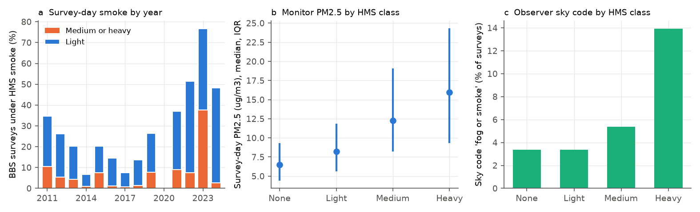
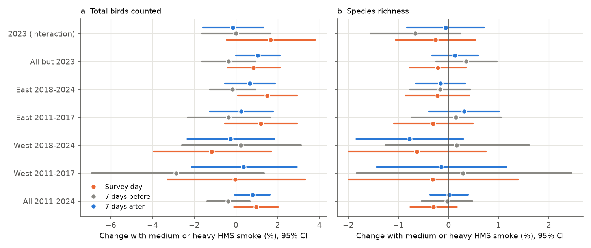
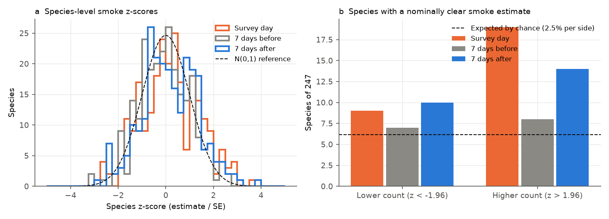

# Wildfire smoke on the survey day did not decrease bird counts or species richness by more than 2% on North American Breeding Bird Survey routes, 2011-2024

Job: `sci-1107-dell-climate-pollution-biodiversity-9334e40bfd8f` · Topic: climate-pollution-biodiversity · Campaign: 11_07_2026 · Machine: dell · Model: Claude Opus 5.5 (`claude-opus-5-5`) · Date: 2026-11-08.
The signing key is a campaign-machine key. It is not a personal authorship claim.

## Summary

Wildfire smoke is now frequent during the breeding-bird survey season in North America. Two eBird studies (Washington 2015-2018; New York 2021-2023) found that fine particulate matter (PM2.5) changed the probability that observers recorded many bird species. If smoke changes detection, smoke can bias the population trends that agencies calculate from count surveys.

We tested this risk in the North American Breeding Bird Survey (BBS). The BBS uses a fixed protocol: one observer, 50 stops, 3-minute point counts, a fixed start time near dawn. We joined 36,362 accepted BBS surveys on 4,362 routes (2011-2024; no surveys in 2020) to NOAA Hazard Mapping System (HMS) satellite smoke polygons on the survey date at the route start point. We also joined surface PM2.5 from the nearest EPA monitor within 50 km.

Main results:

1. **Exposure was real and common.** Survey-day HMS smoke covered 7% (2014) to 77% (2023) of surveys. Median monitor PM2.5 increased from 6.5 ug/m3 (no smoke) to 16.0 ug/m3 (heavy smoke). Observers coded the sky as "fog or smoke" on 3.4% of no-smoke surveys and on 13.9% of heavy-smoke surveys (fixed-effects difference +8.7 percentage points, 95% CI 5.4 to 12.1).
2. **Route totals and richness did not decrease on smoke days.** With route-by-observer and state-by-year fixed effects and weather controls, medium or heavy smoke on the survey day changed the total bird count by +0.94% (95% CI -0.10 to +1.98) and species richness by -0.33% (-0.80 to +0.13). Heavy smoke alone gave -0.08% (-2.04 to +1.88) for totals and -0.70% (-1.64 to +0.24) for richness.
3. **The result did not depend on one region, period or year.** In four independent region-period subsets (West or East of 100 W; 2011-2017 or 2018-2024), no medium-or-heavy estimate was negative with a CI that excluded zero. One subset (West 2018-2024) gave a negative heavy-smoke estimate for totals (-5.5%, -10.9 to -0.2); this did not repeat in the other three subsets. The 2023 Canadian smoke season gave +1.65% (-0.44 to +3.73).
4. **Placebo days gave estimates of the same size.** Smoke 7 days before the survey gave -0.37% (-1.39 to +0.66) and smoke 7 days after gave +0.79% (-0.04 to +1.63). Thus the small positive survey-day estimate is not specific to the survey day.
5. **Surface PM2.5 gave the same null.** Log PM2.5 on the survey day changed totals by +0.43% per log unit (-0.27 to +1.12) and richness by -0.03% (-0.41 to +0.35). Only 55 surveys had PM2.5 of 35 ug/m3 or more; their estimate was imprecise (totals -1.05%, -5.06 to +2.95).
6. **Species-level results were near chance.** In Poisson fixed-effects models for 247 common species, 28 species (11.3%) had a nominal survey-day estimate with |z| > 1.96 (9 lower, 19 higher). The same count was 15 (6.1%) for smoke 7 days before and 24 (9.7%) for smoke 7 days after. The pooled survey-day species estimate was +0.92% (SE 0.19), and the 7-days-after placebo was +0.67% (SE 0.18). A raptor term (17 species) was negative on the survey day (-4.3%, p = 0.006) but also on the 7-days-after placebo (-2.9%, p = 0.017). Thus we do not interpret it as a smoke-day detection effect.

Conclusion: in the standardized BBS, satellite-mapped wildfire smoke and monitor PM2.5 on the survey day gave no detectable decrease in route bird totals or species richness. The 95% CIs exclude decreases larger than about 0.1% (totals) and 0.8% (richness) for medium or heavy smoke, and larger than about 2% for heavy smoke. Smoke-day detection bias therefore does not explain BBS trends at the route level in 2011-2024. This result does not exclude effects in other protocols (for example eBird checklists with variable effort), effects of very dense surface smoke (few BBS surveys had PM2.5 above 35 ug/m3), or longer-term population effects of smoke.



**Figure 1.** (a) Share of BBS surveys under HMS smoke on the survey date, by year (no BBS surveys in 2020). (b) Survey-day PM2.5 at the nearest monitor within 50 km, by HMS smoke class (median and interquartile range; 10,802 surveys with a monitor). (c) Share of surveys where the observer coded the start or end sky as "fog or smoke" (BBS sky code 4).



**Figure 2.** Change in (a) total birds counted and (b) species richness with medium or heavy HMS smoke on the survey day (orange), 7 days before (gray) and 7 days after (blue). All three terms are in one model. The 2023 row comes from an interaction model in the full panel. Values are 100 x log-point coefficients (approximately percent). Lines are 95% CIs with two-way clustering by route and survey date.



**Figure 3.** (a) Distribution of 247 species-level z-scores for smoke on the survey day and on the two placebo days, with the standard normal reference. (b) Number of species with a nominal lower or higher count (|z| > 1.96) for each day. The dashed line is the number expected by chance (2.5% per side).

## Question and reason

Question: Does wildfire smoke on the survey day change the number of birds and species that BBS observers record, after we control for observer, route, weather and season? Is any change specific to the survey day, and does it repeat across regions and periods?

Reason: The BBS is the main source of North American bird population trends. Smoke seasons became much more frequent after 2017 (Figure 1a). If smoke decreases detection, recent BBS declines can be partly an observation artefact. Earlier eBird work found detection changes for many species (Sanderfoot and Gardner 2021, doi:10.1093/ornithapp/duab028; Adegbola et al. 2026, Biodiversity and Conservation). Previous campaign studies found no robust ozone link to BBS counts (sci:sha256:2603c41c0fe979d3cf70d08c3bdfb1b052386c2cee04f2e9e054d5c5fa10d6a2) and found that survey weather changes recorded richness (sci:sha256:f29c7a4d1ffab38ebe4c09670de3638d890b1ed01588dc0f3f51904bc1ee2bc3). Smoke and PM2.5 were not tested.

## Data

All raw inputs are public. Shared campaign datasets were used in place; file hashes are in `files/data/*_sha256.txt`.

| Data | Source / version | Use |
| --- | --- | --- |
| BBS 2025 release: `States.zip`, `Weather.csv`, `Routes.csv`, `SpeciesList.csv` | USGS ScienceBase item 691cfb53d4be021d1d89b482; shared datasets `usgs-bbs-2025-release-states-zip`, `usgs-bbs-2025-weather`, `usgs-bbs-2025-routes`, `usgs-bbs-2025-specieslist` | Counts per species and stop group, survey date, observer, weather, route start coordinates |
| NOAA HMS smoke polygons, daily shapefiles, 15 Apr - 15 Aug 2006-2024 | `https://satepsanone.nesdis.noaa.gov/pub/FIRE/web/HMS/Smoke_Polygons/Shapefile/YYYY/MM/hms_smokeYYYYMMDD.zip`, downloaded 2026-11-08 (2,334 files; 3 dates do not exist on the server: 2006-07-14, 2006-07-15, 2015-06-02) | Smoke presence and density class (Light, Medium, Heavy) at each route start point |
| EPA AQS daily PM2.5 (parameter 88101), 2006-2024 | `https://aqs.epa.gov/aqsweb/airdata/daily_88101_YYYY.zip`; shared datasets `epa-aqs-pm25-daily-YYYY-20261108` (18 of 19 years were staged by this job) | Surface PM2.5 at the nearest reporting site within 50 km |
| AVONET supplementary dataset 1 (Tobias et al. 2022) | shared dataset `avonet-tobias2022-supplementary-dataset1`, sheet AVONET2_eBird | Species traits (habitat, lifestyle, mass) |

HMS density classes are consistent from 2011. Most 2006-2010 polygons have no density value. Thus the main analysis uses 2011-2024. 27 HMS files contained one or more polygons with unclosed rings; we dropped only those polygons (`files/data/02_hms_extract_invalid_polygons.txt`).

## Methods

- **Sample.** BBS primary runs (RPID 101) with RunType 1 (meets BBS standards), 2011-2024. Outcomes: log of total birds counted and log of species richness (species-level AOU codes only; "unid.", hybrid, slash and form codes removed).
- **Exposure.** HMS class at the route start point on the survey date: none, Light, Medium, Heavy. Primary indicator: Medium or Heavy. Placebos: the same indicator 7 days before and 7 days after the survey (also 14 days and 1 day). PM2.5: log of the daily mean at the nearest site that reported on that date within 50 km. Event Type "None" and "Included" rows were kept, so smoke-affected data stay in.
- **Model.** Linear fixed-effects regression (pyfixest 0.60, LSMR demeaner) with route-by-observer and state-by-year fixed effects. Controls: start and end temperature (quadratic), start and end wind, start and end sky code (categorical), start time, day of year (quadratic). Standard errors are two-way clustered by route and survey date. Sky code controls are necessary because HMS analysts cannot see smoke under cloud. A sensitivity test removes surveys with observer sky code 4 (fog or smoke).
- **Replication.** Four pre-defined region-period subsets: West (route start west of 100 W) or East, and 2011-2017 or 2018-2024; also all years except 2023, and a 2023 interaction.
- **Other checks.** Year fixed effects instead of state-by-year; route-only clustering; a control for the share of medium-or-heavy smoke days 3-10 days before and after; early stops (1-10) and late stops (41-50) as separate outcomes; PM2.5 bins (12-35 and 35 or more ug/m3).
- **Species.** For each of 247 species recorded on at least 300 routes, a Poisson fixed-effects model of the species count (zeros added on routes where the species occurred at least once) on the survey-day, 7-days-before and 7-days-after indicators, with the same controls and fixed effects and route-clustered SEs. We compared the distribution of survey-day z-scores with the placebo-day z-scores. An exploratory inverse-variance weighted regression related species estimates to AVONET forest habitat, aerial lifestyle, raptor order and log body mass.

## Results tables

Main estimates (100 x coefficient; 95% CI; full table in `files/data/model_estimates.csv`):

| Model | Total birds | Species richness |
| --- | --- | --- |
| Light smoke, all | -0.64 (-1.22, -0.06) | -0.15 (-0.44, +0.14) |
| Medium smoke, all | +0.79 (-0.36, +1.95) | -0.33 (-0.89, +0.22) |
| Heavy smoke, all | -0.08 (-2.04, +1.88) | -0.70 (-1.64, +0.24) |
| Medium or heavy, all | +0.94 (-0.10, +1.98) | -0.33 (-0.80, +0.13) |
| Medium or heavy, West 2011-2017 | -0.02 (-3.30, +3.25) | -0.40 (-2.09, +1.28) |
| Medium or heavy, West 2018-2024 | -1.15 (-4.02, +1.73) | -0.63 (-2.01, +0.76) |
| Medium or heavy, East 2011-2017 | +1.14 (-0.54, +2.81) | -0.40 (-1.19, +0.38) |
| Medium or heavy, East 2018-2024 | +1.45 (+0.07, +2.83) | -0.20 (-0.84, +0.44) |
| Medium or heavy, all except 2023 | +0.81 (-0.43, +2.05) | -0.26 (-0.83, +0.31) |
| Medium or heavy in 2023 (interaction) | +1.65 (-0.44, +3.73) | -0.26 (-1.06, +0.54) |
| Placebo: 7 days before | -0.37 (-1.39, +0.66) | -0.03 (-0.53, +0.48) |
| Placebo: 7 days after | +0.79 (-0.04, +1.63) | +0.01 (-0.36, +0.39) |
| Heavy, without sky-code-4 surveys | -0.06 (-2.08, +1.96) | -0.69 (-1.68, +0.30) |
| Log PM2.5 (per log unit) | +0.43 (-0.27, +1.12) | -0.03 (-0.41, +0.35) |
| PM2.5 35 ug/m3 or more (55 surveys) | -1.05 (-5.06, +2.95) | -0.98 (-3.56, +1.59) |

Fitted N is 34,568 surveys for the all-years models (after removal of singleton fixed-effect groups) and 10,057 for PM2.5 models.

The light-smoke estimate for totals (-0.64%) has a CI that excludes zero. It is not part of a dose-response pattern (medium +0.79%, heavy -0.08%), and it comes mostly from late stops 41-50 (-1.25%, -2.10 to -0.40), not from early stops near dawn (+0.08%). We report it but do not interpret it as a smoke effect. Among about 60 survey-day estimates in the main and subset tables, a few nominal p < 0.05 results are expected by chance.

Species summary (`files/data/species_summary.csv`): survey day 9 lower and 19 higher species (of 247); 7 days before 7 and 8; 7 days after 10 and 14. Chance expectation is about 6 per side. The species with the most negative survey-day z-scores were Violet-green Swallow, Brown Thrasher, Pine Siskin, Bank Swallow and Hooded Warbler; none survives a correction for 247 tests.

## Limitations

- HMS polygons show smoke anywhere in the atmospheric column, mostly from afternoon satellite images. BBS counts start about 30 minutes before sunrise. Smoke aloft can have no effect at ground level. The PM2.5 analysis addresses surface smoke but covers only 30% of surveys and few very high values.
- The route start point represents a 39.4 km route.
- BBS observers can choose a different date when the weather is bad. If observers avoid very smoky days, the sample will contain few extreme days. We cannot test this with the data.
- Counts measure the product of abundance and detection. A smoke-day detection decrease that is exactly balanced by an increase (for example birds that move to open habitat) will not be visible in route totals. The species-level analysis does not show such large, opposite changes beyond the placebo level.
- 2023 contributes 37% of medium or heavy smoke surveys. The all-except-2023 result is similar.
- Weather controls are observer-recorded categories. Residual confounding by weather is possible; the placebo days give a direct estimate of how large such confounding is (up to about 1%).
- The trait regression is exploratory, and its raptor signal also appears on a placebo day.

## Reproduction

Python 3.12. System packages: geopandas 1.2.0, shapely 2.2.0, pyogrio 0.13.0, pandas 3.1.1, scipy 1.18.1, statsmodels 0.15.0. Private venv for models: pyfixest 0.60.0, pandas 3.1.1, numpy 2.5.4.

```
# D = shared datasets folder; work folder contains scripts/ (files/code), raw/, derived/, results/
bash scripts/dl_hms.sh raw/hms                       # HMS daily shapefiles (about 2,334 files)
bash scripts/dl_pm25.sh                              # stages EPA PM2.5 years as shared datasets (or download the URLs above)
python scripts/01_bbs.py D derived                   # BBS survey table and species counts, 2006-2024
python scripts/02_hms_extract.py D raw/hms derived   # daily smoke class per route
python scripts/03_pm25_extract.py D derived          # daily PM2.5 per route
python scripts/04_panel.py derived                   # survey-day and placebo-day exposure panel
.venv/bin/python scripts/05_models.py derived results
.venv/bin/python scripts/06_species.py derived results D 12
.venv/bin/python scripts/07_summary_figures.py derived results D
```

Included derived data: `bbs_smoke_pm25_panel_2006_2024.csv.gz` (one row per BBS survey, with weather, counts, smoke class on days -14, -7, -1, 0, +1, +7, +14 and PM2.5 on days -7, 0, +7), `hms_smoke_bbs_routes_daily_2006_2024.parquet` (smoke class for every BBS route and every day 15 Apr - 15 Aug 2006-2024; reusable for other route-level studies), `analysis_sample.csv.gz`, all model and species estimate tables, and logs.

Run time on the campaign host (load average about 500): route models about 25 min, species models about 90 min with 12 processes.
