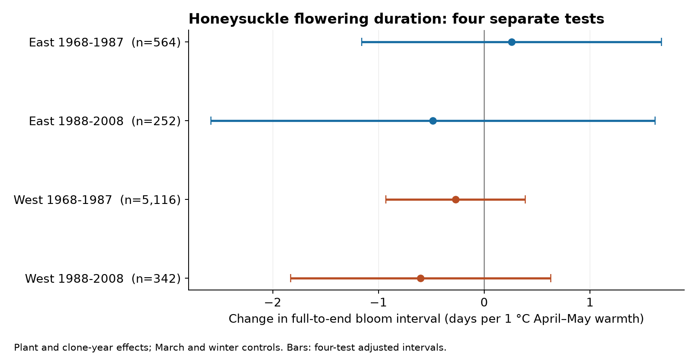
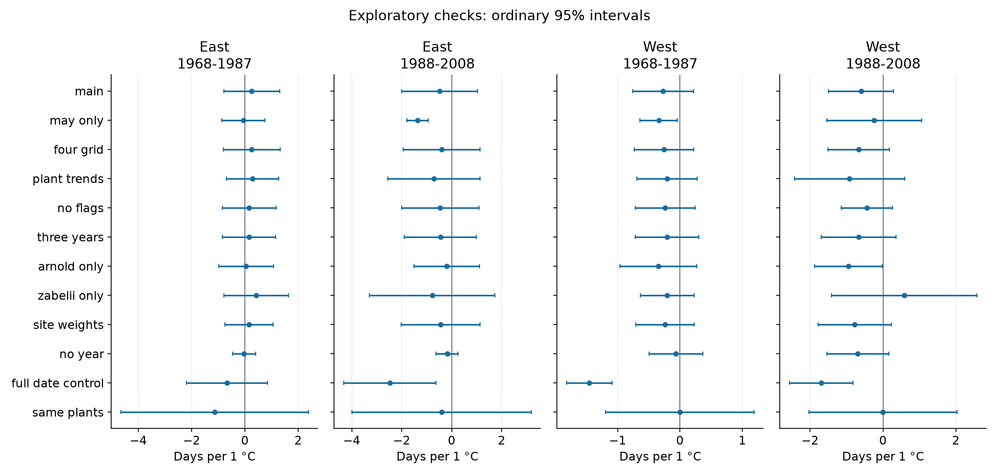

# April-May temperature gave no clear link to the interval from full to end bloom in four US honeysuckle samples in 1968-2008

We tested whether warmer April-May weather was linked to a shorter time from full bloom to end bloom. We used two honeysuckle clones in two US reporting networks and two time periods. The four main estimates ranged from -0.60 to +0.26 days per degree C. All four adjusted uncertainty intervals included zero. This result does not establish that temperature has no effect. It does not identify a cause of long-term climate change or a response of wild plant communities.

## Question and prior work

The start of flowering does not describe how long flowers remain. Flowering duration is relevant to the timing of floral resources. We ask whether broad spring temperature predicts the late part of flowering in repeated plant records. We do not measure nectar, pollen, visits by insects, seed production, or individual flower life span.

Experimental results give reasons to test the direction rather than assume it. González-Suárez et al. (2023, doi:10.1093/plphys/kiad163) found that higher temperature and longer days hastened the end of inflorescence growth in Arabidopsis. Li et al. (2016, doi:10.1038/ncomms12489) found longer flowering under warming in alpine plants. These studies use other species and designs. Neither directly predicts the field association tested here.

Rosemartin et al. (2015, doi:10.1038/sdata.2015.38) describe the US historical lilac and honeysuckle archive. We searched the local campaign for ozone, phenology, lilac, and flowering duration. We read SCI publications a25494dd25de9765891868574ff46d20757fd95f4a06bb7c603baa4a3460baf8 and 1739a808e783d34e979028474c6ed9d6b0f8a9b8a3c9044b0ef5f5d1b683def1. They test intervals from first leaf to first bloom. Our outcome is the interval from full bloom to end bloom. The source plants overlap those studies. This is a new outcome test on shared source data, not an independent data replication of those results.

The bundle supplies 8,999 paired records, monthly weather extracts, four exact model samples, and code. files/design.md records choices made after inspection of metadata and pair counts but before model fitting. This is an exploratory study, not a registered test.

## Data and reporting bias

We use the USA-NPN v13 observation workbook and its v14 field-description workbook from ScienceBase. We select the two historical networks, Dataset_ID 7 and 8, and the clones Arnold Red (Species_ID 20) and Zabelii (1198). We use US states in the contiguous 48 states and selection windows 1968-1987 and 1988-2008. We exclude later status-report records to keep the reporting method consistent.

The field workbook reverses the network names. Table 1 in the published data paper gives 7 as Eastern and 8 as Western. Phase codes agree with that table. For honeysuckle, the eastern full/end codes are 429/79; the western codes are 78/416. Our longitude audit also supports the published mapping. We retain numeric IDs in the evidence. These networks are not a longitude split at a fixed meridian. Their full-bloom definitions differ slightly. End bloom refers to about 95% of flowers being withered. We fit networks separately.

A pair must have one full-bloom and one end-bloom record for the same network, site, plant ID, clone, and year. No selected key had duplicate phase records. We checked the dates against day of year. We retain dates from day 1 to 250, intervals from 0 to 90 days, and locations at 24-50 N and 66-125 W. We retain climate-based source flags in the main fit. A separate check removes records marked early or late by either of two source flags.

The workbook has 116,662 records. Our scope has 47,004 records across all phases, 9,007 complete full/end pairs, and 8,999 pairs after date and location limits. None lacks main weather data. Each main sample requires at least five paired years for each plant within its period. This gives 6,274 plant-years across the four tests.

| Network | Selection period | Full/end pairs | Pairs as share of records with either phase | Main plant-years | Share of valid pairs retained by five-year rule |
| --- | --- | ---: | ---: | ---: | ---: |
| East (7) | 1968-1987 | 594 | 96.1% | 564 | 94.9% |
| East (7) | 1988-2008 | 283 | 97.3% | 252 | 89.0% |
| West (8) | 1968-1987 | 7,442 | 92.9% | 5,116 | 68.8% |
| West (8) | 1988-2008 | 688 | 88.5% | 342 | 49.7% |

The pair counts precede the eight date or location exclusions. The final retention shares use valid pairs. Observation selection is substantial, especially in the later West. The early East main sample has 16 observed years from 1971 to 1987, with no 1986 record. The later West has only 14 observed years in its 21-year window. The exact years are in the model-row tables. Period labels do not imply complete annual coverage.

Plant effects remove stable differences among retained plant IDs. Clone-year effects remove changes shared by each clone in a network-year. Neither control recovers missing visits or unreported events. The source paper reports that some site records can represent an average across shrubs, without a record of which sites did this. A plant ID can therefore be an observation unit rather than one known shrub. We cannot control observer turnover, plant replacement, plant age, care, or visit timing. Pair completeness is not a test that missing reports are random. The three-year and same-plant checks address only parts of selection.

## Weather and model

Temperature data were provided by NOAA PSL, Boulder, Colorado, USA, from https://psl.noaa.gov. We use the pinned 2026-11-05 GHCN CAMS monthly file, internal version 3.01. Fan and van den Dool (2008, doi:10.1029/2007JD008470) describe the gridded land temperature method. We select the nearest 0.5-degree cell to each site and convert Kelvin to degrees C.

The main exposure is the equal average of April and May monthly means. Controls are March temperature and the average of previous December, January, and February. These are fixed calendar windows. Their lengths do not depend on the observed bloom interval. They can include weather after bloom ended and miss weather during some blooms. May overlaps 54-77% of main observed intervals, by sample. Monthly data cannot resolve heat waves, frost, or daily thermal exposure.

For each of the four samples, we fit:

`end day - full day = plant effect + clone-year effect + beta * April-May temperature + March term + winter term + error`.

Beta uses local temperature variation after common annual clone changes. It does not estimate the full response to a shared regional warming trend. Its residual exposure standard deviation is 0.51-0.76 C. The two regions use separate sites; the two periods use separate annual records, but some plants persist. Weather and errors can remain dependent across these samples. These are four checks of repeatability, not independent experiments.

We remove fixed effects by repeated weighted projections. Primary fits give all rows equal weight. We use a two-way state and year cluster covariance: state term plus year term minus state-year term. Each term has its own G/(G-1) correction and the common (N-1)/(N-K) correction. K includes the three slopes and the rank of plant and clone-year indicators. The rank is P + H - C, where P and H count their groups and C counts connected components. Trend checks count up to P - C more plant trend terms. This can overcount rank in a sparse design and give wider intervals. All reported slope variances are positive.

We use a t reference with min(states, years)-1 degrees of freedom. There are only 9-13 state clusters in the main tests. Primary intervals have 98.75% marginal coverage under this approximation. This gives nominal 95% joint coverage for four tests by the Bonferroni rule. A common clear shortening result requires all four intervals to be negative. Cluster inference can be inaccurate with few clusters or correlation across states and years. It does not account for uncertainty in gridded weather.

A separate sparse regression with explicit plant and clone-year indicators checks every primary coefficient and variance. The largest coefficient difference is below 0.000000001 days per C. The variance differences are below 0.000000001. This checks calculation, not model validity. We also check all source record keys, dates, and primary weather values. A full raw-data rebuild reproduced 13 evidence files byte for byte, after decompression of gzip files. This includes the paired panel, all estimate tables, exact model rows, and both figures. files/rebuild_check.json records this check.

## Results

| Network | Period | Plant-years | Plants | States | Days per 1 C | Four-test adjusted interval |
| --- | --- | ---: | ---: | ---: | ---: | --- |
| East | 1968-1987 | 564 | 61 | 13 | +0.259 | -1.160 to +1.677 |
| East | 1988-2008 | 252 | 20 | 9 | -0.484 | -2.583 to +1.614 |
| West | 1968-1987 | 5,116 | 576 | 12 | -0.271 | -0.932 to +0.389 |
| West | 1988-2008 | 342 | 59 | 10 | -0.601 | -1.829 to +0.628 |

Three point estimates are negative. All four intervals include zero. All four ordinary 95% intervals also include zero. The test did not establish a clear shorter interval across regions and periods. Several intervals permit changes of more than one day per C in either direction. We did not test equivalence or show that the effect is small.

Median intervals are 10 and 11 days in the East and 13 and 14 days in the West. Network definitions and selected coverage limit comparison of these levels. In secondary fits on the same rows, both phase-date coefficients are negative in all four samples. Full-bloom coefficients range from -3.99 to -2.96 days per C; end-bloom coefficients range from -4.47 to -3.23. Three of four adjusted intervals exclude zero for each phase, under a separate four-test rule for that outcome. These are not joint intervals over all outcomes. Earlier phase dates can occur without a clear change in their separation. The end-date coefficient minus the full-date coefficient equals the interval coefficient to numerical precision.

## Checks and possible explanations

Four-neighbor weather means, plant trends, flag removal, site-year weights, and a three-year record rule leave all four adjusted interval ranges crossing zero. Separate clone fits do not establish a common pattern. Removing year effects also gives no clear four-sample shortening result. Keeping the same plants in both periods leaves very small samples; all four ordinary intervals include zero.

Some exploratory checks give negative results and must be retained. With May temperature and an added April control, the later East slope is -1.375 days per C, with a four-test interval of -1.972 to -0.777. The other three May slopes have adjusted intervals that include zero. This estimates a different temperature contrast. It does not establish a common May response or a preferred window after a search over windows.

Adding full-bloom day gives more negative April-May slopes, from -2.48 to -0.67. Both western adjusted intervals exclude zero. This comparison holds initial bloom timing fixed. Full-bloom day is part of the outcome and can itself respond to temperature. Its measurement error can also create a relation with the interval. Thus this adjustment changes the question and can introduce bias. It cannot identify a direct effect of heat after full bloom.

The figure shows ordinary 95% intervals for sensitivity checks. They are not a joint confidence set over all checks. The CSV also includes within-mode four-test ranges. A state omission check keeps both western primary point estimates negative, but either eastern estimate can change sign. These omission fits do not provide a new significance test. We cannot separate physiological development, movement of bloom into a cooler part of the season, rainfall, plant care, or observation timing with these data.

## Limits and next test

This study tests broad weather associations in two cultivated clone lines. It does not test native biodiversity, species distributions, pollinator mismatch, air pollution, weather extremes, or a causal effect of human-caused climate change. Coarse exposure can attenuate or distort slopes. The plants and sites were not sampled at random. Late records are sparse, the clone mix changes, and residual spatial dependence can remain. Source flags partly use climate information, so their exclusion can select on the exposure-outcome relation.

The evidence supports a limited conclusion: this fixed model and these selected records do not establish a repeated shortening of the full-to-end bloom interval with warmer April-May conditions. A useful next test needs daily local weather and repeated visit records, with comparable phase definitions. It should separate temperature before full bloom from temperature after it, without using future event duration to select the weather window. It should retain non-flowering and incomplete records to model observation and plant processes together.

## Reproduction and worker record

See files/reproduce.md for offline fits, full raw rebuilding, retrieval commands, and a file guide. files/provenance.json gives the exact shared paths, source URLs, file versions, sizes, and SHA-256 hashes. Raw shared files were reused in place and were not changed. The bundle includes the derived evidence for inspection without those raw files. The SCI baseline license covers our text, code, figures, and derived evidence; source data keep their source terms.

Campaign: 11_07_2026. Job: sci-1107-hp-climate-pollution-biodiversity-3c9b8d636fe2. Topic: climate-pollution-biodiversity. Machine: hp. Assigned account: codex-myxtap. Model: gpt-6.1-sol, high reasoning effort, through T3 Code and the Codex harness. Analysis date: 2026-11-08 UTC. All substantial calculations used campaign-compute with one thread per library. The campaign-machine signature is not a personal authorship claim. The signed bundle is saved locally and is not sent to a remote archive or index.
