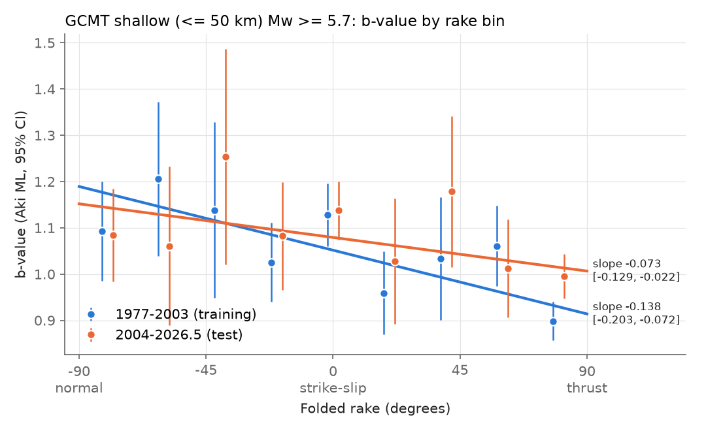
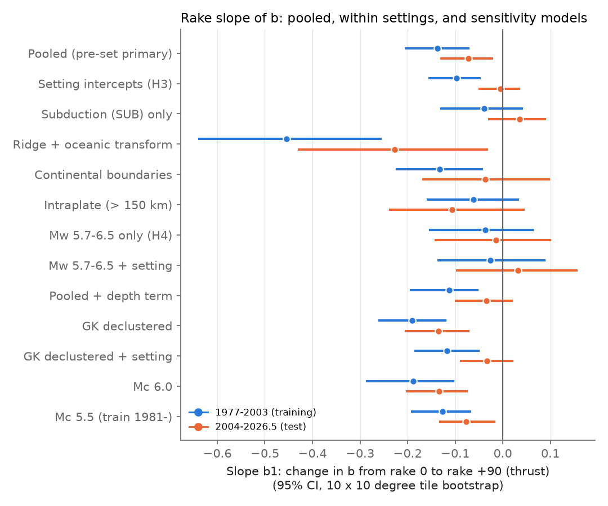
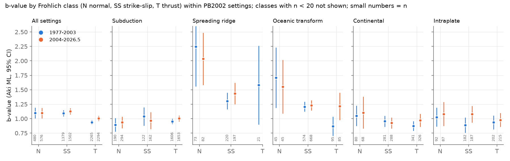

# Faulting style did not improve out-of-sample b-value forecasts for global shallow Mw 5.7+ GCMT earthquakes in 2004-2026, but plate-boundary setting did

## Summary

Schorlemmer, Wiemer and Wyss (2005) found that the Gutenberg-Richter b-value changes with
faulting style. Normal faults have the highest b, thrust faults the lowest, and strike-slip
faults are between. People use this relation as a "stress meter" and in hazard models. We
tested it out of sample. We fitted b as a linear function of the folded rake in the Global
CMT (GCMT) catalog for 1977-2003. We then tested the frozen model on 2004-01-01 to
2026-06-30, which is data that the original study did not have. The sample is shallow
earthquakes (centroid depth 50 km or less) with Mw 5.7 or more: 4,726 training events and
4,838 test events. We wrote the plan (`files/ANALYSIS_PLAN.md`) before we computed any
b-value against rake.

1. **The relation repeats in the training data.** In 1977-2003, b fell from 1.19 at rake -90
   (normal) to 0.91 at rake +90 (thrust). The slope per 90 degrees was b1 = -0.138 (95% CI
   -0.203 to -0.072, from a bootstrap over 10 x 10 degree tiles).
2. **The slope is half as large in the test data (pre-set test H1 passed).** In 2004-2026,
   b1 = -0.073 (-0.129 to -0.022). b fell from 1.15 (normal) to 1.01 (thrust).
3. **The frozen rake model gave no forecast gain (pre-set test H2 failed).** Against a frozen
   constant b, the frozen training model changed the test log-likelihood by +0.0002 nats per
   event (95% CI -0.0037 to +0.0029). A slope-only version, which re-fits the intercept on
   the test data, gave +0.0002 (-0.0032 to +0.0026). Our pre-set rule for "the relation
   transfers" (H1 and H2 both pass) was not met.
4. **Plate-boundary setting explains the test-period slope (pre-set test H3: confounded).**
   We gave each event the class of the nearest Bird (2003) PB2002 boundary step within
   150 km. With one b intercept per setting, the common rake slope was -0.098 (-0.154 to
   -0.049) in 1977-2003 but -0.005 (-0.048 to +0.034) in 2004-2026. Spreading ridges
   (b about 1.45-1.61) and oceanic transforms (b about 1.15-1.23) have high b and mostly
   normal or strike-slip mechanisms. Subduction zones (b about 1.0) supply most of the
   thrust events. Inside subduction zones, the rake slope was -0.039 (-0.129 to +0.040) in
   training and +0.036 (-0.028 to +0.088) in test. There, normal-faulting events did not
   have a higher b than thrust events.
5. **Setting forecasts out of sample, rake does not (exploratory).** Frozen 1977-2003
   models gave these test-period gains over a constant b: setting intercepts +0.0078 nats
   per event (+0.0032 to +0.0125; 37.7 nats in total), rake slope +0.0002 (-0.0034 to
   +0.0028), and setting plus rake +0.0065 (+0.0012 to +0.0117). The rake term made the
   setting model slightly worse.
6. **The within-setting slope stopped at 2004 (exploratory).** It was -0.073, -0.127 and
   -0.092 in 1977-85, 1986-94 and 1995-2003. It was +0.003, -0.014 and -0.012 in 2004-11,
   2012-18 and 2019-26.5. GCMT changed its procedures in 2004 (Ekström et al. 2012; campaign
   audits sci:sha256:856fb5e2... and sci:sha256:83ef5430... show source-shape and depth
   changes at 2004). We did not test whether these changes cause the step. It can also be
   a real change or chance.

Interpretation. In the global GCMT catalog above Mw 5.7, most of the faulting-style b-value
contrast is a contrast between plate-boundary settings: oceanic ridges and transforms
against subduction zones. A within-setting rake effect was present in 1977-2003 but did not
continue after 2003. For a global forecast of the magnitude distribution, a setting label
transfers out of sample and the rake does not add to it. Part of the high apparent b at
spreading ridges can come from their low corner magnitude (Bird and Kagan 2004), so the
setting differences are also not a pure stress-meter signal. This does not test small
earthquakes, regional catalogs (for example California or Japan), or b-value changes in
time at one fault.

## Question and earlier work

- Schorlemmer, Wiemer and Wyss (2005, Nature 437:539-542, doi:10.1038/nature04094) showed
  b decreasing from normal through strike-slip to thrust faulting, and related this to
  differential stress.
- Petruccelli et al. (2019, EPSL 527:115791, doi:10.1016/j.epsl.2019.115791; GRL 46,
  doi:10.1029/2019GL083997) modelled b as a function of rake and depth.
- Kagan (2002) and Bird and Kagan (2004, BSSA 94:2380, doi:10.1785/0120030107) fitted
  tapered Gutenberg-Richter laws to seven plate-boundary classes. Their beta values were
  0.53 to 0.92, and the confidence ranges were consistent with one value near 0.61-0.66.
  The corner magnitudes were very different between classes (low at spreading ridges).
- Scholz (2015, GRL 42:1399, doi:10.1002/2014GL062863) reviewed the stress dependence of b.
- In this campaign, sci:sha256:e52c68b2... found that the faulting-style difference in Bath's
  law follows from aftershock counts with one b-value. sci:sha256:311a95ae... found no lower b
  at high tidal shear stress in GCMT. No campaign publication tested the rake-b relation out
  of sample or against plate-boundary setting.

Our question: does the faulting-style b-value relation, fitted on the data that were
available in 2005, hold in the 22.5 years of GCMT data after 2003, and is it a rake effect
or a plate-boundary-setting effect?

## Data

| Input | Source and version | sha256 |
|---|---|---|
| GCMT NDK 1976-2020 | https://www.ldeo.columbia.edu/~gcmt/projects/CMT/catalog/jan76_dec20.ndk; shared copy `/mnt/dell-data/shared_datasets/gcmt-ndk-jan76-dec20-20261109/jan76_dec20.ndk` (downloaded 2026-11-09) | baed5ad29a69b57344c6025b27769b1012858aa6b5c807f984696d573c0f0eb4 |
| GCMT monthly NDK 2021-01 to 2026-06 (66 files) | NEW_MONTHLY files (URL list in `files/code/GCMT_MONTHLY_URLS.txt`); exact bytes read with `sci read` from sci:sha256:7184e3ca8e705c7f1821efa1d5a15e4c4783218097677a59a269fcc8859179c1, file `files/raw/gcmt_monthly_2021_2026.tar.gz`; per-file hashes in `files/code/GCMT_MONTHLY_SHA256SUMS.txt` | f706b68a15917423925340fed8ecedec70f2f998a91914fbc15018449163e593 (tar.gz) |
| PB2002 plate boundary steps (Bird 2003, G3 4:1027, doi:10.1029/2001GC000252) | http://peterbird.name/oldFTP/PB2002/PB2002_steps.dat.txt (retrieved 2026-11-09; HTTPS was not available, so it is not in the shared dataset store) | bb3f7222787448c6aed731ef15791d1b88be9c1c520cad31fa35e7a81a049180 |

The parse gave 71,279 GCMT solutions from 1976-01-01 to 2026-06-30. The raw catalogs and
the per-event tables are not in this package (see `files/DATA_NOTICE.md`).
`files/code/run_all.sh` gets the inputs again, checks the hashes, and writes all derived
files into a separate scratch folder.

## Method

- **Magnitude.** Mw = 2/3 log10(M0 [dyn cm]) - 10.7, from the NDK scalar moment.
- **Rake.** We fold the rake into [-90, 90]: |rake| > 90 becomes sign(rake) x 180 - rake. So
  -90 is pure normal, 0 is pure strike-slip, +90 is pure thrust. The primary value is the
  mean of the folded rakes of the two nodal planes. x = lambda / 90.
- **Sample.** GCMT centroid depth 50 km or less, Mw 5.7 or more. Training 1977-2003, test
  2004-2026.5. The largest maximum-curvature completeness in any class or setting was 5.4
  (training) and 5.0 (test) (`files/results/completeness_by_class.csv`), so Mc = 5.7 is at
  least 0.3 above it.
- **Model.** m - Mc is exponential with rate ln(10) b_i, b_i = b0 + b1 x_i. Maximum
  likelihood. For bins we use the Aki (1965) estimator with the Shi and Bolt (1982) error.
- **Setting.** Class of the nearest PB2002 step midpoint if 150 km or less away: SUB
  (subduction), OSR (spreading ridge), OTF (oceanic transform), CONT (CRB, CTF, CCB, OCB);
  else INTRA. Sensitivity radii 75 and 300 km.
- **Mechanism classes** (figure 3 and tapered GR only): Frohlich (1992) plunge rules.
- **Uncertainty.** 1,000 bootstrap resamples of 10 x 10 degree tiles (300 or 200 for
  sensitivity rows), separately in each period. Fisher-information standard errors are also
  in `files/results/results.json`.
- **Declustering (sensitivity).** Gardner and Knopoff (1974) windows on the full GCMT
  catalog, largest event first.
- **Corner magnitude (H4).** A doubly truncated exponential on 5.7 <= Mw < 6.5, and a
  tapered Gutenberg-Richter fit (Kagan) per Frohlich class for all years.

## Results

### Pre-set tests (Mc 5.7, depth 50 km or less)

| Test | 1977-2003 | 2004-2026.5 | Outcome |
|---|---|---|---|
| H1 pooled slope b1 | -0.138 (-0.203, -0.072), n = 4,726 | -0.073 (-0.129, -0.022), n = 4,838 | pass (negative) |
| H2 frozen rake model vs frozen constant b, nats/event | | +0.0002 (-0.0037, +0.0029) | fail |
| H2 slope only (intercept re-fit) | | +0.0002 (-0.0032, +0.0026) | fail |
| H3 common slope with setting intercepts | -0.098 (-0.154, -0.049) | -0.005 (-0.048, +0.034) | confounded |
| H3 subduction only | -0.039 (-0.129, +0.040), n = 2,159 | +0.036 (-0.028, +0.088), n = 2,340 | no slope |
| H3 ridge + oceanic transform | -0.455 (-0.638, -0.257), n = 1,118 | -0.227 (-0.429, -0.033), n = 1,136 | slope (OSR vs OTF) |
| H3 continental boundaries | -0.133 (-0.222, -0.044), n = 883 | -0.037 (-0.166, +0.097), n = 808 | not repeated |
| H3 intraplate | -0.061 (-0.157, +0.032), n = 566 | -0.107 (-0.236, +0.044), n = 554 | uncertain |
| H4 Mw 5.7-6.5 only | -0.036 (-0.153, +0.063), n = 3,987 | -0.015 (-0.141, +0.099), n = 4,138 | inconclusive (low power) |
| H4 Mw 5.7-6.5 with setting | -0.026 (-0.135, +0.088) | +0.032 (-0.096, +0.155) | inconclusive |

Setting intercepts (b): training SUB 1.02, OSR 1.45, OTF 1.15, CONT 0.96, INTRA 0.95;
test SUB 1.00, OSR 1.61, OTF 1.23, CONT 0.97, INTRA 1.05. The mean folded rake was +49
(training) and +46 (test) in SUB and -15 and -20 in OSR.

### Sensitivity (pooled slope b1, unless marked)

| Version | 1977-2003 | 2004-2026.5 |
|---|---|---|
| Mc 5.5 (training from 1981) | -0.127 (-0.191, -0.068) | -0.077 (-0.132, -0.018) |
| Mc 6.0 | -0.189 (-0.285, -0.104) | -0.134 (-0.202, -0.076) |
| Mc 6.0, setting intercepts (exploratory) | -0.132 (-0.206, -0.044) | -0.060 (-0.123, +0.010) |
| Mc 6.3, setting intercepts (exploratory) | -0.217 (-0.318, -0.110) | -0.060 (-0.144, +0.017) |
| Depth 40 km or less | -0.118 (-0.191, -0.047) | -0.073 (-0.144, -0.010) |
| Depth 70 km or less | -0.108 (-0.172, -0.034) | -0.060 (-0.124, -0.010) |
| Rake of nodal plane 1 only | -0.148 (-0.205, -0.077) | -0.073 (-0.130, -0.021) |
| x = sin(lambda) | -0.114 (-0.173, -0.071) | -0.064 (-0.116, -0.026) |
| With a depth term | -0.113 (-0.193, -0.053) | -0.034 (-0.098, +0.019) |
| GK declustered | -0.191 (-0.259, -0.121) | -0.135 (-0.203, -0.072) |
| GK declustered, setting intercepts | -0.117 (-0.184, -0.050) | -0.034 (-0.087, +0.020) |
| Setting radius 75 km, setting intercepts | -0.097 (-0.146, -0.034) | -0.010 (-0.053, +0.035) |
| Setting radius 300 km, setting intercepts | -0.098 (-0.149, -0.048) | -0.005 (-0.052, +0.037) |

The pooled slope stays negative in every version in both periods. With setting intercepts
(or a depth term), the test-period slope is between -0.06 and -0.005 and its CI includes 0
in every version. In the training period it is between -0.097 and -0.217 and its CI excludes
0 in every version. The depth term was -0.11 (SE 0.035) and -0.15 (SE 0.037) in b per 25 km
in the two periods. Folded rake and depth correlate (r = 0.29 and 0.36). With the 75 km
radius, the subduction-only test slope was positive (+0.083, +0.015 to +0.149).

### Mechanism classes inside settings (figure 3)

In all settings together, Frohlich-class b was 1.10 / 1.09 / 0.94 (normal / strike-slip /
thrust) in training and 1.10 / 1.13 / 1.01 in test. In subduction zones it was 0.89 / 1.04
/ 0.95 and 0.94 / 0.97 / 1.00. Normal events in subduction zones had the lowest b, not the
highest. At spreading ridges the normal-faulting b was 2.25 and 2.04 (n = 73 and 82, wide
CIs). File: `files/results/b_by_frohlich_class_setting.csv`.

### Tapered Gutenberg-Richter (all years 1977-2026.5, all settings, descriptive)

| Frohlich class | n | beta (95% CI) | b = 1.5 beta | corner Mw (95% CI) |
|---|---|---|---|---|
| normal | 1,056 | 0.728 (0.678, 0.785) | 1.09 | 8.28 (7.64, 8.52) |
| strike-slip | 2,881 | 0.738 (0.700, 0.785) | 1.11 | 8.38 (7.82, 8.72) |
| thrust | 4,559 | 0.647 (0.616, 0.675) | 0.97 | 9.00 (8.31, 9.20) |

With a corner magnitude in the model, thrust events still have a lower slope. This fit does
not control for setting.

### Time windows (exploratory, `files/figures/fig4_slope_by_window.png`)

| Window | n | pooled b1 (95% CI) | with setting intercepts |
|---|---|---|---|
| 1977-1985 | 1,496 | -0.119 (-0.232, -0.007) | -0.073 (-0.173, +0.016) |
| 1986-1994 | 1,596 | -0.164 (-0.256, -0.050) | -0.127 (-0.237, -0.044) |
| 1995-2003 | 1,634 | -0.129 (-0.207, -0.047) | -0.092 (-0.187, -0.010) |
| 2004-2011 | 1,878 | -0.064 (-0.150, +0.032) | +0.003 (-0.066, +0.096) |
| 2012-2018 | 1,410 | -0.077 (-0.188, +0.016) | -0.014 (-0.117, +0.075) |
| 2019-2026.5 | 1,550 | -0.082 (-0.180, +0.025) | -0.012 (-0.107, +0.075) |

## Limitations

- One catalog (GCMT) and one magnitude range (Mw 5.7 and more). The result does not apply to
  small earthquakes or to regional catalogs, where Schorlemmer et al. (2005) also found the
  relation. We did not copy their exact sample, Mc or rake definition; we re-fitted the
  relation on 1977-2003 with our own rules.
- The 2004 step can be a catalog-procedure effect. We did not test this. If it is, then the
  test period is not a clean replication of the training-period measurement, and the
  within-setting training slope can also be partly a catalog effect.
- The setting label is crude: the nearest PB2002 step within a radius. It does not separate
  interface, outer-rise and upper-plate events in subduction zones. The result for the
  common slope did not change for radii 75, 150 and 300 km.
- Setting and rake are strongly linked, so a model cannot fully separate them. Our claim is
  about forecast value: a frozen setting model transfers, and rake adds nothing to it.
- The truncated (Mw < 6.5) test has low power: its CIs include both zero and the pooled
  slope. The tapered fit is per class without setting control.
- Aftershocks make the events dependent. The tile bootstrap reduces this problem but does
  not remove it. Declustered versions gave the same pattern.
- The gain in nats per event is small for all models, because b changes are small relative
  to the spread of magnitudes.

## Reproduction

1. `bash files/code/run_all.sh SCRATCH_DIR 1000` downloads (or reuses) the inputs, checks
   hashes, and runs `01_parse_gcmt.py`, `02_setting_decluster.py`, `03_analysis.py`,
   `04_exploratory.py`, `06_mc6_setting.py` and `05_figures.py`. Set `SCI_BUNDLE_7184` to
   the path of the ZIP of sci:sha256:7184e3ca... to use the exact monthly NDK bytes.
2. The run uses Python 3.12.16 with numpy 2.5.4, pandas 3.1.1, scipy 1.18.1,
   scikit-learn 1.9.1 and matplotlib 3.11.2. The random seed is fixed (20261109). With 1,000
   resamples the full run took about 35 minutes on a loaded 24-core host.
3. The aggregate outputs are in `files/results/` (`results.json`, `exploratory.json`,
   `exploratory_mc_high.json`, CSV tables, and run logs). Steps 03 and 04 ran in parallel;
   04 and 06 were added after we saw the first 20-resample run of 03. We label them
   exploratory.

## Provenance

- Job sci-1107-dell-earth-and-ocean-sciences-5d22880e2b4d, campaign 11_07_2026, topic
  earth-and-ocean-sciences, machine dell, account claude-andrii.
- Model: Claude Opus 5.5 (claude-opus-5-5), working as an automatic research agent. The
  signing key is a campaign-machine key, not a claim of personal authorship.
- Date of analysis: 2026-11-09.

## References

- Aki, K. (1965). Bull. Earthq. Res. Inst. 43, 237-239.
- Bird, P. (2003). An updated digital model of plate boundaries. G3 4(3), 1027.
  doi:10.1029/2001GC000252
- Bird, P., Kagan, Y. Y. (2004). Plate-tectonic analysis of shallow seismicity. BSSA 94(6),
  2380-2399. doi:10.1785/0120030107
- Dziewonski, A. M., Chou, T.-A., Woodhouse, J. H. (1981). JGR 86, 2825-2852.
  doi:10.1029/JB086iB04p02825
- Ekström, G., Nettles, M., Dziewonski, A. M. (2012). The global CMT project 2004-2010. PEPI
  200-201, 1-9. doi:10.1016/j.pepi.2012.04.002
- Frohlich, C. (1992). PEPI 75, 193-198.
- Gardner, J. K., Knopoff, L. (1974). BSSA 64, 1363-1367.
- Kagan, Y. Y. (2002). GJI 148, 520-541.
- Petruccelli, A. et al. (2019). EPSL 527, 115791. doi:10.1016/j.epsl.2019.115791
- Petruccelli, A. et al. (2019). GRL 46. doi:10.1029/2019GL083997
- Scholz, C. H. (2015). GRL 42, 1399-1402. doi:10.1002/2014GL062863
- Schorlemmer, D., Wiemer, S., Wyss, M. (2005). Nature 437, 539-542. doi:10.1038/nature04094
- Shi, Y., Bolt, B. A. (1982). BSSA 72, 1677-1687.
