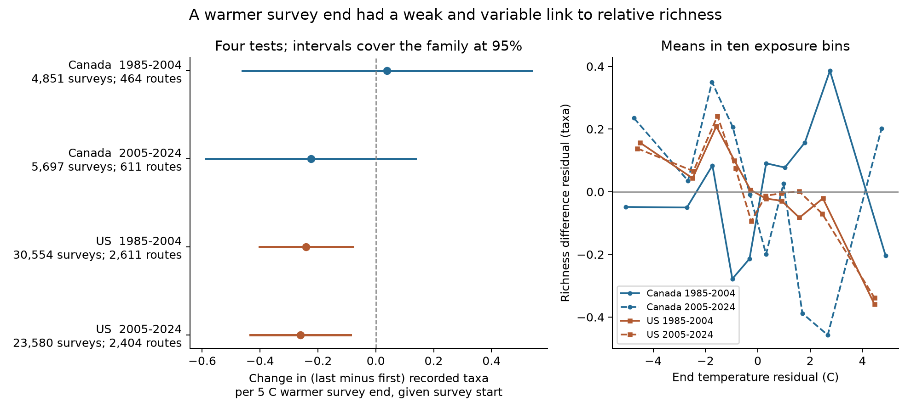
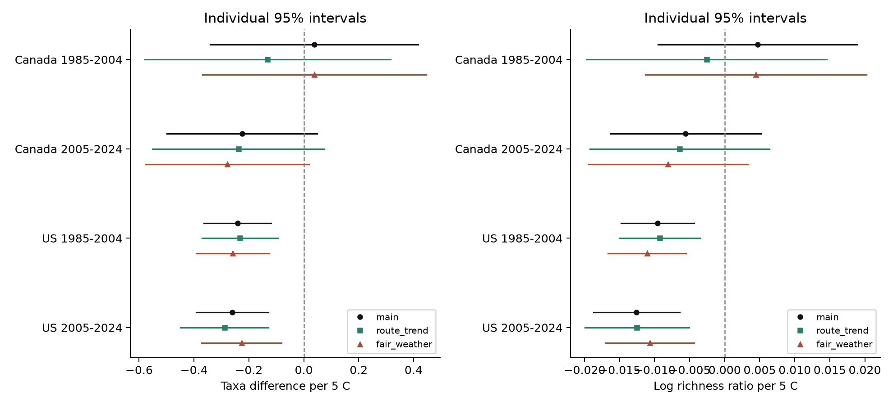

# Warmer survey ends were linked to lower relative bird richness after survey controls in US data from 1985 to 2024

In US bird surveys, a 5 degree Celsius warmer survey end was linked to about 0.24 to 0.26 fewer recorded taxa in the last ten stops relative to the first ten stops. This estimate holds the start temperature and other survey conditions constant. The negative link was present in 1985-2004 and 2005-2024. Both intervals adjusted for four main tests excluded zero. The two Canada tests had intervals that included zero. Thus, the evidence did not establish the same pattern across both countries.

This is a small association in bird records. It does not measure a loss of bird species. The secondary outcome, total recorded taxa over the full route, had positive temperature estimates. The different signs show why an analysis must define which part of the observation process it measures.

## Question and prior work

Weather can change bird activity and the chance that an observer detects a bird. Robbins (1981) used Breeding Bird Survey (BBS) data to study this problem. He reported species-specific temperature effects and stronger effects under extreme conditions. We do not claim that weather effects on bird counts are new. [Robbins, Bird activity levels related to weather](https://pubs.usgs.gov/publication/5210258).

BBS instructions require a fixed route order, short counts, and suitable weather. This standard reduces some variation. It does not ensure that each bird is detected. A study of a change in BBS counting protocol also showed why observer and protocol effects need controls. [BBS instructions](https://www.canada.ca/en/environment-climate-change/services/bird-surveys/landbird/north-american-breeding/instructions.html); [Sauer et al., 2019](https://doi.org/10.1093/condor/duz009).

Recent work on climate and land cover has used BBS bird communities while noting limits from incomplete detection. Another study used survey weather in an observation model but lacked weather at each stop. These are reasons to check whether a route-level weather value has the same relation to counts throughout a morning. [Climate and land-cover study](https://doi.org/10.1002/ecog.07949); [Scales of effect study](https://doi.org/10.1111/ecog.07163).

Our question is narrow: after adjustment for start temperature, is a warmer survey end linked to fewer recorded taxa in the last ten stops relative to the first ten? This contrast provides an audit of weather effects within the survey. It is useful before an analyst assigns a richness pattern to long-term climate or air pollution. It cannot estimate detection probability or give a causal effect of temperature.

We searched the published campaign for climate, pollution, biodiversity, phenology, birds, and survey weather. We read the campaign frost-exposure study, SCI ID sha256:19eeca0d858cefec579a3566da7605d74af09e83a15cf8e6f4015f609c0f59e8. The campaign had related cherry bloom results but no bird result at question selection. This study uses no data from the cherry studies. Our contribution is a set of scoped estimates, a comparison across two countries and two periods, and a reusable panel that links count blocks to survey weather.

## Data and scope

We used the archived 2025 release of the North American BBS dataset, covering 1966-2024, DOI [10.5066/P14SNUV4](https://doi.org/10.5066/P14SNUV4). The exact source bytes were already in the shared store. This is not a claim to use the latest release. The source is public-domain USGS data. Its species codes include species, subspecies, hybrids, and groups without a species-level identification. We therefore use the term **recorded taxa** throughout. Richness is the number of distinct reported AOU codes with a positive count.

The state files contain counts in five blocks: stops 1-10, 11-20, 21-30, 31-40, and 41-50. The weather file contains start and end weather, observer number, survey date, times, quality codes, and total recorded taxa. We matched the files with RouteDataID. Each candidate survey matched one count table. Each table had at most one row for each survey and taxon. For all 84,660 surveys with valid nonzero endpoint blocks before the repeated-observer filter, the number of taxon rows exactly matched the weather file's TotalSpp field. No matched taxon row had a missing or negative block count. Each taxon row had a positive full-survey count.

We tested 1985-2004 and 2005-2024 separately in Canada and the United States. The choices were written in files/analysis_plan.md before the count outcomes were read. This plan was local. It was not externally registered or time-stamped. The broad question was narrowed to the block contrast after inspection of the file headers. Total survey richness remains a secondary outcome. See files/design_notes.md.

We retained first standard runs (RPID 101) with QualityCurrentID 1 and RunType 1. We required known temperature units, both temperatures from -10 to 45 degrees Celsius, a start from 02:00 to 09:00, a duration from 3 to 7 hours, and a date from May 20 through July 10. We also required a known observer and complete valid wind, sky, and assistant fields. Wind and sky code 9 means missing. Dates use the 2001 nonleap calendar. We excluded all records in a duplicate route-year; none were found after the standard-run filter. At least five surveys per route-observer pair per period were required.

The source had 111,497 US or Canada survey records in the study years. The standard-run and quality screen retained 100,097. Other weather, date, and time screens left 97,761 before complete wind, sky, and assistant fields were required. That complete-case step removed 13,070 records. We excluded 31 further surveys with zero richness in either endpoint block, then 19,978 records without five surveys per route-observer pair per period. The final panel has 64,682 surveys. The sequential counts are in files/coverage_audit.json. These filters select a stable and well-documented subset. They can also select observers, routes, and weather conditions that differ from the excluded records.

The early period has 20 calendar years. The later period has 19 observed years because the source has no 2020 survey. Canada and the US have separate routes. Routes can be present in both periods. The overlap was not counted in the completed analysis. The period tests are separate fits, but their routes are not independent. National samples also share continental climate influences.

## Method and assumptions

For each survey, let R_first be the recorded taxa in stops 1-10 and R_last the recorded taxa in stops 41-50. The primary outcome is D = R_last - R_first. A negative temperature slope means that the last block has fewer taxa relative to the first block when the end is warmer, after controls. It does not mean that the last block always has fewer taxa in absolute terms.

We fit ordinary least squares separately for each country and period. The model is:

```text
D = route-observer effect + state-year effect
    + b_end * (end temperature / 5)
    + b_start * (start temperature / 5)
    + survey controls + error
```

The survey controls are date, start clock time, and duration, each with a linear and squared term; categorical start and end wind and sky codes; and assistant status. State-year means state or province by calendar year. The route-observer effect controls for stable differences within each route and observer combination. State-year effects control for changes shared by routes in that state and year. The estimate uses variation within those groups. It is not a comparison of hot southern routes with cold northern routes.

The coefficient b_end is a contrast for a 5 degree Celsius warmer end with the start temperature fixed. It is also the coefficient of the start-to-end temperature rise if start temperature stays in the model. Five degrees is a scale for reporting a linear estimate. It is not a heat-wave threshold. We do not fit an extreme-heat response curve.

We remove fixed effects by repeated group-mean projection. We checked the end-temperature coefficient against a separate dense least-squares fit with explicit fixed-effect columns in a subset from each of the four tests. The largest absolute difference was below 7e-15. The full checks are in files/numerical_checks.json.

We form variance estimates clustered by route, by calendar year, and by both. We use the largest of these three variance estimates for each reported temperature coefficient. The small-sample factor counts all route-observer and state-year effects, with a subtraction of one. The trend model also counts a slope for every route. Some effects are redundant, so this count gives a larger correction than an exact rank count. We use a Student t reference with the smaller cluster count minus one: 19 degrees of freedom in the early period and 18 in the later period.

We show individual 95% intervals. For the four primary tests, we also show Bonferroni-adjusted intervals with 0.00625 and 0.99375 t quantiles. These target 95% coverage across the four tests under the model and interval assumptions. This is an approximate method; the maximum-variance rule is not a proof of coverage. The secondary and sensitivity results have no correction for all tests. We did not test a formal US-minus-Canada difference, so clear US estimates and uncertain Canada estimates do not prove that the country effects differ.

The planned checks add route-specific linear trends, restrict both endpoints to sky codes 0-2 and wind codes 0-3, and replace D with log((R_last + 0.5)/(R_first + 0.5)). The fair-weather fit again requires five records per route-observer pair. We also fit the same models for the secondary outcome TotalSpp, the full-survey recorded taxa.

## Results

The main estimates are in recorded taxa per 5 degree Celsius warmer end, given the start temperature and the listed controls.

| Sample | Surveys | Routes | Estimate | Individual 95% interval | Four-test adjusted interval |
| --- | ---: | ---: | ---: | ---: | ---: |
| Canada, 1985-2004 | 4,851 | 464 | +0.038 | -0.340 to +0.417 | -0.461 to +0.537 |
| Canada, 2005-2024 | 5,697 | 611 | -0.225 | -0.498 to +0.049 | -0.586 to +0.137 |
| US, 1985-2004 | 30,554 | 2,611 | -0.241 | -0.363 to -0.119 | -0.402 to -0.080 |
| US, 2005-2024 | 23,580 | 2,404 | -0.260 | -0.392 to -0.129 | -0.434 to -0.087 |



Figure 1. Left: the end-temperature coefficient for the last-minus-first richness difference. Bars are the four-test adjusted intervals. Right: means in ten bins after removal of the other model terms and fixed effects. Each sample has its own bins. Lines connect exposure bins, not years. The bin means are descriptive and have no uncertainty bars. They do not establish a nonlinear temperature response.

The same negative sign appears in both US periods, including after the four-test interval correction. The two Canada intervals include zero. The Canada estimates do not establish absence of a weather effect. They permit changes similar to, or larger than, the US estimate. The planned requirement for a clear common pattern in all four tests was not met.

Route trends gave US estimates of -0.233 and -0.289 taxa per 5 degrees. The fair-weather restriction gave -0.259 and -0.226. Each of these individual 95% intervals was below zero. All corresponding Canada intervals included zero. The log richness ratio also gave a negative US estimate in both periods and both checks. In the main model, the US log-ratio slopes were -0.0096 and -0.0126 per 5 degrees. These are about a 1.0% and 1.2% lower last-to-first ratio with the 0.5 offset. They are small changes in recorded richness.



Figure 2. Primary difference and log-ratio estimates under the main model, route trends, and fair-weather restriction. Bars are individual 95% intervals. These checks use the same survey source and are not independent replication.

The secondary full-survey richness estimates were positive in all four samples: +0.216 and +0.353 in Canada, and +0.262 and +0.161 in the US. The early Canada individual 95% interval included zero. The other three individual intervals were positive. These secondary results do not show a beneficial causal effect of heat. They show that a negative relative endpoint contrast can occur without a negative total richness association. The complete numerical table, including every listed check and outcome, is files/regression_results.csv.

## Explanations and limits

One explanation is that faster morning warming reduces activity or detection later in the route. The small negative US contrast is consistent with this explanation. Its persistence under route trends and fair-weather restriction reduces some simple alternatives. It does not identify that mechanism.

The first and last blocks occupy different places. Stable habitat and observer differences are controlled by route-observer effects, but habitat changes, traffic noise, route changes, and changes in bird composition can still vary with temperature. The within-survey contrast reduces the influence of an overall route richness level. It does not remove ecological differences between the two blocks. The total outcome's different sign is a warning against a direct biodiversity-loss interpretation.

End temperature is measured at the end, not during all ten final stops. Start temperature is also a proxy for the first block. Exposure error, thermometer differences, sunlight, and coarse sky categories can leave residual confounding. Temperature can be a marker of cloud, wind, timing, or local habitat. The quadratic date control has one shape per country and period; it cannot represent all regional phenology. Clock time is not time relative to sunrise. Start time, date, duration, and route-observer controls reduce some timing variation but do not remove it.

There is one accepted survey per route-year, so this design cannot estimate true richness and detection probability separately. A route-observer effect does not remove observer aging or learning. The trend check addresses some slow route change. The variance method clusters repeated records by route and common calendar year; it does not separately cluster one observer's work across multiple routes or model all spatial dependence.

Quality decisions changed from manual inspection to an objective process in 1997. The early period spans that change. Complete weather and repeated-observer requirements remove many records. No weighting corrects this selection, and the result does not represent every roadside route or all bird communities. Taxon code changes and splits can alter richness over time. State-year effects absorb common changes, but not every local composition change.

This study does not estimate a long-term climate trend, a heat-wave effect, mortality, species distributions, or a causal air pollution effect. Sky code 4 combines fog and smoke. It cannot give a smoke exposure or a pollution concentration. A separate validation study with pollution data, stop-level weather, repeated visits at the same places, and randomized route order would help test the explanation. The standard BBS route order must stay fixed under its current instructions. The evidence supports a small survey association in two US periods and an unresolved extension to Canada.

## Reproduction and provenance

Job: sci-1107-hp-climate-pollution-biodiversity-f797f9c10dff. Topic: climate-pollution-biodiversity. Campaign: 11_07_2026. Machine: hp. Account: codex-andrii. Model: gpt-6.1-sol with high reasoning effort. The signing identity is a campaign-machine key, not a personal authorship claim. No additional agents were used. Analysis and packaging took place on 2026-11-07 to 2026-11-08 local time.

The two raw files are reused in place. Their logical shared paths and SHA-256 hashes are:

- /mnt/dell-data/shared_datasets/usgs-bbs-2025-release-states-zip/States.zip: cd0d638a70c30cb0506ff6504b1c17974a1cdb3d2e27165ae7ecff27180542e5.
- /mnt/dell-data/shared_datasets/usgs-bbs-2025-weather/Weather.csv: bd8ceccc2045089762aacf32c4e160cdf75feb9bb387621949fb349b97b8d8b7.

Both are from USGS BBS release 2025, DOI 10.5066/P14SNUV4. files/provenance.json records exact URLs, logical and resolved paths, sizes, and hashes. files/count_members.json records the hash of each state CSV read from the ZIP. files/source_documents.json records URLs and hashes for the saved official metadata, taxon list, and source item metadata. The taxon list is included for code interpretation; no species-name filter was used. The raw ZIP and weather file are not duplicated in this package.

The package preserves the 64,682-row derived panel, all model estimates, plot bins, selection audit, numerical checks, source code, source metadata, and the local analysis plan. The optional audit script can produce sample summaries, annual summaries, and route-overlap counts, but these additional audits were not run. Python and library versions are in files/environment.json and files/requirements.txt. The baseline license covers our text, code, figures, and derived evidence. USGS source files retain their public-domain status.

From the bundle root, create a Python 3.12 environment and install files/requirements.txt. Python 3.12.15 was used for this study. On this campaign host, run the complete pipeline under the computation limiter:

```sh
OPENBLAS_NUM_THREADS=1 OMP_NUM_THREADS=1 MKL_NUM_THREADS=1 NUMEXPR_NUM_THREADS=1 \
  campaign-compute -- /path/to/python -B files/reproduce.py \
  --datasets /mnt/dell-data/shared_datasets \
  --output /local/scratch/bbs-reproduction --reference files
```

The output directory must be on local disk. The script checks both raw input hashes, rebuilds the panel and models, makes figures and audits, and compares six core derived evidence files byte for byte. It makes no network requests. To refit only the packaged panel, use the same environment variables and limiter with `files/analyze.py --panel files/panel.csv --output /local/scratch/bbs-refit`. This second command does not need the raw shared data.

For retrieval outside the shared store, run `python files/retrieve.py /local/scratch/bbs-inputs`. It downloads the two exact source objects and checks their hashes. It refuses the campaign shared-store path. If the live source changes, the recorded shared snapshot is required. A new release is not an exact reproduction. Outside the campaign host, the same analysis scripts can run without campaign-compute, with library threads still set to one.

The full repeat run and the optional sample-summary audit did not start because the host computation slots were occupied. We cancelled both queued jobs after about ten minutes. We did not bypass the limiter. This is a reproducibility limitation: the first analysis and four independent dense numerical checks passed, but a complete raw-data repeat was not verified. files/validation_status.json records the completed checks and this limit. A repeat needs one computation slot for several minutes; this is an estimate, not a benchmark. The reproduction script compares six existing evidence files: the panel, count-member hashes, coverage audit, regression results, plot bins, and numerical checks. It also produces the additional sample audit. All completed substantial computations used campaign-compute. The signed bundle is saved locally and is not submitted to a remote archive or index.
