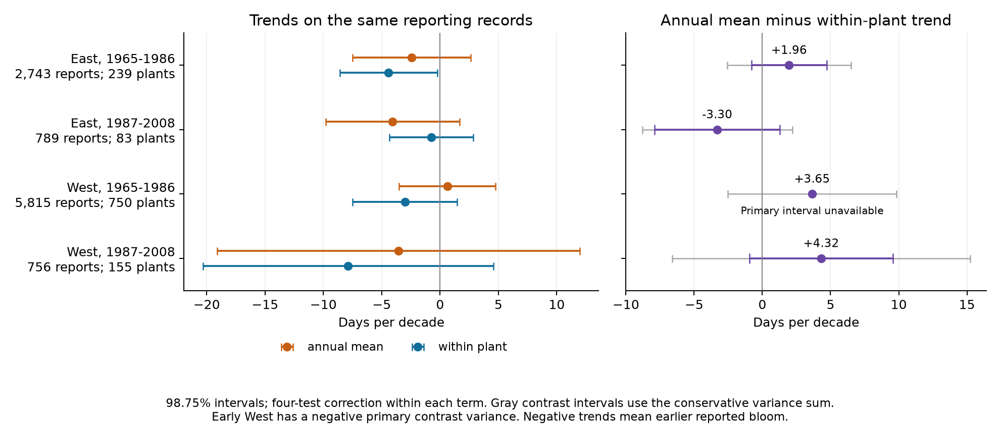
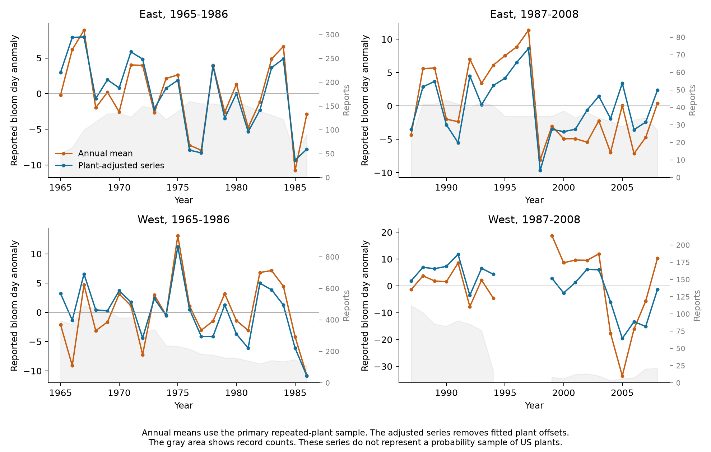

# Annual mean and within-plant lilac bloom trend estimates differed by -3.30 to +4.32 days per decade in four US samples from 1965 to 2008

We tested how the changing mix of reporting plants changed estimated first-bloom trends. We compared annual mean dates with a common trend within the same plants. Four US region and period samples used 10,103 reports. The estimated difference ranged from -3.30 to +4.32 days per decade. In the early West, the two point estimates had opposite signs. The three available primary contrast intervals included zero. The fourth variance estimate was negative, so its interval was not available. Additional conservative intervals included zero in all four samples. These results describe the selected records and fitted models. They do not establish a common direction of observation bias or a population trend.

## Question and prior work

An annual mean can change because the same plants flower earlier or because different plants enter the mean. We ask how much these two trend estimates differ in a public phenology archive. This question matters when ecological timing is used as a climate indicator. Our contribution is a reproducible comparison and an exact fitted decomposition of these records. The algebra and fixed effect method are established methods.

Schwartz and Reiter (2000) studied regional spring trends with observed and modelled lilac dates (DOI: 10.1002/1097-0088(20000630)20:8<929::AID-JOC557>3.0.CO;2-5). We do not reproduce their model or test their reported regional trend. Primack et al. (2023, DOI: 10.1007/s00484-023-02502-7) explain that changes in sampling location and effort can affect phenology results. Our test measures one such difference on a fixed set of source records.

We searched the local SCI campaign for phenology, lilac, trend composition, turnover, and sampling. We read SCI sha256:551302875a5c81f37d7854aa0bbefe4669a61810d9d3573f192717bbbf19b501. That study tested winter changes in spring temperature slopes with plant and year effects. We use its region, plant-type, and period definitions to allow comparison, but fit new trend outcomes. Our records overlap that study. This work is not an independent replication of it. Search notes are in files/search_notes.md.

Files/design.md records the plan after coverage checks and before trend fits. This study was exploratory, not registered. Files/analysis_changes.md identifies two checks added after the primary fits.

## Data and selection

We use the USA-NPN v13 lilac and honeysuckle workbook and v14 field dictionary. Rosemartin et al. (2015, DOI: 10.1038/sdata.2015.38) describe the archive. We select legacy first-bloom reports, Dataset_ID 7 or 8, in 1965-2008. The plant key combines site, individual, and species IDs. The candidate selection has 10,758 records. We remove all four rows from ambiguous duplicate plant-years. We require day of year 1-250, latitude 24-50 N, longitude 66-125 W, and a valid contiguous US state. This leaves 10,584 records.

East uses cloned lilac, Syringa x chinensis 'Red Rothomagensis', species 35, at longitude -100 or farther east. West uses common lilac, Syringa vulgaris, species 36, west of -100. This gives 10,254 eligible records. The field dictionary and recorded phase descriptions disagree about the historical program codes. We preserve the codes and define region from coordinates. Files/program_codes.csv gives the source combinations.

We split each region into 1965-1986 and 1987-2008. The primary models require at least two reports per plant within a period. This leaves 10,103 reports from 1,040 distinct plant keys. There are 187 keys in both periods. Each selected site has one selected plant key within a period. The four samples have disjoint observations. They share archive methods, weather patterns, and some plants across periods. They are separate settings, not independent experiments.

| Region | Period | Reports | Plants and sites | States | Observed years |
| --- | --- | ---: | ---: | ---: | ---: |
| East | 1965-1986 | 2,743 | 239 | 25 | 22 |
| East | 1987-2008 | 789 | 83 | 18 | 22 |
| West | 1965-1986 | 5,815 | 750 | 12 | 22 |
| West | 1987-2008 | 756 | 155 | 13 | 18 |

The later West has no selected observations in 1995-1998. We do not fill these years. The recorded first-bloom definitions differ between historical programs. The later western sample has 27 phase-77 reports and 729 phase-412 reports. The primary model keeps them. A later check restricts western records to phase 412.

For a secondary weather adjustment, we use GHCN CAMS monthly temperature, version 3.01, in the fixed shared snapshot that ends in October 2026. Data were provided by NOAA PSL, Boulder, Colorado, USA. We select the nearest 0.5-degree cell and convert Kelvin to C. Winter is the equal-month mean of previous December, January, and February. Spring is the equal-month mean of March and April. The method is described by Fan and van den Dool (2008, DOI: 10.1029/2007JD008470). All selected records have weather data.

Files/provenance.json gives exact shared and resolved paths, source URLs, versions, byte counts, and verified SHA-256 hashes for the three raw files used. No shared data were changed. No new data were downloaded. The package preserves the selected source events and all monthly weather values used. Raw sources can be retrieved with the checked recipe in files/REPRODUCE.md.

## Method and meaning of the contrast

For each sample, each observed year receives total weight one. Each report in year t has weight 1/n_t, where n_t is the number of selected reports in that year. Thus the first model has the same trend as ordinary least squares on the annual means:

`A: reported bloom day = intercept + b_A * time + error`.

The second model uses the same rows and weights:

`B: reported bloom day = plant effect + b_B * time + error`.

Time is measured in decades. A negative coefficient means earlier reported bloom. Model B uses only change within plants to estimate its common linear trend. It does not give each plant equal weight or recover missing event dates. We use no year effects because an unrestricted year effect would remove the target linear trend.

The primary contrast is Delta = b_A - b_B. A positive value means the annual mean gives a later trend than the model within plants. In model B, let alpha_i be the fitted plant offset. The weighted residual is orthogonal to time. It follows exactly that:

`b_A = b_B + trend in annual mean(alpha_i)`.

We check this identity numerically. It holds for the fitted linear model on the observed panel. The composition component contains fitted spatial, plant, protocol, and other fixed differences. It does not prove that coverage changed for a particular reason. With different trends among plants or selective missing years, a common within-plant trend need not equal a population trend. Fixed effects do not make missingness random.

The two trends are correlated. We estimate the variance of their difference with the difference of their fitted influence scores. We use state variance plus year variance minus state-year variance. Each model has a rank correction (N-1)/(N-K). Each cluster component has a G/(G-1) correction. K includes the plant indicators in model B. We use a t reference with min(number of states, number of years)-1 degrees of freedom. Primary contrast intervals have 98.75% marginal coverage under this approximation. The four-test Bonferroni rule gives nominal 95% family coverage. It does not cover all secondary terms or all sensitivity specifications together. Few clusters and dependence outside the cluster assumptions can make these intervals inaccurate.

The early western contrast has a negative estimated variance: 3.830 + 0.464 - 4.463 = -0.169 squared days per decade. Its primary standard error and interval remain unavailable. We do not set the variance to zero. After seeing this failure, we also report state variance plus year variance without intersection subtraction. This additional estimate is conservative under the same asymptotic two-way cluster model. It does not fix small cluster counts, model error, or unmeasured observation bias. Files/results.csv also gives the separate state and year diagnostics.

## Results

| Region | Period | Annual mean trend | Within-plant trend | Difference | Primary contrast interval | Additional conservative interval |
| --- | --- | ---: | ---: | ---: | --- | --- |
| East | 1965-1986 | -2.44 | -4.41 | +1.96 | -0.80 to +4.73 | -2.56 to +6.49 |
| East | 1987-2008 | -4.06 | -0.76 | -3.30 | -7.89 to +1.29 | -8.80 to +2.20 |
| West | 1965-1986 | +0.63 | -3.02 | +3.65 | Unavailable: negative variance | -2.53 to +9.82 |
| West | 1987-2008 | -3.57 | -7.89 | +4.32 | -0.94 to +9.57 | -6.59 to +15.22 |

All table values use days per decade. The model estimates differ in size, and the early western point estimates have opposite signs. These are descriptive comparisons of fitted estimates. The three available primary contrast intervals include zero. All four additional conservative intervals include zero. The data do not establish a common positive or negative contrast across settings. They also do not establish that the contrast is small. We did not conduct an equivalence test or a formal test of differences between periods.

The all-eligible annual mean trends before the two-report rule are -2.45, -4.45, +0.59, and -3.29 days per decade in the table order. Thus removing singleton plants is not the main source of the primary trend differences in these samples. The changing mix among retained plants can still matter. Files/annual_series.csv gives the exact annual dates, fitted composition, adjusted series, and report counts.

### Checks on observation and model choices

The planned five-year rule gives composition contrasts of +2.29, -2.39, +3.35, and +0.88 days per decade. Requiring a within-period span of at least ten years gives +0.96, -0.70, +1.39, and -2.38. The latter rule changes the later western sign and leaves only 186 reports there. Restricting to plants reported in both periods gives -0.27, +0.16, +0.80, and +2.16. This restriction changes both eastern signs. These checks select different populations of reporting plants; they do not isolate a single causal mechanism.

Removing the leap day or flagged dates retains the four primary contrast signs. Equal report weights and equal total plant weights also retain those signs. Some exploratory intervals exclude zero: equal report weights in early East and later West, equal plant weights in later East, and flag removal in early West. The early western variance is negative for many other specifications. These isolated results do not establish a common effect. Their intervals do not adjust for all sensitivity tests. All fitted checks, including contrary estimates, are in files/results.csv.

Omitting one state at a time keeps the four contrast signs, with ranges of +1.38 to +3.69, -4.19 to -2.34, +1.53 to +4.25, and +2.93 to +6.14. These ranges are influence checks, not confidence intervals. The later phase-consistent check changes the later western contrast from +4.32 to +1.81, with a primary interval of -5.73 to +9.36. Protocol composition can therefore affect the estimate. This check was added after the phase audit and results, and is not a primary test.

### Secondary weather adjustment

Adding winter and spring temperature to model B gives time trends of -2.98, -0.14, +0.19, and -9.03 days per decade. Their four-test intervals are -5.84 to -0.12, -2.41 to +2.13, -1.97 to +2.35, and -21.35 to +3.29. The early western within-plant trend moves toward zero after adjustment. The later western estimate becomes more negative. This does not support a single explanation across all samples.

The fitted spring slopes are -2.46, -3.58, -4.08, and -3.70 days per C. The first three separate four-test intervals are below zero; the later western two-way variance is negative and its interval is unavailable. Monthly weather adjustment is descriptive. The spring window extends past bloom for some records. In table order, 467, 119, 2,300, and 336 reports occur before May. These variables do not measure daily forcing, chilling, frost, or plant-level heat. They cannot attribute a trend to human-caused climate change.

## Limits and use

The exact fitted decomposition is the strongest result. It gives an inspectable way to separate annual averaging from a common trend within reporting plants. It is useful for an observation-bias audit. It does not identify which model is closer to an unobserved target population. The fitted plant offsets can absorb real spatial differences and differences in monitoring practice. Plant-specific nonlinear responses, changing care, age, replacement, and selective reporting can remain in the within-plant coefficient.

The selected shrubs are planted indicators, not a probability sample of native communities. East and West also use different lilac types and historical bloom definitions. Unknown visit schedules and observer histories prevent correction for reporting delay. The later western records are sparse and include a four-year gap. Equal year weights give sparse years as much total weight as dense years. Approximate cluster intervals cannot account for all these limits. A failure to reject zero is not proof of unbiased reporting or stable phenology.

We do not measure air pollution, damaging extremes, species distributions, flower abundance, pollinator mismatch, or biodiversity loss. This investigation addresses ecological timing and observation bias within the campaign objective. The analysis should be extended with comparable plant types, complete visit histories, daily weather, and independent observation systems before causal claims are made.

## Reproduction and worker record

Files/REPRODUCE.md gives saved-panel, raw-data, and retrieval commands. The package contains code, selected source records, monthly weather, all estimates, fitted annual series, source hashes, an analysis plan, changes to the plan, figures, and exact package versions. Independent explicit weighted least squares checks the two primary coefficients, their paired covariance, the annual mean fit, and the exact decomposition. Raw validation checks event selection and monthly climate values. The numerical results and completed checks are in files/validation.json and files/repeat_check.json. These checks verify calculations, not the observation or model assumptions.

Campaign: 11_07_2026. Job: sci-1107-hp-climate-pollution-biodiversity-734135fc87ea. Topic: climate-pollution-biodiversity. Machine: hp. Account: codex-myxtap. Model: gpt-6.1-sol, high reasoning effort, through T3 Code and the Codex harness. Analysis date: 2026-11-08 UTC. No agents were launched. The campaign-machine key is not a personal authorship claim. The publication is stored locally and is not sent to a remote archive or index. The baseline license covers our text, figures, derived evidence, and code. Raw source data retain their source terms.
