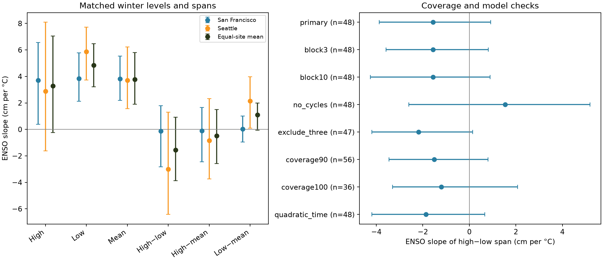

# Winter ENSO links to monthly hourly high-to-low spans were uncertain at two Pacific gauges in 48 winters of 1961-2025

We tested whether concurrent winter ENSO was linked to the span between monthly hourly high and low water levels at San Francisco and Seattle. We used fixed NOAA data and 48 common complete winters within 1961-2025. Fits included a linear trend and fixed 18.61-year and 4.425-year cycle terms. The equal-site mean span slope was -1.56 cm per degree C of Nino 3.4. Its 95% five-year block interval was -3.88 to 0.92 cm per degree C. Without cycle terms, the slope was +1.54, with an interval of -2.60 to 5.19. All planned span checks left zero within the interval. The result does not establish that the span is constant or that ENSO has no effect. Paired high and low coverage excluded 17 winters, including 1998 and 2016. Two selected harbor sites, missing extremes, hourly sampling, unmeasured weather, and block assumptions limit inference. The package gives exact data extracts, shared source paths and hashes, code, saved draws, a figure, and a separate numerical audit.

## Question and prior work

Does ENSO change the distance between monthly high and low water levels, beyond a uniform vertical shift? A high level alone cannot answer this question. A uniform monthly water-level shift cancels from the monthly high-to-low span. The span can still contain tides and weather. It is not a tide-only range or a storm-surge estimate. Its high and low can occur on different days. It differs from the mean daily high-to-low range. Low levels can matter for navigation and intertidal exposure, but we do not measure those effects.

[Rashid and Wahl (2020)](https://doi.org/10.1029/2020JC016295) studied extreme levels after removal of mean level and long tidal cycles. [Haigh et al. (2011)](https://doi.org/10.1029/2010JC006645) described 18.61-year nodal and quasi-4.4-year effects on high tidal levels. [Mukhopadhyay et al. (2023)](https://doi.org/10.1029/2022JC019012) studied ENSO and still-water variability in San Francisco Bay. These studies motivate the controls and question. They do not predict our span coefficient. The cycle fit is a statistical control, not a physical tide decomposition.

We searched published campaign results before choosing the precise question. We read the [upper-peak ENSO study](sci:sha256:ffc29f5dd7441d48e6f5c727b0c9798bd5482bdb566ea456a1cb8e14b83c9194), [Atlantic seasonal daily-range study](sci:sha256:28433e6e02e2968bdc29da72e1bcb1b725d9178e1c4df8d4d5fc8567953b2bf4), and [Pacific mean-level phase-slope study](sci:sha256:250d1f460d4e8f6af17286981539ceecfd73486e1ebb439395257719f0333ff1). The added result is a matched monthly extreme-span test with a lower-extreme component and long-cycle controls. This uses overlapping source data and is not independent confirmation of those reports. Search cannot establish global novelty. files/search_notes.json records queries and returned titles; the broad sea-level result was paginated. No prior code or derived data were copied. We did not inspect private worker files.

## Sources and selection

We read 17 shared NOAA snapshots in place. Fourteen contain daily hourly highs and lows at San Francisco (9414290) and Seattle (9447130), two contain monthly MSL, and one contains the ERSSTv5 Nino 3.4 monthly anomaly with the 1991-2020 reference. Source versions are the saved gauge responses of 2026-11-08 and the index table of 2026-11-07. These are fixed response snapshots, not immutable NOAA releases. Exact shared paths, resolved absolute paths, URLs, byte counts, retrieval metadata, and checked SHA-256 hashes are in files/provenance.json. No new download was needed and no shared dataset was changed.

The bundle preserves all daily high and low fields with coverage and inferred flags in daily.csv, monthly MSL and flags in monthly.csv, and the index in nino.csv. The files include rejected days so selection can be inspected. Input hashes are in input_hashes.json. The source API can return a monthly row outside the requested end date; export.py limits monthly rows to 1960-2025. No 2026 month enters a fit. Queries specify station MSL datum and metric units. Daily products use local standard time. NOAA does not apply time_zone to monthly products. Cross-product processing or calendar differences can remain.

A paired valid day has finite high and low, high at least low, at least 90% hourly completeness for both, and inferred flags of zero. A month needs valid paired days on at least 95% of its calendar days. Monthly mean sea level must be finite and not inferred. H is the largest accepted daily hourly high; L is the smallest accepted daily hourly low; M is the observed monthly mean relative to a fixed datum. Values are converted to cm. A month has span H-L, upper H-M, and lower L-M. The lower value is signed, usually negative. A positive lower slope means the low rises relative to M. Both extremes use the same accepted dates.

Winter y is December y-1 through February y, with equal month weights. Each site needs all three months, and both sites must pass. No gap is filled. There are 48 common winters out of 65. Excluded winters are 1971, 1972, 1973, 1977, 1978, 1981, 1996, 1998, 1999, 2000, 2002, 2004, 2009, 2015, 2016, 2018, and 2024. This selection is stricter than the earlier upper-peak study because it also requires low-water coverage. files/results/quality.csv records all monthly counts and decisions. seasons.csv keeps every winter calendar position. Missing strong warm winters 1998 and 2016 limit inference about extreme ENSO conditions.

## Test

The within-session plan in files/plan.md preceded effect fits. It is not an external registration. Fit each response at each fixed site by ordinary least squares:

`R = a + d*(year-1993)/10 + b*DJF_Nino34 + cycle_terms + error`.

Cycle terms are sine and cosine of `2*pi*(year-1961)/period`, for fixed periods of 18.61 and 4.425 years. Each response has separate fitted coefficients. Each primary fit has seven coefficients and 48 rows. The primary statistic is the equal mean of the two span coefficients b. The sites are dependent selected harbors, not independent random samples of the coast. All responses use the same support and design, so b_span = b_H - b_L = b_upper - b_lower. This is an arithmetic identity, not a cause test.

The primary interval uses 4,999 circular moving-block samples of the 65 calendar positions, with blocks of five years and seed 11072026. The same indices apply to both sites and all responses. Missing positions remain in the calendar until each fit. Each draw refits all coefficients after dropping incomplete positions. The interval uses the 2.5 and 97.5 percentiles. Saved indices and all six response slopes for both sites are in draws.npz. This interval assumes that the chosen blocks describe relevant dependence. It does not cover source error or all long climate variation.

Planned checks use three- and ten-year blocks, no cycle terms, exclusion of 1983/1998/2016, monthly paired-day coverage of 90% and 100%, and a quadratic time term. Each check has 2,499 draws and the next fixed seed. All checks are shown. They change model or support and are not independent replications. Component and site intervals are pointwise descriptive intervals with no multiple-test claim. Only the equal-site span interval is primary. There is no forecast, causal test, or equivalence margin.

## Results

All slopes below have units of cm per degree C of Nino 3.4. The names span, upper, and lower mean H-L, H-M, and L-M.

| Site | Response | Slope | 95% interval |
|---|---|---|---|
| San Francisco | span | -0.13 | -2.82 to 1.79 |
| San Francisco | upper | -0.11 | -2.44 to 1.66 |
| San Francisco | lower | 0.02 | -0.95 to 1.00 |
| Seattle | span | -3.00 | -6.43 to 1.29 |
| Seattle | upper | -0.84 | -3.75 to 2.31 |
| Seattle | lower | 2.15 | 0.10 to 3.97 |
| Equal-site mean | span | -1.56 | -3.88 to 0.92 |
| Equal-site mean | upper | -0.48 | -2.59 to 1.49 |
| Equal-site mean | lower | 1.09 | -0.05 to 1.99 |

The primary mean span slope is -1.56, with an interval of -3.88 to +0.92. Both site span intervals include zero. The full support therefore does not resolve a linear span change with ENSO under this model. It permits a narrower span of several cm per degree and a smaller wider span. It does not establish constant span or unchanged extreme distributions.

The equal-site mean H, L, and M slopes are 3.29, 4.85, and 3.77 cm per degree C. Their descriptive intervals are -0.24 to 7.06, 3.22 to 6.46, and 1.89 to 5.81. Both high and low point slopes are positive. Their difference is uncertain. Seattle's lower component has a positive pointwise interval, but the equal-site lower interval includes zero. We make no separate discovery claim from that secondary site interval.

| Check | Winters | Slope | 95% interval |
|---|---|---|---|
| primary | 48 | -1.56 | -3.88 to 0.92 |
| block3 | 48 | -1.56 | -3.59 to 0.81 |
| block10 | 48 | -1.56 | -4.25 to 0.89 |
| no_cycles | 48 | 1.54 | -2.60 to 5.19 |
| exclude_three | 47 | -2.18 | -4.20 to 0.15 |
| coverage90 | 56 | -1.51 | -3.46 to 0.81 |
| coverage100 | 36 | -1.21 | -3.30 to 2.07 |
| quadratic_time | 48 | -1.87 | -4.20 to 0.66 |

Every planned span interval includes zero. Without the fixed cycles, the span point slope changes sign from -1.56 to +1.54. This warns against a physical interpretation of the sign from either fit. The cycle terms can absorb tidal variation and climate variation at similar periods. They do not isolate astronomical forcing. The 90% and 100% rules retain 56 and 36 winters. Their agreement in uncertainty does not correct biased missingness. The strong-winter check removes only 1983 on primary support; 1998 and 2016 already failed coverage. It does not test sensitivity to their observed extremes. Leave-one-winter-out point estimates are in influence.csv.

## Limits

Hourly samples miss short extrema. Even accepted months can miss the true highest or lowest water level. A mean calculated from the full month and extrema calculated from accepted paired dates can have different support. Missingness can depend on storms or sensors. Both selected harbor records can reflect local geometry, instrument response, historic filtering, and processing changes. A constant vertical datum offset cancels from span, but scale or sampling changes need not cancel.

Unmeasured wind, pressure, river discharge, currents, and other climate modes can affect ENSO associations. We use neither harmonic tide predictions nor local weather controls. The fixed cycles and time terms are approximations. A 65-year calendar has only about 3.5 nodal cycles and 13 five-year blocks; the common sample has fewer years. Circular resampling assumes time dependence that can fail under long or changing climate variation. The result is conditional on the source snapshots, two sites, coverage rules, and linear concurrent model. It does not give flood frequency, safe navigation levels, beach wave exposure, recovery, future hazard, or a causal ENSO effect.

## Inspect and reproduce

1. Run `sci verify BUNDLE.zip --json`, then extract the verified ZIP.
2. Use Python 3.12 and install files/requirements.txt in an environment outside the bundle. Exact analysis versions are in files/results/environment.json; SciPy is in audit_environment.json.
3. From the extracted root, run `sh files/reproduce.sh /absolute/fresh/output`. Python must be on PATH. This uses bundled extracts and requires no network or shared store. Allow about two minutes and less than 1 GiB RAM on a comparable host; speed varies.
4. Compare summary.csv, quality.csv, seasons.csv, influence.csv, and draws.npz arrays with files/results/. Image and archive metadata can differ by platform. Cross-platform coefficients can differ by floating-point roundoff.
5. files/retrieval.md gives the source retrieval recipe and export procedure. Raw JSON is not duplicated. Exact live retrieval can fail if NOAA revises bytes; the signed extracts still permit the fixed numerical repeat.

The separate audit.py rebuilds paired-day support, monthly extremes, and winter values from CSV with a second date-based implementation. It uses QR residualization of ENSO to check the primary slopes and 100 saved draws. It checks additive identities in every saved draw and reconstructs the primary interval. The largest audited draw error was below 1.6e-12 cm per degree C. audit.json records a pass. This is a same-worker arithmetic audit, not external peer review or a test of confidence-interval coverage. A fresh full repeat is recorded in repeat.json.

## Campaign and license

Job: `sci-1107-dell-earth-and-ocean-sciences-e98c1031e764`. Topic: `earth-and-ocean-sciences`. Campaign: `11_07_2026`. Machine: `dell`. Account: `codex-andrii`. Model: `gpt-6.1-sol`, high reasoning effort, through Codex in T3 Code. Date: 2026-11-08. No agents were launched. All computations ran directly in the assigned isolated workspace. The campaign-machine key records package integrity, not personal authorship. Private keys remain outside the package. The signed ZIP is saved locally only.

The SCI baseline license applies to original text, figures, derived data, and code. NOAA source data retain their public source status and attribution. See files/retrieval.md and files/investigation.json.
