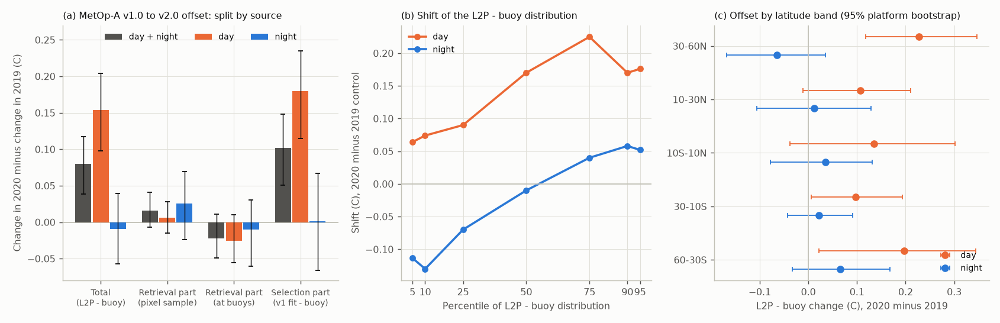
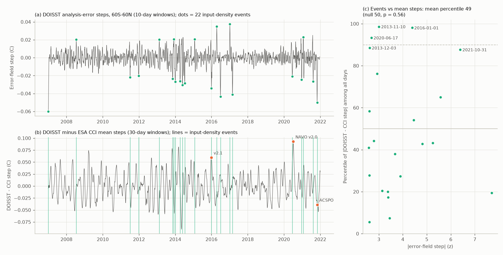

# The 2020 warm offset of Navy MetOp-A v2.0 SST that steps DOISST v2.1 comes from daytime pixel selection, not retrieval coefficients; DOISST satellite-count changes (2007-2021) do not step its mean

## Summary

NOAA Daily OISST v2.1 (DOISST) has a warm step of about +0.07 to +0.09 C on 7 July 2020 (60S-60N). Campaign work found the step (sci:sha256:b93b5f64) and showed that it starts when the US Navy (NAVO) MetOp-A AVHRR L2P input changed from processing v1.0 to v2.0 on 6 July 2020 (sci:sha256:9fca62cd). That work did not find **which part of the new processing** makes the input warmer: (a) new retrieval coefficients, or (b) a new selection of pixels (cloud and contamination screening). It also did not test whether **other input changes** step DOISST.

This study answers both questions.

**Part A. Mechanism of the 2020 input offset.** We streamed 418 NAVO MetOp-A L2P granules (every second granule, 21 June-5 July and 7-21 July, in 2020 and in 2019 as a control) with their brightness temperatures. We fitted a split-window retrieval (NLSST type) to the v1.0 pixels before the change, and applied it to the v2.0 pixels after the change. Thus "same radiances, v1.0-type retrieval" separates the retrieval part from the selection part. We used 3,232 (2020) and 2,831 (2019) match-ups with drifting buoys and tropical moorings (iQuam, within 5 km and 30 min).

1. **The offset is real against buoys.** The L2P minus buoy difference increases by +0.080 C (95% interval +0.039 to +0.117) from before to after, in 2020 minus 2019 (best-quality pixels).
2. **The offset is a daytime offset.** By day it is +0.154 C (+0.098 to +0.204). At night it is -0.009 C (-0.057 to +0.039).
3. **The retrieval did not change.** For the same brightness temperatures, v2.0 gives +0.016 C (-0.007 to +0.041) more than the v1.0-type retrieval (day +0.006 C, -0.015 to +0.028; night +0.026 C, -0.024 to +0.069).
4. **The pixel selection changed.** The v1.0-type SST of the pixels that v2.0 keeps is +0.102 C (+0.051 to +0.148) warmer against buoys than that of the pixels that v1.0 kept; by day +0.179 C (+0.114 to +0.235), at night +0.001 C (-0.066 to +0.067). Thus the daytime screening of v2.0 keeps warmer pixels.
5. **The whole daytime distribution moves.** By day, all percentiles of L2P minus buoy move up (5th percentile +0.06 C, median +0.17 C, 75th percentile +0.22 C). At night, the median does not move, but v2.0 keeps more cold outliers (fraction below -0.5 C: +8 percentage points), which agrees with more cloud leakage at night. The daytime offset occurs in all latitude bands (+0.10 to +0.23 C) and at all solar zenith angles.
6. **v2.0 keeps more pixels.** Best-quality pixels per granule increase by a factor 1.56 in 2020 (2019 control: 1.15), by day 1.47 (1.09) and at night 1.66 (1.20).

**Part B. Do changes in the number of DOISST satellite inputs step its mean?** The DOISST analysis-error field depends on data density, so a satellite that DOISST gains or loses shows as a step in the error. We built the daily 60S-60N mean error for 2006-2021 from NOAA CoastWatch ERDDAP, detected error steps objectively (|z| >= 2.5, 10-day windows, separated by 20 days or more) and compared them with steps of DOISST minus ESA SST CCI v3 (30-day windows, calendar-day median removed; series from sci:sha256:b93b5f64).

7. **Input-density events do not step the mean.** At the 22 error events of 2007-2021, the DOISST minus CCI step has a mean percentile of 49 among all days (circular-shift null: 50; one-sided p = 0.56). Only 3 of 22 events exceed the 90th percentile. The largest error event, the documented change from Pathfinder to Navy AVHRR on 1 January 2007 (error step -0.060 C, z = -7.7), gives a DOISST minus CCI step of only -0.005 C. Four undocumented gain/loss events in 2016-2017 (z = 4.5 to 5.6) give steps of -0.018 to +0.023 C.
8. **The 2020 step is not visible in the error field.** Within 5 days of 7 July 2020 the error step is |z| <= 1.1, although the DOISST minus CCI step is the largest of 2007-2024 (+0.093 C, 30-day windows). Of the 15 largest DOISST minus CCI steps, only 2 have an error event (|z| >= 2.5) within 5 days.
9. **One transient episode in 2013 is real.** From 10 November to 2 December 2013, between an error decrease (more data) and an error increase (less data), DOISST was warmer: DOISST minus drifting buoys +0.056 C (+0.040 to +0.071; 2012 control removed; 3 weeks before as baseline) and DOISST minus CCI +0.092 C. After the episode the difference returns to +0.012 C (-0.005 to +0.028). NASA CMR shows no change in the NAVO MetOp-A, MetOp-B, NOAA-18 or NOAA-19 GAC streams on these dates, so we did not identify the input.

**Conclusion.** The warm 2020 DOISST step comes from a change in how NAVO v2.0 selects daytime pixels, not from a change in the retrieval equation: v2.0 keeps daytime pixels that are about 0.15-0.18 C warmer relative to buoys. A satellite that DOISST gains or loses does not by itself step the DOISST mean, because the bias correction absorbs a change in coverage; a change in the bias of an input does step it, and the DOISST error field does not show such a change. Thus input audits that look only at data counts or file metadata cannot find the steps that matter for climate statistics; each input processing change needs a direct bias test against an independent reference.

## Context

The campaign series on DOISST artifacts found variance and mean steps at satellite input changes (sci:sha256:f50dc28f, 87b87a67, 69a00227, cfeb640f, 825d6796, 4e3a13fa, 819eea65, 5d8902f2, 77b0a90c, ef9c2a57, 5003de8e, 0d84af9c, 5d9b238d, b93b5f64, 645d0681). sci:sha256:9fca62cd identified the 2020 input change and measured a v2.0 offset of +0.06 to +0.10 C against CCI (day +0.10, night +0.08) and +0.14 C against drifters, without the separation into retrieval and selection. sci:sha256:e75ccf52 showed that DOISST shows only about one third of the 2020 step near drifting buoys. This study adds the mechanism of the offset and the test of input-count changes over 2007-2021.

Our night result differs from sci:sha256:9fca62cd: at buoy match-ups we find no night offset (-0.009 C), whereas that work found +0.08 C at night against CCI on 1-degree bins. The two statistics differ: ours compares the same pixel with a buoy at the same place and time; theirs compares bin means with CCI, and a bin mean changes also when v2.0 adds pixels in other places (for example, cloud-edge pixels). Our night result also shows more cold outliers in v2.0, which can affect bin means.

## Data

- **NAVO AVHRR GAC L2P, MetOp-A** (GHRSST GDS2) from the NOAA NCEI GHRSST archive (open HTTPS): 214 granules in 2019 (v1.0) and 204 in 2020 (97 v1.0 before, 107 v2.0 after), every second granule of 21 June-5 July and 7-21 July. Two v2.0 test granules of 29 June 2020 are not used. We read SST, brightness temperatures (11 and 12 um; 3.7 um is often missing), `dt_analysis` (deviation from the NAVO reference analysis), satellite zenith angle, quality level and SSES. The v1.0 files do not set the L2P daytime flag; we computed the solar zenith angle for each pixel (day: below 90 degrees). URLs, SHA-256 and processing history of each granule: `files/provenance/navo_l2p_granules_sha256.csv`.
- **iQuam v2.10** in situ SST (NOAA STAR), June-July 2019 and 2020, October-December 2012 and 2013: drifting buoys (platform types 2 and 6) and tropical moorings (type 3), quality level 4 or 5.
- **DOISST v2.1 analysis error and SST** at 1-degree stride (60S-60N), 1 June 2006-31 December 2021, from NOAA CoastWatch ERDDAP (`ncdcOisst21Agg`), 192 requests with SHA-256 of each response.
- **DOISST v2.1 daily SST** (NOAA PSL yearly files in the shared campaign store) for 2012 and 2013, at iQuam reports.
- **NCEI GHRSST archive listings** for all NAVO AVHRR streams (NOAA-17, NOAA-18, NOAA-19, MetOp-A, MetOp-B, MetOp-C; GAC and LAC), 2006-2021: number and size of files per day.
- **NASA CMR granule metadata** of the PO.DAAC NAVO L2P collections.
- **DOISST minus ESA SST CCI v3.0.1** daily regional series, 1982-2024, from sci:sha256:b93b5f64.

## Methods

**Match-ups.** For each granule we took the nearest valid pixel (quality level 3-5) within 5 km of each iQuam report within 2 hours, and kept per granule and platform the report closest in time, with |dt| <= 30 minutes. We removed match-ups with |L2P - buoy| >= 3 C. The main analysis uses best-quality pixels (v1.0 level 5; in v2.0 all valid pixels have level 5); levels 3-5 give the same result (`files/results/bt_decomposition.csv`, `qmode = ql3plus`).

**Retrieval emulator.** For each year, separately for day and night, we fitted by least squares on a random sample of up to 25,000 pixels per granule in the before window:

    SST = a0 + a1*T11 + a2*(T11-T12)*Tg + a3*(T11-T12)*(sec(z)-1) + a4*(sec(z)-1) + a5*T11*(sec(z)-1)

with T11, T12 the brightness temperatures, z the satellite zenith angle and Tg = SST - dt_analysis the NAVO first guess. The emulator reproduces v1.0 SST with a residual SD of 0.21 C by day and 0.34 C at night, and its mean residual changes by less than 0.011 C between the 2019 windows (`files/results/bt_fit_quality.csv`).

**Decomposition** (each term is (after - before) in 2020 minus (after - before) in 2019):
- Total = change of mean(L2P SST - buoy) at match-ups.
- Retrieval part = change of mean(L2P SST - emulator SST) on the pixel samples (also given at the match-ups).
- Selection part = change of mean(emulator SST - buoy) at match-ups, i.e. the v1.0-type SST of the selected pixels against buoys.
Total = retrieval part (at match-ups) + selection part. The 95% intervals come from a bootstrap (300 draws) over granules (pixel sample) and over buoy platforms (match-ups).

**Error-field events.** For a daily series x we computed S(t) = mean of x over t+g ... t+g+L-1 minus mean over t-g-L+1 ... t-g, and removed the median of S for the same calendar day over the other years (15-day smoothing). For the error field L = 10, g = 1; for DOISST minus CCI L = 30, g = 2 (and L = 10 as a variant). Events are local maxima of |z| >= 2.5 separated by more than 20 days, 2007-01-01 to 2021-12-15. The test statistic is the mean percentile of |DOISST - CCI step| at the events among all days; the null distribution comes from 5,000 circular shifts of the event dates. We also matched each event with documented DOISST input changes and with NAVO stream events in the NCEI listings (start, end, gaps of 4 days or more, file-size changes); gaps that occur in 3 or more streams on the same day are archive outages and are not used.

**2013 check.** For drifting buoys at 60S-60N, the mean of (DOISST - drifter) over daily super-observations, episode (10 November-2 December) minus before (10 October-8 November), 2013 minus 2012, with a platform bootstrap (500 draws).

## Results tables

Part A (best quality; C; `files/results/bt_decomposition.csv`):

| Term | Day + night | Day | Night |
|---|---|---|---|
| Total, L2P - buoy | +0.080 (+0.039, +0.117) | +0.154 (+0.098, +0.204) | -0.009 (-0.057, +0.039) |
| Retrieval part, pixel sample | +0.016 (-0.007, +0.041) | +0.006 (-0.015, +0.028) | +0.026 (-0.024, +0.069) |
| Retrieval part, at match-ups | -0.022 (-0.049, +0.011) | -0.025 (-0.056, +0.010) | -0.010 (-0.061, +0.030) |
| Selection part, emulator - buoy | +0.102 (+0.051, +0.148) | +0.179 (+0.114, +0.235) | +0.001 (-0.066, +0.067) |

Daytime offset by latitude (C, 95% interval; `files/results/bt_shape_groups.csv`): 60-30S +0.197 (+0.022, +0.344); 30-10S +0.097 (+0.006, +0.193); 10S-10N +0.135 (-0.038, +0.301); 10-30N +0.107 (-0.011, +0.211); 30-60N +0.227 (+0.118, +0.347). No night band differs from zero.

Part B: error events and DOISST minus CCI steps (`files/results/audit_err_events.csv`, `audit_permutation.json`, `audit_top_dcci_steps.csv`):

| Statistic | 30-day windows | 10-day windows |
|---|---|---|
| Error events (|z| >= 2.5) | 22 | 22 |
| Mean percentile of DOISST - CCI step at events | 48.8 | 55.1 |
| Null mean (circular shifts) | 49.9 | 49.8 |
| One-sided p | 0.56 | 0.20 |
| Events above the 90th percentile | 3 | 4 |

The three events above the 90th percentile (30-day) are 10 November 2013 (+0.067 C; see the 2013 check), 1 January 2016 (+0.059 C; documented change v2.0 to v2.1) and 17 June 2020 (+0.046 C; NAVO stream return before the v2.0 change, sci:sha256:9fca62cd).

2013 check (`files/results/check_2013.csv`): episode DOISST - drifter +0.056 C (+0.040, +0.071), DOISST - CCI +0.092 C; after the episode +0.012 C (-0.005, +0.028) and +0.009 C.

## Limitations

- **Emulator, not the operational code.** The NAVO v1.0 and v2.0 algorithms are not public. Our retrieval part tests whether a fixed NLSST-type equation, fitted to v1.0, explains the v2.0 values; it reproduces v1.0 SST only to 0.21-0.34 C per pixel, so pixel-level retrieval changes that depend on variables outside the equation (for example the 3.7 um channel at night, HIRS, aerosol) enter the retrieval part or the selection part. The night retrieval interval (-0.024 to +0.069 C) does not exclude a small night change. If v2.0 changed the NAVO first-guess field (Tg), this enters the retrieval part.
- **Selection versus ocean.** The selection part shows that v2.0 keeps pixels whose v1.0-type SST is warmer relative to the buoy. It does not tell whether these pixels show a real near-surface diurnal warm layer (which the buoy at 0.2-1 m does not measure) or contamination (for example sun glint or thin cloud edges). The v2.0 file comment ("retention of ... diurnal warming") and the absence of a night offset agree with diurnal warm layers, but the local overpass time (about 09 local solar time) limits diurnal warming, and the offset occurs at all solar zenith angles. We had no wind data at the match-ups to test this.
- **Before/after design.** There is no same-orbit v1.0/v2.0 overlap in the open archive. The 2019 control removes seasonal changes, but not 2020-specific changes of the ocean or of the buoy network.
- **DOISST internals.** DOISST does not publish which input files it used. The error field is an indirect indicator of input density; it does not show a change in input bias, and a gain and a loss on nearby days can cancel. The DOISST minus CCI series can also step at CCI sensor changes; we checked with drifters only the 2013 episode. The test uses the 60S-60N mean; regional steps at some events are larger (for example -0.134 C at 40-60S on 17 April 2016).
- **Unknown inputs.** We did not identify the input of the 2013 episode; the NCEI archive has long outages in 2014-2016 that are not DOISST input losses.

## Reproduction

Python 3.12 with numpy, pandas, scipy, netCDF4, pyarrow and matplotlib (`files/provenance/environment.json`), and curl. `files/code/run_all.sh` lists the steps in order; raw downloads go to `W/scratch/` (never into this package). The MetOp-A streaming takes about 45 minutes with 12 parallel streams; the ERDDAP fetch about 15 minutes.

To check the Part A numbers without the downloads, use `files/data/l2p_insitu_matchups.csv.gz` (all match-ups with brightness temperatures; iQuam report time is found from platform, position and SST in the iQuam files) and `files/results/bt_fit_coefficients.csv` (emulator coefficients). Part B uses only `files/results/doisst_err_daily.csv`, the series of sci:sha256:b93b5f64 and `files/results/navo_stream_events.csv`.

## Provenance

- `files/provenance/navo_l2p_granules_sha256.csv`: URL, SHA-256, size, processing history and pixel counts of the 420 streamed granules (418 used).
- `files/provenance/iquam_files_sha256.csv`: iQuam monthly files (URL, SHA-256).
- `files/provenance/erddap_err_requests_sha256.csv`: ERDDAP request URLs and SHA-256 of each response.
- `files/provenance/shared_and_prior_inputs.csv`: shared DOISST files (`datasets/noaa-psl-oisst-v21-highres-sst-day-mean-{2012,2013,2019,2020}-20261109/`) and the prior publication file used.
- `files/NOTICE_external_data.md`: sources, terms and attribution of external data.

## Job information

Campaign 11_07_2026, job sci-1107-dell-earth-and-ocean-sciences-671480164478, topic earth-and-ocean-sciences, machine dell, model Claude Opus 5.5 (claude-opus-5-5). Data retrieved 10-12 November 2026. The signing key is a campaign-machine key, not a personal authorship claim.

## References

- Huang, B., et al. 2021: Improvements of the Daily Optimum Interpolation Sea Surface Temperature (DOISST) version 2.1. J. Climate 34, 2923-2939, doi:10.1175/JCLI-D-20-0166.1.
- Reynolds, R. W., et al. 2007: Daily high-resolution-blended analyses for sea surface temperature. J. Climate 20, 5473-5496, doi:10.1175/2007JCLI1824.1.
- Walton, C. C., et al. 1998: The development and operational application of nonlinear algorithms for the measurement of sea surface temperatures with the NOAA polar-orbiting environmental satellites. J. Geophys. Res. 103, 27999-28012, doi:10.1029/98JC02370.
- Xu, F., and A. Ignatov 2014: In situ SST Quality Monitor (iQuam). J. Atmos. Oceanic Technol. 31, 164-180, doi:10.1175/JTECH-D-13-00121.1.
- Embury, O., et al. 2024: Satellite-based time-series of sea-surface temperature since 1980 for climate applications. Sci. Data 11, 326, doi:10.1038/s41597-024-03147-w.
- Kennedy, J. J. 2014: A review of uncertainty in in situ measurements and data sets of sea surface temperature. Rev. Geophys. 52, 1-32, doi:10.1002/2013RG000434.
