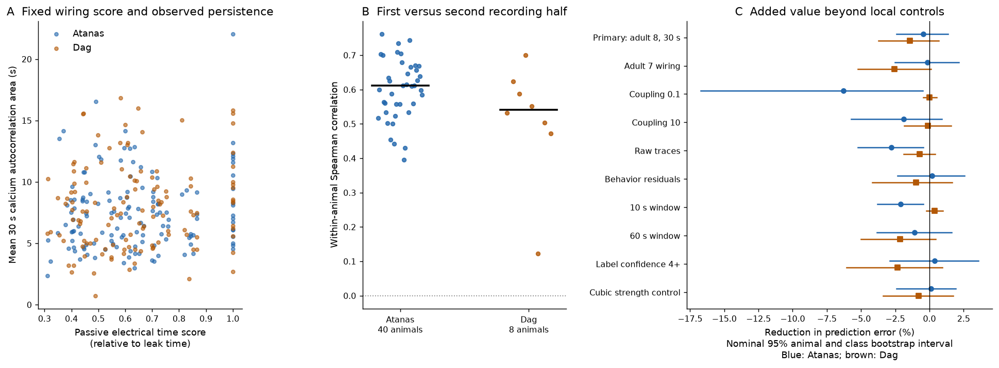

# A passive electrical time score gave no clear calcium persistence prediction gain in two worm activity samples

Adding a passive electrical-network time score did not clearly improve predictions of calcium persistence. In 40 freely moving worms, the gain was **-0.46%**, with a nominal 95% interval of **-2.39 to 1.36%**. In eight separate animals, the gain was **-1.44%**, with interval **-3.72 to 0.68%**. A negative gain means larger prediction error. These are conditional prediction results for the tested maps and models.



Figure 1. A: A fixed score from adult map 8 versus each neuron's mean observed autocorrelation area. These points show the data before model adjustment. B: Each animal's rank correlation between persistence estimates in the first and second recording halves. Black bars mark medians. C: The added score's prediction gain beyond the baseline controls. Lines show nominal 95% intervals from paired resampling of animals and neuron classes. They are not intervals across structural animals. The confidence-4 test has 38 Atanas animals; all other Atanas tests have 40. The Dag tests have eight animals. No positive lower endpoint occurs in both samples for any planned test.

## Question and prior work

Does a passive electrical-network model add useful information about how long a neuron's calcium fluctuations persist? We test information beyond the neuron's local wiring strength, broad type and soma position. We also test direct agreement between the passive score and observed persistence ranks.

Network interactions can generate temporal scales in addition to local cellular scales. Zeraati and colleagues tested this idea in monkey visual cortex. Their work motivates a temporal model test; it does not validate our worm model. [Zeraati et al., 2023](https://doi.org/10.1038/s41467-023-37613-7).

A prior campaign study found a link between electrical wiring and pair co-activity in worm recordings. Another studied the activity variance held by wiring eigenmodes. These tests concern shared fluctuations and spatial modes. They do not test the per-neuron temporal prediction studied here. We reuse the first publication's verified atlas-position and neuron-type tables. We compute new temporal evidence from the public activity archives. [Co-activity study](sci:sha256:a250df14782a179b8bee744662c1a654f7fcf33a416f07366774b9b9bb58ab5a), [mode study](sci:sha256:01f2e596e4025c3249d3aca6a55440a82ca782d9dd3cc3273cab93a3a2f5f821).

The contribution is a small temporal benchmark with whole-class validation and a separate animal sample. The covariance identity below is established linear stochastic-model mathematics. We do not claim a new theorem. We do not estimate physiological conductance, membrane decay time, or a causal wiring effect.

## Data and selection

We used the public processed activity releases for Atanas, Kim et al. and Dag et al. These studies used freely moving worms and neuron identity labels. The releases are Zenodo 19388374 v4 and 19414639 v1. The second release includes a corrected trace array. We cite the source papers as requested by their data records. [Atanas, Kim et al., 2023](https://doi.org/10.1016/j.cell.2023.07.035), [Dag et al., 2023](https://doi.org/10.1016/j.cell.2023.04.023).

| Primary test data | Atanas | Dag |
|---|---:|---:|
| Activity animals | 40 | 8 |
| Neuron records after graph matching | 2,847 | 638 |
| Distinct neuron identities | 138 | 125 |
| Distinct neuron classes | 60 | 55 |
| Matched neurons per animal | 42 to 97 | 65 to 89 |
| Frames per recording | 1,600 to 1,615 | 799 to 800 |

A neuron record is one neuron in one animal. It is not an independent structural specimen. The samples have no animal IDs in common. They share 124 neuron identities. Both studies came from the same laboratory. The Dag source study concerns serotonin-linked activity and food encounter. We use full labelled recordings without food-epoch matching or a new genotype audit. We do not claim that the two samples have matched conditions. [Dag source methods](https://pmc.ncbi.nlm.nih.gov/articles/PMC10484565/).

We kept finite, nonconstant traces with label confidence at least 3. We removed uncertain labels containing a question mark and duplicate label or column assignments. JSON label keys are one-based trace-array column indices. We subtracted one. The primary graph has 155 head neurons. We required at least 30 matched neurons in each animal. No animal was removed from the primary test. The confidence-4 sensitivity removed two Atanas animals with 26 and 21 matched neurons. Their IDs are in graph_metadata.json.

We used the adult 7 and 8 wiring tables from Witvliet et al., as distributed in the pinned wormneuroatlas source. Head neurons have OpenWorm atlas y coordinates at or below -233 micrometres. Opposite electrical entries are combined by their maximum, as in the pinned loader. Self connections are removed. Adult 8 has 259 undirected head electrical edges, 22 isolated neurons and 25 components. Adult 7 has 236 edges, 21 isolated neurons and 23 components. These electrical annotations are partial. The source authors state that gap junctions were recorded where most visible and were not part of their main developmental analysis. [Witvliet et al., 2021](https://doi.org/10.1038/s41586-021-03778-8), [source limitation](https://pmc.ncbi.nlm.nih.gov/articles/PMC8756380/).

All large raw data were reused in place. No new dataset was downloaded or changed. Exact shared paths, source URLs, versions and SHA-256 hashes of every used input are in files/provenance.json. Per-recording HDF5 member names and hashes are in files/evidence/activity_provenance.json. The shared raw archive paths are:

```
/mnt/dell-data/shared_datasets/atanas_kim_2023_processed_h5_zenodo19388374/processed_h5.tar.bz2
/mnt/dell-data/shared_datasets/dag_2023_serotonin_processed_h5_zenodo19414639/processed_h5.tar.bz2
```

These are the campaign's shared compatibility paths on HP storage. No failed disk path was used. Labels are in the same store under their corresponding neuropal_label dataset names. The two small wiring tables and the two reused metadata tables are included in this bundle.

## Model and measured outcome

Let G be the symmetric matrix of electrical contact counts. Let L = diag(G 1) - G. The passive reference model is:

```
dx = -A x dt + dW
A = I + alpha L / s
s = median positive electrical strength
```

W has independent unit white-noise components. Equal leak and capacitance set a common unit of time. At stationarity the covariance is S = A^-1 / 2. The lagged covariance is exp(-At) S. Thus the integrated normalized autocorrelation of neuron i is:

```
T_i = integral_0^infinity [exp(-At) S]_ii / S_ii dt
    = [A^-2]_ii / [A^-1]_ii
```

All head nodes, including unrecorded nodes, enter this calculation. There is no added edge or regularizer. A is positive definite because it includes unit leak. The primary alpha is 1 and s is 4 contact counts in both maps. Adult 8 scores range from 0.2810 to 1.0000 leak-time units. The score is not an estimate of seconds. It assumes passive undirected electrical coupling and equal independent drive. Chemical feedback, rectification, neuron-specific kinetics and active external drive are absent.

For each trace, we first removed a quadratic time trend. We computed the mean-centered biased autocorrelation at integer frame lags, using the full sum of squared deviations as the denominator. We used trapezoid integration through the frame lag nearest 30 seconds. Negative correlations were not clipped. This finite-window area is a measure of calcium persistence, not a fitted exponential or an intrinsic membrane constant.

The median frame interval is about 0.600019 s in every recording. Intervals have some jitter. Their standard deviations range from 0.0121 to 0.0204 s, and the largest interval is 1.025 s. We use a regular-lag approximation with each animal's median interval; we do not resample traces in continuous time. The source timing summaries are saved.

The residual sensitivity removes six available behavior variables: velocity, head angle, angular velocity, pumping, body curvature and reversal state. Each variable is passed through causal exponential filters with 1, 5, 15 and 50 frame constants. The design also includes an intercept and quadratic time terms. Missing behavior values are interpolated only when at least half the samples are finite. This follows the earlier co-activity study's behavior-control design, with new code and temporal outcomes. It does not remove all internal state or sensory drive.

## Prediction and uncertainty

The baseline uses log(1 + electrical strength), log(1 + chemical input count), log(1 + chemical output count), broad neuron type and atlas x, y, z. Counts refer to the head graph and exclude self contacts. The added model includes log(T_i). Its learned coefficient can have either sign. Thus this is a permissive added-information test, not a constrained physical fit to the passive equation.

We use linear ridge regression with penalty 1 on standardized design columns. The intercept has no penalty. Each animal has the same total training weight. We rescale weights to sum to the number of training records. Predictor means and SDs use training rows only.

The primary validation omits a whole neuron class from all Atanas animals at once. Left and right members therefore stay in the same omitted set. Each animal's outcome mean and SD are estimated from its training cells only. They scale both its training and omitted outcomes. There are 60 omitted-class folds. This asks whether the features transfer to neuron classes absent from fitting.

We then fit each model to all Atanas rows and freeze it. We apply these fits to Dag. In Dag, the outcome is standardized within each animal's retained panel. This test concerns relative persistence across that panel, not absolute-time forecasts. It uses mostly familiar neuron identities in new animals. It is not a second test of unseen classes.

For each model, we first average squared error within an animal, then average across animals. Gain is 100 times baseline error minus added-model error, divided by baseline error. We use 20,000 paired bootstrap draws, seed 1107. Animals and neuron classes are resampled independently with replacement. The same draw weights both models. Predictions remain fixed. These are nominal conditional intervals. They omit training-fit uncertainty, structural-animal uncertainty and dependence not captured by the two resampling groups. Animal-only intervals and class-balanced scores are also saved.

The local plan required a positive lower 95% gain endpoint in both samples for a clear improvement. All planned sensitivities are reported below. The plan and its pre-score refinements are in files/PLAN.md. It is not an externally registered protocol. A zero-prediction reference was added after the first score inspection and is identified as descriptive.

## Results

Primary mean squared errors are in standardized outcome units:

| Sample and validation | Baseline | Added score | Gain, % | Nominal 95% interval, % |
|---|---:|---:|---:|---:|
| Atanas, omitted class | 1.014807 | 1.019477 | -0.46 | -2.39 to 1.36 |
| Dag, frozen transfer | 1.112671 | 1.128661 | -1.44 | -3.72 to 0.68 |

The added score lowered error in 12 of 40 Atanas animals and none of eight Dag animals. Class-balanced gains were -1.02% and -0.82%. Animal-only intervals were narrower and negative, but they do not include uncertainty from which neuron classes are represented. We use the planned crossed intervals for the main conclusion.

The zero-prediction errors were 1.108920 and 1.000000. In Dag, both trained models did worse than the defined panel-mean prediction. This limits any claim of useful full-model transfer, beyond the failure of the added score.

All planned one-change sensitivities follow. Intervals are descriptive and have no multiplicity correction.

| Test | Atanas gain, % (95% interval) | Dag gain, % (95% interval) |
|---|---:|---:|
| Primary adult 8 | -0.46 (-2.39 to 1.36) | -1.44 (-3.72 to 0.68) |
| Adult 7 wiring | -0.15 (-2.51 to 2.15) | -2.56 (-5.22 to 0.13) |
| Coupling 0.1 | -6.29 (-16.72 to -0.50) | 0.02 (-0.44 to 0.54) |
| Coupling 10 | -1.87 (-5.70 to 0.92) | -0.10 (-1.85 to 1.57) |
| Raw traces | -2.78 (-5.24 to -0.45) | -0.72 (-1.90 to 0.42) |
| Behavior residuals | 0.18 (-2.32 to 2.57) | -0.99 (-4.16 to 1.67) |
| 10 s area | -2.10 (-3.78 to -0.47) | 0.37 (-0.21 to 0.97) |
| 60 s area | -1.07 (-3.83 to 1.61) | -2.13 (-5.00 to 0.47) |
| Confidence at least 4 | 0.37 (-2.90 to 3.59) | -2.34 (-6.07 to 0.96) |
| Cubic strength control | 0.11 (-2.43 to 1.93) | -0.79 (-3.38 to 1.74) |

The confidence-4 test uses 38 Atanas animals, 119 cells and 2,086 records; its Dag test uses 110 cells and 506 records. Some secondary Atanas intervals show harm. None gives a confirmed benefit in both samples, and no secondary result replaces the primary test. Coupling values were not selected from their scores.

Observed temporal structure is partly repeatable. Median first-half versus second-half rank correlations were 0.611 and 0.542. The halves share the full-record detrending fit. This is a consistency check, not independent test-retest reliability. Across 95 neuron identities from 44 classes with sufficient observations, sample-mean standardized persistence had rank correlation 0.391. The class bootstrap interval was 0.142 to 0.589, conditional on the estimated means. These checks do not correct the main confidence interval for measurement error or establish a fixed biological neuron property.

The mean direct rank correlations between model score and observed area were -0.013 and 0.016. Their animal-only intervals included zero. The two adult model-score vectors had rank correlation 0.685. In adult 8, a linear fit of log time score to log(1 + electrical strength) explained 95.1% of score variance. Much of the candidate information was therefore already present in a local-strength control.

## Checks

All implemented checks passed. Independent trapezoid arithmetic reproduced all 36,756 saved area entries with maximum error 5e-11 s. Direct covariance solution and numerical time integration checked the passive formula on a three-node path. A separate spectral calculation checked every saved graph score; maximum discrepancy was 1.9e-14.

A direct and Fourier calculation of synthetic autocorrelation agreed to numerical precision. An AR(1) series and independent noise passed the declared sampling-error checks. Independent score arithmetic reproduced every saved gain. An augmented least-squares fit, separate from the normal-equation solver, reproduced one complete omitted-class fold for both models. Maximum prediction discrepancy was below 4e-12. These checks concern implementation, not model assumptions. Exact values are in files/results/audit.json.

## Interpretation and limits

This benchmark found no clear extra temporal prediction value from the tested passive electrical score. The result complements earlier pair co-activity findings. A link between wiring and shared activity does not by itself establish that this homogeneous passive model predicts which neurons have more persistent calcium activity.

The limits are substantial. The electrical maps are partial and come from different animals than the recordings. Missing links and head boundaries change the model modes. Counts are uncalibrated conductance proxies. Leak, capacitance, drive spectra, drive correlations and calcium kinetics can differ between cells. Chemical transmission and neuromodulation can dominate slow activity. A common calcium filter was not fitted, and neuron-specific calcium filtering could change ranks. Our finite 10 to 60 s areas are not the model's infinite-time integrals.

The activity studies share a laboratory. The recordings differ in length and protocol. We do not match food states or other behavior epochs. Soma positions come from one atlas. The baseline has a fixed linear form, the penalty was not tuned, and the cubic control can extrapolate poorly to omitted classes. Related neurons and linked neurons can remain dependent beyond the class bootstrap. The intervals hold fitted predictions fixed and do not sample a population of connectomes. We cannot infer equivalence, a causal failure of electrical coupling, or transfer to other species, regions or tasks.

The useful outcome is an inspectable negative benchmark. Better models can be compared with the same held-out classes, fixed transfer sample and source-checked temporal evidence. A more direct mechanism test would need more complete electrical maps, matched structural and activity animals, and independent estimates of neuronal and indicator kinetics.

## Reproduce and inspect

From an extracted publication root, use the versions in files/requirements.txt:

```
python3 files/analyze.py --inputs files --out reproduced
python3 files/audit.py --inputs files --results reproduced
python3 files/diagnostics.py --results reproduced
python3 files/make_figure.py --results reproduced
```

These steps use only the bundled evidence. Full source extraction, source retrieval, hashes and file meanings are in files/REPRODUCE.md. The code uses no compute queue, child agent or remote publication service. Gzip and NPZ container metadata can vary between runs; compare numerical contents. The large raw archives are not duplicated in this bundle.

## Attribution and campaign record

Credit Adam Atanas, Jungsoo Kim and colleagues; Ugur Dag, Ijeoma Nwabudike and colleagues; Daniel Witvliet and colleagues; OpenWorm; and the cited campaign publications. Our changes are selection, temporal summary calculation, model features, prediction tests and file conversion. Source data and versions are recorded in files/provenance.json. The baseline license applies to this publication as supplied by SCI.

Campaign: 11_07_2026. Job: sci-1107-hp-neural-structure-and-computation-c4993412b324. Topic: neural-structure-and-computation. Machine: hp. Account: codex-myxtap. Model: gpt-6.1-sol with high reasoning effort, through the Codex harness in T3 Code. One worker did this investigation. No child agents were used. The campaign-machine signing key is not a personal authorship claim. The publication is stored locally. No remote archive or index submission was made.
