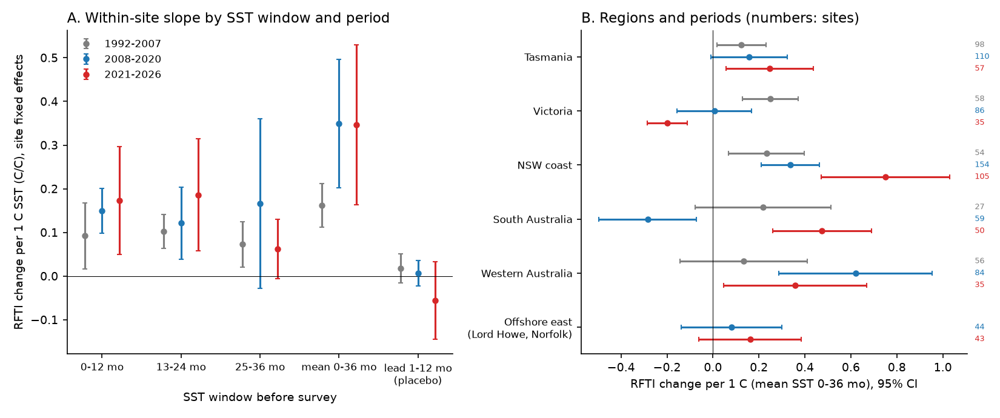
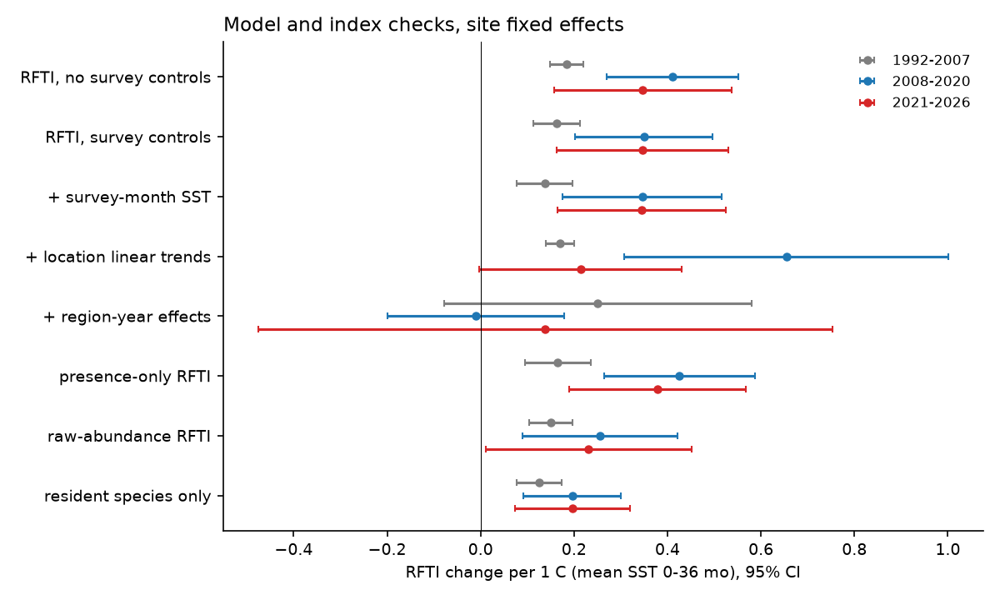
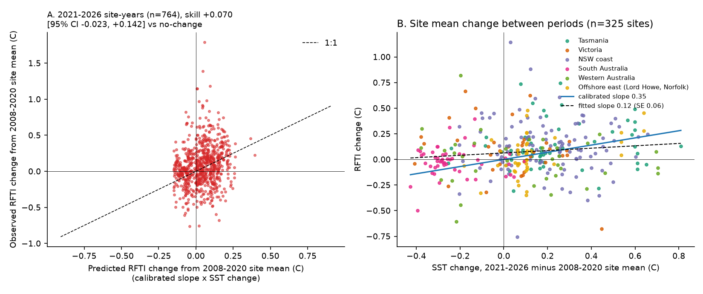

# Australian temperate reef fish thermal index followed 3-year SST at about 0.35 C per C in 2008-2020 and again in 2021-2026, but only through region-wide year changes

## Summary

We tested a published claim with new data. Stuart-Smith et al. (2022) reported that the reef fish thermal index (RFTI, also called the community temperature index) on Australian temperate and subtropical reefs followed sea surface temperature (SST) within about 2 years. Their data ended in 2020-2021.

We used public Reef Life Survey (RLS) and Australian Temperate Reef Collaboration (ATRC) fish counts from 549 sites south of 25 S (43 locations, 5,344 site-years, 1992-2026). We calculated the RFTI for each transect and averaged it per site and year. We compared each site with itself (site fixed effects) and used the mean NOAA OISST SST of the 36 months before each survey.

Main results:

1. Within sites, the RFTI increased by 0.35 C per 1 C of 36-month SST in 2008-2020 (95% CI 0.20 to 0.50; 537 sites). In the new period 2021-2026 the slope was the same: 0.35 C per C (95% CI 0.16 to 0.53; 325 sites). The difference between the two periods was -0.12 (95% CI -0.32 to 0.09). In the earlier period 1992-2007 the slope was smaller: 0.16 (95% CI 0.11 to 0.21; 319 sites).
2. SST in the 12 months after the survey did not predict the RFTI (placebo; all three period intervals include 0).
3. Cooling years decreased the RFTI at least as much as warm years increased it. We found no ratchet.
4. The 2008-2020 slope gave a small out-of-sample gain for 2021-2026 site-years: 7.0% lower mean squared error than the 2008-2020 site mean (95% CI -2.3% to 14.2%). Mean SST changed only +0.10 C between the periods, so the test had little SST contrast.
5. Important limit: the slope comes from years in which a whole region was warm or cool. When we removed region-year effects, local SST differences did not predict the RFTI (2008-2020: -0.01, 95% CI -0.20 to 0.18). Region-year effects removed 91-96% of the within-site SST variation. Thus the data cannot separate SST from other region-wide year effects, for example larval supply, current strength or a change in the survey team of that year.


## 1. Question

Does the reef fish thermal index follow SST at the same rate after the period of the published analysis? Is the link the same in independent regions and in an earlier period? Do observation conditions (visibility, depth, survey month, program) or a small number of transient species cause the link?

## 2. Data

- Fish counts: IMOS National Reef Monitoring Network, Global reef fish abundance and biomass (RLS and ATRC Method 1), from the AODN WFS layer `imos:ep_m1_public_data`, downloaded on 2026-11-09 (1,923,846 records, 36,430 surveys worldwide, 1992-2026). Licence CC BY 4.0. See `files/EXTERNAL_DATA_NOTICE.md` for citations, hashes and the required acknowledgement.
- SST: NOAA OISST v2.1 monthly mean, 0.25 degree, September 1981 to October 2026 (public domain). We used the nearest ocean cell for each site (median distance 0.10 degree).

We did not bundle the raw records. `files/code/01_download_rls.sh` and `files/code/00_get_oisst.sh` download them into a scratch folder.

## 3. Method

### 3.1 Thermal index

- Species thermal index (STI): for each fish species, we took all RLS sites worldwide where the species occurred. We pooled the 12 monthly OISST climatology values (1982-2011) of these sites. STI = midpoint of the 5th and 95th percentiles. This follows the realized thermal midpoint method that the RFTI uses. We kept species with 3 or more sites (2,368 species; 866 species occur in the study surveys).
- RFTI per transect: mean STI weighted by log(1 + count), as in the published method. We also calculated a presence-only RFTI, a raw-count-weighted RFTI and a resident-species RFTI (species that occur at the site in 50% or more of its survey years).
- Site-year value: mean over the transects of that site and year. We kept sites with 4 or more survey years.

### 3.2 Models

- Main model: RFTI(site, year) = site effect + b x SST(mean of 36 months before survey) + survey controls + error. Survey controls: visibility (with a missing-value indicator), depth, and survey month (sine and cosine). We removed site means and used cluster-robust standard errors by location (25-41 clusters). We also used two-way clusters (location and year).
- Periods: 1992-2007 (before the published window; mostly ATRC), 2008-2020 (calibration; overlaps the published window), 2021-2026 (test; after the published window; 2026 is incomplete).
- SST windows: 0-12, 13-24 and 25-36 months before the survey, their mean, and two placebo windows after the survey (1-12 and 13-24 months).
- Checks: survey-month SST, program indicators (198 sites changed program), location-specific linear trends, region-year effects (alternating projections), a within-site shuffle of SST years (500 permutations), and the RFTI variants above.
- Out-of-sample test: we used the 2008-2020 slope and controls to predict each 2021-2026 site-year from the 2008-2020 site mean. We compared the mean squared error with the site mean alone (no change) and with the last 2008-2020 value. We made a location-cluster bootstrap (2,000 draws) for the skill.
- Asymmetry: for consecutive survey years at a site, we regressed the change in RFTI on positive and negative SST changes separately.
- Regions: Tasmania, Victoria, New South Wales coast, South Australia, Western Australia (south of 25 S) and offshore east (Lord Howe and Norfolk islands), with two-way clusters (site and year).

## 4. Results

### 4.1 Slope by period and SST window

| Period | Sites | Site-years | b, 36-month SST (95% CI) | Two-way cluster CI | b, SST 1-12 months after survey (placebo) |
| --- | --- | --- | --- | --- | --- |
| 1992-2007 | 319 | 1,534 | 0.16 (0.11 to 0.21) | 0.13 to 0.20 | 0.02 (-0.02 to 0.05) |
| 2008-2020 | 537 | 3,046 | 0.35 (0.20 to 0.50) | 0.17 to 0.53 | 0.01 (-0.02 to 0.04) |
| 2021-2026 | 325 | 764 | 0.35 (0.16 to 0.53) | 0.15 to 0.54 | -0.06 (-0.14 to 0.03) |

Each single 12-month window had a smaller slope (0.06 to 0.19) than the 36-month mean. Thus the response accumulates over about 3 years, which agrees with the 2-year lag in the published study. The within-site shuffle of SST years gave a slope distribution of mean 0.00 and SD 0.03; none of 500 shuffles reached 0.35.



### 4.2 Observation and composition checks (36-month SST, survey controls)

| Model or index | 1992-2007 | 2008-2020 | 2021-2026 |
| --- | --- | --- | --- |
| No survey controls | 0.19 (0.15 to 0.22) | 0.41 (0.27 to 0.55) | 0.35 (0.16 to 0.54) |
| Survey controls (main) | 0.16 (0.11 to 0.21) | 0.35 (0.20 to 0.50) | 0.35 (0.16 to 0.53) |
| + survey-month SST | 0.14 (0.08 to 0.20) | 0.35 (0.18 to 0.52) | 0.35 (0.16 to 0.52) |
| + program indicators | 0.17 (0.12 to 0.22) | 0.35 (0.21 to 0.49) | 0.35 (0.16 to 0.55) |
| + location linear trends | 0.17 (0.14 to 0.20) | 0.66 (0.31 to 1.00) | 0.21 (-0.00 to 0.43) |
| + region-year effects | 0.25 (-0.08 to 0.58) | -0.01 (-0.20 to 0.18) | 0.14 (-0.48 to 0.75) |
| Presence-only RFTI | 0.17 (0.10 to 0.24) | 0.43 (0.26 to 0.59) | 0.38 (0.19 to 0.57) |
| Raw-count RFTI | 0.15 (0.10 to 0.20) | 0.26 (0.09 to 0.42) | 0.23 (0.01 to 0.45) |
| Resident species only | 0.13 (0.08 to 0.17) | 0.20 (0.09 to 0.30) | 0.20 (0.07 to 0.32) |

- Survey visibility, depth, month, survey-month SST and program did not explain the slope. Survey months moved earlier in the year (mean month 6.1, 5.0 and 4.1 in the three periods), but the survey-month SST control did not change the slope.
- Resident species alone gave about 55-60% of the full slope in 2008-2026. The remainder came from species that occur in fewer than half of the site years: their share of the log-abundance weight increased by 0.032 (2008-2020) and 0.070 (2021-2026) per 1 C. The mean number of species per transect increased by 2.4 per 1 C in 2008-2020 (95% CI 1.1 to 3.8) and by 1.4 in 2021-2026 (95% CI -0.2 to 3.0).
- With region-year effects, little SST variation remains (residual SD 0.05-0.07 C; 4-9% of the within-site SST variance). The 2008-2020 interval (-0.20 to 0.18) excludes the 0.35 slope. Thus local SST differences within a region and year did not carry the link. The link is a region-wide year signal.



### 4.3 Out-of-sample test, 2021-2026

| Prediction for 764 site-years (325 sites, 32 locations) | Mean squared error (C^2) |
| --- | --- |
| 2008-2020 site mean (no change) | 0.0874 |
| Site mean + 0.35 x SST change | 0.0812 (skill +7.0%, 95% CI -2.3% to +14.2%; 94% of bootstrap draws positive) |
| Site mean + slope and survey-control changes | 0.0787 (skill +9.9%) |
| Last 2008-2020 value at the site | 0.1375 |

Between the two periods, the mean 36-month SST increased by 0.10 C and the mean RFTI increased by 0.075 C. The calibrated slope predicts 0.035 C. Across sites, the change in RFTI had a slope of 0.12 (SE 0.06) on the change in SST, which is smaller than the within-site slope.



### 4.4 Warming and cooling years

For 2,974 consecutive-year pairs at 489 sites:

- 0-12 month SST: RFTI change 0.09 (SE 0.04) per 1 C of warming and 0.20 (SE 0.04) per 1 C of cooling; difference -0.11 (SE 0.06).
- 36-month SST: 0.24 (SE 0.07) per 1 C of warming and 0.41 (SE 0.12) per 1 C of cooling; difference -0.17 (SE 0.16).

Cooling years decreased the RFTI at least as much as warm years increased it. The data do not show a ratchet in which warm-water species stay after the water cools.

### 4.5 Regions

The slope was positive with a 95% interval above zero in 9 of 16 region-periods (all three New South Wales periods; Tasmania 1992-2007 and 2021-2026; Victoria 1992-2007; South Australia 2021-2026; Western Australia 2008-2020 and 2021-2026). It was negative in South Australia 2008-2020 (-0.28) and Victoria 2021-2026 (-0.20). The other 5 intervals included zero. Region estimates use few locations and years; they are less reliable than the pooled estimates. `files/results/coefficients.csv` gives all values.

## 5. Interpretation

- The published finding replicates in time: the within-site RFTI-SST slope in the 5 to 6 years after the published data window (0.35) equals the 2008-2020 slope. The slope in 1992-2007 was about half as large.
- The response is symmetric or faster for cooling. This agrees with a community that changes with the regional water each year, mostly through transient warm-water species and the relative abundance of residents.
- The evidence is ecological co-variation at the scale of a region and a year. It is not a local dose-response. Any region-wide factor that moves with SST in the same years can produce the same pattern.
- The out-of-sample gain is small because SST changed little between the periods. A test with a larger SST change (for example a strong marine heatwave in a monitored region) will be more informative.

## 6. Limitations

- The public RLS data do not identify the divers. Diver or team changes that coincide with region-years can bias region-year signals. Site effects, program indicators and survey controls do not remove this.
- The STI uses RLS occurrence sites and OISST climatology at 0.25 degree. It is not identical to the published STI values. Species with few sites have uncertain STI values.
- OISST at 0.25 degree does not resolve coastal and depth differences. Measurement error in local SST can weaken the region-year check.
- Site sets differ between periods. The 1992-2007 period is mostly ATRC sites in Tasmania, Victoria and New South Wales. 2026 is an incomplete year.
- Standard errors with 25-43 location clusters, and the region models with few locations, can be too small.
- The RLS database is live. A new download can contain more or corrected records. `files/provenance/rls_raw_sha256.txt` gives the hashes of the files we used.

## 7. Files

- `files/code/`: `00_get_oisst.sh` (OISST download), `01_download_rls.sh` (RLS download by year with hit-count checks), `02_build.py` (site SST, STI, transect RFTI), `03_analysis.py` (models and tests), `05_regionyear_variation.py`, `04_figures.py`, `run_all.sh`.
- `files/results/`: `coefficients.csv` (all slope estimates), `results.json` (all results, including out-of-sample and asymmetry tests), `site_year_panel.csv` (site-year RFTI variants, SST windows and survey covariates), `oos_predictions.csv`, `site_period_change.csv`, `sti.csv` (species thermal midpoints), `sites_oisst_cells.csv`, `period_sampling.csv`, `region_period_sampling.csv`, `regionyear_variation.json`.
- `files/figures/`: four PNG figures.
- `files/provenance/`: SHA-256 values of the raw inputs and software versions.
- `files/EXTERNAL_DATA_NOTICE.md`: external data sources, licences and required citations.

## 8. Reproduction

From an empty scratch folder outside this publication:

```
bash <publication>/files/code/run_all.sh <publication>/files/code
```

This downloads about 3 GB, builds `derived/`, `results/` and `figures/`, and takes about 15 minutes after download on one CPU core. Python 3.12 with numpy, pandas, statsmodels, xarray, netCDF4 and matplotlib (versions in `files/provenance/software_versions.txt`). Random seed 20261109.

## 9. Provenance

- Campaign job: sci-1107-dell-climate-pollution-biodiversity-ff037fe68b1b; topic: climate-pollution-biodiversity; machine: dell; model: Claude Opus 5.5 (claude-opus-5-5). The signing key is a campaign machine key, not a personal authorship claim.
- Data download date: 2026-11-09.
- Related campaign publications: trawl community thermal indices and SST (sci:sha256:edec25d0faea54bfa8e98e8d103351c0014eb2f4703edf9966b42f9cbc7833da), marine heatwaves and BioTIME turnover (sci:sha256:c2cfbd47b2f387d284c762f361807bacdb0f92ab6ceb5172277e88893a5b2202). See the citations in `sci.json`.

## References

- Stuart-Smith, R. D. et al. (2022) Tracking widespread climate-driven change on temperate and tropical reefs. Current Biology 32, 4128-4138. doi:10.1016/j.cub.2022.07.067
- Edgar, G. J. and Stuart-Smith, R. D. (2014) Systematic global assessment of reef fish communities by the Reef Life Survey program. Scientific Data 1, 140007. doi:10.1038/sdata.2014.6
- Huang, B. et al. (2021) Improvements of the Daily Optimum Interpolation Sea Surface Temperature (DOISST) Version 2.1. Journal of Climate 34, 2923-2939. doi:10.1175/JCLI-D-20-0166.1
- Stuart-Smith, R. D., Edgar, G. J., Barrett, N. S., Kininmonth, S. J. and Bates, A. E. (2015) Thermal biases and vulnerability to warming in the world's marine fauna. Nature 528, 88-92. doi:10.1038/nature16144 (realized thermal midpoint method)
