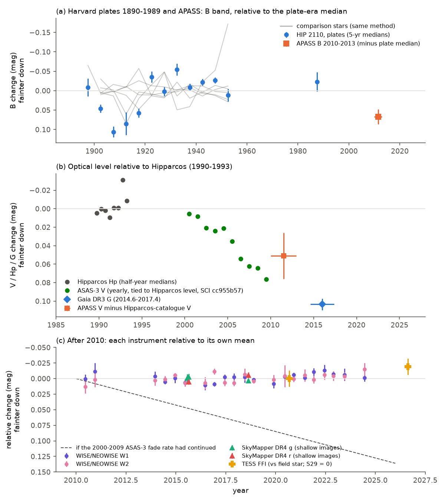
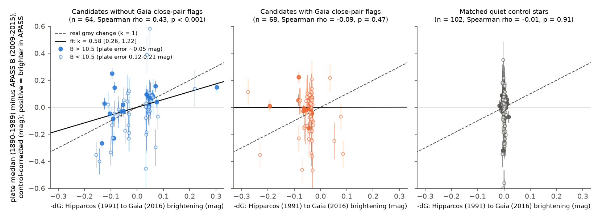

# Harvard plates and APASS confirm the unexplained Hipparcos-to-Gaia brightness changes as a group, and HIP 2110 had two separate dimming episodes about 100 years apart

## Summary

The campaign publication SCI sha256:cc955b57 compared Hipparcos (1991) and Gaia DR3 (2016) photometry of 70,818
quiet stars. It found 216 stars that changed by more than 0.03 mag. It explained 101 of them as Gaia close-pair
artefacts and 64 as known variable classes. 51 stars stayed unexplained. The largest unexplained change was the
F-type dwarf HIP 2110 (CD-23 156), which faded by 0.104 mag. That study used Hipparcos, Tycho, ASAS-3 and Gaia data.
It had no data before 1989 and no 0.01-mag data after 2017.

We did two new tests with instruments that are independent of Hipparcos and Gaia:

1. **Population test with Harvard plates and APASS.** For each candidate and for 216 matched quiet control stars, we
   compared the median brightness on Harvard plates (DASCH DR7, 1890-1989) with the APASS B magnitude (2009-2015).
   If a Hipparcos-to-Gaia change is real, this plate-to-APASS change must follow it. If the change is a Hipparcos or
   Gaia measurement error, the plate-to-APASS change must be zero.
2. **Full history of HIP 2110 from 1897 to 2026.** We used Harvard plates with six local comparison stars, WISE and
   NEOWISE (2010-2024), SkyMapper DR4 (2015-2018) and TESS full-frame images (2020 and 2026).

Main results:

- **Candidates without Gaia close-pair flags (64 stars with APASS references):** the plate-to-APASS change follows the
  Hipparcos-to-Gaia change. The Spearman rank correlation is rho = 0.43 (p = 0.0004). The fitted ratio is
  k = 0.58 (95 % bootstrap interval 0.26 to 1.22). k = 1 is a real grey change; k = 0 is a measurement error.
  For the 26 unexplained stars alone: k = 0.96 (0.44 to 1.85), rho = 0.40 (p = 0.045).
- **Candidates with Gaia close-pair flags (68 stars):** no relation (k = 0.00, interval -0.32 to 0.74;
  rho = -0.09, p = 0.47). This agrees with the earlier result that these changes are Gaia close-pair artefacts.
  The difference between the two groups is significant (permutation p = 0.002).
- **Control stars (102 stars):** no relation (rho = -0.01). Their scatter sets the error of the plate test:
  0.042 mag for B > 10.5, 0.096 mag for B 9.5-10.5 and 0.135 mag for brighter stars.
- **HIP 2110 faded twice.** On the plates, the star was 0.05 to 0.11 mag fainter in 1902-1917 than in 1921-1955.
  The 1905-1909 bin is 0.106 +/- 0.014 mag faint, while the six comparison stars in the same bin are within
  0.016 mag of zero. Two independent plate series show this episode (AM series +0.101 mag with 184 and 165 plates,
  AC series +0.065 mag). After 1921 the star was steady to about 0.05 mag until the last plates (1985-1989).
  Then it faded by about 0.07 mag in ASAS-3 V from 2000 to 2009, and Gaia G (2014-2017) is 0.104 mag below the
  Hipparcos level. APASS B (2010-2013) is 0.067 +/- 0.019 mag fainter than the plate-era median, relative to the
  six comparison stars.
- **The second fade stopped by about 2010.** WISE W1 is constant from 2010.5 to 2024.5 (slope -0.0010 +/- 0.0004
  mag per year, 21 epochs; W2 -0.0004 +/- 0.0004). SkyMapper g and r change by less than 0.006 mag from 2015.6 to
  2018.6. TESS gives -0.019 +/- 0.013 mag (a small brightening) from 2020.7 to 2026.6, relative to a field star.
  If the 2000-2009 fade rate had continued, TESS would show +0.051 mag.

Thus the unexplained Hipparcos-to-Gaia changes are mostly real changes of the stars, not Gaia or Hipparcos errors.
HIP 2110 is not in a steady decline. It had one faint episode of about 0.1 mag in about 1900-1920, a steady state for
at least 65 years, and a second 0.1-mag fade in about 2000-2010 that has stayed for at least 16 years. We do not
know the cause.

Figure 1. HIP 2110 brightness history. (a) Harvard plates (B band), 5-year medians relative to the plate-era median,
after a per-plate zero point from six local comparison stars (blue); the same method applied to each comparison
star against the other five (grey lines); APASS B relative to the plate median (orange). (b) Optical level relative
to Hipparcos: Hipparcos epoch photometry, ASAS-3 V yearly medians (tied to the Hipparcos level with the calibration
of SCI cc955b57), APASS V minus the Hipparcos-catalogue ground-based V, and Gaia DR3 G. (c) After 2010, each
instrument relative to its own mean: WISE/NEOWISE W1 and W2, SkyMapper DR4 g and r (shallow-survey images), and TESS
(sector 29 = 0). The dashed line shows the 2000-2009 ASAS-3 fade rate.

Figure 2. Plate-to-APASS change (control-corrected) against the Hipparcos-to-Gaia change. Left: candidates without
Gaia close-pair flags. Middle: candidates with Gaia close-pair flags. Right: matched quiet control stars. Filled
points have B > 10.5, where the plate error is about 0.04 mag. The dashed line is a real grey change (k = 1); the
solid line is the robust fit.

## Question

The study SCI cc955b57 found 51 unexplained 25-year brightness changes in Hipparcos-quiet stars. Are these changes
real? Independent instruments must answer this, because Hipparcos, Tycho and Gaia errors can cause apparent changes.
For HIP 2110, the largest case: what did the star do before 1989 and after 2017?

## Data

| Data | Epochs | Use | Access |
| --- | --- | --- | --- |
| DASCH DR7 Harvard plate photometry (B-like, calibrated to APASS) | 1890-1989 | plate-era level and history | StarGlass public API, refcat `apass` |
| APASS reference B magnitude (the DASCH `stdmag` of `APASS_` entries) | 2009-2015 | modern B level | in the DASCH refcat |
| AllWISE multi-epoch and NEOWISE-R single exposures | 2010-2024 | HIP 2110 infrared level | IRSA TAP |
| SkyMapper DR4 per-image photometry | 2015-2020 | HIP 2110 optical level | SkyMapper TAP |
| TESS FFI cutouts, sectors 29 and 107 (camera 1, CCD 2) | 2020.7, 2026.6 | HIP 2110 optical level | MAST TESScut |
| Gaia DR3 (HIP 2110 and field stars) | 2014-2017 | positions, binarity and extinction checks | IRSA TAP |
| Candidate list, dGc values, ASAS-3 and Hipparcos epoch files | 1989-2017 | inputs | SCI sha256:cc955b57 |

All downloads were made on 2026-11-11. `files/provenance/input_sha256.csv` lists the sizes and SHA-256 hashes of the
873 input files (829 DASCH files for the 432 population stars, of which 397 have a light curve; 31 DASCH files of
the local comparison run; WISE, SkyMapper and Gaia tables; two TESS cutouts; and four files from cc955b57). The external-data terms are in `files/NOTICE-external-data.md`.

## Method

### Population test (Harvard plates against APASS)

1. **Targets.** All 216 candidates of cc955b57. For each candidate, one quiet control star from the same analysis
   sample (no candidate, no close-pair flag, |z| < 2), in the same hemisphere, nearest in Gaia G (scale 0.2 mag)
   and BP-RP (scale 0.1 mag), without reuse (`make_targets.py`; list in `files/results/dasch_target_list.csv`).
2. **Plates.** For each star, a 40-arcsec DASCH `querycat` cone, the nearest reference entry within 10 arcsec, and
   its DASCH DR7 light curve (`dasch_pop_fetch.py`). Plate quality rules are from SCI sha256:24007cae
   (`dasch_load.py`): bad AFLAGS rejected, one row per plate solution, and only plates at least 1 mag deeper than
   the star.
3. **Plate-to-APASS change.** Delta_plate = median plate magnitude (1880-1989) minus the APASS B magnitude
   (`dasch_pop_measure.py`). We use only stars whose reference is an APASS entry (`APASS_...`). Bright stars often
   have a Tycho reference (`T...`). A Tycho magnitude is from 1991, so it gives no information after 1991; we
   removed these stars. Of the 13 tier A stars, 10 were lost this way or had no APASS B.
4. **Control correction and errors.** A robust linear fit of Delta_plate against B for the control stars removes a
   small magnitude term. The residual r has a robust control scatter s0 in three B bins (`dasch_pop_analysis.py`).
5. **Statistics per group.** For a real grey change after the plate era, r = -k dGc with k near 1 (dGc is the
   Hipparcos-to-Gaia change; positive = fainter in Gaia). We fit k with Huber weights (c = 1.5) and error s0, and
   bootstrap the stars 4,000 times. We also give the Spearman rank correlation of r with -dGc and a sign test.
6. **Robustness** (`pop_robustness.py`): early (1880-1949) and late (1950-1989) plate eras separately, a colour term
   in the control model, removal of hot stars (BP-RP < 0.3), and a label permutation test of the difference in rank
   correlation between the close-pair group and the other candidates.

### HIP 2110

1. **Local plate comparison.** `dasch_fetch.py` selects six isolated APASS stars within 30 arcmin with B within 0.8
   mag and B-V within 0.4 of HIP 2110 (B 10.98-11.86, B-V 0.56-0.72). Per plate, the zero point is the median
   offset of the comparison stars from their own plate medians. 5-year medians of the target follow
   (`dasch_local_measure.py`). Each comparison star, measured against the other five, gives a null curve. The
   plate-to-APASS change of the target is compared with the median of the comparison stars; the error is the
   leave-one-out scatter of the comparison stars.
2. **Plate series check** (`hip2110_series_check.py`): the target-minus-zero-point offset for 1900-1920 and for
   1921-1955 in each plate series with at least 8 plates in each era.
3. **WISE/NEOWISE** (`wise_diff.py`): good single exposures (qual_frame > 0, qi_fact > 0.9, no Moon mask,
   cc_flags 0000, nb = 1, no solar-system flag); a median per visit (about every 6 months); the zero point is the
   median offset of six field stars with W1 within -1.5 to +2.0 mag of the target.
4. **SkyMapper DR4** (`skymapper_diff.py`): per image, the target offset minus the median offset of 13 to 39 field
   stars (flags < 4, no image flags, error < 0.03 mag). We use only shallow-survey images (5 to 40 s). The 100-s
   main-survey v and u images are near saturation for this star.
5. **TESS** (`tess_level.py`): circular apertures of 1.5 to 3.0 pixels at Gaia positions, local background from an
   annulus of 5 to 8 pixels with stars masked, QUALITY = 0 cadences, and the 70 % of cadences with the lowest
   background. The level is the median flux ratio of HIP 2110 to the only bright field star in the cutout
   (Gaia DR3 2360472420534222848, G = 12.2). The error is the scatter over the four aperture sizes (at least
   0.01 mag). In sector 2 (2018) the star fell outside the active CCD area, and we did not use it.

## Results

### Population test

| Group | Stars | k (95 % interval) | Spearman rho (p) | Sign agrees |
| --- | --- | --- | --- | --- |
| All candidates without close-pair flags | 64 | 0.58 (0.26 to 1.22) | 0.43 (0.0004) | 42 of 64 |
| - unexplained (tiers A, B, C) | 26 | 0.96 (0.44 to 1.85) | 0.40 (0.045) | 18 of 26 |
| - known variable or binary class | 38 | 0.51 (0.11 to 1.35) | 0.41 (0.010) | 24 of 38 |
| Candidates with Gaia close-pair flags | 68 | 0.00 (-0.32 to 0.74) | -0.09 (0.47) | 36 of 68 |
| Matched quiet control stars | 102 | -0.48 (-2.94 to 2.26) | -0.01 (0.91) | 54 of 102 |

Values only for B > 10.5 (where the plate error is 0.04 mag) are in `files/results/population_fit.json`. The result
is the same in both plate eras for all candidates without close-pair flags (1880-1949: rho = 0.42, p = 0.0005;
1950-1989: rho = 0.36, p = 0.006), with a colour term (rho = 0.42), and without hot stars (rho = 0.35, p = 0.012).
For the unexplained group alone, the late era is weaker (rho = 0.19, p = 0.38, 23 stars).

Most stars with large changes are bright (B < 10). For them the plate error is 0.10 to 0.14 mag, larger than the
changes (median |dGc| 0.04 to 0.07 mag). Thus the test is a group test; it does not confirm single stars. Three tier A
stars have an APASS reference: HIP 2110 (below), HIP 16623 (r = +0.093, expected +0.050, error 0.096) and
HIP 91669 (r = +0.106, expected +0.046, error 0.096). Both of the latter agree in sign but are not significant alone.
One unexplained star, HIP 70727 (B = 8.8), has r = +0.58, which is 4.3 times its error; we think that this is a
plate error for a bright star, and the rank statistics are not sensitive to it.

### HIP 2110

| Instrument | Epoch | Result |
| --- | --- | --- |
| Harvard plates, 6 comparison stars | 1902-1917 | 0.05 to 0.11 mag fainter than in 1921-1955 (1905-1909: +0.106 +/- 0.014) |
| Harvard plates, per series | 1900-1920 minus 1921-1955 | AM +0.101 (184/165 plates), AC +0.065 (17/37), B +0.019 (16/8) |
| Harvard plates | 1921-1989 | steady; 5-year bins within -0.054 to +0.011 mag |
| Plates against APASS B | plate median to 2010-2013 | APASS fainter by 0.067 +/- 0.019 mag (comparison-star scatter 0.019) |
| Hipparcos-catalogue ground V against APASS V | before 1991 to 2010-2013 | APASS fainter by 0.05 +/- 0.025 mag (10.68 against 10.731) |
| ASAS-3 V (SCI cc955b57 file) | 2000 to 2009 | yearly medians fade from +0.005 to +0.076 mag below the Hipparcos level |
| Gaia DR3 G (SCI cc955b57) | 2014.6-2017.4 | +0.104 +/- 0.006 mag below the Hipparcos level |
| WISE/NEOWISE W1, W2 | 2010.5-2024.5 | slopes -0.0010 +/- 0.0004 and -0.0004 +/- 0.0004 mag per year |
| SkyMapper DR4 g, r | 2015.6-2018.6 | +0.0045 and -0.0053 mag (errors 0.004 to 0.005) |
| TESS FFI | 2020.7 to 2026.6 | -0.019 +/- 0.013 mag (apertures give -0.010 to -0.038) |

Other properties from Gaia DR3 and AllWISE: RUWE 1.06; no radial-velocity variation (rv_chisq_pvalue 0.53,
14 transits over 707 days, rv_amplitude_robust 6.3 km/s at an error of 0.58 km/s for the mean); GSP-Phot
A_G = 0.0006 mag; Teff 6565 K, log g 4.18, [M/H] -0.50, distance 296 pc; no mid-infrared excess (W1 - W3 = 0.08 mag).

## Interpretation

**Population.** Before this study, all evidence for the unexplained changes came from the same two satellites
(Hipparcos with Tycho, and Gaia) plus ASAS-3 for some southern stars. The Harvard plates and APASS are independent of
both satellites. The plate-to-APASS change follows the satellite change for the candidates without close-pair flags,
and it does not for the close-pair group. Thus the close-pair changes are Gaia artefacts, and the other changes are
mostly changes of the stars. The value k = 0.96 for the unexplained group agrees with a grey change. k is less than 1
for the known variable classes. Possible reasons are that variable stars change again between the epochs, and that the
plate median covers a century, not only the years just before 1991.

**HIP 2110.** The new data change the picture of this star. It is not in a slow decline. It had at least two separate
dimming episodes of about 0.1 mag. The first ended by about 1921. The second began after the Hipparcos mission
(ASAS-3 shows it from about 2002) and became steady by about 2010; the star is still at the low level in 2026. The
B-band fade (0.067 mag from the plate median, or about 0.09 mag from the 1921-1955 level) is not larger than the G-band
fade (0.104 mag). Interstellar-like small dust grains would give a B-band fade about 1.5 times the G-band fade. This
weakly disfavours small grains, but the epochs and passbands of the two measurements are different. A fading
unresolved companion would need to give 10 % of the light; Gaia shows no astrometric or radial-velocity sign of a
close companion, but a faint companion at a separation of 0.1 to 1 arcsec is not excluded. A change of the star itself
(for example a long magnetic cycle) of 10 % in an F dwarf has no known precedent. We do not know the cause.

## Limitations

- Only 26 of the 51 unexplained stars and 3 of the 13 tier A stars have an APASS reference with enough plates. Bright
  stars (B < 9.5) have a Tycho reference or a large plate error. Thus the population result rests mostly on stars with
  B = 9.5 to 12.7, and the single-star tests are weak except for HIP 2110.
- The plate median covers 1890-1989. A change before 1991 also enters the test. APASS epochs (2009-2015) are not the
  Gaia epochs (2014-2017).
- DASCH magnitudes are calibrated against APASS. Each star's own APASS value is one of many calibrators on a plate,
  which can only pull the plate value toward APASS and make k smaller.
- The plate bands (blue-sensitive emulsions, calibrated to B) differ from Hp, V and G. We assume a grey change for
  k = 1.
- The early faint episode of HIP 2110 depends on plates from 1900-1920. Two plate series show it, and six comparison
  stars of B-V 0.56-0.72 do not, but HIP 2110 is bluer (B-V 0.41) than all comparison stars. A colour-dependent
  plate error of 0.1 mag between B-V 0.41 and 0.56 is unlikely but not excluded.
- The TESS test uses one comparison star, and the result depends on the aperture by up to 0.03 mag.
- WISE does not test a dust fade: small grains dim W1 by only about 6 % of the V-band amount. It tests only a grey
  change after 2010.
- No spectroscopy or high-resolution imaging of HIP 2110 was available.

## What remains open

- A spectrum of HIP 2110 (lithium, activity, a second set of lines) and high-resolution imaging for a companion.
- Precise multi-band photometry now, to measure the colour of the low state against Hipparcos-era colours.
- More plate archives (for example the APPLAUSE plates or the Sonneberg plates) for the 1955-1985 gap and for
  northern candidates without APASS references.
- Local comparison stars for the other unexplained stars with B > 10 would reduce the plate error from about 0.04 to
  about 0.02 mag and could confirm single stars.
- Gaia DR4 epoch photometry (2014-2019) will show whether the HIP 2110 fade ended before 2017.

## Reproducibility

- Code: `files/code/`. Run `bash files/code/run_all.sh WORKDIR CAMPAIGN_DIR` with a new, empty WORKDIR outside this
  publication and the campaign folder that holds SCI cc955b57. It downloads about 0.8 GB and takes 2 to 3 hours with
  two DASCH streams. It writes all inputs and outputs into WORKDIR. Then `package_results.py` copies the derived
  tables into a results folder.
- Software: Python 3.12 with numpy, pandas, scipy, astropy, matplotlib and requests (versions in
  `files/provenance/environment.txt`). Set OMP_NUM_THREADS=1 on a shared machine.
- Inputs: `files/provenance/input_sha256.csv`. DASCH and TAP outputs can change when the services change; a new
  download can have different bytes.
- Derived results: `files/results/` (population offsets per star, fits, robustness tests, HIP 2110 curves and levels).

## Provenance

- Campaign 11_07_2026, job sci-1107-dell-astronomy-0a0307c769b1, topic astronomy, machine dell, account claude-sci.
- Model: Claude Opus 5.5 (claude-opus-5-5), working through the Claude Code harness.
- The signing key is a campaign-machine key. It does not state personal authorship.
- Analysis date: 2026-11-11.
- This work builds on SCI sha256:cc955b57 (candidates, dGc, ASAS-3 and Hipparcos epoch files) and reuses the DASCH
  access and quality code of SCI sha256:24007cae.

## References

- Grindlay, J. et al. 2009, ASP Conf. Ser. 410, 101 (DASCH).
- Henden, A. A. et al. 2016, VizieR II/336 (APASS DR9).
- ESA 1997, The Hipparcos and Tycho Catalogues, ESA SP-1200.
- Gaia Collaboration, Vallenari, A. et al. 2023, A&A 674, A1, doi:10.1051/0004-6361/202243940.
- Wright, E. L. et al. 2010, AJ 140, 1868 (WISE), doi:10.1088/0004-6256/140/6/1868.
- Mainzer, A. et al. 2014, ApJ 792, 30 (NEOWISE-R), doi:10.1088/0004-637X/792/1/30.
- Onken, C. A. et al. 2024, PASA 41, e061 (SkyMapper DR4).
- Ricker, G. R. et al. 2015, JATIS 1, 014003 (TESS), doi:10.1117/1.JATIS.1.1.014003.
- Brasseur, C. E. et al. 2019, ASCL 1905.007 (Astrocut/TESScut).
- Pojmanski, G. 2002, Acta Astronomica 52, 397 (ASAS).
