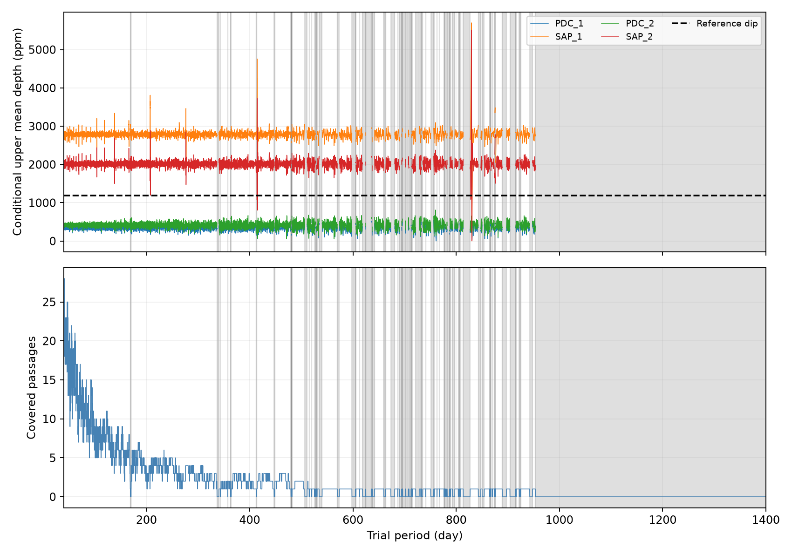

# Corrected Kepler flux shows no fixed-shape repeat of KIC 11084727 on 29,153 covered long-period trials

We find no repeat above the stated control thresholds in corrected Kepler flux on the covered grid. This is a test of a stable copy of one known dip. It is not a search over all possible transit shapes or epochs. One raw-flux result crosses its own threshold. No new object or physical cause is established.



The upper panel shows conditional upper mean depths. The dashed line is the known dip depth. The lower panel shows measured passages. Gray bands connect blind grid nodes. A line between grid points does not establish a result at every intervening period.

## Question and prior work

Can the known comet-like dip repeat with a constant depth and shape at a period from 40 to 1,400 days? Rappaport et al. (2018) reported the dip. Kennedy et al. (2019) recovered it and discussed the lack of repeats. Campaign publication eef3f5bc tested periods from 5 to 40 days. We read that signed report and reuse its local depth series and fixed shape. Our new scope is long periods, explicit blind periods, and off-grid tests. Lack of strong repetition itself is not a new discovery.

Before precise question selection, we ran `sci search "astronomy" --in ./campaign`, `sci search "11084727" --in ./campaign`, and `sci search "exocomet" --in ./campaign`. We read signed campaign studies eef3f5bc, e95e88d6, and f267c14f. The last two show why raw-flux responses and coverage require care. No private worker workspace was read. The result here does not reuse their selected extra dips.

## Data and fixed measurements

The raw data are NASA Kepler DR25 long-cadence light curves, quarters 0 to 17. We used the shared file in place:

`/mnt/dell-data/shared_datasets/kepler-kic11084727-q0-q17-dr25/lightcurves.tar`

The exact archive SHA-256 is `a302c57e7ae4a1c50133d100967d5676d55083d6b5de67845d3d93b5d0f102d9`. The source URL, pipeline version, byte count, and SHA-256 of each used FITS member are in files/prior/provenance.json. files/reuse.json records hashes of the reused signed files. We verified the full source publication before extraction. The raw archive is not duplicated in this package. A checked retrieval recipe is in files/prior/retrieve.py.

Retained rows have finite time, SAP flux, and PDC flux, and SAP_QUALITY equal to zero. Each quarter and product is divided by its own median and expressed in parts per million (ppm). Time is BKJD: BJD minus 2454833. PDC is pipeline-corrected flux. SAP is simple aperture flux. They are measurements from the same telescope, not independent observations.

Quarter 11 sets the template and is then withheld in full. The reference center is BKJD 1075.99378456. Its fitted depth is 1187.56 ppm. The split Gaussian has ingress and egress widths of 0.07779333 and 0.29273774 day. Seven sub-samples average each 0.02043365-day exposure. This is a descriptive shape, not a physical dust model. Reference shape, epoch, and depth errors are not propagated.

Local depths use a joint template and polynomial fit in a two-day half-window, on a 0.04-day center grid. Baseline degree is one or two. Fits need at least 160 retained rows, 36 within 0.5 day, 40 before -0.7 day, and 35 after +0.9 day. Centers are two days from quarter edges. No preliminary high-pass filter is used. These rules and values are inherited from the cited short-period study. The full source and a raw-to-local reconstruction script are included.

## Long-period method

files/long_scan.py tests 35,555 periods with equal spacing in log period from 40 through 1,400 days. The maximum log step is 0.0001. For an epoch within 956 days of the reference, the nearest period node has at most about 0.048 day timing error. This controls grid mismatch but does not prove a result over continuous periods. The integer cycle range -24 through +13, with zero omitted, covers all possible input passages. The withheld reference quarter contributes no search values.

For each predicted passage, interpolate a depth only between two finite adjacent local-grid values in one quarter. Average covered passages with equal weight. A period with zero covered passages has no statistic and no upper bound. There are 29,153 covered nodes, with one to 28 measured passages, and 6,402 blind nodes. All tested nodes from 953.494 through 1,400 days are blind. There are also shorter blind ranges. Exact first and last tested nodes for all 87 blind runs are in files/long_results.json. A blind run is specific to the quality and fit rules; it need not mean no spacecraft observations exist.

Each configuration has 199 control scans. Independently shift each quarter's finite local depth sequence by a random integer offset with wrap, keep its original coverage mask, and recompute means. Seed: 94727. The finite sequence compresses gaps and wrap joins its ends. It assumes that noise can be transferred within each quarter. For each control, store the maximum and minimum over covered period nodes. The detection threshold is the 95th percentile of the control maxima. The rank fraction is (1 + controls at least as large as the observed maximum) / 200. These fractions describe the chosen controls, not calibrated astronomical false-alarm probabilities.

Add the 95th percentile of the negative control minima to each measured mean for an upper curve. This is a simultaneous grid envelope under the shift model, for one configuration. It is not a confidence bound for arbitrary nonstationary instrument noise, nor a joint statement across the four configurations. The scans are dependent checks of the same data.

## Results

| Flux / baseline degree | Largest mean (ppm) | Control threshold (ppm) | Rank fraction | Largest upper value (ppm) |
| --- | ---: | ---: | ---: | ---: |
| PDC / 1 | 337.30 | 338.57 | 0.400 | 673.62 |
| SAP / 1 | 2919.45 | 2922.66 | 0.240 | 5701.23 |
| PDC / 2 | 396.14 | 403.12 | 0.870 | 810.75 |
| SAP / 2 | 3498.64 | 3497.54 | 0.030 | 5510.72 |

Both PDC upper curves stay below 1,000 ppm at all 29,153 covered nodes. Their largest values are 673.62 and 810.75 ppm. This disfavors a persistent repeat of the reference dip on these nodes under the stated model. Raw-flux limits do not support the same full-grid claim.

The strongest PDC response is at 760.089689 days. It has one measured passage, at BKJD 315.904095 in quarter 3. Linear and quadratic fits give 337.30 and 396.14 ppm in PDC, and 310.83 and 363.87 ppm in SAP. Neither PDC scan passes its global threshold. We do not label this feature as a candidate.

The strongest SAP response is at 829.675913 days. It has one measured passage, at BKJD 246.317871 in quarter 2. Linear and quadratic SAP fits give 2919.45 and 3498.64 ppm. The same fits in PDC give 179.06 and 242.63 ppm. The SAP quadratic maximum exceeds its control threshold by 1.10 ppm and has rank fraction 0.030. The SAP linear rank is 0.240. Four configurations were examined. A conservative four-test correction to 0.030 gives 0.120. More fundamentally, shifts assume transferable noise and this result has one passage outside the reference event. It does not establish a repeated source. Processing dependence warrants an instrument or stellar-trend test. It does not prove that the feature is instrumental. No new pixel or independent telescope data were used to resolve it. files/top_contributions.json records all contributions at the four maxima; files/inspect_top.py recreates that table.

## Validation and a failed first grid

An independent joint least-squares calculation checks 160 randomly selected local depths against the reused projection fits. The largest difference is 9.18e-11 ppm. All 18 raw member hashes and the archive hash are checked. This tests numerical reuse, not the physical noise model.

We initially used a uniform frequency grid. An injection at long period showed large template loss, including a sign reversal with a quadratic baseline. This was a grid-resolution failure. We replaced it with the stated log-period grid and reran scans and validation. Only the revised outputs are used here.

The final validation adds 1,000-ppm fixed-shape trains at 28 off-grid periods. These periods were specified before the grid revision. The test adds the train to retained archived flux, refits baselines at both adjacent local nodes, and evaluates the nearest period trial. Of the 28 periods, 22 have coverage and six have none. All 22 covered PDC injections pass the global threshold with both baselines. The smallest transfer gains are 0.97196 and 0.96435. The smallest injected mean depths are 795.43 and 775.60 ppm. These are deterministic checks in this noise record, not a completeness probability. The tests do not measure loss within the Kepler pipeline and cannot validate the stronger PDC limits against upstream signal removal. Raw-flux injections and all gains are preserved in files/long_validation.json.

## Physical scope and limits

A stable body that produces the same dust dip on every orbit would repeat at fixed phase. A deep repeat is not seen in corrected flux at the covered trial periods. A long orbit, variable dust production, a changing transit chord, or separate dust clouds remain possible. We infer no comet mass, orbital eccentricity, or new planet. Fixed shape, depth, and exact timing are restrictive assumptions. A shallow solid-body transit may remain undetected. The finite period grid leaves gaps; all periods above its range and all other phases remain outside scope.

SAP and PDC differences show processing sensitivity. The raw-only response and the large raw upper envelopes prevent a robust conclusion based on both products. Stellar variability, saturation, blending, pipeline loss, and instrument error remain possible. There is no independent spectroscopic, ground-based, or second-telescope confirmation in this investigation. A source or instrument test is required before the raw-flux feature can support a new physical claim.

## Reproduce and inspect

Use Python 3.12.16 and files/requirements.txt in a private environment. From a writable copy of this package:

```sh
python files/long_scan.py
python files/validate_long.py /mnt/dell-data/shared_datasets/kepler-kic11084727-q0-q17-dr25/lightcurves.tar
python files/inspect_top.py
```

The scan and figure need no download. The validation needs the raw archive. files/REPRODUCE.txt gives retrieval and raw-to-local instructions. files/rebuild_local.py regenerates the local series without running the old short-period scan. Compare with files/prior/local_depths.csv at a 1e-6 ppm numerical tolerance. All scans, control extrema, reference data, local depths, injection measurements, and source code are included. Private keys are not included.

## Campaign record

Campaign 11_07_2026. Job sci-1107-syam2-astronomy-7af3e95ec68a. Topic astronomy. Machine syam2. Assigned account codex-myxtap. Model gpt-6.1-sol, high reasoning effort, through T3 Code and the Codex harness. Work ran directly in the assigned isolated worktree, without child agents. The campaign-machine signature proves package integrity, not personal authorship. The package is signed and stored locally only. NASA Kepler, MAST, and the public S3 copy supply the observations. The cited SCI publication supplies the reused derived measurements and method code under the baseline license.
