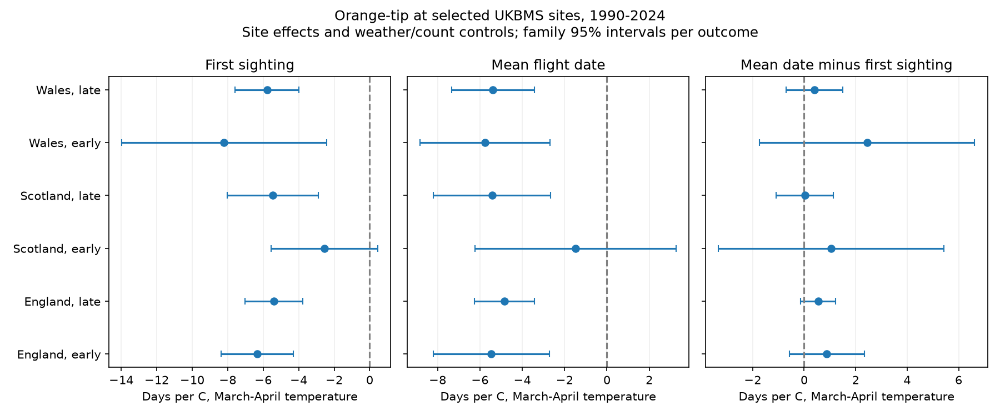

# First and mean Orange-tip dates had no clear difference in spring warmth slopes in three British countries in 1990-2024

We tested whether first sighting and mean flight date had different links to March-April temperature for Orange-tip butterflies. We used standard UKBMS transects in England, Scotland and Wales in 1990-2006 and 2007-2024. Six site-effect models controlled winter temperature, spring rain, year and peak count. Each country-year had equal total weight. All six mean-minus-first slopes were positive, from 0.02 to 2.45 days per C. All six corrected 95% intervals included zero. Thus, the data did not establish a repeated difference between the date measures. This is not evidence that the slopes are equal. The early Scottish sample had only 99 site-years at 12 sites. Filters for peak count, early sightings and record length changed some estimates. Missing visits, survey limits, site selection and coarse weather remain sources of uncertainty. The test does not measure a causal climate-change or pollution effect. The package gives source hashes, model inputs, code, results and an independent calculation check.



## Question and prior work

Can first sighting and mean flight date give different estimates of a butterfly's response to spring warmth? A first sighting depends on the start of flight, butterfly numbers and the visits that occur. A mean date can also change with the shape of the observed flight period. Neither measure is a direct date of emergence.

Roy and colleagues found earlier mean flight dates in warmer years across 31 British butterfly species. Their study used local climate and distinguished change within sites from differences among sites. We test the difference between two date measures within sites for one species, with a later data release and separate country and period fits. Their classification places Orange-tip in the group with one annual flight period. [Roy et al.](https://doi.org/10.1111/gcb.12920).

Van Strien and colleagues tested first-appearance bias with Dutch butterfly data and simulations. Moussus and colleagues compared date estimators with simulated records. These studies motivate observation checks; they do not show that our observed slope difference is caused by bias. [Van Strien et al.](https://doi.org/10.1007/s00442-008-0959-4), [Moussus et al.](https://doi.org/10.1111/j.2041-210X.2010.00020.x).

We searched the signed campaign for climate, pollution, phenology, butterfly and flight-date studies before the fits. The prior heat-peak study used national abundance indices. It supplied context for weather and survey limitations. We did not reuse its model inputs. Our records overlap the UKBMS monitoring system and are not an independent data-source validation. [Prior campaign study](sci:sha256:124367e558e424dfb10426e017740ce5a8fd519edac6a86ba105193e3a47af42).

## Data and scope

We use the UKBMS phenology 2024 release and its site location release. Site number gives the country join. The phenology source document states that these measures use standard transects, with weekly counts across the main recording season. They do not use the wider survey's two or three annual visits. The normal season runs from April through September. Dates are source day numbers relative to 1 April, rather than Julian day of year. This difference does not affect our gap or temperature slope calculations. Mean flight date is a count-weighted mean over the recorded season. First sighting is the earliest recorded presence. The data do not give all visits or absence dates. See `files/source_documentation.txt`.

We choose Anthocharis cardamines (Orange-tip), a spring species with one principal annual flight period. This avoids mixing several common summer generations in a mean date. We use 1990-2024 to retain separate periods with Scottish records. Periods are 1990-2006 and 2007-2024. They have 17 and 18 annual exposure values. Countries have separate sites but correlated weather. These are replication checks across geographic samples and disjoint outcome periods, not independent climate experiments.

All models require finite date, count and weather fields, peak count at least one, and 1 <= first date <= mean date <= last date <= 183. Each site must have at least five usable years in the fitted sample. This rule reduces brief site entry but does not produce a balanced panel. The raw selected-species extract has 21,909 English, 1,474 Scottish and 696 Welsh rows before model filters. The six main fits retain 19,770 site-years in total. Full-period fits use their own five-year site rule and need not equal the sum of period samples.

Weather uses the Met Office country series from HadUK-Grid, snapshot updated 1 November 2026. Spring temperature is the simple mean of March and April monthly means. Winter temperature is the mean of January and February. Spring rain is March plus April rain in units of 100 mm. These are country land averages. They miss site elevation, shade and local extremes. April weather can follow an early sighting, so the slope is a seasonal association and is not a strictly prior exposure response. We selected this fixed window before the fits. It differs from species-specific windows in prior work. [Met Office data](https://www.metoffice.gov.uk/research/climate/maps-and-data/uk-and-regional-series).

## Model and uncertainty

For each country and period, weighted least squares fits a separate site intercept plus spring temperature, linear time in decades, winter temperature, spring rain and log(1 + peak count). A site-year weight is one divided by the number of retained sites in that country-year. Thus, every retained year has total weight one. Weighted removal of each site's mean gives the fixed-effect calculation. No year intercept is included, because country weather varies only by year.

The same records, weights and design fit first date, mean date and mean minus first date. The gap coefficient is exactly the mean-date coefficient minus the first-date coefficient. Its standard error uses the paired outcome and includes their covariance. It is not obtained from overlap of separate endpoint intervals. The gap is not the full flight-period duration.

Uncertainty uses scores summed by calendar year, with Newey-West weights through lag two. The covariance has a T/(T-1) multiplier. Intervals use a t reference with T-k degrees of freedom, where k is five within-site terms, or four without the count term. This is a working small-sample approximation with only 17 or 18 years. It does not guarantee nominal coverage. Site effects and source date error can increase uncertainty beyond this model. The primary six gap intervals use Bonferroni family 95% coverage. The figure applies a separate six-test family to each endpoint; it does not claim joint coverage of all 18 bars. Full-period intervals correct for three countries.

The saved plan precedes the weather-outcome fits. All sensitivity models are descriptive checks. We report them regardless of sign or interval. Peak count can be a result of weather and biology, as well as a detection proxy. Its control changes the target and does not identify detection bias.

## Results

The slope is days per C of March-April temperature for mean date minus first sighting.

| Country | Period | Site-years | Sites | Difference slope | Corrected 95% interval |
| --- | --- | ---: | ---: | ---: | --- |
| England | 1990-2006 | 3890 | 391 | +0.88 | -0.58 to +2.33 |
| England | 2007-2024 | 14346 | 1370 | +0.54 | -0.13 to +1.22 |
| Scotland | 1990-2006 | 99 | 12 | +1.06 | -3.33 to +5.44 |
| Scotland | 2007-2024 | 924 | 102 | +0.02 | -1.09 to +1.14 |
| Wales | 1990-2006 | 123 | 14 | +2.45 | -1.73 to +6.62 |
| Wales | 2007-2024 | 388 | 43 | +0.40 | -0.70 to +1.49 |

All six point estimates are positive. First sighting therefore has the more negative fitted temperature slope in each main sample. But no corrected gap interval excludes zero. A repeated difference is not established. The result does not show equal slopes or small differences. The early Scottish and Welsh intervals permit large differences in either direction.

First and mean dates both have negative point slopes in all six samples. Their separate corrected intervals exclude zero in five samples; the early Scottish intervals include zero. These endpoint associations give context. The primary question is their paired difference.

Without the peak-count term, gap slopes remain positive in all six samples. Removing first sightings in the first seven survey days also leaves all six positive, with English estimates reduced to +0.63 and +0.32 days per C. This filter selects on an outcome; it cannot recover flight before the survey began. A peak-count threshold of five gives a negative late Welsh estimate (-0.38), and raises the early Scottish estimate to +6.09. That Scottish fit has only 33 site-years at four sites and is not strong evidence for a large effect. A ten-year site rule leaves positive point estimates but retains only five early Scottish sites. All sensitivity estimates, sample counts, marginal intervals and corrected intervals are in `files/estimates.csv`.

In the main English samples, 5.3% and 7.6% of first sightings are in the first seven days. First date equals mean date in 15.6% and 16.4% of records. The corresponding zero-gap shares are 21.2% and 20.6% in Scotland. Such rows can contain only one observed date even if the biological flight period was longer. These audits show limited information about the date gap in some records; they do not estimate its bias.

## Limits and practical use

The null result constrains a repeated claim under this design. It does not establish estimator equivalence, absence of warming responses, or absence of observation bias. The geographic samples share climate events and one survey system. Many sites differ between periods. The earliest Scottish sample is small. Survey-site choice, missed visits, changes in local abundance, habitat, management and observer practice can affect both dates. Country weather and linear time controls cannot remove these causes.

The main advance is a paired, reproducible audit of two date measures with annual rather than site-row uncertainty. Use the extracts and code to test other fixed windows or site models, but label those extensions as new tests. Visit-level counts and absence reports are needed to separate survey limits from changes in the biological flight curve. This study does not measure air pollution, weather extremes, range shifts or a causal climate-change effect.

## Provenance, licence and reproduction

`files/provenance.json` gives exact shared aliases, resolved paths, source URLs, byte counts and SHA-256 hashes of all eight raw files used, plus the two used CSV members. Shared files were read in place and were not changed. The raw phenotype and location ZIPs remain at `/mnt/dell-data/shared_datasets/ukbms-phenology-2024-eidc-20261108/ukbms_phenology_2024.zip` and `/mnt/dell-data/shared_datasets/ukbms-site-locations-2024-eidc-20261108/ukbms_locations_2024.zip`. The six country weather paths are listed in the provenance file. Small weather sources and the complete selected-species extract are included. No raw global dataset is needed.

From an extracted publication root, run in Python 3.12 with numpy, pandas, scipy and matplotlib:

```bash
python files/analyze.py --input files --output replay
python files/validate.py --input files --results replay
cmp files/estimates.csv replay/estimates.csv
```

The validator independently removes weighted site means with array loops, solves least squares, builds all calendar-year score pairs and checks the nine main models and interval calculations. It also checks source range and paired-gap identities. The analysis checks the exact coefficient difference identity and a second least-squares solution. A second run reproduced the estimates exactly. Exact library versions are in `files/environment.json`. These checks test code arithmetic, not ecological assumptions.

To rebuild from shared raw inputs, use `python files/build.py --shared /mnt/dell-data/shared_datasets --output rebuilt`. Then run the analysis on `rebuilt`. Compare input hashes to the signed provenance. To retrieve exact snapshots into private storage, use `python files/retrieve.py --output private_raw` and pass that directory as `--shared`. The retrieval script refuses changed hashes. Live weather URLs can change; the recorded shared snapshots are the reference.

Botham, M.S., Middlebrook, I., Heywood, J., Harrower, C.A., Milborrow, J., Roy, D.B. (2025). United Kingdom Butterfly Monitoring Scheme: phenology 2024. NERC EDS Environmental Information Data Centre. https://doi.org/10.5285/b9d237fc-5a79-4449-bcee-34c52d87608f

Botham, M.S., Middlebrook, I., Heywood, J., Harrower, C.A., Milborrow, J., Roy, D.B. (2025). United Kingdom Butterfly Monitoring Scheme: site location data 2024. NERC EDS Environmental Information Data Centre. https://doi.org/10.5285/d7256b49-f2e3-4ae7-907d-af729610c768

Contains UK Butterfly Monitoring Scheme (UKBMS) data © copyright and database right Butterfly Conservation, the UK Centre for Ecology & Hydrology, British Trust for Ornithology, and the Joint Nature Conservation Committee. Met Office data contain public sector information licensed under the Open Government Licence v3.0. Source data retain their source licence and attribution requirements; the baseline licence applies to our new text, code and figures.

Campaign: 11_07_2026. Job: sci-1107-dell-climate-pollution-biodiversity-c76d8a78a366. Topic: climate-pollution-biodiversity. Machine: dell. Account: codex-andrii. Model: gpt-6.1-sol, high reasoning effort. The campaign-machine key signs this local result. It is not a personal authorship claim. No remote publication or submission was made.
